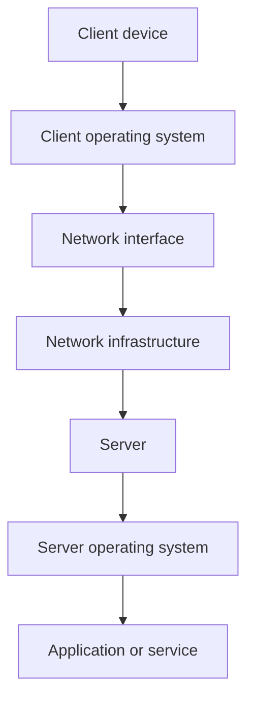
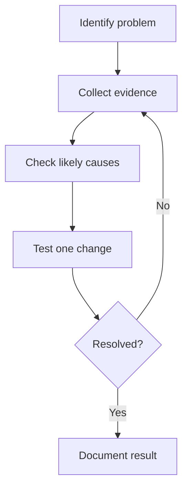

# Introduction to System and Network Administration

## Learning objectives
Define SNA, distinguish system administration from network administration, describe common responsibilities, and explain how systems and networks depend on one another.

## What is SNA?
**System and Network Administration (SNA)** is the work of configuring, maintaining, monitoring, and troubleshooting computer systems and networks so users can access reliable services.

A university, for example, may have student computers, servers, printers, switches, routers, and shared storage. Administrators help keep these resources working, control access, and investigate failures.

## What is a system?
A computer system combines hardware and software to perform tasks. Examples include desktops, laptops, physical servers, and virtual machines. The operating system manages hardware resources and provides services to applications.

## What is a network?
A computer network connects devices so they can exchange data and share resources. Common components include network interfaces, switches, routers, wireless access points, and firewalls.

## System administration vs network administration

| Area | System administration | Network administration |
|---|---|---|
| Main focus | Operating systems, servers, users, files, services | Connectivity, network devices, addressing, traffic |
| Common tasks | Accounts, permissions, updates, storage, service health | IP configuration, routing, switching, connectivity troubleshooting |
| Example issue | A service fails to start | A client cannot reach a server |

These responsibilities overlap, especially in smaller organizations.

## System administrator responsibilities
- Install, configure, and maintain operating systems.
- Manage users, groups, permissions, and software.
- Monitor services, logs, storage, and system health.
- Maintain backups and support recovery.
- Troubleshoot errors and document changes.
- Apply appropriate security controls and updates.

## Network administrator responsibilities
- Maintain network devices and connectivity.
- Configure or troubleshoot IP addresses, gateways, and DNS.
- Investigate packet loss, latency, and routing issues.
- Monitor traffic and maintain network documentation.
- Apply access controls according to policy.

## How systems and networks work together
A server may be healthy while a network problem prevents clients from reaching it. A network may work while an application on the server has failed.

This is a simplified conceptual diagram. Real communication also depends on protocols, addressing, routing, and other components.

## Important terms

| Term | Meaning |
|---|---|
| Client | Device or program requesting a service |
| Server | System or program providing a service |
| Operating system | Software managing hardware and supporting applications |
| Router | Forwards packets between IP networks |
| Switch | Connects devices within a local network |
| Firewall | Applies rules to network traffic |
| Service | Program providing a function |
| Virtual machine | Software-defined computer |

## Foundational skills
1. Operating-system fundamentals: files, processes, users, permissions, services, logs.
2. Command-line skills: execute commands and interpret output.
3. Networking: IP addresses, DNS, gateways, routing, connectivity.
4. Troubleshooting: gather evidence, test hypotheses, verify the result.
5. Documentation: record actions and findings accurately.
6. Security: use least privilege and protect credentials.

## Troubleshooting workflow

## Summary
System administration focuses on operating systems, users, files, services, and storage. Network administration focuses on communication, network devices, and connectivity. Practical administration often combines both.

## Related notes
- [SNA Certifications](02-SNA-Certifications.md)
- [RHEL](03-Linux-Fundamentals/01-Introduction-to-RHEL.md)
- [Tcpdump](04-Networking/01-Tcpdump-Commands.md)
