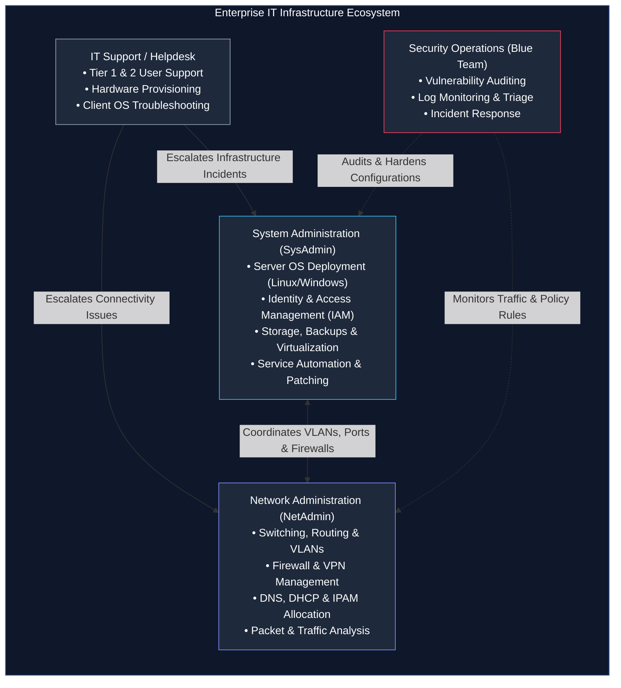

# Introduction to System and Network Administration (SNA)

> **Module:** System and Network Administrator (SNA) Foundations  
> **Topic Level:** Beginner / Open-Source Foundations  
> **Related Reference:** [02-SNA-Certifications.md](02-SNA-Certifications.md) | [SNA Index](README.md)

---

## 🎯 Learning Objectives

By the end of this note, you will be able to:

- Differentiate the operational scopes of **System Administration**, **Network Administration**, and **IT Support**.
- Understand the core duties, daily lifecycle activities, and SLAs managed by an SNA.
- Recognize how server infrastructure, network switching/routing, and client endpoints interconnect.
- Explain the significance of system uptime, redundancy, security baseline enforcement, and disaster recovery.
- Identify the foundational administrative toolchains used across Linux and Windows server environments.

---

## 1. Introduction and Context

In modern enterprise IT environments, services such as web applications, corporate email, centralized identity (LDAP/Active Directory), and database engines do not operate in a vacuum. They depend entirely upon underlying servers, virtualization layers, storage area networks (SAN), and packet-switching routing infrastructures.

**System and Network Administration (SNA)** represents the engineering discipline responsible for designing, deploying, maintaining, and defending this foundational IT infrastructure. While software developers write business applications and security analysts monitor threat telemetry, the System and Network Administrator ensures that the hardware, operating systems, and network paths are high-performing, resilient, properly configured, and available 24/7/365.



---

## 2. Definitions of Important Terminology

| Term | Definition |
|---|---|
| **System Administrator (SysAdmin)** | The engineer responsible for provisioning, configuring, patching, and maintaining physical/virtual server systems, services, and directory accounts. |
| **Network Administrator (NetAdmin)** | The engineer responsible for the design, connectivity, maintenance, and packet flow integrity across switches, routers, firewalls, and subnets. |
| **High Availability (HA)** | Architectural design ensuring an IT service remains accessible without interruption even during component failures (e.g., redundant power, RAID, NIC bonding, cluster failovers). |
| **Service Level Agreement (SLA)** | A contractual or operational commitment defining expected system availability (e.g., "99.9% uptime" allows ~8.76 hours of downtime per year). |
| **Root / Superuser (`uid 0`)** | The unrestricted administrative account on Unix-like operating systems that possesses full control over kernel, drivers, storage, and processes. |
| **Hypervisor** | Software or firmware (e.g., VMware ESXi, KVM, VirtualBox) that creates and runs virtual machines (VMs) by abstracting physical CPU, RAM, and storage. |
| **Out-of-Band (OOB) Management** | A dedicated hardware interface (e.g., Dell iDRAC, HP iLO, physical serial console) used to manage physical hardware independently of the main operating system. |

---

## 3. Core Concepts and Roles

### 3.1 Differentiating IT Responsibilities

To clearly understand real-world roles, observe the operational hierarchy of technical support and administration:

1. **IT Support / Help Desk (Tier 1 & Tier 2)**:
   - Focused primarily on end-user endpoints (laptops, desktop monitors, local printers, software installations).
   - Handles password resets, email client setup, and workstation diagnostics.
2. **System Administrator (Server & Cloud Layer)**:
   - Focused on the backend servers that power applications (Red Hat Enterprise Linux, Windows Server, VMware vSphere).
   - Manages shared resources: centralized storage (NFS, SMB), user directories (Active Directory, LDAP), automated backup pipelines, and system configuration automation.
3. **Network Administrator (Transport & Connectivity Layer)**:
   - Focused on moving packets between endpoints, data centers, and external carriers.
   - Manages physical cabling, core/distribution/access switches, edge routers, boundary firewalls, wireless access points, and VPN gateways.

### 3.2 The Administrative Lifecycle

System and Network Administrators follow an ongoing operational cycle:

```text
[Provision & Install] ──> [Configure & Baseline] ──> [Harden & Secure]
          ▲                                                   │
          │                                                   ▼
[Retire & Decommission] <── [Incident Response] <── [Monitor & Maintain]
```

- **Provisioning**: Installing OS images, setting up BIOS/UEFI parameters, and allocating disk storage.
- **Configuring**: Establishing hostnames, static network interfaces, domain binding, and baseline packages.
- **Hardening**: Disabling unnecessary services, disabling default accounts, configuring host firewalls (`iptables` / `firewalld`), and enforcing permissions.
- **Monitoring**: Inspecting system logs (`/var/log/messages`, `journalctl`), tracking hardware health (CPU, RAM, disk space), and observing bandwidth utilization.
- **Patch Management**: Testing and applying operating system errata and software updates without disrupting business operations.
- **Disaster Recovery**: Verifying cold, warm, or offsite backups to recover from hardware crashes, ransomware, or administrative errors.

---

## 4. Fundamental Command-Line Inspection Syntax

An SNA must be proficient in inspecting server state immediately upon gaining terminal access. Below are non-destructive diagnostic commands commonly used during initial triage:

### System & Kernel Identity
```bash
# Display system hostname
hostname

# Display kernel release and hardware architecture (e.g., Linux 2.6.32 on RHEL 6 or 5.14+ on RHEL 9)
uname -a

# Display operating system release details
cat /etc/redhat-release   # RHEL/CentOS systems
cat /etc/os-release       # Standard modern systemd-based Linux
```

### Resource & Uptime Inspection
```bash
# Display system uptime, logged-in user count, and 1-, 5-, and 15-minute load averages
uptime

# Inspect volatile RAM memory allocation and swap space in human-readable megabytes/gigabytes
free -m

# Inspect filesystem disk usage across all mounted storage partitions
df -h
```

### Network Interface Inspection
```bash
# Legacy (RHEL 6 / standard net-tools) interface inspection
ifconfig -a

# Modern standard (iproute2) interface and IP address inspection
ip addr show
```

---

## 5. Common Operational Pitfalls & Troubleshooting

- **Working directly as `root` without restriction**:
  - *Risk*: A misplaced typo (e.g., `rm -rf / path/to/dir`) executed as root is immediately destructive.
  - *Mitigation*: Log in as an unprivileged user and use `sudo` for elevated tasks to maintain audit logging in `/var/log/secure`.
- **Neglecting Disk Space Checks on `/var` or `/tmp`**:
  - *Symptom*: Daemons crash abruptly, databases stop accepting writes, and user sessions fail to spawn.
  - *Root Cause*: Application logs filled `/var/log` or `/var/lib` to 100% capacity.
  - *Remediation*: Always establish separate partition mount points during installation so an overflowing log does not bring down the root `/` partition.
- **Assuming Network Connectivity Without Step-by-Step Triage**:
  - *Symptom*: Administrator assumes an application is broken when the default gateway cannot be reached.
  - *Standard Triage Model*:
    1. Check link state (cable / NIC up: `ethtool eth0` or `ip link`).
    2. Check IP configuration (`ip addr`).
    3. Ping localhost loopback (`ping 127.0.0.1`) to verify local IP stack.
    4. Ping default gateway to verify local subnet switching.
    5. Ping remote IP (`ping 8.8.8.8`) to verify WAN routing.
    6. Query DNS resolution (`dig` / `nslookup`) to verify name services.

---

## 6. Security Considerations for Administrators

1. **Principle of Least Privilege**: Never grant users administrator permissions when standard group permissions suffice.
2. **Secure Communication Only**: Telnet, rlogin, and FTP transmit credentials and data in plain text across the wire. Enterprise administrators strictly enforce **SSH (Secure Shell)** and **SFTP (SSH File Transfer Protocol)**.
3. **Separation of Duties & Backups**: The 3-2-1 backup strategy must be enforced: 3 total copies of data, across 2 different physical storage media, with 1 copy stored completely off-site or air-gapped.

---

## 7. Summary & Next Steps

System and Network Administration bridges physical hardware, operating systems, and network communication channels into a reliable, enterprise-grade platform. Gaining proficiency requires understanding operating system lifecycles, configuration files, permission models, and troubleshooting workflows.

- **Next Chapter:** Explore industry credentials and career progression paths in [02-SNA-Certifications.md](02-SNA-Certifications.md).
- **Core Linux Notes:** Begin enterprise server administration in [03-Linux-Fundamentals/01-Introduction-to-RHEL.md](03-Linux-Fundamentals/01-Introduction-to-RHEL.md).
- **Quick Reference:** Inspect [cheatsheets/Linux-Commands-Cheatsheet.md](cheatsheets/Linux-Commands-Cheatsheet.md).
