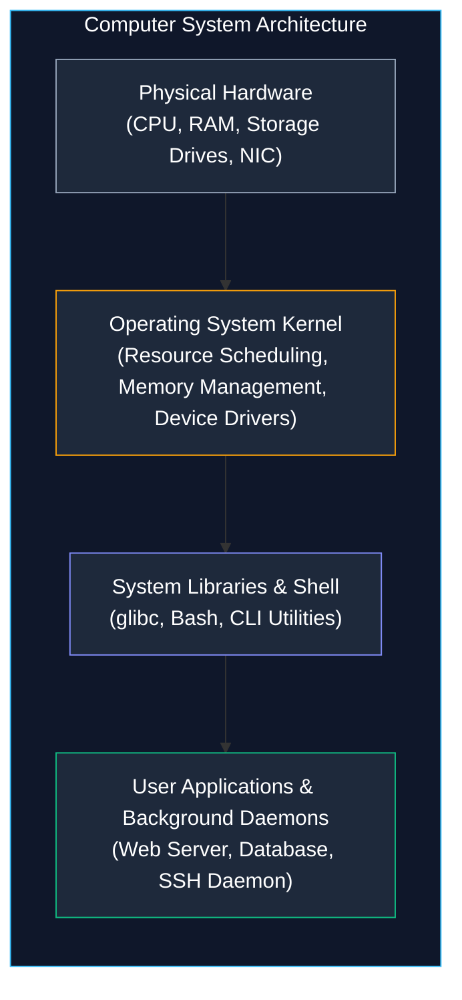
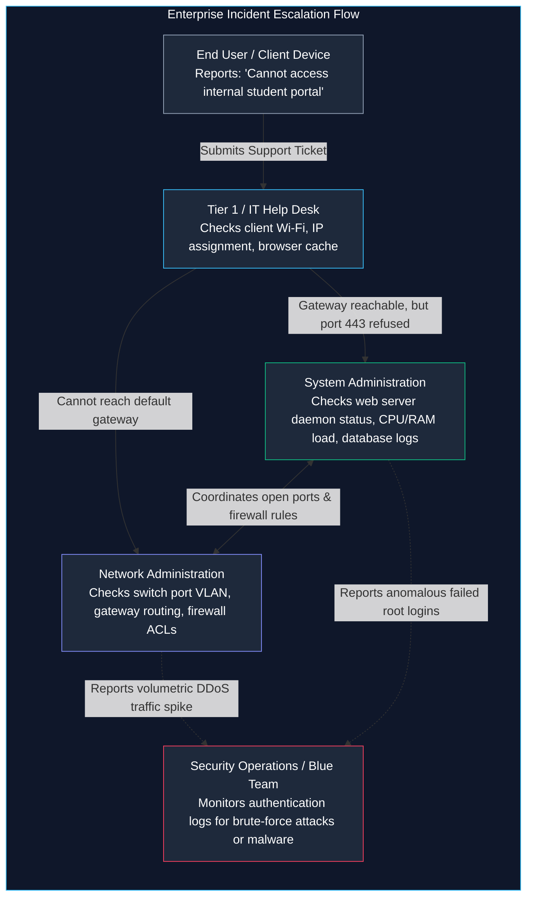
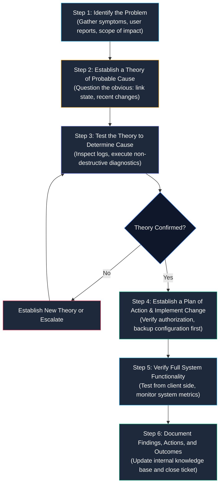

# Introduction to System and Network Administration (SNA)

> **Module:** System and Network Administrator (SNA) Foundations  
> **Target Audience:** BSIT Students, Aspiring System Administrators, and Network Engineers  
> **Related Reference:** [02-SNA-Certifications.md](02-SNA-Certifications.md) | [SNA Navigation Hub](README.md)

---

## 🎯 Learning Objectives

By the end of this chapter, you will be able to:

- Clearly define **System and Network Administration** and articulate why it forms the backbone of all organizational IT services.
- Distinguish between a **computer system**, a **computer network**, and an **application service**.
- Differentiate the operational scopes, daily responsibilities, and skill sets of **System Administrators**, **Network Administrators**, and **IT Support Engineers**.
- Trace the complete **System Administration Lifecycle** from initial hardware provisioning to service decommissioning.
- Execute and interpret foundational Linux system inspection commands (`uptime`, `uname`, `free`, `df`, `hostname`, `id`, `ip addr`).
- Understand core infrastructure reliability concepts including **High Availability (HA)**, **Service Level Agreements (SLAs)**, and the **3-2-1 Backup Strategy**.
- Apply a structured, evidence-based troubleshooting methodology to resolve infrastructure incidents.

---

## 1. What is System and Network Administration?

Imagine a modern university campus or a regional hospital. Every day, thousands of people rely on essential digital services:
- University students log into the student portal to register for courses, submit assignments, and check grades.
- Instructors project lectures, record attendance, and access shared departmental drives.
- Hospital doctors retrieve electronic patient health records, pharmacy inventories, and medical imaging scans.

To an ordinary user, these digital services appear to live magically inside their web browser or phone app. However, as an Information Technology (BSIT) student, you must look beneath the user interface. 

Where does the student portal actually run? It executes on an operating system (such as Red Hat Enterprise Linux) running on a server. Where are the student records stored? They reside inside a database engine mounted on an encrypted, redundant disk array. How does the user's laptop communicate with the database? Data packets travel through physical Ethernet cables, wireless access points, network switches, Virtual Local Area Networks (VLANs), and hardware firewalls.

**System and Network Administration (SNA)** is the engineering discipline responsible for designing, building, configuring, maintaining, securing, and troubleshooting the entire underlying ecosystem of computers, operating systems, and network connections.

Without effective system and network administrators:
- Servers run out of memory or disk space and crash.
- Security vulnerabilities go unpatched, exposing sensitive corporate data to ransomware.
- Network switches develop routing loops or broadcast storms, disconnecting entire buildings from the internet.
- Hardware failures result in permanent data loss because backups were never configured or tested.

The primary mission of an administrator is **availability, integrity, and performance**: ensuring that systems remain secure, fast, and accessible to authorized users 24 hours a day, 7 days a week, 365 days a year.

---

## 2. Fundamental Definitions: Systems, Networks, and Services

Before examining administrator roles, let us clarify the three foundational building blocks of all IT infrastructure.

### 2.1 What is a System?
In IT, a **computer system** is an integrated collection of hardware components and software programs working together to process, store, and communicate information.



Systems take multiple physical and virtual forms:
1. **Client Workstations / Desktops / Laptops**: End-user computers optimized for interactive applications (web browsing, office productivity, development tools).
2. **Physical Bare-Metal Servers**: High-capacity enterprise computers equipped with multi-core server processors (such as Intel Xeon or AMD EPYC), hundreds of gigabytes of Error-Correcting Code (ECC) RAM, redundant hot-swappable power supplies, and enterprise storage arrays. They are mounted inside standard 19-inch equipment racks in data centers.
3. **Virtual Machines (VMs)**: Software-defined computers created by a **hypervisor** (such as VMware ESXi, KVM, or Proxmox). A hypervisor abstracts the physical hardware of one server so that dozens of independent virtual servers can run concurrently on the same physical box.
4. **Cloud Compute Instances**: Virtual servers leased on-demand from cloud service providers (such as Amazon Web Services EC2, Microsoft Azure VMs, or Google Compute Engine).

### 2.2 What is a Network?
A **computer network** is a collection of two or more computing devices connected by physical media (copper Ethernet cables, fiber-optic lines) or wireless transmission (Wi-Fi, microwave, satellite) for the purpose of exchanging data packets.

Key networking components include:
- **Network Interface Card (NIC)**: The physical chip and port on a computer that converts operating system data packets into electrical signals, light pulses, or radio waves. Every NIC possesses a unique, hardcoded physical identifier called a **MAC address**.
- **Network Switch**: An intelligent local device (operating primarily at OSI Layer 2) that connects computers within the same Local Area Network (LAN). It maintains a MAC address table to forward frames directly to the intended destination port rather than broadcasting them everywhere.
- **Router**: A gateway device (operating at OSI Layer 3) that joins different networks together (such as connecting an internal office LAN to the global internet). Routers examine destination **IP addresses** and use routing tables to forward packets across network boundaries.
- **Firewall**: A security barrier that inspects incoming and outgoing network traffic. It permits or drops packets based on defined security rules (e.g., allow traffic to web port 443, but block unauthorized SSH access on port 22 from the public internet).

### 2.3 What is a Service (or Daemon)?
A **service** is a software program that runs continuously in the background of an operating system, waiting to handle requests from clients or perform scheduled administrative tasks. In the Unix and Linux world, services are traditionally called **daemons** (their names often end in the letter "d", such as `sshd` for Secure Shell daemon, `httpd` for HTTP daemon, and `crond` for scheduled job execution).

Services listen for connections on specific numerical **ports**. For example:
- A web server listens on port `80` (unencrypted HTTP) or port `443` (encrypted HTTPS).
- A remote administration server listens on port `22` (SSH).
- A domain name resolver listens on port `53` (DNS).

---

## 3. System Administration vs. Network Administration vs. IT Support

In small companies or university labs, a single person might wear many hats and handle everything from fixing a jammed printer to configuring an enterprise router. However, in enterprise environments, technical duties are divided into specialized roles.

| Operational Area | IT Support / Help Desk | System Administrator (SysAdmin) | Network Administrator (NetAdmin) |
|---|---|---|---|
| **Primary Scope** | End-user devices and client desktop operating systems | Backend servers, operating systems, and service platforms | Network hardware, packet routing, and communication links |
| **Typical Systems** | Windows 10/11, macOS, desktop apps, office printers, VoIP phones | Red Hat Enterprise Linux, Windows Server, VMware ESXi, database servers | Cisco/Juniper routers, managed switches, boundary firewalls, VPN gateways |
| **Primary Goal** | Resolve immediate end-user problems to keep employees productive | Ensure server operating systems, applications, and storage are available and secure | Ensure network connectivity is fast, redundant, reliable, and secure |
| **Common Tasks** | - Reset user passwords<br/>- Provision employee laptops<br/>- Troubleshoot printer/Wi-Fi connection issues<br/>- Install software packages | - Deploy and configure server OS<br/>- Manage user accounts and groups (`/etc/passwd`, Active Directory)<br/>- Enforce filesystem permissions and quotas<br/>- Configure automated backups and disaster recovery<br/>- Apply OS security patches | - Configure VLANs and trunk ports on switches<br/>- Implement dynamic routing protocols (OSPF, BGP)<br/>- Configure Access Control Lists (ACLs) and firewall rules<br/>- Monitor bandwidth usage and troubleshoot packet loss |
| **Example Incident** | *"My laptop screen is flickering and Outlook won't open."* | *"The web application is throwing 500 errors because the `/var` filesystem is 100% full."* | *"Branch office computers cannot reach the central database server across the VPN tunnel."* |

### 3.1 The Enterprise Collaboration Workflow

No administrative domain exists in isolation. Systems cannot communicate without the network, and the network is meaningless without servers providing services. Consider how these roles collaborate during an incident:



**Workflow Explanation:**
1. **Initial Triage:** An end user reports that they cannot access the student registration portal. The Help Desk confirms whether the issue affects only one person or everyone.
2. **Connectivity Verification:** If the user's laptop cannot ping the local gateway or acquire an IP address from DHCP, the Help Desk escalates the ticket to the **Network Administrator**. The NetAdmin investigates switch port configurations, VLAN memberships, and wireless controllers.
3. **Service Verification:** If network connectivity is healthy and the server's IP address responds to ICMP ping requests, but the web browser reports "Connection Refused", the ticket is escalated to the **System Administrator**. The SysAdmin checks whether the web service daemon (`httpd` or `nginx`) is running, inspects service logs in `/var/log/`, and verifies system memory and disk capacity.
4. **Security Auditing:** If the outage was triggered by a denial-of-service attack or an exploited vulnerability, both administrators coordinate with the **Security Operations (Blue Team)** analysts to block malicious IPs and review system audit records.

---

## 4. The Administrative Lifecycle

Managing enterprise IT infrastructure is an ongoing engineering process, not a one-time setup. Professional administrators follow a structured lifecycle:


1. **Provision & Install**: Selecting hardware or spinning up virtual machines. Partitioning storage drives, configuring BIOS/UEFI firmware, and installing the base enterprise Linux or Windows Server operating system.
2. **Configure & Baseline**: Assigning static IP addresses, configuring hostname and Fully Qualified Domain Names (FQDN), joining centralized identity domains (such as LDAP or Active Directory), and setting standard time synchronization (NTP).
3. **Harden & Secure**: Implementing the Principle of Least Privilege. Disabling unused network services, configuring host-based firewalls (`iptables` / `firewalld`), enforcing strong password policies, and restricting remote root SSH logins.
4. **Monitor & Maintain**: Implementing automated agent monitoring (such as Prometheus, Zabbix, or Nagios) to track CPU utilization, memory exhaustion, disk space, and network interface errors before users experience an outage.
5. **Patch & Backup**: Testing and applying operating system errata and software updates in a staging environment before rolling them out to production. Regularly verifying automated data backups.
6. **Incident Response & Recovery**: Troubleshooting hardware failures, corrupted filesystems, or service crashes. Utilizing system logs and diagnostic utilities to restore normal operations rapidly.
7. **Decommission & Retire**: Securely sanitizing storage drives to prevent data leakage, archiving final system states, reallocating IP addresses, and removing decommissioned machines from DNS and monitoring systems.

---

## 5. Essential System Inspection Commands

When an administrator logs into a Linux server via SSH, the terminal prompt does not show graphical charts. You must know how to inspect the system state immediately using core command-line utilities.

Below are the foundational inspection commands every BSIT student must master.

```
+----------------------------------------------------------------------------------------------------+
|                                    COMMAND REFERENCE SUMMARY                                       |
+--------------+-------------------------------------+-----------------------------------------------+
| Command      | Primary Purpose                     | Key Flags / Usage                             |
+--------------+-------------------------------------+-----------------------------------------------+
| uptime       | System run duration & load average  | uptime                                        |
| uname        | Kernel version & architecture       | uname -a, uname -r                            |
| free         | RAM memory & swap utilization       | free -m, free -h                              |
| df           | Filesystem disk space capacity      | df -h, df -hT                                 |
| hostname     | System identity & domain name       | hostname, hostname -I                         |
| whoami / id  | Current logged-in user & UID/GIDs   | whoami, id <username>                         |
| ip addr      | Network interfaces & IP addresses   | ip addr show, ip -s link                      |
+--------------+-------------------------------------+-----------------------------------------------+
```

---

### 5.1 `uptime` — System Run Duration and Load Average

- **Purpose:** Checks how long the system has been running without rebooting, how many users are logged in, and the system CPU load averages over the past 1, 5, and 15 minutes.
- **Syntax:**
  ```bash
  uptime
  ```
- **How It Works:** `uptime` reads information directly from the Linux `/proc` virtual filesystem (specifically `/proc/uptime` and `/proc/loadavg`), which is maintained directly in memory by the Linux kernel.
- **Example Execution:**
  ```bash
  uptime
  ```
- **Expected Output:**
  ```text
   14:23:10 up 45 days,  3:12,  2 users,  load average: 0.15, 0.08, 0.02
  ```
- **Interpreting the Output:**
  - `14:23:10`: The current system clock time.
  - `up 45 days, 3:12`: The system has been running continuously for 45 days, 3 hours, and 12 minutes without a reboot or power failure.
  - `2 users`: Two active terminal sessions are currently connected.
  - `load average: 0.15, 0.08, 0.02`: The average number of runnable processes waiting for CPU time over the last 1 minute, 5 minutes, and 15 minutes.
- **Practical Use Case:** If users complain that the server is sluggish, the administrator runs `uptime`. On a system with 4 CPU cores, a load average above `4.00` indicates that the CPU is saturated and processes are queued up waiting for execution time.
- **Common Mistakes:** Confusing load average with percentage. A load average of `1.00` on a single-core machine means the CPU is 100% utilized; on an 8-core server, a load of `1.00` means the system is largely idle (only utilizing ~12.5% of total capacity).
- **Related Commands:** `top`, `htop`, `w`.

---

### 5.2 `uname` — Kernel Version and Architecture

- **Purpose:** Displays information about the operating system kernel and hardware architecture.
- **Syntax:**
  ```bash
  uname [OPTION]...
  ```
  - `-a` (all): Prints all available system information in sequence.
  - `-r` (kernel release): Prints only the kernel release version.
  - `-m` (machine): Prints the hardware architecture (e.g., `x86_64` for 64-bit Intel/AMD, `aarch64` for ARM).
- **Example Execution:**
  ```bash
  uname -a
  ```
- **Expected Output (Modern RHEL / Rocky Linux 9):**
  ```text
  Linux server01.lab.local 5.14.0-284.11.1.el9_2.x86_64 #1 SMP PREEMPT_DYNAMIC Wed Apr 12 10:45:03 EDT 2023 x86_64 x86_64 x86_64 GNU/Linux
  ```
- **Expected Output (Legacy RHEL 6):**
  ```text
  Linux rhel6-legacy.lab.local 2.6.32-754.el6.x86_64 #1 SMP Tue Jun 19 21:26:03 UTC 2018 x86_64 x86_64 x86_64 GNU/Linux
  ```
- **Interpreting the Output:**
  - `Linux`: The operating system kernel name.
  - `server01.lab.local`: The network hostname of the computer.
  - `5.14.0-...` or `2.6.32-...`: The specific kernel release version.
  - `x86_64`: The 64-bit processor architecture.
- **Practical Use Case:** When installing third-party kernel modules (such as storage drivers or virtualization hypervisors), administrators must check `uname -r` to ensure driver compatibility with the active running kernel.
- **Common Mistakes:** Running `uname` without flags, which prints only the word `Linux` without giving version or architecture details.

---

### 5.3 `free` — Volatile Memory (RAM) and Swap Inspection

- **Purpose:** Displays the total amount of free and used physical memory (RAM) and swap space in the system.
- **Syntax:**
  ```bash
  free [OPTION]
  ```
  - `-m`: Displays values in megabytes (MB).
  - `-h`: Human-readable format (automatically formats in MB, GB, or TB).
- **Example Execution:**
  ```bash
  free -m
  ```
- **Expected Output:**
  ```text
                total        used        free      shared  buff/cache   available
  Mem:           7820        1420        3890         120        2510        6010
  Swap:          2047           0        2047
  ```
- **Interpreting the Output:**
  - `total (7820 MB)`: Total physical RAM installed (~8 GB).
  - `used (1420 MB)`: Memory actively allocated by applications and the operating system kernel.
  - `free (3890 MB)`: Memory completely untouched.
  - `buff/cache (2510 MB)`: Memory temporarily used by the Linux kernel to cache files read from disk. This memory is reclaimed instantly if an application requests RAM.
  - `available (6010 MB)`: The true amount of memory ready for new applications without swapping (`free` + reclaimable `buff/cache`).
  - `Swap`: Virtual memory allocated on a storage drive used when physical RAM fills up.
- **Practical Use Case:** When an application crashes with an "Out of Memory" (OOM) error, the administrator checks `free -m`. If `available` is near zero and `Swap` usage is high, the server requires either performance tuning or more physical RAM.
- **Common Mistakes:** Looking only at the `free` column and panicking that Linux is running out of RAM. Linux intentionally uses unused RAM for `buff/cache` to speed up disk access. Always look at the **`available`** column.

---

### 5.4 `df` — Filesystem Disk Space Usage

- **Purpose:** Reports the amount of available and used disk space on all mounted filesystems.
- **Syntax:**
  ```bash
  df [OPTION]... [FILE]...
  ```
  - `-h` (human-readable): Prints sizes in powers of 1024 (KB, MB, GB, TB).
  - `-T` (print type): Displays the filesystem type (e.g., `xfs`, `ext4`, `nfs`).
- **Example Execution:**
  ```bash
  df -h
  ```
- **Expected Output:**
  ```text
  Filesystem             Size  Used Avail Use% Mounted on
  devtmpfs               3.9G     0  3.9G   0% /dev
  tmpfs                  3.9G     0  3.9G   0% /dev/shm
  /dev/mapper/rhel-root   45G   12G   34G  27% /
  /dev/sda1             1014M  210M  805M  21% /boot
  /dev/mapper/rhel-var    20G   18G  2.0G  90% /var
  ```
- **Interpreting the Output:**
  - `Filesystem`: The physical disk partition or logical volume (e.g., `/dev/mapper/rhel-var`).
  - `Size`: Total storage capacity allocated to that partition.
  - `Used`: Storage currently consumed.
  - `Avail`: Free space remaining.
  - `Use%`: Percentage of space consumed.
  - `Mounted on`: The directory path in the Linux filesystem tree where that partition is attached.
- **Practical Use Case:** In the output above, `/dev/mapper/rhel-var` is at `90%` capacity! Because system log files live in `/var/log`, an administrator must immediately investigate and rotate old logs before the partition hits 100%, which would cause system daemons to fail.
- **Common Mistakes:** Confusing `df` with `du`. `df` (disk free) displays overall filesystem allocation; `du` (disk usage) measures the size of specific files and folders inside a directory.
- **Related Commands:** `du -sh *`, `lsblk`.

---

### 5.5 `hostname` — System Identity and Network Addressing

- **Purpose:** Views or temporarily sets the system's network hostname.
- **Syntax:**
  ```bash
  hostname [OPTION]
  ```
  - No options: Displays the current hostname.
  - `-I` (all IP addresses): Displays all network IP addresses assigned to host interfaces.
- **Example Execution:**
  ```bash
  hostname
  hostname -I
  ```
- **Expected Output:**
  ```text
  webserver01.corp.local
  192.168.10.50 10.0.0.15
  ```
- **Practical Use Case:** In modern automated data centers with hundreds of terminal sessions open simultaneously, checking `hostname` prevents an administrator from accidentally executing a configuration command on the wrong server (e.g., modifying production instead of staging).
- **Related Commands (Modern Linux):** `hostnamectl` (used in RHEL 7/8/9 to configure static, transient, and pretty hostnames).

---

### 5.6 `whoami` and `id` — Identity and Permission Inspection

- **Purpose:** Verifies which user account you are currently operating as, including your numerical User ID (UID), primary Group ID (GID), and supplementary security groups.
- **Syntax:**
  ```bash
  whoami
  id [USERNAME]
  ```
- **Example Execution:**
  ```bash
  whoami
  id
  ```
- **Expected Output:**
  ```text
  student
  uid=1001(student) gid=1001(student) groups=1001(student),10(wheel),1002(developers)
  ```
- **Interpreting the Output:**
  - `uid=1001(student)`: The unique numerical user ID assigned to the account.
  - `gid=1001(student)`: The user's primary group.
  - `groups=...10(wheel)`: The user belongs to the `wheel` group. On RHEL systems, members of the `wheel` group are authorized to execute administrative commands using `sudo`.
- **Practical Use Case:** When troubleshooting "Permission Denied" errors, running `id` tells you if your account belongs to the required security group needed to read or execute a file.

---

### 5.7 `ip addr` vs. Legacy `ifconfig` — Network Interface Inspection

- **Purpose:** Displays all active network interfaces, their link statuses, MAC addresses, and assigned IPv4/IPv6 addresses.
- **Syntax:**
  ```bash
  # Modern Linux standard (iproute2 package)
  ip addr show

  # Legacy standard (net-tools package, standard on RHEL 6)
  ifconfig -a
  ```
- **Example Execution (Modern Linux):**
  ```bash
  ip addr show eth0
  ```
- **Expected Output:**
  ```text
  2: eth0: <BROADCAST,MULTICAST,UP,LOWER_UP> mtu 1500 qdisc fq_codel state UP group default qlen 1000
      link/ether 52:54:00:12:34:56 brd ff:ff:ff:ff:ff:ff
      inet 192.168.1.100/24 brd 192.168.1.255 scope global dynamic noprefixroute eth0
         valid_lft 86350sec preferred_lft 86350sec
      inet6 fe80::5054:ff:fe12:3456/64 scope link
         valid_lft forever preferred_lft forever
  ```
- **Interpreting the Output:**
  - `state UP`: The physical or virtual network interface is enabled and connected to a switch.
  - `link/ether 52:54:00:12:34:56`: The hardware MAC address of the interface.
  - `inet 192.168.1.100/24`: The assigned IPv4 address with a 24-bit subnet mask (`255.255.255.0`).
  - `brd 192.168.1.255`: The broadcast address for this local subnet.
- **Practical Use Case:** Confirming that a newly deployed server successfully acquired an IP address from the DHCP server or verifying that a static IP assignment took effect.
- **Version Compatibility Note:** `ifconfig` was deprecated in the Linux kernel community in the early 2000s and is replaced by `ip` (part of `iproute2`). However, legacy operating systems like **RHEL 6** still rely heavily on `ifconfig` by default. As an administrator, you must recognize both tools.

---

## 6. High Availability, SLAs, and Disaster Recovery

A single computer can fail at any time: a power supply can short-circuit, a hard drive can suffer a mechanical head crash, or a memory stick can produce uncorrectable bit flips. Enterprise system administration relies on architectural principles designed to survive component failures.

### 6.1 Service Level Agreements (SLAs) and "The Nines"
A **Service Level Agreement (SLA)** is a formal agreement between an IT service provider and its customers defining expected system uptime. Availability is measured in percentages, commonly referred to as "the nines":

| Availability Level | Downtime per Year | Downtime per Month | Downtime per Week | Enterprise Meaning |
|---|---|---|---|---|
| **99.0% ("Two Nines")** | 3.65 days | 7.31 hours | 1.68 hours | Acceptable for non-critical internal lab tools |
| **99.9% ("Three Nines")** | 8.77 hours | 43.83 minutes | 10.08 minutes | Standard corporate business-hour systems |
| **99.99% ("Four Nines")** | 52.60 minutes | 4.38 minutes | 1.01 minutes | Critical production systems (ERP, banking portals) |
| **99.999% ("Five Nines")** | 5.26 minutes | 26.30 seconds | 6.05 seconds | High-availability carrier-grade telecommunications and emergency dispatch |

To achieve 99.999% availability, an administrator cannot rely on manual repairs. The architecture must possess **High Availability (HA)** through automated redundancy.

### 6.2 Redundancy Principles
Redundancy means eliminating any **Single Point of Failure (SPOF)**:
- **Redundant Power:** Enterprise servers have dual power supplies connected to completely independent Power Distribution Units (PDUs) and Uninterruptible Power Supplies (UPS).
- **Storage Redundancy (RAID):** Using Redundant Arrays of Independent Disks (such as RAID 1 mirroring or RAID 5/6 parity) so that the operating system continues running without data loss even if a physical hard drive physically burns out.
- **Network Interface Bonding (NIC Teaming):** Binding two or more physical network cables to the same server so that if one cable is accidentally unplugged, traffic seamlessly flows over the remaining link.
- **Server Clustering:** Running services across multiple physical nodes with automatic failover (e.g., if Host A crashes, Host B immediately assumes its virtual machines and IP addresses).

### 6.3 The 3-2-1 Backup Strategy
Hardware redundancy protects against equipment breakdown, but it does **not** protect against human error, file corruption, or ransomware (if a user deletes a file on a RAID 1 mirrored disk, the file is instantly deleted from both disks!).

Administrators strictly enforce the **3-2-1 Backup Rule**:
```text
[ 3 Copies of Data ] ──> Keep the primary production copy + 2 separate backup copies.
          │
[ 2 Different Media ] ──> Store backups across two distinct storage technologies
          │               (e.g., fast local Network Attached Storage [NAS] + tape/cloud).
          ▼
[ 1 Offsite Copy ]    ──> Maintain at least one copy in a physically separate location
                          (e.g., cloud object storage or a remote data center) to
                          survive fire, flood, or facility-wide disaster.
```

---

## 7. Systematic Troubleshooting Methodology

When an incident occurs, inexperienced technicians often panic and start changing random settings—modifying permissions, rebooting servers, and rewriting network configs in the dark. This frequently worsens the outage.

Professional administrators follow a **systematic, evidence-based troubleshooting model**:



### 7.1 The Layer-by-Layer Network Triage Model
When troubleshooting network communication, always test from the physical bottom upward:
1. **Physical Link Check:** Is the network cable plugged in? Does the NIC show a link light? (`ip link` shows `state UP`).
2. **Local Address Check:** Is a valid local IP and subnet mask configured? (`ip addr show`).
3. **Loopback Stack Verification:** Can you ping `127.0.0.1`? If yes, the local TCP/IP software stack in the operating system kernel is functioning properly.
4. **Local Gateway Check:** Can you ping the local default gateway (the router)? If yes, local Layer 2 Ethernet switching is working.
5. **Remote IP Routing Check:** Can you ping a known external IP address (such as `8.8.8.8` or `1.1.1.1`)? If yes, Layer 3 WAN routing and the default gateway are working.
6. **Name Resolution (DNS) Check:** Can you resolve domain names (`ping google.com` or `dig google.com`)? If raw IP pings succeed but domain names fail, the problem is strictly a DNS configuration error (`/etc/resolv.conf`).
7. **Application Port Check:** Can you establish a TCP connection to the specific service port? (`curl -Iv https://server:443`).

---

## 8. Important Points to Remember

- **SNA Core Purpose:** System and Network Administration is about maintaining the availability, integrity, and performance of server operating systems, networks, and services.
- **Separation of Roles:** IT Support manages end-user client devices; System Administrators manage backend servers, operating systems, storage, and identity; Network Administrators manage packet flow across switches, routers, and firewalls.
- **Uptime vs. Load:** `uptime` displays system duration and 1-, 5-, and 15-minute load averages. Load average must always be evaluated relative to the total number of CPU cores available.
- **Memory Interpretation:** In `free -m`, never judge system memory solely by the `free` column. The Linux kernel deliberately caches files in RAM; always evaluate the **`available`** column.
- **Disk Full Hazards:** A 100% full partition (especially on root `/` or `/var`) causes background daemons to crash, databases to corrupt, and user logins to fail. Inspect capacity with `df -h`.
- **Interface Evolution:** `ifconfig` is a legacy tool standard in RHEL 6; modern Linux distributions rely on `ip addr` from the `iproute2` package.
- **Backups vs. RAID:** RAID protects against physical disk hardware failures; backups protect against accidental deletion, file corruption, and ransomware. Both are mandatory.
- **Troubleshooting Discipline:** Never make unmeasured, random configuration changes during an outage. Always test hypotheses systematically from the physical layer upward and document findings.

---

## 9. Key Terms Glossary

| Term | Technical Definition |
|---|---|
| **Bare-Metal Server** | A physical computer server dedicated to running a single operating system without an intermediate hypervisor virtualization layer. |
| **Daemon** | A continuous background process on Unix-like operating systems that handles service requests (e.g., `sshd`, `httpd`). |
| **Default Gateway** | The IP address of the local router interface that host systems forward traffic to when the destination IP resides on an external network. |
| **DHCP (Dynamic Host Configuration Protocol)** | A network protocol that automatically issues IP addresses, subnet masks, default gateways, and DNS server settings to client devices. |
| **DNS (Domain Name System)** | The hierarchical naming database that translates human-readable domain names (e.g., `portal.university.edu`) into numerical IP addresses. |
| **Hypervisor** | Software, firmware, or hardware that creates and manages virtual machines by virtualizing physical CPU, memory, and storage resources. |
| **MAC Address** | Media Access Control address; a 48-bit globally unique hardware identifier permanently burned into a Network Interface Card. |
| **Principle of Least Privilege** | A foundational security rule dictating that users and processes must be granted only the absolute minimum permissions required to perform their tasks. |
| **RAID** | Redundant Array of Independent Disks; a technology combining multiple physical disk drives into a single logical unit for redundancy or performance. |
| **SLA (Service Level Agreement)** | A formalized contract defining the expected uptime percentage, operational performance, and support commitments of an IT system. |
| **Swap Space** | A dedicated partition or file on storage used by the Linux kernel as an extension of volatile RAM when physical memory becomes exhausted. |
| **VLAN (Virtual LAN)** | A logical subnetwork created on Layer 2 network switches that isolates broadcast domains independently of physical cabling. |

---

## 10. Practice Questions

Test your understanding of System and Network Administration fundamentals. Attempt each question independently before consulting the answer key below.

### Question 1 (Conceptual)
Which of the following scenarios is primarily the responsibility of a **Network Administrator** rather than a System Administrator?
- [A] Adding five new user accounts and configuring their home directory permissions on an SFTP server.
- [B] Reconfiguring switch trunk ports and VLAN tags because computers in the marketing lab cannot communicate with the file server.
- [C] Extending a Logical Volume (LVM) because the `/var` partition reached 95% capacity.
- [D] Compiling a custom Linux kernel to enable virtualization extensions.

### Question 2 (Command Interpretation)
An administrator runs `uptime` on an 8-core Linux web server and sees the following output:
```text
10:15:02 up 12 days,  1:40,  1 user,  load average: 14.20, 11.50, 6.10
```
How should the administrator interpret this load average?
- [A] The server is completely idle because the numbers are below 100.
- [B] The load is perfectly optimal because 14.20 MB of RAM is in use.
- [C] The server's CPU is heavily saturated. A load of 14.20 on an 8-core system means tasks are queuing up waiting for CPU execution time, and load has been increasing over the last 15 minutes.
- [D] The server has experienced a memory leak and will automatically reboot in 6.10 minutes.

### Question 3 (Memory Diagnostics)
Examine the following output from `free -m`:
```text
              total        used        free      shared  buff/cache   available
Mem:          15880        3200         450         220       12230       12150
Swap:          4096           0        4096
```
A junior technician looks at the `free` column (450 MB) and claims the server is nearly out of memory and needs an emergency RAM upgrade. Is the technician correct? Why or why not?

### Question 4 (Storage Analysis)
A database server suddenly stops accepting new customer transactions. The administrator suspects disk space exhaustion. Which command displays filesystem usage in human-readable gigabytes alongside the mount points?
- [A] `du -sh`
- [B] `df -h`
- [C] `ls -lh /`
- [D] `free -m`

### Question 5 (Troubleshooting Scenario)
A workstation in a computer lab cannot open any internal or external websites. The administrator troubleshoots systematically:
1. Running `ip addr` shows an IP of `192.168.10.45/24` with `state UP`.
2. Pinging `127.0.0.1` succeeds.
3. Pinging the default gateway `192.168.10.1` succeeds.
4. Pinging the public IP `8.8.8.8` succeeds.
5. Pinging `google.com` fails with `Name or service not known`.

What is the precise root cause of the failure, and which configuration file should be inspected?

### Question 6 (Safety & Redundancy)
A system administrator configures a server with two hard drives in a RAID 1 (mirroring) array. The administrator claims: *"Because we have RAID 1, we do not need to configure automated tape or cloud backups."* Why is this statement dangerously false?

### Question 7 (Kernel & OS Verification)
Write the exact command an administrator would execute to print the full kernel release, system hostname, and CPU hardware architecture in one single line.

---

## 11. Answer Key & Explanations

### Answer to Question 1:
**Correct Option:** **[B]**  
*Explanation:* Configuring network switch trunk ports, VLAN memberships, and Layer 2 packet routing falls squarely under the jurisdiction of the **Network Administrator**. Managing user accounts [A], disk partitions/LVM [C], and operating system kernels [D] are responsibilities of the **System Administrator**.

### Answer to Question 2:
**Correct Option:** **[C]**  
*Explanation:* On an 8-core system, a load average of `8.00` represents 100% CPU capacity. A 1-minute load of `14.20` means that the 8 CPU cores are fully saturated and approximately 6 processes are constantly waiting in the run queue for CPU scheduling. Furthermore, because the 1-minute load (14.20) is higher than the 5-minute (11.50) and 15-minute (6.10) averages, the system load is actively climbing.

### Answer to Question 3:
**Correct Answer:**  
The technician is **incorrect**. In Linux, unused memory is wasted memory. The Linux kernel actively uses idle RAM for `buff/cache` (12,230 MB) to store filesystem data in memory for lightning-fast reads. If applications need more memory, the kernel instantly flushes the cache and gives the memory to applications. The true indicator of memory health is the **`available`** column, which shows **12,150 MB** ready for use. Additionally, `Swap` usage is at `0 MB`, confirming the system has plenty of physical memory.

### Answer to Question 4:
**Correct Option:** **[B]**  
*Explanation:* `df -h` (Disk Free, human-readable) lists all mounted filesystems, total capacities, used space, free space, and mount paths. `du` measures directory file sizes, `ls` lists files, and `free` checks RAM memory.

### Answer to Question 5:
**Correct Answer:**  
The root cause is a **Domain Name System (DNS) failure**. Because pinging `8.8.8.8` succeeded, the physical link, local IP, gateway switching, and WAN routing are all 100% operational. The host simply cannot translate domain names into IP addresses. On a Linux host, the administrator should inspect `/etc/resolv.conf` to verify the configured `nameserver` IP addresses.

### Answer to Question 6:
**Correct Answer:**  
RAID 1 protects only against **physical drive hardware failure**. If an administrator accidentally runs a destructive command (`rm -rf /data`), if an application corrupts its database table, or if a ransomware virus encrypts the filesystem, that destruction is mirrored **instantly** to both hard drives. Backups preserve independent, point-in-time, offsite snapshots of data that can be restored after accidental deletion, corruption, or catastrophic site disaster.

### Answer to Question 7:
**Correct Answer:**  
```bash
uname -a
```

---

## 🔗 Related Notes & Next Steps

- **Next Note:** Learn how industry credentials validate administrative skills in [02-SNA-Certifications.md](02-SNA-Certifications.md).
- **Core Linux Foundation:** Begin enterprise server administration with [03-Linux-Fundamentals/01-Introduction-to-RHEL.md](03-Linux-Fundamentals/01-Introduction-to-RHEL.md).
- **Quick Reference:** Keep [cheatsheets/Linux-Commands-Cheatsheet.md](cheatsheets/Linux-Commands-Cheatsheet.md) bookmarked during lab exercises.
