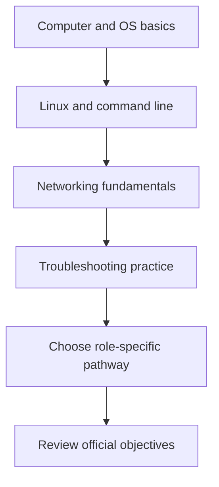

# SNA Certifications and Learning Pathways

## What is a certification?
A professional certification is a credential awarded by an organization after defined requirements are met, often through an exam. It can demonstrate knowledge, but it does not replace practical experience.

## Common certification areas

| Certification | General focus | May suit |
|---|---|---|
| CompTIA A+ | IT support, hardware, operating systems, troubleshooting | IT support beginners |
| CompTIA Network+ | Networking concepts and troubleshooting | Vendor-neutral networking learners |
| Cisco CCNA | Networking fundamentals and Cisco-oriented networking | Network engineering learners |
| Red Hat RHCSA | Practical Red Hat Enterprise Linux administration | Linux administration learners |
| CompTIA Security+ | Foundational cybersecurity concepts | Learners exploring security |

Descriptions are general. Names, exam codes, objectives, prices, and requirements change; verify current details on official provider websites before paying or registering.

## Choosing a pathway
Ask:
1. What role interests me: IT support, Linux administration, network engineering, or security?
2. What fundamentals do I already understand?
3. Do the official exam objectives match my goals?
4. Can I practice the relevant tasks safely?
5. What are the current costs, format, and renewal rules?

## Suggested learning sequence

This is a flexible learning sequence, not a mandatory prerequisite chain.

## Certification and practical skill
Certification study gives structure to learning and may provide a recognized credential. Practical work develops troubleshooting, judgment, and evidence of applied skill. A balanced approach includes both theory and practice.

## Verify before paying
Check the official provider's current certification status, exam objectives, prerequisites, fees, delivery options, and renewal policy. Avoid outdated unofficial exam dumps and follow exam rules.

## Summary
Choose a certification based on your target role, current knowledge, budget, and verified exam objectives. No single certification is required for every SNA job.

## Related notes
- [Introduction to SNA](01-Introduction-to-SNA.md)
- [RHEL](03-Linux-Fundamentals/01-Introduction-to-RHEL.md)
