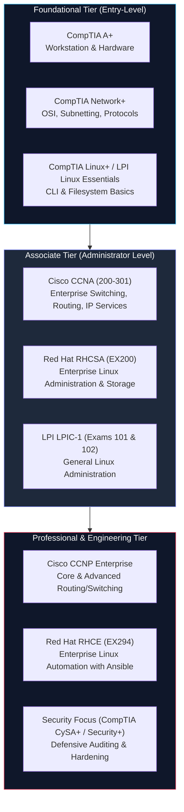

# System and Network Administrator (SNA) Certifications & Career Roadmaps

> **Module:** System and Network Administrator (SNA) Foundations  
> **Topic Level:** Academic / Professional Career Roadmap  
> **Previous Reference:** [01-Introduction-to-SNA.md](01-Introduction-to-SNA.md) | [SNA Index](README.md)

---

## 🎯 Learning Objectives

By the end of this note, you will be able to:

- Differentiate between **vendor-neutral** and **vendor-specific** industry certifications.
- Identify the leading credential tracks across Linux administration (Red Hat, LPI, CompTIA) and networking (Cisco, CompTIA).
- Understand how hands-on performance-based exams (e.g., RHCSA) differ from multiple-choice knowledge assessments.
- Formulate a pragmatic, student-friendly certification roadmap starting from foundational studies through junior administrator readiness.
- Avoid common certification traps, "paper certification" risks, and exam preparation misconceptions.

---

## 1. Introduction and Context

In the IT industry, university degrees demonstrate foundational computer science knowledge and disciplined problem-solving capability. However, enterprise employers hiring for System and Network Administrator positions frequently rely on standardized industry certifications as objective benchmarks of hands-on competence.

Certifications validate that a candidate understands standard command-line tools, network cabling, protocol behavior, and troubleshooting workflows. Understanding the certification landscape allows BSIT students to align their academic coursework (such as RHEL 6/8 labs, Cisco packet tracing, and Linux permissions) with globally recognized credentials.

---

## 2. Definitions of Important Terminology

| Term | Definition |
|---|---|
| **Vendor-Neutral Certification** | A credential that evaluates foundational principles applicable across all technologies regardless of the manufacturer (e.g., CompTIA Network+, LPIC-1). |
| **Vendor-Specific Certification** | A credential that evaluates mastery of a specific commercial vendor's proprietary OS, hardware, or syntax (e.g., Red Hat RHCSA, Cisco CCNA, Microsoft Azure). |
| **Performance-Based Exam** | A practical examination where candidates are placed in front of real, running virtual machines and must fix broken configurations, install packages, and deploy services to pass (e.g., Red Hat EX200). |
| **Knowledge-Based Exam** | An examination consisting of multiple-choice, drag-and-drop, or scenario simulations to test conceptual mastery (e.g., CompTIA, Cisco). |
| **"Paper Certified"** | An industry term describing an individual who passed an examination by memorizing practice question dumps without acquiring real troubleshooting or terminal proficiency. |

---

## 3. Major Certification Bodies & Tracks



### 3.1 Linux Administration Certifications

#### 1. Red Hat Certified System Administrator (RHCSA — Exam EX200)
- **Vendor:** Red Hat Inc.
- **Exam Style:** 100% Practical, performance-based (3 hours on a live RHEL system).
- **Core Domains:**
  - Managing files, directories, command environments, and documentation.
  - Creating shell scripts, controlling system services (`systemctl` / `service`), and managing boot states.
  - Configuring local storage (partitions, MBR/GPT, LVM, filesystems).
  - Creating and configuring file systems and file system attributes (permissions, encryption, ACLs).
  - Deploying, configuring, and maintaining systems (software packages via `yum` / `rpm`, system clocks).
  - Managing basic networking, user and group security accounts, and firewall rules.
- **Industry Reputation:** Highest tier of respect for enterprise Linux administration due to its strictly hands-on, zero-multiple-choice format.

#### 2. Linux Professional Institute Certification (LPIC-1)
- **Vendor:** Linux Professional Institute (LPI) — Vendor-Neutral.
- **Exam Style:** Two written exams (Exam 101 and Exam 102).
- **Core Domains:** System architecture, Linux installation, package management (both Debian `.deb` and Red Hat `.rpm`), GNU/Unix commands, devices, Linux filesystems, shells, and scripting.
- **Industry Reputation:** Excellent foundational credential that ensures well-rounded exposure across diverse Linux distributions.

#### 3. CompTIA Linux+ (Exam XK0-005)
- **Vendor:** CompTIA — Vendor-Neutral.
- **Exam Style:** Multiple-choice and performance-based simulation questions.
- **Core Domains:** System management, security, troubleshooting, scripting, containers, and automation.

---

### 3.2 Network Administration Certifications

#### 1. Cisco Certified Network Associate (CCNA — Exam 200-301)
- **Vendor:** Cisco Systems.
- **Exam Style:** Multiple-choice, drag-and-drop, and configuration simulations.
- **Core Domains:**
  - Network fundamentals (routers, switches, cabling, IPv4/IPv6 subnetting).
  - Network access (VLANs, trunking, EtherChannel, Spanning Tree Protocol).
  - IP connectivity (routing tables, static routes, OSPFv2).
  - IP services (NTP, DHCP, DNS, SNMP, SSH).
  - Security fundamentals (access control lists - ACLs, port security, wireless security).
  - Automation and programmability (REST APIs, JSON, Ansible).
- **Industry Reputation:** The gold standard for entry-to-intermediate enterprise network engineering.

#### 2. CompTIA Network+ (Exam N10-008 / N10-009)
- **Vendor:** CompTIA — Vendor-Neutral.
- **Exam Style:** Multiple-choice and performance-based questions.
- **Core Domains:** Networking concepts, network infrastructure, network operations, network security, and network troubleshooting.
- **Industry Reputation:** Ideal introductory stepping stone for students with zero prior networking background before attempting vendor-specific material.

---

## 4. Comprehensive Certification Comparison Matrix

| Credential | Sponsor | Format | Level | Typical Target Role | Key Strength |
|---|---|---|---|---|---|
| **CompTIA Network+** | CompTIA | Knowledge/Sims | Entry | Help Desk, Junior Tech | Vendor-neutral protocol foundations |
| **Cisco CCNA** | Cisco | Knowledge/Sims | Associate | Junior Network Administrator, NOC Tech | Deep routing, switching, and CLI mastery |
| **CompTIA Linux+** | CompTIA | Knowledge/Sims | Entry-Associate | Junior SysAdmin, Systems Support | Broad Linux distribution coverage |
| **LPIC-1** | LPI | Multiple-choice | Entry-Associate | Linux Administrator | Covers Debian and Red Hat package ecosystems |
| **Red Hat RHCSA** | Red Hat | 100% Practical Live VM | Associate | Enterprise Linux Administrator | Unrivaled practical respect in enterprise |

---

## 5. Practical Student Recommendation Roadmap

For students currently pursuing a degree in Information Technology or Computer Science:

```text
[Academic Coursework: RHEL Labs & Networking]
                       │
                       ▼
            [Step 1: Foundational Study]
            • Master Command-Line Navigation & Permissions
            • Practice IPv4 Subnetting & Packet Analysis (tcpdump)
                       │
                       ▼
            [Step 2: Dual Entry Milestone]
      ┌────────────────┴────────────────┐
      ▼                                 ▼
[Red Hat RHCSA Track]            [Cisco CCNA Track]
• Local file management           • Switching & VLANs
• LVM storage & partitions        • Subnetting & Routing
• Services & Init levels          • ACLs & Port Security
      │                                 │
      └────────────────┬────────────────┘
                       ▼
      [Step 3: Blue Team / SOC Convergence]
      • Hardened server baselines
      • Network protocol anomaly detection
      • Centralized logging & auditing
```

---

## 6. Common Misconceptions & Mistakes

1. **Relying on Exam Dumps**: Memorizing question dumps allows an applicant to pass a multiple-choice test, but they will fail technical interviews, practical tests (like RHCSA), and live production troubleshooting on day one.
2. **Ignoring Networking While Learning Linux**: A System Administrator who cannot analyze a packet capture with `tcpdump` or determine why a host route is missing will struggle in enterprise environments where services cross firewalls and subnets.
3. **Ignoring Linux While Learning Networking**: Modern network engineers manage software-defined networks (SDN), network operating systems (Cisco Nexus, Arista EOS, Cumulus Linux), and automation frameworks (Ansible, Python), all of which run natively on Linux.

---

## 7. Security Considerations

- Certified administrators handle critical identity, access control, and cryptographic keys.
- Earning a credential carries ethical and legal responsibilities: never use administrative tools or packet sniffers on networks or systems without explicit, written authorization.

---

## 8. Summary & Next Steps

Certifications provide clear milestones for technical growth. In the context of our SNA curriculum, mastering Red Hat Enterprise Linux commands, filesystem hierarchies, user permissions, and networking packet capture directly aligns with both RHCSA and CCNA domains.

- **Next Chapter:** Dive into enterprise Linux operating systems in [03-Linux-Fundamentals/01-Introduction-to-RHEL.md](03-Linux-Fundamentals/01-Introduction-to-RHEL.md).
- **Practical Cheatsheets:** Review the [cheatsheets/README.md](cheatsheets/README.md) for quick terminal references.
