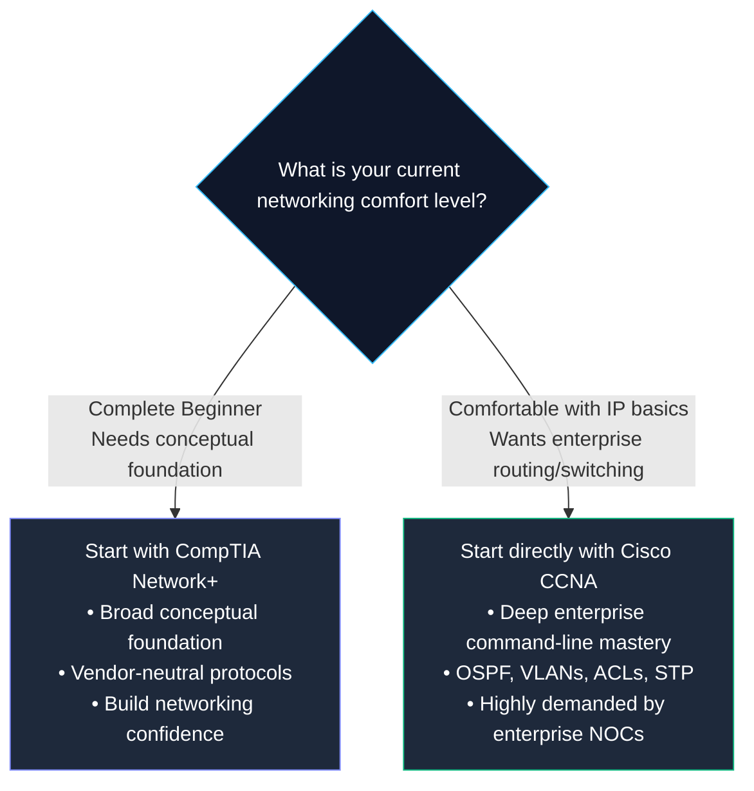
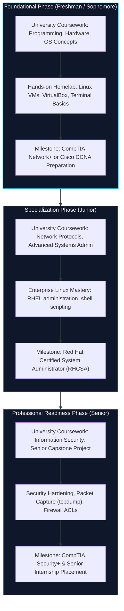
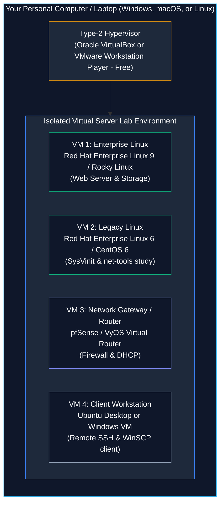

# SNA Certifications and Professional Learning Pathways

> **Module:** System and Network Administrator (SNA) Foundations  
> **Target Audience:** BSIT Students, Career Changers, and Aspiring IT Professionals  
> **Related Reference:** [01-Introduction-to-SNA.md](01-Introduction-to-SNA.md) | [03-Linux-Fundamentals/01-Introduction-to-RHEL.md](03-Linux-Fundamentals/01-Introduction-to-RHEL.md)

---

## 🎯 Learning Objectives

By the end of this chapter, you will be able to:

- Articulate the role of **professional IT certifications** in career development and understand how they differ from academic university degrees.
- Distinguish between **vendor-neutral** certifications (such as CompTIA) and **vendor-specific** certifications (such as Cisco and Red Hat).
- Analyze the core industry certification standards: **CompTIA A+**, **Network+**, **Security+**, **Cisco CCNA**, and **Red Hat RHCSA**.
- Navigate a structured, step-by-step career and certification roadmap aligned with university BSIT coursework.
- Understand the distinction between performance-based (hands-on live terminal) exams and multiple-choice exams.
- Build a zero-cost or low-cost **System and Network Administration Home Lab** to develop verified, practical command-line skills.
- Recognize the ethical and professional risks associated with unauthorized exam dumps.

---

## 1. Academic Degrees vs. Professional Certifications

As a university Information Technology (BSIT) student, you are investing years into studying computer science theory, operating system mechanics, discrete mathematics, database design, and software engineering. You might ask: *"If I am already earning a university degree, why do IT certifications matter?"*

Understanding the complementary relationship between academic study and professional certifications is essential for planning your career.

```mermaid
flowchart LR
    subgraph Academic["Academic Degree (BSIT)"]
        A1["Broad Theoretical Foundations"]
        A2["Long-Term Problem Solving"]
        A3["Computer Architecture & Math"]
        A4["Lifelong Analytical Thinking"]
    end

    subgraph Certification["Professional Certifications"]
        C1["Immediate Vendor Competence"]
        C2["Standardized Toolchain Skills"]
        C3["Performance Under Exam Time Constraints"]
        C4["HR Resume Filtering Alignment"]
    end

    Academic <-->|Combined for Career Excellence| Certification

    style Academic fill:#0f172a,stroke:#38bdf8,color:#fff
    style Certification fill:#0f172a,stroke:#f59e0b,color:#fff
    style A1 fill:#1e293b,stroke:#94a3b8,color:#fff
    style A2 fill:#1e293b,stroke:#94a3b8,color:#fff
    style A3 fill:#1e293b,stroke:#94a3b8,color:#fff
    style A4 fill:#1e293b,stroke:#94a3b8,color:#fff
    style C1 fill:#1e293b,stroke:#94a3b8,color:#fff
    style C2 fill:#1e293b,stroke:#94a3b8,color:#fff
    style C3 fill:#1e293b,stroke:#94a3b8,color:#fff
    style C4 fill:#1e293b,stroke:#94a3b8,color:#fff
```



### 1.1 The Academic University Degree
A university BSIT degree teaches you **why** systems work from a scientific perspective. You learn:
- How memory paging algorithms and CPU scheduling algorithms operate inside operating system kernels.
- The mathematical foundations of cryptography and network hashing.
- How relational databases optimize SQL queries using B-trees.
- Software development paradigms and systems analysis.

A degree demonstrates to employers that you have intellectual stamina, communication skills, project collaboration experience, and a deep theoretical foundation that will not become obsolete when a specific software version changes.

### 1.2 The Professional Certification
A professional certification proves to employers **how** to do the work right now using specific tools. A certification validates that:
- You know the exact command flags to configure an IP address or bond a network interface on a Linux server.
- You can configure VLANs and Access Control Lists on a Cisco enterprise switch under time pressure.
- You have verified, current knowledge that meets an audited industry standard.

When enterprise recruiters and Human Resources (HR) departments receive hundreds of resumes for a junior System Administrator opening, automated Applicant Tracking Systems (ATS) frequently filter candidates based on whether they hold foundational credentials (such as CCNA, RHCSA, or Security+). Holding both a university degree and targeted industry certifications places a candidate in the top tier of competitive applicants.

---

## 2. Vendor-Neutral vs. Vendor-Specific Credentials

When selecting certifications, you will encounter two primary categories:

```
+----------------------------------------------------------------------------------------------------+
|                                CREDENTIAL TAXONOMY COMPARISON                                      |
+--------------------------+------------------------------------+------------------------------------+
| Category                 | Vendor-Neutral                     | Vendor-Specific                    |
+--------------------------+------------------------------------+------------------------------------+
| Primary Providers        | CompTIA, LPI, GIAC                 | Red Hat, Cisco, Microsoft, AWS     |
| Focus                    | Universal concepts and standards   | Proprietary syntax & ecosystems    |
| Portability              | Applies across all operating tools | Deep authority within that vendor  |
| Best For                 | Beginners establishing foundations | Administrators specializing in tech|
| Primary Exam Style       | Multiple-choice & drag-and-drop PBQ| Live performance / CLI terminal labs|
+--------------------------+------------------------------------+------------------------------------+
```

### 2.1 Vendor-Neutral Credentials
**Vendor-neutral** certifications test universal concepts and open standards that apply regardless of which manufacturer built the hardware or software.
- **Example:** The CompTIA Network+ exam tests the 7 layers of the OSI model, TCP/IP headers, IPv4 subnetting, and fiber-optic cable types. Whether you work with Cisco, Juniper, Arista, or Linux routing, these networking physics and protocols remain identical.
- **Advantage:** Maximum career flexibility. You learn foundational concepts that never lock you into a single software vendor.

### 2.2 Vendor-Specific Credentials
**Vendor-specific** certifications test in-depth mastery of a particular manufacturer's proprietary command-line syntax, architectural features, and configuration interfaces.
- **Example:** The Cisco Certified Network Associate (CCNA) tests how to execute specific Cisco IOS commands (`show ip route`, `switchport mode trunk`) on Cisco switches and routers.
- **Example:** The Red Hat Certified System Administrator (RHCSA) requires you to log into a live Red Hat Enterprise Linux server and configure LVM storage, user accounts, and SELinux policies from memory.
- **Advantage:** Highly respected by enterprise employers because they prove direct, hands-on productivity on the exact platforms used in commercial data centers.

---

## 3. Comprehensive Industry Certification Breakdown

Below is a detailed analysis of the core certifications relevant to a System and Network Administrator.

| Certification Name | Sponsoring Body | Exam Code | Testing Format | Primary Technical Focus | Typical Target Role |
|---|---|---|---|---|---|
| **CompTIA A+** | CompTIA | Core 1 (220-1101)<br/>Core 2 (220-1102) | Multiple Choice & Performance-Based Questions | Computer hardware, mobile devices, networking hardware, Windows/Linux OS basics, software troubleshooting, operational security | IT Support Specialist, Desktop Support, Help Desk Tier 1 |
| **CompTIA Network+** | CompTIA | N10-008 / N10-009 | Multiple Choice & Performance-Based Questions | OSI model, IPv4/IPv6 subnetting, network topologies, routing protocols, DNS/DHCP, network security, cabling standards | Junior Network Administrator, Field Technician, NOC Technician |
| **Cisco CCNA** | Cisco Systems | 200-301 CCNA | Multiple Choice, Drag-and-Drop, Simlets (CLI) | Network fundamentals, IP connectivity (OSPF routing), IP services (NAT, DHCP, NTP), security fundamentals, network automation & programmability | Network Support Engineer, Junior Network Administrator, Systems Engineer |
| **Red Hat RHCSA** | Red Hat | EX200 | **100% Hands-On Practical Lab** (No multiple choice!) | Managing storage (LVM, partitions), file systems, user identities, process management, systemd services, SELinux enforcement, SSH hardening | Linux System Administrator, DevOps Engineer, Cloud Infrastructure Admin |
| **CompTIA Security+** | CompTIA | SY0-701 | Multiple Choice & Performance-Based Questions | Threats, vulnerabilities, and mitigations; cryptography; identity and access management (IAM); enterprise security architecture; incident response | SOC Analyst (Tier 1), Junior Security Administrator, Information Security Specialist |

---

### 3.1 CompTIA A+ — The Hardware and Client OS Foundation
- **Why It Matters:** CompTIA A+ is the industry benchmark for entry-level IT operations. It covers motherboards, RAM types, power supplies, RAID arrays, operating system installations, and basic command-line navigation.
- **Syllabus Overlap for BSIT:** A+ reinforces university courses in **Computer Organization and Architecture** and **Operating Systems**.
- **Student Recommendation:** If you have already built your own desktop computer, installed Linux alongside Windows, and understand basic troubleshooting, you may choose to skip A+ and begin directly with Network+ or CCNA.

---

### 3.2 CompTIA Network+ vs. Cisco CCNA — The Networking Choice
Students frequently ask: *"Should I take CompTIA Network+ or Cisco CCNA?"*



- **CompTIA Network+:** Best for students who want a gentle, broad introduction to networking theory. It does not require memorizing proprietary command syntax.
- **Cisco CCNA (200-301):** The gold standard for network engineering. While it focuses on Cisco equipment, approximately 80% of the knowledge (IP addressing, TCP three-way handshake, Spanning Tree Protocol, routing mechanics) applies to every network switch and router in the world. CCNA carries significantly more weight on a resume for network administration roles.

---

### 3.3 Red Hat Certified System Administrator (RHCSA) — The Live Linux Exam
The **RHCSA (EX200)** is widely regarded as one of the most rigorous and respected technical exams in the entire IT industry.

Unlike exams where you select [A], [B], [C], or [D] on a computer screen, the RHCSA is a **100% practical, performance-based live terminal examination**:
1. You are seated in front of a live, running virtual machine running Red Hat Enterprise Linux.
2. You are handed a list of administrative problem statements (e.g., *"Create a Logical Volume named `data` of size 5GB mounted on `/finance` with an XFS filesystem; ensure it mounts automatically on boot; grant group ownership to `accountants` with read-write permissions"*).
3. You must execute the real Linux commands in the terminal, edit configuration files, configure SELinux, and reboot the system.
4. When time expires, Red Hat's automated grading scripts reboot your machine. If your configuration does not survive a reboot or your permissions are incorrect, you receive zero points for that task.

**Why It Matters for BSIT Students:** Earning an RHCSA proves that you are not simply memorizing definitions from a textbook—it proves that you can sit down at an enterprise Linux terminal and configure servers immediately.

---

## 4. The BSIT Professional Roadmap

To maximize your time during university studies, follow this sequenced progression:



### Milestone Explanation:
1. **Years 1 & 2 (Foundational Competence):** Focus on core computer architecture, binary arithmetic, and IPv4 subnetting. Build comfort inside the Linux terminal. Aim to achieve **Cisco CCNA** or **CompTIA Network+** before your junior year.
2. **Year 3 (System Mastery):** Focus on enterprise server administration. Master user management, permissions, system initialization, and storage management. Study for and attempt the **Red Hat RHCSA**.
3. **Year 4 (Defensive Security & Capstone):** Synthesize systems and networks into security defense. Master packet analysis (`tcpdump`), firewall configuration, and intrusion detection. Complete **CompTIA Security+** to qualify for enterprise Security Operations Center (SOC) and Systems Engineer roles upon graduation.

---

## 5. Building an SNA Homelab on a Student Budget

You do not need to buy expensive enterprise server racks or Cisco switches to practice for these certifications. You can build an entire enterprise-grade data center inside your personal computer using free, open-source virtualization.



### Essential Free Tools for BSIT Students:
1. **Type-2 Hypervisors (Zero Cost):**
   - **Oracle VirtualBox:** Completely free and open source on Windows, macOS, and Linux.
   - **VMware Workstation Pro:** Now free for personal and educational use.
2. **Free Enterprise Linux Licenses:**
   - **Red Hat Developer Subscription for Individuals:** Red Hat provides a **free developer subscription** that allows individuals to download and run up to 16 physical or virtual installations of official **Red Hat Enterprise Linux (RHEL 8/9)** with full access to official software repositories and updates.
   - **Rocky Linux / AlmaLinux:** Free, 100% bug-for-bug binary compatible open-source rebuilds of RHEL maintained by community foundations.
3. **Network Simulation Tools:**
   - **Cisco Packet Tracer:** Free network simulation software provided by the Cisco Networking Academy. Allows building virtual Cisco networks with routers, switches, and workstations.
   - **GNS3 / EVE-NG:** Advanced network emulators capable of running real Cisco IOS images and virtual appliances.

---

## 6. The Danger of "Brain Dumps"

In certification forums, you will encounter websites advertising "Brain Dumps"—unauthorized collections of stolen, leaked exam questions and answer keys.

As a BSIT student, you must understand why using brain dumps is **professionally destructive**:
1. **Interview Exposure:** Technical interviewers do not ask multiple-choice questions. They ask practical scenario questions: *"Explain how an ARP request traverses a switch across VLANs"* or *"Log into this Linux terminal and resolve why Apache won't bind to port 80."* A student who memorized brain dump answer keys will fail technical interviews instantly.
2. **Credential Revocation:** Certification bodies (Cisco, CompTIA, Red Hat) actively monitor dump websites and employ statistical algorithms during exams to detect anomalous answering speeds. Candidates caught using unauthorized materials face permanent bans and decertification.
3. **Loss of Troubleshooting Instinct:** The purpose of certification study is the mental struggle of diagnosing broken configurations in your lab. Skipping the struggle robs you of the diagnostic intuition that makes an engineer valuable.

---

## 7. Important Points to Remember

- **Degrees vs. Certifications:** Academic degrees provide broad, lifelong conceptual engineering foundations; certifications validate immediate, standardized operational competence on specific toolchains.
- **Vendor-Neutral vs. Specific:** Vendor-neutral credentials (CompTIA) establish universal protocol foundations; vendor-specific credentials (Cisco, Red Hat) prove in-depth command-line execution ability on commercial platforms.
- **Hands-On Live Lab Exams:** Red Hat's RHCSA is a 100% performance-based exam where you configure real Linux virtual machines under a running timer with zero multiple-choice questions.
- **The Ideal Sequence:** Start with networking (Network+ or CCNA), progress to enterprise server administration (RHCSA), and culminate in defensive security (Security+).
- **Homelab Availability:** You can build an entire enterprise lab environment at zero cost using VirtualBox, free Red Hat Developer subscriptions, Rocky Linux, and Cisco Packet Tracer.
- **Hands-On Integrity:** Never use unauthorized exam dumps; technical interviews instantly reveal the difference between true diagnostic ability and rote memorization.

---

## 8. Key Terms Glossary

| Term | Technical Definition |
|---|---|
| **Applicant Tracking System (ATS)** | Automated human resources software that scans resumes for specific keywords, education credentials, and certification titles before human review. |
| **Brain Dump** | An illicit, unauthorized collection of leaked exam questions memorized to bypass genuine learning. Violates testing policies and leads to decertification. |
| **Cisco Packet Tracer** | A visual network simulation program developed by Cisco Systems that allows students to simulate network configurations on routers and switches. |
| **Performance-Based Question (PBQ)** | An exam testing component that requires the candidate to perform an interactive simulation or type configuration commands rather than selecting multiple-choice answers. |
| **Red Hat Developer Subscription** | A complimentary program provided by Red Hat allowing students and engineers to run genuine RHEL servers for personal learning and testing. |
| **RHCSA (EX200)** | Red Hat Certified System Administrator; a premier performance-based live-terminal certification testing enterprise Linux systems administration. |
| **Type-2 Hypervisor** | Virtualization software that runs as an application on top of an existing host operating system (e.g., Oracle VirtualBox, VMware Workstation). |
| **Vendor-Neutral** | Technical standards, protocols, and certifications that apply equally across all hardware manufacturers and software developers (e.g., CompTIA). |
| **Vendor-Specific** | Technical credentials focused specifically on the proprietary command syntax, software features, and hardware architecture of one company (e.g., Cisco, Red Hat). |

---

## 9. Practice Questions

Test your knowledge of IT certification paths and learning strategies. Attempt these questions independently before checking the answer key.

### Question 1 (Conceptual)
Which of the following certifications uses a **100% live-terminal, performance-based grading model** where candidates must configure a live operating system with no multiple-choice questions?
- [A] CompTIA A+ Core 1
- [B] CompTIA Network+
- [C] Red Hat Certified System Administrator (RHCSA EX200)
- [D] CompTIA Security+

### Question 2 (Career Strategy)
A second-year BSIT student wants to pursue enterprise network engineering. The student already understands basic binary arithmetic and computer hardware. Which certification pathway is most appropriate for establishing enterprise routing and switching credibility?
- [A] CompTIA A+ followed by Linux+
- [B] Cisco Certified Network Associate (CCNA)
- [C] Microsoft Certified: Azure Fundamentals
- [D] ITIL 4 Foundation

### Question 3 (Credential Taxonomy)
Explain the primary difference between a **vendor-neutral** certification (like CompTIA Network+) and a **vendor-specific** certification (like Cisco CCNA). Provide one operational advantage of each.

### Question 4 (Lab Architecture Scenario)
A student wants to study for the RHCSA and test RHEL 6 legacy SysVinit scripts alongside modern RHEL 9 systemd services. The student has a single laptop running Windows 11 with 16GB of RAM. What is the most cost-effective and technically sound architecture to achieve this lab environment?

### Question 5 (Technical Interview Scenario)
During a job interview for a Junior Linux Administrator role, the interviewer asks:
*"We see candidates with five certifications who cannot troubleshoot a basic server crash. How can you demonstrate that your certification represents genuine practical ability?"*
How should a prepared BSIT candidate answer this question?

---

## 10. Answer Key & Explanations

### Answer to Question 1:
**Correct Option:** **[C]**  
*Explanation:* The Red Hat RHCSA (EX200) is entirely hands-on. Candidates are provided with actual virtual machines and a list of operational tasks (e.g., create LVM logical volumes, configure users, repair a broken bootloader). CompTIA exams [A, B, D] are primarily multiple-choice with occasional simulated performance-based widgets.

### Answer to Question 2:
**Correct Option:** **[B]**  
*Explanation:* For network engineering, the Cisco CCNA (200-301) is the premier enterprise benchmark. It covers deep Layer 2 switching, Layer 3 dynamic routing (OSPF), IP services (NAT, ACLs), and network automation.

### Answer to Question 3:
**Correct Answer:**  
- **Vendor-Neutral (e.g., CompTIA Network+):** Focuses on universal standards, open protocols, and foundational physics (OSI model, Ethernet standards, IPv4/IPv6).  
  *Advantage:* Knowledge is universally portable across any organization and equipment manufacturer.
- **Vendor-Specific (e.g., Cisco CCNA):** Focuses on the proprietary syntax, architecture, and configuration conventions of a specific manufacturer (Cisco IOS).  
  *Advantage:* Proves immediate, hands-on command-line productivity on enterprise hardware widely deployed in commercial data centers.

### Answer to Question 4:
**Correct Answer:**  
The student should install a free Type-2 hypervisor on Windows 11 (such as **Oracle VirtualBox** or **VMware Workstation Pro**). Inside the hypervisor:
1. Register for a free **Red Hat Developer Subscription for Individuals** to download official RHEL 9 ISOs.
2. Obtain a legacy RHEL 6 or CentOS 6 minimal ISO for legacy testing.
3. Allocate 2 GB RAM and 20 GB disk space to each virtual machine.
4. Configure an internal Host-Only or Bridged virtual network to allow SSH connectivity from the Windows host using PuTTY or Windows Terminal.  
This solution costs $0 and provides complete, isolated operational control.

### Answer to Question 5:
**Correct Answer:**  
The candidate should highlight their **active homelab and practical project portfolio**:
- Point to specific homelab architectures built from scratch (e.g., *"In my personal lab running Rocky Linux on VirtualBox, I configured automated backup scripts, built LVM storage pools, and triaged simulated service crashes"*).
- Discuss real troubleshooting experiences rather than memorized definitions (e.g., resolving a broken GRUB bootloader or fixing a corrupted `/etc/fstab` file).
- Share links to documented lab notes or a public GitHub repository showing shell scripts, network topology diagrams, and technical writeups.

---

## 🔗 Related Notes & Next Steps

- **Next Chapter:** Explore the architecture, release history, and enterprise role of Red Hat Enterprise Linux in [03-Linux-Fundamentals/01-Introduction-to-RHEL.md](03-Linux-Fundamentals/01-Introduction-to-RHEL.md).
- **Core Linux Commands:** Begin hands-on CLI practice with [03-Linux-Fundamentals/02-Common-Linux-Commands.md](03-Linux-Fundamentals/02-Common-Linux-Commands.md).
- **Cheatsheet Reference:** Consult the high-density [cheatsheets/README.md](cheatsheets/README.md) for quick command lookups during lab work.
