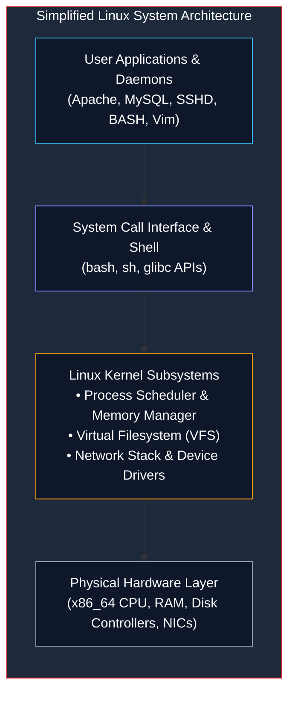
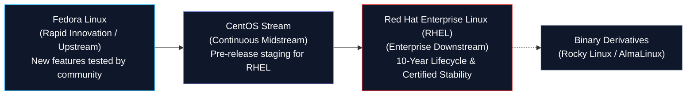

# Introduction to Red Hat Enterprise Linux (RHEL)

> **Module:** System and Network Administrator (SNA) — 03 Linux Fundamentals  
> **Topic Level:** Foundational Linux Administration  
> **Related Reference:** [02-Common-Linux-Commands.md](02-Common-Linux-Commands.md) | [SNA Index](../README.md)

---

## 🎯 Learning Objectives

By the end of this note, you will be able to:

- Explain the origins, enterprise role, and release philosophy of **Red Hat Enterprise Linux (RHEL)**.
- Understand the open-source upstream/downstream lifecycle connecting **Fedora**, **CentOS Stream**, and **RHEL**.
- Describe the architectural layers of an enterprise Linux system from hardware to user applications.
- Identify the structural and operational differences between **RHEL 6 (legacy lab environment)** and modern RHEL 8/9 releases.
- Use command-line utilities to inspect kernel version, architecture, OS release details, and installed software.

---

## 1. Introduction and Context

In the computing world, general-purpose consumer operating systems prioritize bleeding-edge features and multimedia convenience. In contrast, enterprise servers prioritize **stability**, **predictability**, **long-term security backporting**, and **strict vendor support**.

**Red Hat Enterprise Linux (RHEL)** is the commercial market leader in enterprise server distributions. Developed by Red Hat (an IBM subsidiary), RHEL powers global financial institutions, mission-critical healthcare systems, telecommunication backbones, cloud hyperscalers, and government datacenters. Because of this industry footprint, university SNA curricula heavily base practical laboratory work on RHEL and its binary-compatible derivatives.



---

## 2. Definitions of Important Terminology

| Term | Definition |
|---|---|
| **Kernel** | The core software program that maintains complete control over the system, mediating hardware access for all executing software. |
| **Upstream / Downstream** | The software flow where community-developed source code ("upstream", e.g., Linux kernel, Fedora) is curated, stabilized, and packaged into enterprise products ("downstream", e.g., RHEL). |
| **ABI / API Stability** | Application Binary Interface stability guarantee ensuring compiled binary applications run unchanged across minor releases without recompilation. |
| **RPM (Red Hat Package Manager)** | The low-level binary packaging format (`.rpm`) and package management tool utilized across Red Hat-based distributions. |
| **YUM (Yellowdog Updater, Modified)** | The high-level command-line package management tool that automatically calculates, downloads, and resolves `.rpm` dependency trees (superseded by DNF in RHEL 8/9). |
| **Backporting** | The engineering practice of taking security patches and bug fixes from newer upstream software and applying them to older, established packages without altering software versions or breaking compatibility. |

---

## 3. The Red Hat Ecosystem: Upstream to Downstream

Red Hat does not build software from scratch in isolation. It relies on a multi-stage open-source pipeline:



1. **Fedora**: Rapid-release community project sponsored by Red Hat. Serves as the testbed for cutting-edge technologies (new Linux kernels, GCC compilers, desktop environments).
2. **CentOS Stream**: A continuous-delivery distribution tracking just ahead of current RHEL minor releases.
3. **RHEL**: The commercial product supported under enterprise subscriptions, offering guaranteed 10-year enterprise maintenance lifecycles, regulatory compliance certifications, and 24/7 technical support.

---

## 4. RHEL 6 Legacy Compatibility vs. Modern RHEL

Many academic computer labs and legacy industrial facilities maintain **RHEL 6** instances due to established curricula, legacy hardware, or specialized enterprise software. It is vital for an SNA student to understand how RHEL 6 differs from modern releases:

| Feature / Subsystem | RHEL 6 (Legacy Academic Environment) | RHEL 7 / 8 / 9 (Modern Enterprise) |
|---|---|---|
| **Init System** | Upstart / SysVinit (`/sbin/init`, `/etc/inittab`) | `systemd` (`/usr/lib/systemd/systemd`) |
| **Service Control** | `service httpd status` | `systemctl status httpd` |
| **Boot Service Management** | `chkconfig httpd on` | `systemctl enable httpd` |
| **Default Kernel** | Linux 2.6.32 | Linux 3.10 (RHEL 7), 4.18 (RHEL 8), 5.14+ (RHEL 9) |
| **Package Manager CLI** | `yum install <pkg>` | `dnf install <pkg>` (or `yum` symlink) |
| **Default Filesystem** | `ext4` | `xfs` |
| **Host Firewall** | Static `iptables` service | Dynamic `firewalld` daemon (`firewall-cmd`) |
| **Network Configuration** | Network scripts (`/etc/sysconfig/network-scripts/`) | NetworkManager (`nmcli`, `nmtui`) |

---

## 5. Inspection Commands & Syntax

When logging into an unfamiliar server, administrators use standardized commands to inspect the operating system profile:

### Identifying Distribution & Release
```bash
# Display the exact RHEL release string
cat /etc/redhat-release
# Example output on RHEL 6: Red Hat Enterprise Linux Server release 6.10 (Santiago)
# Example output on RHEL 8: Red Hat Enterprise Linux release 8.8 (Ootpa)

# Display LSB (Linux Standard Base) information if installed
lsb_release -a
```

### Inspecting Kernel & Hardware Architecture
```bash
# Display kernel version, hostname, and CPU architecture
uname -a
# Example output: Linux server01 2.6.32-754.el6.x86_64 #1 SMP x86_64 x86_64 x86_64 GNU/Linux

# View physical and logical CPU core details
lscpu
# Or direct kernel proc entry:
cat /proc/cpuinfo | grep "model name" | head -n 1
```

### Checking Package Inventory via RPM
```bash
# Query whether a specific package is installed
rpm -q bash
# Example output: bash-4.1.2-48.el6.x86_64

# List all installed packages on the system
rpm -qa | head -n 10
```

---

## 6. Common Mistakes & Troubleshooting

- **Attempting to use `systemctl` on RHEL 6**:
  - *Symptom*: Terminal outputs `bash: systemctl: command not found`.
  - *Cause*: `systemd` was not introduced to the Red Hat family until RHEL 7.
  - *Fix*: Use SysVinit commands: `service <daemon> <start|stop|status>` and `chkconfig <daemon> <on|off>`.
- **Assuming RHEL package names match Ubuntu/Debian names**:
  - *Symptom*: `yum install apache2` fails with `No package apache2 available`.
  - *Cause*: Debian/Ubuntu names the Apache HTTP daemon `apache2`, whereas RHEL/CentOS names it `httpd`. Similarly, MySQL/MariaDB server is `mariadb-server` on RHEL.

---

## 7. Security Considerations

1. **Backported Vulnerability Fixes**: In RHEL, vulnerability databases may show an alert for an older version of Apache (e.g., Apache 2.2 on RHEL 6). Red Hat backports security fixes into the existing package version without changing the version string. Always check Red Hat Security Advisories (RHSA) rather than relying on naive version-number scanners.
2. **SELinux (Security-Enhanced Linux)**: RHEL ships with SELinux enabled in `Enforcing` mode by default. SELinux provides mandatory access control (MAC) based on security labels, restricting processes even if an attacker gains root credentials.

---

## 8. Summary & Next Steps

Red Hat Enterprise Linux establishes the enterprise standard for stability, long-term support, and software management. Understanding its architecture and legacy RHEL 6 compatibility is essential for both academic lab exams and real-world infrastructure administration.

- **Next Chapter:** Master daily operational CLI syntax in [02-Common-Linux-Commands.md](02-Common-Linux-Commands.md).
- **Service Control Reference:** Review boot and runlevels in [06-System-Initialization.md](06-System-Initialization.md).
- **Quick Reference:** Inspect [../cheatsheets/Linux-Commands-Cheatsheet.md](../cheatsheets/Linux-Commands-Cheatsheet.md).
