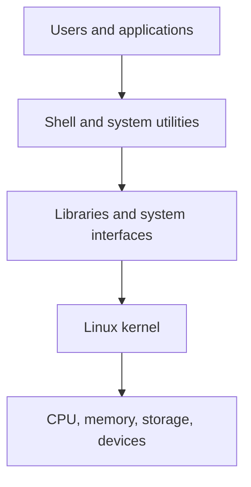

# Introduction to Red Hat Enterprise Linux (RHEL)

## Learning objectives
Understand Linux distributions, recognize core terms, inspect a Linux environment, and identify version-specific administration differences.

## What is Linux?
Linux is an open-source operating-system kernel. A Linux distribution combines the kernel with utilities, libraries, package tools, and other software. Examples include Red Hat Enterprise Linux, Fedora, Debian, and Ubuntu.

## What is RHEL?
**Red Hat Enterprise Linux (RHEL)** is an enterprise Linux distribution used in managed server and business environments. RHEL 6 is an old release; keep legacy lab systems isolated and do not use it as a newly deployed internet-facing production system.

## Simplified architecture


## Important terms

| Term | Explanation |
|---|---|
| Kernel | Core component managing hardware and system resources |
| Shell | Program interpreting commands, such as Bash |
| Terminal | Interface for interacting with a shell |
| Distribution | Packaged operating system built around the Linux kernel |
| Root user | Superuser with extensive administrative privileges |
| Package | Unit of software installed or managed by package tools |
| Service/daemon | Background program providing a function |
| Filesystem | Structure and method for organizing files |

## Inspect your system
```bash
whoami
hostname
uname -a
pwd
cat /etc/redhat-release
```
`whoami` prints the effective username; `hostname` prints the configured host name; `uname -a` shows kernel/system details; `pwd` shows the current directory; `/etc/redhat-release` commonly identifies a Red Hat release. That file may not exist on other distributions.

## Root and ordinary users
Use an ordinary account for routine work and elevate privileges only when needed and authorized. Do not assume `sudo` is installed or configured on an older system; follow the approved lab procedure.

## Version differences
RHEL 6 commonly uses SysV init and service scripts. Later RHEL releases use systemd. Always identify the version before following service-management instructions.

## Safe habits
- Inspect unfamiliar commands before executing them.
- Read manual pages where available: `man command`.
- Avoid running unfamiliar commands as root.
- Verify the target before disk or filesystem operations.
- Keep old lab systems isolated from untrusted networks.

## Summary
RHEL is an enterprise Linux distribution. Learning the shell, filesystem, users, permissions, services, and logs builds a foundation for administration. Version compatibility is especially important when studying RHEL 6.

## Related notes
- [Common Linux Commands](02-Common-Linux-Commands.md)
- [File Management](03-File-Management.md)
- [File Permissions](04-File-Permissions.md)
