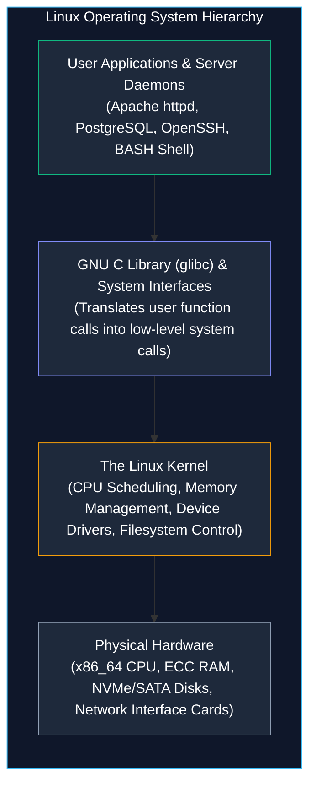
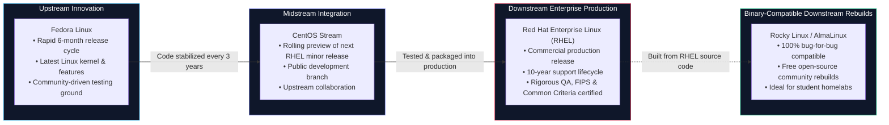
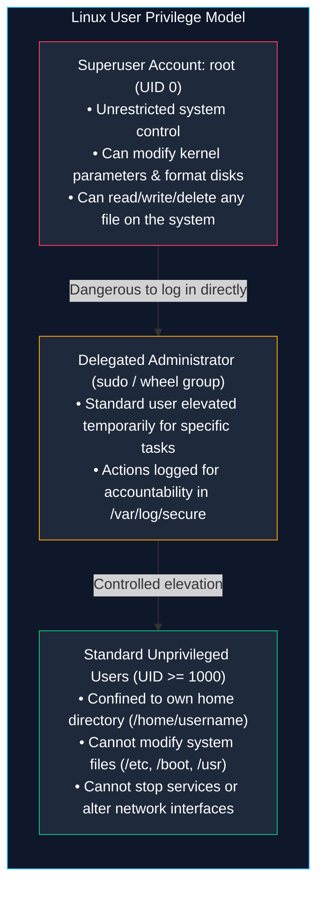

# Introduction to Red Hat Enterprise Linux (RHEL)

> **Module:** System and Network Administrator (SNA) Foundations  
> **Topic:** Linux Operating System Architecture & Enterprise Release Models  
> **Target Audience:** BSIT Students, Junior System Administrators, and Infrastructure Engineers  
> **Related Reference:** [02-Common-Linux-Commands.md](02-Common-Linux-Commands.md) | [06-System-Initialization.md](06-System-Initialization.md)

---

## 🎯 Learning Objectives

By the end of this chapter, you will be able to:

- Deconstruct the Linux operating system into its three core layers: **Kernel**, **GNU System Utilities**, and **Distribution Packaging**.
- Understand why **Red Hat Enterprise Linux (RHEL)** dominates commercial enterprise data centers, government infrastructure, and financial institutions.
- Map the software lineage connecting **Fedora**, **CentOS Stream**, **RHEL**, and downstream binary rebuilds (**Rocky Linux** and **AlmaLinux**).
- Contrast the administrative architecture of legacy **RHEL 6** (SysVinit, `service`, `chkconfig`, `ifconfig`) with modern **RHEL 7/8/9** (systemd, `systemctl`, `iproute2`).
- Execute and interpret core Linux release and environment verification commands (`cat /etc/os-release`, `uname -r`, `cat /etc/redhat-release`).
- Grasp foundational enterprise stability features including **Application Binary Interface (ABI) stability**, **Long-Term Support (LTS)**, and **SELinux**.

---

## 1. What is Linux? (Kernel vs. Operating System)

When people say *"I am running Linux"*, they are technically referring to the **Linux kernel**—the core supervisory program created by Linus Torvalds in 1991.

A kernel alone, however, is not a usable operating system. If you booted a computer with only the Linux kernel, the machine would initialize the processor and memory, mount storage drivers, and then halt because there would be no user interface, command shell, or file utilities to interact with.

A complete Linux operating system consists of three distinct layers:



1. **The Linux Kernel:** The master controller that sits directly on top of physical hardware. It allocates CPU time slices to processes, manages virtual memory address spaces, arbitrates access to hard drives, and transmits packets through physical network cards.
2. **GNU System Utilities & System Libraries:** In the 1980s, Richard Stallman and the Free Software Foundation developed the GNU project to create a free Unix-like system. They authored the foundational command-line utilities (`ls`, `cp`, `cat`, `grep`), the BASH shell, and the standard C library (`glibc`). When the Linux kernel was combined with GNU software in 1992, the complete **GNU/Linux** operating system was born.
3. **The Distribution (Distro):** A software company or community foundation that bundles the Linux kernel, GNU utilities, an installation program (such as Red Hat's Anaconda), a package manager (such as `rpm` and `dnf`), security policies, and pre-compiled software into a polished, bootable ISO image.

---

## 2. Why Red Hat Enterprise Linux (RHEL)?

There are hundreds of Linux distributions available today, including Ubuntu, Debian, Arch Linux, Linux Mint, and Fedora. Why does the enterprise world standardize so heavily on **Red Hat Enterprise Linux (RHEL)**?

### 2.1 The Enterprise Philosophy: Predictable Stability
In home computing or gaming, users often want the bleeding-edge latest software versions. In enterprise banking, air traffic control, and healthcare systems, however, unexpected change is the enemy of stability:
- If a package update alters the behavior of a network driver or database API, a multinational business can suffer millions of dollars in downtime.
- Red Hat provides an **Application Binary Interface (ABI) guarantee**: software compiled for a major RHEL version (e.g., RHEL 8.0) is guaranteed to run without breaking on RHEL 8.10 ten years later.
- Every major RHEL release receives **10 full years of commercial support**, including backported security patches, bug fixes, and hardware certifications without introducing breaking changes.

### 2.2 Commercial Hardware and Software Certification
Major server hardware manufacturers (Dell PowerEdge, HPE ProLiant, Lenovo ThinkSystem) and mission-critical enterprise software vendors (Oracle Database, SAP HANA, IBM WebSphere) officially certify their products on RHEL. If a bank experiences a database freeze on RHEL, Red Hat's 24/7 commercial engineering support collaborates directly with Oracle or Dell engineers to resolve the kernel bug under strict Service Level Agreements.

---

## 3. The Red Hat Ecosystem: Fedora, CentOS Stream, RHEL, and Downstream

A common source of confusion for BSIT students is understanding how Red Hat, Fedora, CentOS, and Rocky Linux relate to one another. Red Hat utilizes an open-source development pipeline that flows from community innovation to enterprise hardening:



### 3.1 Fedora: The Upstream Innovation Engine
Fedora is a community-supported Linux distribution sponsored by Red Hat. It releases a new version every six months featuring the absolute newest Linux kernel, latest compiler versions, and bleeding-edge system software. Fedora acts as the laboratory where radical new ideas (such as transitioning from SysVinit to systemd, adopting Wayland, or using Btrfs) are tested by hundreds of thousands of users.

### 3.2 CentOS Stream: The Midstream Testing Branch
Every three years, Red Hat takes a stabilized snapshot of Fedora to begin constructing the next major RHEL release. **CentOS Stream** is the continuous public development branch where updates slated for the next RHEL minor release (e.g., RHEL 9.3 -> RHEL 9.4) are integrated, built, and tested publicly before reaching commercial customers.

### 3.3 Red Hat Enterprise Linux (RHEL): The Commercial Standard
The fully stabilized, tested, and commercially supported distribution sold to enterprise clients. It includes enterprise phone support, live kernel patching without reboots (`kpatch`), certified security modules (FIPS 140-2, Common Criteria), and long-term regulatory compliance.

### 3.4 Rocky Linux and AlmaLinux: 100% Binary Rebuilds
Because the Linux kernel and GNU software are licensed under the GNU General Public License (GPL), Red Hat must make the source code of RHEL publicly available. Community organizations take this source code, remove Red Hat's proprietary trademarks and logos, recompile it, and release it for free as **Rocky Linux** or **AlmaLinux**. For a student building a homelab, Rocky Linux or AlmaLinux behaves identically to commercial RHEL.

---

## 4. Architectural Evolution: RHEL 6 vs. RHEL 7 vs. Modern RHEL 8/9

In university labs, industrial control networks, and government data centers, you will frequently encounter older servers running legacy **RHEL 6** alongside modern **RHEL 8 and 9** platforms.

As an administrator, you cannot assume every Linux server uses the same commands. You must know how the internal architecture evolved:

| System Subsystem | Legacy Standard: RHEL 6 | Transition Era: RHEL 7 | Modern Standard: RHEL 8 & 9 |
|---|---|---|---|
| **Kernel Release** | Linux `2.6.32` | Linux `3.10` | Linux `4.18` (RHEL 8) / `5.14+` (RHEL 9) |
| **Init & Service Manager** | **SysVinit / Upstart**<br/>`/etc/inittab`, runlevels 0-6 | **systemd**<br/>systemd targets | **systemd**<br/>systemd targets, cgroups v2 |
| **Service Control Command** | `service httpd start`<br/>`chkconfig httpd on` | `systemctl start httpd`<br/>`systemctl enable httpd` | `systemctl start httpd`<br/>`systemctl enable httpd` |
| **Package Management** | `yum` (Yellowdog Updater, Modified) | `yum` (version 3) | **`dnf`** (Dandified YUM) / `yum` (symlink to dnf) with Application Streams |
| **Default Filesystem** | **ext4** (Fourth Extended Filesystem) | **XFS** (high scalability, 500TB) | **XFS** (reflink support, metadata verification) |
| **Network Configuration** | `net-tools` (`ifconfig`, `route`)<br/>Static `/etc/sysconfig/network-scripts/` | `iproute2` (`ip addr`, `ip route`)<br/>`nmcli` (NetworkManager) | **`iproute2`** (`ip addr`, `ip route`)<br/>`nmcli`, NetworkManager keyfiles |
| **Firewall Framework** | `iptables` service | `firewalld` (dynamic daemon) | **`nftables`** backend managed via `firewalld` |
| **Container Engine** | Docker (early adoption) | Docker / Early Podman | **Podman**, Buildah, Skopeo (rootless containers) |

---

## 5. Inspecting Your Linux System Environment

Whenever you sit down at an unfamiliar Linux terminal, your immediate first step is to identify the operating system distribution, kernel release, and environment details.

```
+----------------------------------------------------------------------------------------------------+
|                               ENVIRONMENT INSPECTION CHEATSHEET                                   |
+--------------------------+------------------------------------+------------------------------------+
| Command                  | Primary Information Provided       | Key Files Inspected                |
+--------------------------+------------------------------------+------------------------------------+
| cat /etc/os-release      | Standard distribution name & major | /etc/os-release (systemd standard) |
| cat /etc/redhat-release  | Red Hat specific version string    | /etc/redhat-release                |
| uname -r                 | Active running kernel release      | In-memory kernel data structures   |
| hostname                 | Current configured system hostname | /etc/hostname                      |
| whoami                   | Currently active username          | In-memory process UID mapping      |
| pwd                      | Absolute current working directory | Shell internal state               |
+--------------------------+------------------------------------+------------------------------------+
```

---

### 5.1 `cat /etc/os-release` and `cat /etc/redhat-release`

- **Purpose:** Identifies the exact Linux distribution name, version number, and base architecture.
- **Syntax:**
  ```bash
  cat /etc/os-release
  cat /etc/redhat-release
  ```
- **How It Works:** In the Unix philosophy, system configuration and state are stored in plain ASCII text files. `/etc/os-release` is the standardized vendor specification file introduced by systemd across all modern Linux distributions. `/etc/redhat-release` is the traditional Red Hat identification file.
- **Example Execution (Modern System):**
  ```bash
  cat /etc/os-release
  ```
- **Expected Output (RHEL 9 / Rocky Linux 9):**
  ```text
  NAME="Rocky Linux"
  VERSION="9.2 (Blue Onyx)"
  ID="rocky"
  ID_LIKE="rhel centos fedora"
  VERSION_ID="9.2"
  PLATFORM_ID="platform:el9"
  PRETTY_NAME="Rocky Linux 9.2 (Blue Onyx)"
  ANSI_COLOR="0;32"
  CPE_NAME="cpe:/o:rocky:rocky:9::baseos"
  HOME_URL="https://rockylinux.org/"
  ```
- **Example Execution (Legacy RHEL 6 System):**
  ```bash
  cat /etc/redhat-release
  ```
- **Expected Output:**
  ```text
  Red Hat Enterprise Linux Server release 6.10 (Santiago)
  ```
- **Practical Use Case:** Automation tools (such as Ansible playbooks or bash deployment scripts) read `/etc/os-release` to decide whether to execute modern `systemctl` commands or legacy `service` commands.
- **Common Mistakes:** Trying to read `/etc/os-release` on legacy RHEL 6 systems. On RHEL 6, `/etc/os-release` does not exist; you must read `/etc/redhat-release`.

---

### 5.2 `uname -r` — Active Running Kernel Release

- **Purpose:** Prints the exact release version of the currently executing Linux kernel.
- **Syntax:**
  ```bash
  uname -r
  ```
- **How It Works:** Queries the running Linux kernel directly in RAM using the `uname()` system call.
- **Example Execution:**
  ```bash
  uname -r
  ```
- **Expected Output (Modern RHEL 9):**
  ```text
  5.14.0-284.11.1.el9_2.x86_64
  ```
- **Expected Output (Legacy RHEL 6):**
  ```text
  2.6.32-754.el6.x86_64
  ```
- **Interpreting the Kernel String (`5.14.0-284.11.1.el9_2.x86_64`):**
  - `5`: Major kernel version.
  - `14`: Minor kernel version.
  - `0`: Patch level.
  - `284.11.1`: Red Hat specific build and errata packaging revision.
  - `el9`: Compiled specifically for Enterprise Linux 9 (`el` = Enterprise Linux).
  - `x86_64`: 64-bit AMD/Intel processor architecture.
- **Practical Use Case:** When a security vulnerability (such as a Dirty COW or Dirty Pipe kernel privilege escalation) is discovered, the administrator runs `uname -r` to verify if the server is running an unpatched, vulnerable kernel build.

---

### 5.3 `whoami` and `pwd` — Context and Location

- **Purpose:**
  - `whoami`: Prints the effective username executing commands in the current shell.
  - `pwd` (Print Working Directory): Prints the complete, absolute path from the root directory `/` to the current folder.
- **Syntax:**
  ```bash
  whoami
  pwd
  ```
- **Example Execution:**
  ```bash
  whoami
  pwd
  ```
- **Expected Output:**
  ```text
  student
  /home/student/projects
  ```
- **Practical Use Case:** Before running file deletion or backup commands (`rm`, `tar`), an administrator always runs `pwd` to avoid accidentally deleting files in the wrong folder.

---

## 6. Root vs. Standard User: The Principle of Privilege

In Linux, user accounts are strictly categorized into two security tiers:



1. **The Superuser (`root`, UID 0):** The root account possesses absolute authority over the entire operating system. The kernel does not apply permission checks to root. If root executes `rm -rf /`, the kernel will delete every file on the hard drive without prompting for confirmation.
2. **Standard Users (UID >= 1000 on modern RHEL, UID >= 500 on RHEL 6):** Regular accounts used by employees and students. Standard users cannot modify operating system files, install software globally, or reconfigure network interfaces.
3. **The Sudo Security Model:** In enterprise environments, direct root logins are strictly disabled over SSH. Administrators log in with their personal named accounts and use `sudo` (SuperUser DO) to execute elevated commands. This creates an immutable audit trail in `/var/log/secure` recording exactly who ran what command and when.

---

## 7. Enterprise Security: The Role of SELinux

A defining feature of Red Hat Enterprise Linux is **Security-Enhanced Linux (SELinux)**, a mandatory access control (MAC) architecture originally developed by the United States National Security Agency (NSA) and integrated into the mainline Linux kernel.

In standard Linux, if a web server running as the user `apache` is compromised via an application vulnerability, the attacker inherits all permissions of the `apache` user. If files in `/tmp` or `/home` have read permissions, the attacker can steal them.

SELinux enforces an additional layer of security based on **labels (contexts)**:
- Even if a process runs as root, SELinux confines the process so it can only access files explicitly labeled for that service.
- An Apache web server process labeled `httpd_t` is physically prevented by the kernel from reading files labeled `user_home_t` (student files) or executing scripts in `/tmp`, completely containing the compromise!

Administrators check SELinux status with the command:
```bash
sestatus
```
SELinux operates in one of three modes:
- **Enforcing:** Security policy is strictly enforced; unauthorized access is blocked and logged.
- **Permissive:** Security violations are permitted, but warnings are logged for debugging.
- **Disabled:** SELinux is completely turned off (strongly discouraged in enterprise environments).

---

## 8. Important Points to Remember

- **Kernel vs. OS:** Linux is technically only the kernel; combined with GNU utilities and libraries, it forms the GNU/Linux operating system.
- **RHEL Value Proposition:** Enterprise Linux prioritizes 10-year ABI stability, long-term security backporting, and certified vendor hardware support over bleeding-edge software versions.
- **The Pipeline:** Fedora (rapid upstream innovation) -> CentOS Stream (midstream development) -> RHEL (hardened commercial release) -> Rocky Linux / AlmaLinux (free 100% binary rebuilds).
- **RHEL 6 vs Modern RHEL:** RHEL 6 relies on legacy SysVinit (`service`, `chkconfig`, `/etc/inittab`, `ifconfig`, ext4); modern RHEL (7/8/9) relies on systemd (`systemctl`, `iproute2`, XFS, `firewalld`).
- **Release Inspection:** Use `cat /etc/os-release` on modern distributions and `cat /etc/redhat-release` on RHEL systems. Check kernel release with `uname -r`.
- **Root Safety:** Never conduct routine administrative work directly logged in as `root`. Log in as a standard user and elevate privileges using `sudo`.
- **SELinux Purpose:** SELinux provides Mandatory Access Control (MAC) that restricts compromised services even if an attacker gains root-level application access.

---

## 9. Key Terms Glossary

| Term | Technical Definition |
|---|---|
| **ABI (Application Binary Interface)** | The low-level interface between compiled binary programs and the operating system libraries. An ABI guarantee ensures software binaries run across minor OS updates without recompilation. |
| **CentOS Stream** | A continuously delivered Linux distribution tracking just ahead of Red Hat Enterprise Linux, serving as the midstream development branch for upcoming RHEL minor releases. |
| **cgroups (Control Groups)** | A Linux kernel feature that isolates and limits resource usage (CPU, memory, disk I/O, network) for collections of processes. |
| **Distribution (Distro)** | A complete, packaged operating system comprising the Linux kernel, GNU utilities, package manager, and pre-compiled software. |
| **glibc (GNU C Library)** | The core system C library providing fundamental system calls and basic functions (such as `open`, `read`, `write`, `malloc`) required by all Linux programs. |
| **kpatch** | A technology allowing administrators to apply critical security patches directly to a running Linux kernel in memory without rebooting the server. |
| **Linus Torvalds** | The Finnish computer scientist who created the Linux kernel in 1991 and continues to coordinate its core development today. |
| **Rocky Linux** | An open-source, community-driven enterprise operating system designed to be 100% bug-for-bug binary-compatible with Red Hat Enterprise Linux. |
| **SELinux** | Security-Enhanced Linux; a kernel security mechanism enforcing Mandatory Access Control (MAC) policies on processes and files. |
| **SysVinit** | The traditional System V initialization process (standard in RHEL 6) that booted the OS using sequential shell scripts located in `/etc/rc.d/init.d/`. Replaced by systemd. |

---

## 10. Practice Questions

Test your knowledge of Red Hat Enterprise Linux fundamentals. Attempt these questions independently before reviewing the answer key below.

### Question 1 (Conceptual)
Why is the Linux operating system technically described as **GNU/Linux** rather than simply "Linux"?
- [A] Because GNU is the company that owns the copyright to the Linux kernel.
- [B] Because the Linux kernel provides hardware and resource scheduling, while the GNU project contributed the essential system libraries, command-line utilities, compiler, and shell.
- [C] Because GNU is a graphical desktop environment required to boot the Linux kernel.
- [D] Because Linus Torvalds originally worked as an employee at the GNU Foundation.

### Question 2 (Architecture Comparison)
An administrator logs into an older production server and attempts to start the Apache web server by running:
```bash
systemctl start httpd
```
The shell responds with: `bash: systemctl: command not found`.
What does this error indicate about the operating system, and what is the correct command to start the service?

### Question 3 (Kernel Version Analysis)
A junior technician executes `uname -r` on a newly installed database server and receives:
```text
5.14.0-162.6.1.el9_1.x86_64
```
Identify what the strings `el9` and `x86_64` mean in this output.

### Question 4 (Ecosystem Pipeline)
Arrange the following distributions in correct chronological order reflecting the software development pipeline from upstream community testing to enterprise downstream production:
- [1] Red Hat Enterprise Linux (RHEL)
- [2] Fedora Linux
- [3] Rocky Linux
- [4] CentOS Stream

### Question 5 (Troubleshooting Scenario)
A web developer deploys a new custom script on an enterprise RHEL 9 server running SELinux in **Enforcing** mode. The developer sets file permissions to `777` (`rwxrwxrwx`) and runs the script through Apache, but the web browser still displays `403 Forbidden`. The developer claims: *"File permissions are wide open, so Linux file permissions are broken."*
Explain to the developer why the script is blocked and what security subsystem is responsible.

### Question 6 (System Administration Safety)
Why do enterprise security baselines strictly forbid administrators from logging into remote Linux servers directly as the `root` account over SSH? Cite two specific operational reasons.

---

## 11. Answer Key & Explanations

### Answer to Question 1:
**Correct Option:** **[B]**  
*Explanation:* The Linux kernel controls hardware, memory, and CPU scheduling, but provides no user tools. Richard Stallman's GNU project developed the shell (BASH), compiler (GCC), standard C library (`glibc`), and foundational command utilities (`ls`, `cp`, `cat`, `grep`). Combining the GNU software suite with the Linux kernel yielded a complete, functional operating system.

### Answer to Question 2:
**Correct Answer:**  
The server is running a legacy operating system (such as **RHEL 6** or CentOS 6) that utilizes **SysVinit** rather than the modern **systemd** service manager. The `systemctl` binary does not exist on RHEL 6.  
The correct legacy command to start the service is:
```bash
service httpd start
```
To ensure it starts automatically on subsequent system reboots in RHEL 6, run:
```bash
chkconfig httpd on
```

### Answer to Question 3:
**Correct Answer:**  
- `el9`: Indicates that this kernel was built and packaged specifically for **Enterprise Linux 9** (RHEL 9 or binary rebuilds like Rocky 9/Alma 9).
- `x86_64`: Denotes the 64-bit AMD64 / Intel 64 instruction set hardware architecture.

### Answer to Question 4:
**Correct Order:**  
**[2] Fedora Linux** ──> **[4] CentOS Stream** ──> **[1] RHEL** ──> **[3] Rocky Linux**  
*Explanation:* Fedora serves as the upstream innovation laboratory; CentOS Stream acts as the midstream rolling development branch for upcoming RHEL minor releases; RHEL is the hardened commercial downstream release; Rocky Linux is the downstream community rebuild recompiled from RHEL source code.

### Answer to Question 5:
**Correct Answer:**  
Standard Linux Discretionary Access Control (DAC) permissions (`chmod 777`) are evaluated first, but **Security-Enhanced Linux (SELinux)** enforces Mandatory Access Control (MAC) on top of standard permissions. Because SELinux is in **Enforcing** mode, the web server process (running in the `httpd_t` domain) is forbidden by kernel security policies from accessing files that do not possess the proper SELinux file context label (such as `httpd_sys_content_t`). To fix the issue, the administrator must assign the correct SELinux context using `restorecon -v /path/to/script` or `chcon -t httpd_sys_content_t /path/to/script`.

### Answer to Question 6:
**Correct Answer:**  
1. **Lack of Individual Accountability:** If multiple administrators log in directly as `root`, all actions are recorded under the generic user `root` in `/var/log/secure`. It is impossible to determine which specific human engineer executed a damaging command. Logging in with named individual accounts and using `sudo` provides complete non-repudiation and audit logging.
2. **Vulnerability to Automated Brute-Force Attacks:** The username `root` exists on 100% of all Linux servers. Internet scanning bots constantly target port 22 attempting password guesses against `root`. Disabling direct root login (`PermitRootLogin no` in `/etc/ssh/sshd_config`) forces attackers to guess both an unknown username and a password.

---

## 🔗 Related Notes & Next Steps

- **Next Chapter:** Master foundational terminal navigation and text filtering commands in [02-Common-Linux-Commands.md](02-Common-Linux-Commands.md).
- **Filesystem Architecture:** Learn how Linux organizes directories under `/` in [03-File-Management.md](03-File-Management.md).
- **Service Management:** Deep-dive into system initialization, runlevels, and systemd targets in [06-System-Initialization.md](06-System-Initialization.md).
