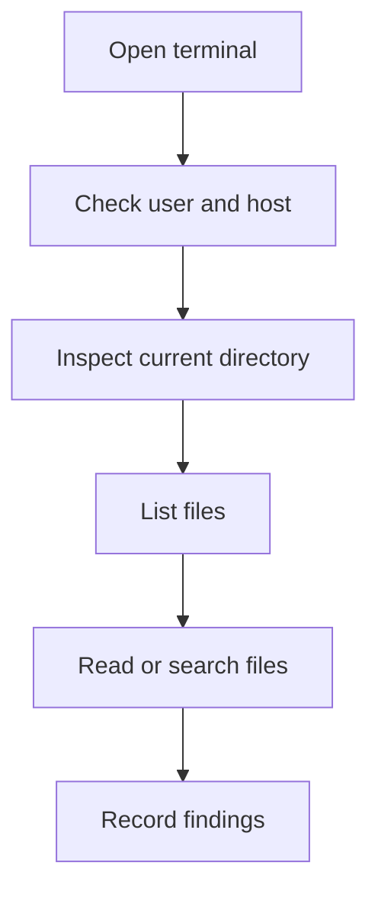

# Common Linux Commands

## Command structure
A common command has the form `command [options] [arguments]`. The command is the program, options adjust behavior, and arguments identify targets or inputs.

Example: `ls -l /etc` requests a detailed listing of `/etc`.

## Navigation and inspection

| Command | Purpose | Example |
|---|---|---|
| `pwd` | Show current directory | `pwd` |
| `ls -l` | Detailed listing | `ls -l /etc` |
| `ls -a` | Include hidden names | `ls -a` |
| `cd /path` | Change directory | `cd /var/log` |
| `cd ..` | Parent directory | `cd ..` |
| `whoami` | Effective username | `whoami` |
| `hostname` | Host name | `hostname` |
| `date` | System date/time | `date` |
| `uname -a` | Kernel/system details | `uname -a` |
| `df -h` | Filesystem usage | `df -h` |
| `ps` | Process listing | `ps` |
| `top` | Interactive process view | `top` |

## Reading and searching

| Command | Purpose |
|---|---|
| `cat file.txt` | Print file content |
| `less file.txt` | Browse file page by page |
| `head file.txt` | Show first lines |
| `tail file.txt` | Show last lines |
| `wc -l file.txt` | Count lines |
| `wc -w file.txt` | Count words |
| `grep 'BSIT' students.txt` | Search matching lines |
| `find /home -name '*.txt'` | Search for names under a path |

Some commands may be unavailable or have different options on a given system. Use `man command` or the command's supported help option.

## Redirection
```bash
echo "Server status" > server.txt
echo "Second line" >> server.txt
cat server.txt
```
`>` creates or replaces a file; `>>` appends. **Warning:** `>` overwrites existing content.

## File operations
```bash
cp source.txt backup.txt
mv oldname.txt newname.txt
mkdir reports
rmdir empty-folder
rm unwanted.txt
```
`cp` copies, `mv` moves or renames, `mkdir` creates a directory, `rmdir` removes an empty directory, and `rm` deletes files. Deletion may not be reversible.

## Inspection workflow


## Safety checklist
Before running a command, ask whether it changes anything, what target it affects, whether you are authorized, and whether a backup is needed.

## Summary
Learn navigation and inspection first, then file reading, searching, redirection, and file operations. Understand each command before running it.

## Related notes
- [File Management](03-File-Management.md)
- [File Permissions](04-File-Permissions.md)
- [Linux Commands Cheatsheet](../cheatsheets/Linux-Commands-Cheatsheet.md)
