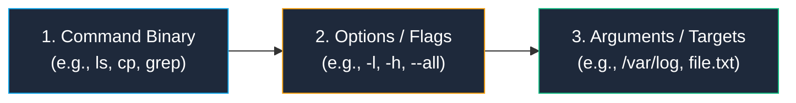
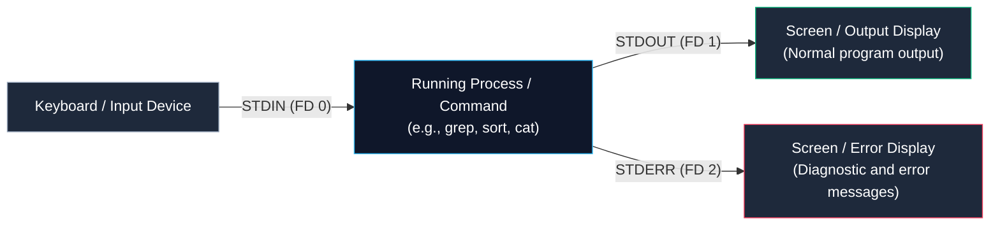
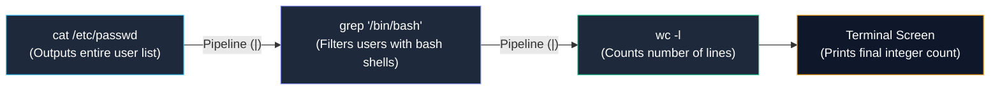

# Essential Linux Command-Line Operations

> **Module:** System and Network Administrator (SNA) Foundations  
> **Topic:** Linux CLI Syntax, Navigation, File Operations, and Stream Redirection  
> **Target Audience:** BSIT Students, System Administration Beginners, and Technical Learners  
> **Related Reference:** [03-File-Management.md](03-File-Management.md) | [04-File-Permissions.md](04-File-Permissions.md) | [Linux Commands Cheatsheet](../cheatsheets/Linux-Commands-Cheatsheet.md)

---

## 🎯 Learning Objectives

By the end of this chapter, you will be able to:

- Deconstruct the universal anatomy of a Linux command: **Command Name**, **Options/Flags**, and **Arguments**.
- Navigate the Linux hierarchical directory tree with speed and confidence using **absolute** and **relative** paths.
- Master file inspection, pagination, and log monitoring commands (`cat`, `less`, `head`, `tail -f`).
- Utilize **standard input (STDIN)**, **standard output (STDOUT)**, **standard error (STDERR)**, redirection operators (`>`, `>>`, `2>`), and pipelines (`|`).
- Search files and filter text streams with precision using `find`, `grep`, and `wc`.
- Perform file and directory manipulation safely (`cp`, `mv`, `mkdir -p`, `rm`), avoiding accidental data destruction.
- Evaluate command exit status codes (`$?`) to verify whether an administrative operation succeeded.

---

## 1. Anatomy of a Linux Command

To an untrained observer, entering commands into a black terminal window looks intimidating. However, every command in Linux follows a strict, logical, universal grammatical structure:

```text
command   [options]   [arguments]
  │           │           │
What to do   How to do it  What to do it to
```



### 1.1 The Three Components
1. **The Command (Executable Binary or Built-in):** The name of the program you wish to execute. Examples include `ls` (list files), `cp` (copy), `mkdir` (make directory), or `rm` (remove). The shell searches through the directories listed in your `$PATH` environment variable to find the binary.
2. **Options (Flags or Switches):** Modifiers that change the default behavior of the command.
   - **Short Options:** Start with a single dash `-` and a single letter (e.g., `ls -l` for long listing, `ls -a` for all files). Short options can almost always be combined into a single group: `ls -la` or `ls -lah`.
   - **Long Options:** Start with two dashes `--` and a full descriptive word (e.g., `ls --all`, `uname --all`, `cp --recursive`).
3. **Arguments:** The target upon which the command acts. This is usually a filename, a directory path, a username, or a network IP address (e.g., in `cat /etc/resolv.conf`, the path `/etc/resolv.conf` is the argument).

### 1.2 Command Exit Status (`$?`)
In Linux, every program that finishes running returns an invisible numerical **exit code** (or return code) to the shell:
- An exit code of **`0`** strictly means **SUCCESS** (no errors occurred).
- Any non-zero exit code (such as `1`, `2`, or `127`) indicates an **ERROR** or failure.

Administrators verify the exit status of the immediately preceding command using:
```bash
echo $?
```
This is the foundational logic used by system administrators when writing automated bash shell scripts.

---

## 2. Standard Streams, Redirection, and Pipelines

Understanding input and output streams is what separates an ordinary computer user from a skilled system administrator.

Whenever a program runs in Linux, the operating system kernel automatically opens **three standard data streams**:



1. **Standard Input (STDIN - File Descriptor 0):** The stream of data fed into the program (defaults to your keyboard).
2. **Standard Output (STDOUT - File Descriptor 1):** The normal output stream produced by the program when it runs successfully (defaults to your terminal screen).
3. **Standard Error (STDERR - File Descriptor 2):** The error stream produced when something goes wrong (defaults to your terminal screen).

### 2.1 Output Redirection (`>` and `>>`)
By default, STDOUT prints to your screen. Redirection allows you to divert that stream into a file on disk:

```bash
# Overwrite Redirection (>): Creates the file if it does not exist, or OVERWRITES existing contents
hostname > server_info.txt

# Append Redirection (>>): Creates the file if absent, or APPENDS data to the bottom
date >> server_info.txt
```

> 🚨 **Critical Safety Warning on `>`:** The single right-angle bracket `>` is destructive! If `server_info.txt` already contained 5,000 lines of critical configuration, running `echo "test" > server_info.txt` instantly erases the entire file and replaces it with that one word. Always use `>>` when you intend to preserve existing log or config data.

### 2.2 Redirecting Errors (`2>` and `2>&1`)
Because STDOUT and STDERR are independent streams, redirecting standard output with `>` does not hide error messages from the screen.
- **Redirecting Errors Only:**
  ```bash
  # Send error messages to an error log file while normal output prints to screen
  find / -name "*.conf" 2> errors.log
  ```
- **Discarding Errors to `/dev/null`:** In Linux, `/dev/null` is the "black hole" (bit bucket) of the filesystem. Any data written to it is instantly discarded:
  ```bash
  # Search the root filesystem without cluttering your screen with "Permission Denied" errors
  find / -name "*.conf" 2> /dev/null
  ```
- **Redirecting Both STDOUT and STDERR to the Same File:**
  ```bash
  # Modern syntax (BASH 4+)
  ./deploy_script.sh &> deployment.log

  # Traditional POSIX syntax (supported on all Unix/Linux versions)
  ./deploy_script.sh > deployment.log 2>&1
  ```

### 2.3 Pipelines (`|`): Chaining Small Tools Together
The **pipe operator (`|`)** connects the **STDOUT** of one command directly into the **STDIN** of the next command. This embodies the foundational Unix philosophy: *"Write programs that do one thing well, and write programs to work together."*



```bash
# Example: Count how many active interactive user accounts exist on the server
cat /etc/passwd | grep "/bin/bash" | wc -l
```

---

## 3. Detailed Command Reference and Deep Explanations

Below are the essential command-line tools categorized by administrative function. Each command is presented with complete technical context.

```
+----------------------------------------------------------------------------------------------------+
|                                      CORE COMMAND QUICK INDEX                                      |
+--------------------------+------------------------------------+------------------------------------+
| Category                 | Commands Included                  | Primary Operational Scope          |
+--------------------------+------------------------------------+------------------------------------+
| Directory Navigation     | pwd, cd, ls                        | Positioning and directory inspection|
| File Viewing & Reading   | cat, less, head, tail              | Reading, paginating, and live logs |
| Text Search & Analysis   | grep, find, wc                     | Searching strings, paths, counters |
| File & Folder Ops        | touch, mkdir, cp, mv, rm           | Creation, copying, moving, deletion|
| Process Inspection       | ps, top                            | Monitoring active tasks & CPU usage|
+--------------------------+------------------------------------+------------------------------------+
```

---

### 3.1 Directory Navigation: `pwd`, `cd`, and `ls`

#### `pwd` — Print Working Directory
- **Purpose:** Reveals your current absolute directory location in the filesystem tree.
- **Syntax:** `pwd`
- **How It Works:** Queries the current process's environment state maintained by the kernel.
- **Example:**
  ```bash
  pwd
  ```
- **Expected Output:**
  ```text
  /var/log/httpd
  ```

#### `cd` — Change Directory
- **Purpose:** Moves your active shell session into a different directory.
- **Syntax:** `cd [DIRECTORY_PATH]`
- **How It Works:** A shell built-in command that updates the active working directory pointer of your shell process.
- **Key Navigation Shortcuts:**
  - `cd /var/log` ──> Absolute path (starts with `/`). Navigates directly regardless of where you currently stand.
  - `cd httpd` ──> Relative path (does not start with `/`). Navigates to a folder inside the current directory.
  - `cd ..` ──> Navigates up one level into the parent directory.
  - `cd ../..` ──> Navigates up two parent levels.
  - `cd ~` (or simply `cd`) ──> Returns immediately to your personal user home directory (`/home/username` or `/root`).
  - `cd -` ──> Toggles back to the previous directory you were just working in (like the "previous channel" button on a TV remote).

#### `ls` — List Directory Contents
- **Purpose:** Displays the names, permissions, owners, and sizes of files and subdirectories.
- **Syntax:** `ls [OPTIONS]... [FILE/DIRECTORY]...`
- **Important Options:**
  - `-l`: Long listing format. Displays permissions, hard link count, owner, group, size, and modification timestamp.
  - `-a`: All files. Displays hidden files (any file whose name begins with a dot `.`, such as `.bashrc`).
  - `-h`: Human-readable sizes (formats bytes into KB, MB, GB when paired with `-l`).
  - `-t`: Sorts output by modification time (newest files first).
  - `-R`: Recursive listing (lists all subdirectories and their contents).
- **Example Execution:**
  ```bash
  ls -lah /var/log
  ```
- **Expected Output:**
  ```text
  total 1.2M
  drwxr-xr-x.  8 root root 4.0K Oct 24 10:12 .
  drwxr-xr-x. 21 root root 4.0K May 15 08:30 ..
  -rw-r--r--.  1 root root  45K Oct 24 09:30 boot.log
  drwxr-xr-x.  2 root root 4.0K Oct 20 14:00 httpd
  -rw-------.  1 root root 850K Oct 24 10:14 messages
  -rw-------.  1 root root 220K Oct 24 10:15 secure
  ```
- **Interpreting the Output:**
  - `drwxr-xr-x`: File type (`d` = directory, `-` = regular file) and UGO permission bits.
  - `1`: Number of hard links.
  - `root root`: File user owner (`root`) and group owner (`root`).
  - `850K`: File size formatted in human-readable kilobytes.
  - `Oct 24 10:14`: Timestamp of last modification.
  - `messages`: Name of the file.
- **Common Mistakes:** Running plain `ls` without `-a` and failing to locate critical user environment files like `.bash_profile` or `.ssh/`.

---

### 3.2 File Reading and Inspection: `cat`, `less`, `head`, and `tail`

#### `cat` — Concatenate and Print Files
- **Purpose:** Dumps the entire contents of one or more text files to STDOUT.
- **Syntax:** `cat [OPTION]... [FILE]...`
- **Important Options:**
  - `-n`: Number all output lines.
  - `-b`: Number non-blank lines only.
- **Example:**
  ```bash
  cat -n /etc/hosts
  ```
- **Expected Output:**
  ```text
  1  127.0.0.1   localhost localhost.localdomain
  2  ::1         localhost localhost.localdomain
  3  192.168.1.5 server01.lab.local server01
  ```
- **Practical Use Case:** Quickly inspecting small configuration files (such as `/etc/resolv.conf`, `/etc/hostname`).
- **Common Mistakes:** Using `cat` to open a 100,000-line server log file! The terminal will scroll violently for minutes, locking your screen. For large files, always use `less`.

#### `less` — Interactive Terminal Pager
- **Purpose:** Opens text files in an interactive, scrollable viewing window without loading the entire file into memory at once.
- **Syntax:** `less [FILE]`
- **How It Works:** Memory-efficient pager. Allows navigating forward and backward through gigabyte-sized files smoothly.
- **Key In-Viewer Keybindings:**
  - `Spacebar` / `f`: Scroll down one full page.
  - `b`: Scroll up one full page.
  - `Enter` / `j`: Scroll down one line.
  - `k`: Scroll up one line.
  - `/pattern`: Search forward for a specific string (e.g., `/error`). Press `n` for next match, `N` for previous.
  - `G`: Jump immediately to the very end of the file.
  - `1G` (or `g`): Jump to the very top of the file.
  - `q`: Quit and return to the terminal shell prompt.

#### `head` and `tail` — Reading File Extremities
- **Purpose:**
  - `head`: Displays the first 10 lines of a file by default.
  - `tail`: Displays the last 10 lines of a file by default.
- **Syntax:**
  ```bash
  head -n [NUMBER] [FILE]
  tail -n [NUMBER] [FILE]
  tail -f [FILE]
  ```
- **The Crucial `-f` (Follow) Flag on `tail`:**
  - Running `tail -f /var/log/secure` keeps the file open and **streams new log lines onto your screen in real time** as they are written by the operating system!
- **Practical Admin Use Case:** An administrator opens a terminal, runs `tail -f /var/log/httpd/access_log`, and then refreshes a web browser. If the page throws an error, the error details appear on the screen the exact millisecond the request fails. Press `Ctrl + C` to stop following.

---

### 3.3 Text Searching and Path Filtering: `grep`, `find`, and `wc`

#### `grep` — Global Regular Expression Print
- **Purpose:** Searches through files or input streams and extracts only lines that match a specified pattern.
- **Syntax:** `grep [OPTIONS] "PATTERN" [FILE]...`
- **Essential Options:**
  - `-i`: Case-insensitive search (matches `error`, `Error`, and `ERROR`).
  - `-v`: Invert match (prints lines that do **NOT** match the pattern).
  - `-n`: Prints line numbers alongside matching lines.
  - `-c`: Prints only the count of matching lines.
  - `-E`: Extended regular expressions (enables advanced regex tokens like `|`, `+`).
- **Example 1: Searching a Log File for Authentication Failures:**
  ```bash
  grep -i "failed password" /var/log/secure
  ```
- **Example 2: Stripping Comments and Blank Lines from Configuration Files:**
  ```bash
  # Filter out all comment lines (#) and blank lines (^) to view a clean config
  grep -v "^#" /etc/httpd/conf/httpd.conf | grep -v "^$"
  ```
- **Common Mistakes:** Forgetting quotes around the pattern. If your pattern contains spaces or symbols (e.g., `grep failed password file.log`), the shell interprets `password` as a filename instead of part of the search query! Always quote your search strings: `grep "failed password" file.log`.

#### `find` — Locating Files in the Directory Hierarchy
- **Purpose:** Recursively traverses directories to locate files matching specific criteria (name, size, modification time, permissions).
- **Syntax:** `find [STARTING_DIRECTORY] [CRITERIA] [ACTION]`
- **Key Search Criteria:**
  - `-name "pattern"`: Search by filename (case-sensitive).
  - `-iname "pattern"`: Search by filename (case-insensitive).
  - `-type f`: Restrict search to regular files.
  - `-type d`: Restrict search to directories.
  - `-size +100M`: Find files larger than 100 megabytes.
  - `-mtime -7`: Find files modified within the last 7 days.
- **Example Execution:**
  ```bash
  # Find all configuration (.conf) files under /etc
  find /etc -name "*.conf"
  ```
- **Practical Use Case:** When a server's disk hits 98% capacity, the administrator runs:
  ```bash
  find /var -type f -size +500M
  ```
  This immediately locates runaway log files or massive forgotten database backups consuming disk space.
- **Related Command:** `locate` (relies on a pre-built database index updated via `updatedb`).

#### `wc` — Word, Line, and Byte Count
- **Purpose:** Counts lines, words, and characters in a file or pipeline stream.
- **Syntax:** `wc [OPTION] [FILE]`
  - `-l`: Count lines.
  - `-w`: Count words.
  - `-c`: Count bytes/characters.
- **Example:**
  ```bash
  wc -l /etc/passwd
  ```
- **Expected Output:**
  ```text
  38 /etc/passwd
  ```
  *(Meaning: There are exactly 38 user accounts registered in `/etc/passwd`)*.

---

### 3.4 File and Directory Manipulation: `touch`, `mkdir`, `cp`, `mv`, and `rm`

#### `touch` — Create Blank File or Update Timestamps
- **Purpose:** Creates an empty file if the specified target does not exist; if the file already exists, updates its access and modification timestamps to the current second without modifying content.
- **Syntax:** `touch [FILENAME]`
- **Example:**
  ```bash
  touch /tmp/health_check.lock
  ```

#### `mkdir` — Make Directories
- **Purpose:** Creates one or more new directories.
- **Syntax:** `mkdir [OPTION] [DIRECTORY_NAME]`
- **The Essential `-p` (Parents) Flag:**
  - If you run `mkdir /opt/finance/reports/2026` and the folders `finance` and `reports` do not exist yet, standard `mkdir` fails with `No such file or directory`.
  - Adding `-p` creates all missing parent directories automatically:
  ```bash
  mkdir -p /opt/finance/reports/2026
  ```

#### `cp` — Copy Files and Directories
- **Purpose:** Duplicates files or directories from a source location to a destination.
- **Syntax:** `cp [OPTIONS] [SOURCE] [DESTINATION]`
- **Key Options:**
  - `-r` (or `-R`): Recursive. **Mandatory** when copying directories containing files.
  - `-p`: Preserves file attributes (original ownership, timestamps, and permissions).
  - `-i`: Interactive prompt before overwriting an existing destination file.
- **Example 1: Safe Backup of a Critical Config File:**
  ```bash
  # Always make a backup before editing configuration files!
  cp -p /etc/ssh/sshd_config /etc/ssh/sshd_config.bak
  ```
- **Example 2: Copying an Entire Directory Structure:**
  ```bash
  cp -r /var/www/html /var/www/html_backup
  ```

#### `mv` — Move or Rename Files and Directories
- **Purpose:** Relocates a file or directory from one path to another, or renames it if the source and destination are in the same folder.
- **Syntax:** `mv [OPTIONS] [SOURCE] [DESTINATION]`
- **How It Works:** On the same filesystem partition, `mv` does not copy data bytes across disk sectors; it simply updates the directory pointer table (inode reference). It is an instantaneous operation regardless of file size.
- **Example 1: Renaming a File:**
  ```bash
  mv report_draft.txt report_final.txt
  ```
- **Example 2: Moving a File to a Different Directory:**
  ```bash
  mv report_final.txt /opt/finance/reports/
  ```

#### `rm` — Remove (Delete) Files and Directories
- **Purpose:** Deletes files and directory trees from the filesystem.
- **Syntax:** `rm [OPTIONS] [TARGET]...`
- **Key Options:**
  - `-r` (or `-R`): Recursive. Recursively removes directories and their entire contents.
  - `-f`: Force. Ignores nonexistent files and never prompts for confirmation.
  - `-i`: Interactive. Prompts before deleting each individual file (`y/n`).

> 🚨 **Critical Enterprise Danger: `rm -rf`**  
> In Linux, there is **NO Recycle Bin or Trash Can** on the command line. When a file is removed with `rm`, its inode pointer is unlinked, and its disk blocks are returned to the free pool immediately. Recovery requires specialized forensic file carving tools and is rarely 100% successful.  
> **Never execute:** `rm -rf /` or `rm -rf /*`  
> A classic administrative accident occurs with a misplaced space:  
> Intended: `rm -rf /tmp/app_cache/*`  
> Accidental typo: `rm -rf / tmp/app_cache/*`  
> Notice the space after `/`! The shell interprets `/` as the first argument, immediately deleting the entire operating system root directory!

---

### 3.5 Process Inspection: `ps` and `top`

#### `ps` — Snapshot of Current Running Processes
- **Purpose:** Captures a static snapshot of processes currently running in memory.
- **Syntax Styles:**
  ```bash
  # Standard BSD Syntax (Most common in enterprise Linux)
  ps aux

  # Standard System V (POSIX) Syntax
  ps -ef
  ```
- **Understanding `ps aux` Options:**
  - `a`: Displays processes of all users (not just your own shell).
  - `u`: Displays user-oriented format (shows username, CPU%, MEM%).
  - `x`: Includes processes not attached to a controlling terminal (background daemons).
- **Filtering `ps` with `grep`:**
  ```bash
  # Find the Process ID (PID) of the SSH daemon
  ps aux | grep sshd
  ```

#### `top` — Real-Time Dynamic Process Monitor
- **Purpose:** Provides a live, interactive display of processor activity, memory usage, running tasks, and load averages updated every 3 seconds.
- **Syntax:** `top`
- **Key Interactive Commands Inside `top`:**
  - `M`: Sort process list by memory usage (highest RAM consumers at top).
  - `P`: Sort process list by CPU percentage (highest CPU consumers at top).
  - `k`: Kill a runaway process (prompts for the target PID).
  - `q`: Quit `top` and return to the command line.
- **Modern Alternative:** `htop` (interactive, colorful process viewer with mouse support).

---

## 4. Important Points to Remember

- **Command Grammar:** Every command follows `command [options] [arguments]`. Options modify behavior; arguments define targets.
- **Exit Status Guarantee:** `echo $?` prints the return code of the last command (`0` = absolute success, non-zero = failure).
- **Redirection Rules:** `>` creates or completely **overwrites** a file; `>>` **appends** to the end.
- **Stream Independence:** STDOUT (`1`) and STDERR (`2`) are separate. Use `2> errors.log` to isolate errors, or `2> /dev/null` to silence permission warnings.
- **Pipes Connect:** The pipe `|` sends the standard output of one command directly into the standard input of the next.
- **Log Monitoring:** `tail -f /var/log/messages` streams system log entries live as they occur.
- **Search Distinctives:** Use `find` to locate filenames on the storage drive; use `grep` to search for text patterns inside files.
- **No Command-Line Trash:** File deletion via `rm` is permanent and instantaneous. Always double-check target paths before using `rm -rf`.

---

## 5. Key Terms Glossary

| Term | Technical Definition |
|---|---|
| **Absolute Path** | A complete filesystem path starting from the root directory `/` (e.g., `/etc/httpd/conf/httpd.conf`). Resolves identically from any location. |
| **BASH** | Bourne-Again SHell; the default interactive command-line interpreter used on Red Hat Enterprise Linux and most Linux distributions. |
| **Exit Code** | An integer (0 to 255) returned by a process upon termination. Code 0 denotes success; codes 1–255 denote specific operational error conditions. |
| **File Descriptor (FD)** | An integer handle used by the Linux kernel to track open data streams for a process (0 = STDIN, 1 = STDOUT, 2 = STDERR). |
| **Pipeline (`\|`)** | An inter-process communication mechanism that channels the standard output of one program into the standard input of another. |
| **Relative Path** | A filesystem path interpreted relative to the current working directory (e.g., `conf/httpd.conf` or `../notes.txt`). |
| **Standard Error (STDERR)** | The default stream (File Descriptor 2) reserved for outputting diagnostic notices, warnings, and error messages. |
| **Standard Input (STDIN)** | The default stream (File Descriptor 0) through which a process receives input data from the keyboard or an upstream pipe. |
| **Standard Output (STDOUT)** | The default stream (File Descriptor 1) through which a process emits its normal operational output data. |
| **Wildcard (Glob)** | Shell characters (`*`, `?`, `[...]`) evaluated by the shell to match patterns of filenames on disk before passing arguments to a command. |

---

## 6. Practice Questions

Test your mastery of foundational Linux command-line operations. Attempt each question independently before consulting the answer key below.

### Question 1 (Command Syntax & Exit Codes)
An administrator runs the following command sequence:
```bash
ls /nonexistent_folder
echo $?
```
What will the second command output?
- [A] `0`
- [B] `/nonexistent_folder`
- [C] A non-zero integer (such as `2`) indicating that the command failed
- [D] `null`

### Question 2 (Redirection Hazards)
A junior technician wants to add a new server IP (`192.168.1.50 web02`) to the end of `/etc/hosts`, which currently contains 20 important corporate domain mappings. The technician runs:
```bash
echo "192.168.1.50 web02" > /etc/hosts
```
What catastrophic error did the technician just commit, and what is the correct syntax?

### Question 3 (Text Processing Pipelines)
Write a single piped command line that:
1. Displays the contents of `/etc/passwd`.
2. Filters out all users who do not have `/sbin/nologin` as their shell.
3. Sorts the output alphabetically.
4. Saves the final result to `/tmp/service_accounts.txt`.

### Question 4 (Command Interpretation)
Examine this command:
```bash
grep -v "^#" /etc/ssh/sshd_config | grep -v "^$" | wc -l
```
Explain precisely what this pipeline calculates and what each stage accomplishes.

### Question 5 (Live Log Troubleshooting)
A system administrator is troubleshooting an SSH service failure. The administrator wants to watch authentication attempts appear in real time while attempting a login from another machine. What exact command should the administrator run?
- [A] `cat /var/log/secure`
- [B] `less /var/log/secure`
- [C] `tail -f /var/log/secure`
- [D] `head -n 50 /var/log/secure`

### Question 6 (File Operations & Safety)
An administrator needs to create a new folder path `/backup/mysql/daily/logs`. Currently, neither `mysql`, `daily`, nor `logs` exists under `/backup`.
Which command creates the entire directory chain without generating an error?
- [A] `mkdir /backup/mysql/daily/logs`
- [B] `mkdir -r /backup/mysql/daily/logs`
- [C] `mkdir -p /backup/mysql/daily/logs`
- [D] `touch -d /backup/mysql/daily/logs`

### Question 7 (Search & Disk Space Triage)
The `/var` partition on an enterprise email server is 99% full. Write the exact `find` command an administrator would use to locate all regular files under `/var` that are larger than 200 Megabytes, while suppressing all "Permission Denied" errors from cluttering the terminal.

---

## 7. Answer Key & Explanations

### Answer to Question 1:
**Correct Option:** **[C]**  
*Explanation:* Because `/nonexistent_folder` does not exist, `ls` fails and returns a non-zero exit status (typically `2` for file/directory not found). `echo $?` prints this return code. An exit code of `0` is reserved exclusively for commands that complete with zero errors.

### Answer to Question 2:
**Correct Answer:**  
The technician used the single overwrite redirection operator (`>`). This **completely erased and truncated** all 20 existing host mappings in `/etc/hosts` and replaced the entire file with that single line!  
The correct syntax to append data to an existing file without deleting its contents is the double angle bracket (`>>`):
```bash
echo "192.168.1.50 web02" >> /etc/hosts
```

### Answer to Question 3:
**Correct Answer:**
```bash
grep "/sbin/nologin" /etc/passwd | sort > /tmp/service_accounts.txt
```
*(Note: `cat /etc/passwd | grep "/sbin/nologin" | sort > /tmp/service_accounts.txt` is also functionally correct).*

### Answer to Question 4:
**Correct Answer:**  
This pipeline calculates the total number of **active, non-default configuration directives** in `/etc/ssh/sshd_config`:
1. `grep -v "^#"`: Inverts the match (`-v`) to strip away all lines starting with a comment symbol (`#`).
2. `grep -v "^$"`: Inverts the match to strip away all empty blank lines.
3. `wc -l`: Counts the remaining lines, delivering the exact count of functional configuration lines.

### Answer to Question 5:
**Correct Option:** **[C]**  
*Explanation:* `tail -f` (follow) monitors a file dynamically. As new authentication attempts are recorded by the system logger, new lines scroll across the terminal screen in real time.

### Answer to Question 6:
**Correct Option:** **[C]**  
*Explanation:* The `-p` (parents) option tells `mkdir` to create any necessary intermediate parent directories without error if they do not already exist.

### Answer to Question 7:
**Correct Answer:**
```bash
find /var -type f -size +200M 2> /dev/null
```
- `/var`: Starting search directory.
- `-type f`: Restricts search to regular files (ignoring directories, sockets, and block devices).
- `-size +200M`: Filters for files strictly greater than 200 Megabytes.
- `2> /dev/null`: Redirects Standard Error (stream 2) to the bit bucket, discarding all permission warnings so only matching files print to the screen.

---

## 🔗 Related Notes & Next Steps

- **Next Chapter:** Deepen your knowledge of the Linux filesystem tree, absolute/relative paths, and hard/symbolic links in [03-File-Management.md](03-File-Management.md).
- **Access Controls:** Master read, write, execute permissions and numeric octal chmod calculations in [04-File-Permissions.md](04-File-Permissions.md).
- **Quick Reference:** Consult [../cheatsheets/Linux-Commands-Cheatsheet.md](../cheatsheets/Linux-Commands-Cheatsheet.md).
