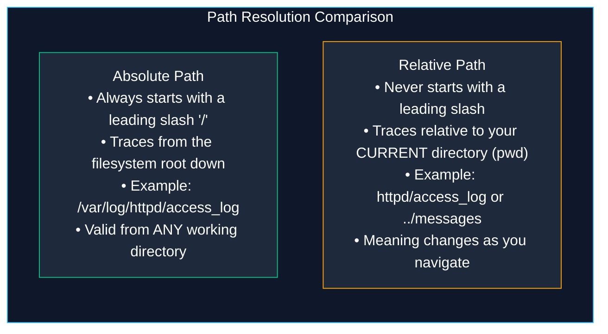
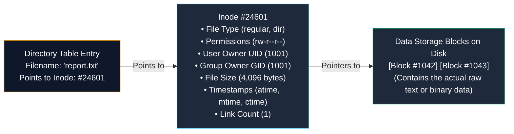
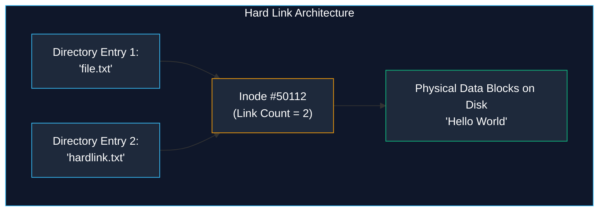

# Linux File Management and the Filesystem Hierarchy Standard

> **Module:** System and Network Administrator (SNA) Foundations  
> **Topic:** Filesystem Hierarchy Standard (FHS), Path Resolution, Inodes, and Links  
> **Target Audience:** BSIT Students, Junior Linux Administrators, and Infrastructure Engineers  
> **Related Reference:** [02-Common-Linux-Commands.md](02-Common-Linux-Commands.md) | [04-File-Permissions.md](04-File-Permissions.md) | [Linux File Management Cheatsheet](../cheatsheets/Linux-File-Management-Cheatsheet.md)

---

## 🎯 Learning Objectives

By the end of this chapter, you will be able to:

- Navigate the **Filesystem Hierarchy Standard (FHS)** and articulate the exact operational purpose of every major root directory (`/etc`, `/var`, `/dev`, `/proc`, `/sys`).
- Construct and resolve **absolute** and **relative** filesystem paths without ambiguity.
- Explain the internal mechanics of a Linux **Inode** and how files are stored, referenced, and deleted on disk.
- Differentiate between **Hard Links** and **Symbolic (Soft) Links**, identifying their architectural limitations and use cases.
- Create, inspect, and extract enterprise archive files using `tar` combined with `gzip` compression.
- Apply safe administrative habits to prevent accidental directory overwrites and data corruption.

---

## 1. The Filesystem Hierarchy Standard (FHS)

If you are accustomed to the Microsoft Windows operating system, you are familiar with drive letters: `C:\`, `D:\`, `E:\`. Each physical hard drive or partition is assigned its own distinct letter, and files live under isolated trees.

Linux does not use drive letters. Instead, Linux organizes every file, folder, physical storage disk, USB flash drive, network share, and even hardware device into a **single, unified inverted tree structure** starting at a single root point designated by a forward slash: **`/`** (pronounced *"root"*).

```mermaid
flowchart TD
    ROOT["/ (The Filesystem Root)"]
    
    ROOT --> BIN["/bin -> /usr/bin<br/>(Essential user binaries)"]
    ROOT --> BOOT["/boot<br/>(Kernel, GRUB2, initramfs)"]
    ROOT --> DEV["/dev<br/>(Device nodes: sda, nvme, null)"]
    ROOT --> ETC["/etc<br/>(Host configuration files)"]
    ROOT --> HOME["/home<br/>(Standard user home folders)"]
    ROOT --> ROOT_DIR["/root<br/>(Superuser home folder)"]
    ROOT --> PROC["/proc<br/>(Virtual RAM kernel process metrics)"]
    ROOT --> SYS["/sys<br/>(Virtual RAM hardware device state)"]
    ROOT --> VAR["/var<br/>(Variable data: logs, spools, databases)"]
    ROOT --> USR["/usr<br/>(Installed software & libraries)"]
    ROOT --> OPT["/opt<br/>(Third-party enterprise applications)"]
    ROOT --> TMP["/tmp<br/>(Temporary files)"]

    style ROOT fill:#0f172a,stroke:#38bdf8,color:#fff
    style BIN fill:#1e293b,stroke:#94a3b8,color:#fff
    style BOOT fill:#1e293b,stroke:#f59e0b,color:#fff
    style DEV fill:#1e293b,stroke:#818cf8,color:#fff
    style ETC fill:#1e293b,stroke:#f43f5e,color:#fff
    style HOME fill:#1e293b,stroke:#10b981,color:#fff
    style ROOT_DIR fill:#1e293b,stroke:#f43f5e,color:#fff
    style PROC fill:#1e293b,stroke:#38bdf8,color:#fff
    style SYS fill:#1e293b,stroke:#38bdf8,color:#fff
    style VAR fill:#1e293b,stroke:#f59e0b,color:#fff
    style USR fill:#1e293b,stroke:#10b981,color:#fff
    style OPT fill:#1e293b,stroke:#818cf8,color:#fff
    style TMP fill:#1e293b,stroke:#94a3b8,color:#fff
```



To maintain predictability across different distributions, the Linux Foundation maintains the **Filesystem Hierarchy Standard (FHS)**. This specification defines where specific types of files must reside.

### 1.1 Complete Directory Breakdown

| Directory Path | Purpose and Operational Content | Enterprise Significance |
|---|---|---|
| **`/`** | **The Root Directory**: The foundational base of the entire filesystem tree. Every single file and mounted disk partition descends from `/`. | If the partition containing `/` becomes corrupted or 100% full, the entire operating system may fail to boot. |
| **`/boot`** | Contains everything needed to boot the Linux operating system: the compiled Linux kernel binary (`vmlinuz`), the initial RAM filesystem (`initramfs`), and the **GRUB2** bootloader files. | Must be located on a partition readable by the BIOS/UEFI firmware before storage drivers are loaded. |
| **`/etc`** | Stores **host-specific system configuration files** (the name historically stood for *"editable text configuration"*). Contains user tables (`/etc/passwd`), network configurations, firewall rules, and daemon settings. | **Never contains binary executables**. This is the most critical directory for backups. If `/etc` is backed up, an administrator can reconstruct the server. |
| **`/dev`** | Contains **device nodes** representing hardware devices managed by the kernel (disks, terminals, sound cards, random number generators). | Not stored on disk; populated dynamically in memory by `udev`. Files like `/dev/sda` represent hard drives; `/dev/null` acts as the data black hole. |
| **`/home`** | The default parent directory containing personal workspaces for standard, unprivileged users (e.g., `/home/student`, `/home/alice`). | Frequently mounted on a separate disk partition or network share (NFS) so user files survive OS reinstallations. |
| **`/root`** | The personal home directory of the **superuser `root`**. | Located under `/root` instead of `/home/root` so the superuser can still log in and repair the system even if `/home` fails to mount! |
| **`/var`** | Variable data: files that constantly change in size while the system is running. Includes system log files (`/var/log`), print spools, mailboxes (`/var/spool/mail`), databases (`/var/lib/mysql`), and web files (`/var/www`). | In enterprise servers, `/var` is always isolated on its own disk partition or Logical Volume so runaway logs do not crash the root `/` filesystem. |
| **`/usr`** | User System Resources: Contains shareable, read-only system software, user-level command binaries (`/usr/bin`, `/usr/sbin`), libraries (`/usr/lib`), documentation (`/usr/share/doc`), and man pages. | On modern Linux systems (RHEL 7/8/9), `/bin` and `/sbin` are symbolic links pointing directly to `/usr/bin` and `/usr/sbin`. |
| **`/proc`** | **Virtual in-memory filesystem** exposing running process information and kernel parameters. | Consumes 0 bytes of disk space; generated dynamically by the kernel. For example, `/proc/cpuinfo` reports CPU models; `/proc/meminfo` reports memory metrics. |
| **`/sys`** | **Virtual in-memory filesystem** exposing the kernel's hardware device model and kernel module tunable parameters. | Used by modern system daemons (`systemd`, `udev`) to inspect and configure hardware devices. |
| **`/opt`** | Optional third-party application software packages (e.g., Google Chrome, commercial database engines, custom enterprise software suites). | Software installed under `/opt` keeps all its libraries, binaries, and configurations self-contained in a single subfolder (e.g., `/opt/customapp`). |
| **`/tmp`** | Temporary scratch space accessible to all users and applications. | On modern distributions, `/tmp` is mounted as a RAM disk (`tmpfs`) and is automatically purged upon system reboot. |
| **`/media` & `/mnt`** | Mount points for external or temporary filesystems. `/media` is used for auto-mounted removable devices (CD-ROMs, USB sticks); `/mnt` is used by administrators for manual temporary mounts. | Standard staging location when attaching a backup drive or secondary disk for recovery. |

---

## 2. Path Resolution: Absolute vs. Relative Paths

Every file in Linux is accessed using a path. Understanding the difference between **absolute** and **relative** paths is the most fundamental operational skill in command-line navigation.



### 2.1 Absolute Paths
An **absolute path** specifies the unambiguous, complete location of a file starting from the top of the hierarchy: the root directory `/`.
- **Identifying Characteristic:** It **always** begins with a leading forward slash `/`.
- **Examples:**
  - `/etc/ssh/sshd_config`
  - `/var/log/messages`
  - `/home/student/projects/lab1.py`
- **Rule:** An absolute path points to the exact same file regardless of where you currently stand in the filesystem.

### 2.2 Relative Paths
A **relative path** specifies the location of a file relative to your **current working directory** (the directory reported by `pwd`).
- **Identifying Characteristic:** It **never** begins with a leading forward slash.
- **Special Relative Path Symbols:**
  - `.` (Single Dot): Represents the current working directory.
  - `..` (Double Dot): Represents the immediate parent directory (one level up).
  - `~` (Tilde): Expands to your personal user home directory (e.g., `/home/student`).
- **Examples:**
  - If your `pwd` is `/var/log`:
    - The relative path `httpd/access_log` resolves to `/var/log/httpd/access_log`.
    - The relative path `../etc/hosts` navigates up to `/var`'s parent (`/`), then into `/etc/hosts`.

---

## 3. Inodes and the Architecture of Linux Files

In Windows (FAT32/NTFS), a file's name and its file properties are stored together in a directory entry. In Linux, files are architected completely differently.

To understand files, you must understand the **Inode (Index Node)**.

### 3.1 What is an Inode?
An **Inode** is a fixed-size data structure on a storage drive that stores **all metadata** about a file **except** its filename and its actual content data:



**What an Inode Contains:**
- Numerical Inode Number (e.g., `#24601`).
- File type (regular file, directory, socket, pipe, symlink).
- Permissions (UGO read, write, execute bits).
- User Owner (UID) and Group Owner (GID).
- File size in bytes.
- Timestamps: Access time (`atime`), Modification time (`mtime`), and Inode Change time (`ctime`).
- Hard link counter.
- **Pointers to physical disk data blocks** where the actual file content is written.

**What an Inode Does NOT Contain:**
1. The **Filename**!
2. The actual **Data Content**!

### 3.2 What is a Directory in Linux?
In Linux, **a directory is simply a specialized file containing a lookup table**. That table contains only two pieces of information per line:
```text
[ Filename ] ───> [ Inode Number ]
"report.txt"      24601
"data.csv"        88412
```
When you run `cat report.txt`, the kernel looks inside the current directory's table, finds the entry `"report.txt"`, reads the associated Inode number `#24601`, inspects `#24601` to check if your user has read permissions, and follows the data block pointers to read the bytes off the physical disk sectors!

You can inspect the inode number of any file using `ls -i` or `stat`:
```bash
ls -li report.txt
```
```text
24601 -rw-r--r--. 1 student student 4096 Oct 24 10:15 report.txt
```
*(Notice the leading number `24601`—that is the physical inode number on the filesystem)*.

---

## 4. Hard Links vs. Soft (Symbolic) Links

Because filenames are merely labels pointing to inode numbers, Linux allows multiple filenames to point to the exact same file. These are called **links**.

```
+----------------------------------------------------------------------------------------------------+
|                                    HARD LINK VS. SOFT LINK COMPARISON                              |
+--------------------------+------------------------------------+------------------------------------+
| Feature                  | Hard Link                          | Soft / Symbolic Link (Symlink)     |
+--------------------------+------------------------------------+------------------------------------+
| Command Syntax           | ln target link_name                | ln -s target link_name             |
| Inode Number             | Identical to target inode          | Completely new, independent inode  |
| Spanning Partitions      | CANNOT cross disk partitions       | CAN cross different disk partitions|
| Linking Directories      | CANNOT link directories (safety)   | CAN link directories               |
| If Original is Deleted   | File remains accessible (link >= 1)| Link BREAKS (becomes dangling link)|
| File Size                | Same as target file                | Size equal to length of path string|
+--------------------------+------------------------------------+------------------------------------+
```

### 4.1 Hard Links: Multiple Names for the Same File
A **hard link** is an additional directory entry that points directly to an existing inode number:



- **Creating a Hard Link:**
  ```bash
  ln original.txt my_hardlink.txt
  ```
- **How It Works:** `ln` creates a new directory entry pointing to the exact same inode. The inode's **link count** increments from `1` to `2`.
- **Modifications:** If you edit `original.txt`, `my_hardlink.txt` reflects the change instantly because they share the exact same storage blocks!
- **Deletion Behavior:** If you delete `original.txt` using `rm`, the file data is **NOT** erased! The kernel simply decrements the inode link count from `2` to `1`. The data remains completely intact and accessible via `my_hardlink.txt`. A file is only deleted from disk when its link count reaches `0` and no running processes have it open.
- **Architectural Limitations:**
  1. A hard link **cannot cross filesystem partitions** (because inode numbers are only unique within a single partition; `/dev/sda1` has its own Inode #100, and `/dev/sda2` has its own completely different Inode #100).
  2. Standard users and administrators **cannot hard-link directories** (to prevent infinite recursive directory loops that would crash filesystem traversal tools).

### 4.2 Soft (Symbolic) Links: Pointers to Pathnames
A **symbolic link (symlink)** is a specialized, independent file that contains the text path to another file or directory (similar to a desktop shortcut in Windows or an alias in macOS):


- **Creating a Symbolic Link (Note the `-s` flag!):**
  ```bash
  ln -s /var/log/httpd/access_log /home/student/web_access.log
  ```
- **How It Works:** The kernel creates a brand-new inode (`#77123`) marked with file type `l` (link). Its data block contains only the text string `"/var/log/httpd/access_log"`. Whenever a program accesses `web_access.log`, the kernel transparently redirects the operation to the target path.
- **Dangling (Broken) Symlinks:** If the original target file `/var/log/httpd/access_log` is deleted or moved, the symlink remains pointing to a non-existent path. The symlink becomes "broken" (or dangling), and attempting to open it produces `No such file or directory`.
- **Advantages:**
  1. Symlinks **can cross disk partitions** (e.g., linking a folder on `/dev/sda1` to a network storage drive on `/dev/sdb1`).
  2. Symlinks **can link directories**, allowing administrators to create clean navigation shortcuts to deeply nested folders.

---

## 5. Enterprise Archiving and Compression with `tar`

In the Unix and Linux world, **archiving** and **compression** are distinct operations:
1. **Archiving:** Bundling hundreds of individual files and directories into a single container file while preserving their permissions, owners, and folder structures. The universal tool is **`tar`** (Tape Archive).
2. **Compression:** Running mathematical compression algorithms (`gzip`, `bzip2`, `xz`) on that single container file to reduce its size on disk.

```mermaid
flowchart LR
    FILES["Multiple Files & Directories<br/>(scripts/, configs/, data.txt)"] -->|tar (Archive)| TAR["Single Archive Container<br/>backup.tar<br/>(Original size preserved)"]
    TAR -->|gzip (Compression)| TARGZ["Compressed Tarball<br/>backup.tar.gz<br/>(Significantly smaller size)"]

    style FILES fill:#1e293b,stroke:#94a3b8,color:#fff
    style TAR fill:#1e293b,stroke:#38bdf8,color:#fff
    style TARGZ fill:#1e293b,stroke:#10b981,color:#fff
```

### 5.1 The Master `tar` Flag Reference

| Flag | Meaning | Mnemonic / How to Remember |
|:---:|---|---|
| **`-c`** | **Create** a new archive file | *"C is for Create"* |
| **`-x`** | **Extract** files from an existing archive | *"X is for eXtract"* |
| **`-t`** | **Table of contents** (list archive files without extracting) | *"T is for Table"* |
| **`-v`** | **Verbose** (list files on screen as they are processed) | *"V is for Verbose"* |
| **`-f`** | **Filename** (specifies the archive filename to write or read) | *"F is for File (Must be immediately before the archive name!)"* |
| **`-z`** | Compress/decompress using **gzip** (`.tar.gz` or `.tgz`) | *"Z is for Zip / Gzip"* |
| **`-j`** | Compress/decompress using **bzip2** (`.tar.bz2` - higher compression, slower) | *"J is for bJip2"* |
| **`-J`** | Compress/decompress using **xz** (`.tar.xz` - maximum compression ratio) | *"Capital J is for XZ"* |
| **`-C`** | Change to specified destination directory before extracting | *"Capital C is for Change directory"* |

---

### 5.2 Common Administrative `tar` Scenarios

#### Scenario 1: Creating a Gzipped Archive Backup (`-czvf`)
```bash
# Archive and compress the entire /etc/httpd configuration folder
tar -czvf httpd_config_backup.tar.gz /etc/httpd
```
- `-c`: Create archive.
- `-z`: Compress with gzip.
- `-v`: Print filenames to screen as they are packed.
- `-f httpd_config_backup.tar.gz`: The name of the resulting archive file.
- `/etc/httpd`: The source target to back up.

#### Scenario 2: Inspecting an Archive Without Extracting (`-tzvf`)
Before extracting an unknown archive, an administrator always checks its contents to avoid accidentally unpacking thousands of files directly into their working folder:
```bash
tar -tzvf httpd_config_backup.tar.gz
```

#### Scenario 3: Extracting an Archive to a Specific Directory (`-xzvf -C`)
```bash
# Extract the contents into a temporary restoration folder
tar -xzvf httpd_config_backup.tar.gz -C /tmp/restore/
```

---

## 6. Safe Administrative File Habits

1. **Always Verify Your Working Directory:** Run `pwd` before executing recursive commands like `rm -rf *` or `chown -R`.
2. **Preserve Permissions on Backups:** When copying configuration files for backup, always use `cp -p` to preserve file ownership and modification timestamps.
3. **Use `-i` for Destructive Operations:** Consider setting an alias (`alias rm='rm -i'`) during manual maintenance sessions to force confirmation prompts.
4. **Be Wary of Trailing Slashes on Symlinks:** Running `rm symlink_folder/` (with a trailing slash) can confuse the shell into attempting to delete the contents of the target directory rather than removing the symlink itself!

---

## 7. Important Points to Remember

- **FHS Core Layout:** The Linux tree starts at `/`. Configuration files reside in `/etc`; variable data and logs in `/var`; system binaries in `/usr/bin`; hardware devices in `/dev`.
- **Path Distinctions:** Absolute paths begin with `/` and resolve universally; relative paths start without a slash and resolve relative to `pwd`.
- **Inode Anatomy:** Inodes store all file metadata (owner, permissions, size, timestamps, data pointers) but do **not** store the filename or data content.
- **Directory Function:** A directory is simply a table mapping human-readable filenames to numerical inode addresses.
- **Hard Link Behavior:** Hard links share the exact same inode. Deleting one hard link does not delete the file data until all hard links are removed (link count reaches 0).
- **Hard Link Limits:** Hard links cannot link directories and cannot cross disk partitions.
- **Symlink Power & Fragility:** Symbolic links (`ln -s`) are pointer files containing a pathname. They can cross disk partitions and link directories, but become dangling if the target file is deleted or renamed.
- **Tar Syntax:** Memorize `-czvf` to create a gzipped archive, `-xzvf` to extract, and `-tzvf` to preview. Always place `-f` directly before the archive filename.

---

## 8. Key Terms Glossary

| Term | Technical Definition |
|---|---|
| **Dangling Symlink** | A symbolic link whose target file or directory has been deleted or moved, leaving the link pointing to a non-existent path. |
| **FHS** | Filesystem Hierarchy Standard; an industry specification maintaining standard directory structures across Linux distributions. |
| **Hard Link** | A directory entry that directly references an existing inode number on the same filesystem partition. |
| **Inode** | Index Node; a filesystem data structure storing all metadata (permissions, ownership, timestamps, block pointers) for a file or directory. |
| **Link Count** | An integer counter stored inside an inode tracking how many directory entries point to that inode. |
| **Paging / Virtual Filesystem** | In-memory filesystems (`/proc`, `/sys`) created dynamically by the Linux kernel to expose system diagnostics without consuming physical disk space. |
| **Relative Path** | A filesystem navigation path evaluated from the current working directory (`pwd`), utilizing `.` (current) and `..` (parent). |
| **Symbolic Link (Symlink)** | A specialized file whose data block contains a text pathname pointing to another file or directory across any storage volume. |
| **Tarball** | A colloquial term for a single archive file generated by `tar` and compressed using `gzip` (typically ending in `.tar.gz` or `.tgz`). |
| **udev** | The Linux kernel device manager that dynamically creates and removes device nodes in the `/dev` directory as hardware is detected. |

---

## 9. Practice Questions

Test your mastery of the Linux filesystem hierarchy and link mechanics. Attempt these questions independently before checking the answer key.

### Question 1 (FHS Theory)
A junior administrator needs to modify the system-wide network domain name servers (DNS). In which directory under `/` is this configuration file located?
- [A] `/var/log`
- [B] `/boot`
- [C] `/etc`
- [D] `/usr/sbin`

### Question 2 (Path Resolution)
A student is currently working in `/var/www/html`. The student needs to view the system log file `/var/log/messages`. Which of the following is a valid **relative path** to view the file?
- [A] `cat /var/log/messages`
- [B] `cat ../../log/messages`
- [C] `cat ../messages`
- [D] `cat ./log/messages`

### Question 3 (Inode Mechanics)
Explain why running `df -h` on a Linux server might report that a disk is only at 40% capacity, yet when a user attempts to create a new 1-kilobyte text file, the operating system throws an error: `No space left on device`?

### Question 4 (Hard Link Identification)
An administrator runs `ls -l` and observes:
```text
-rw-r--r--. 2 root root 5120 Oct 24 11:00 config.xml
```
What does the number `2` immediately following the permission bits represent?
- [A] The file is stored across 2 physical disk partitions.
- [B] Two users currently have the file open in an editor.
- [C] There are 2 hard links pointing to this exact same inode.
- [D] The file has been modified twice today.

### Question 5 (Link Comparison Scenario)
A systems engineer wants to create a shortcut link from `/opt/database/data` on disk partition `/dev/sdb1` to `/home/dbadmin/db_data` on disk partition `/dev/sda2`.
Can the engineer use a **hard link** for this task? Why or why not? Which command should be used?

### Question 6 (Dangling Link Troubleshooting)
An administrator creates a link using:
```bash
ln -s /tmp/test.txt /opt/shortcut.txt
rm /tmp/test.txt
cat /opt/shortcut.txt
```
What will the `cat` command output, and what is this link condition called?

### Question 7 (Archive Execution)
Write the exact `tar` command an administrator would run to compress the entire directory `/var/log` into an archive named `/backup/logs_2026.tar.gz` using gzip compression while displaying file names as they are packed.

---

## 10. Answer Key & Explanations

### Answer to Question 1:
**Correct Option:** **[C]**  
*Explanation:* Host-specific system configuration files reside in `/etc`. Network DNS configuration specifically lives in `/etc/resolv.conf`. `/var/log` contains log data, `/boot` holds the kernel, and `/usr/sbin` holds administrative binaries.

### Answer to Question 2:
**Correct Option:** **[B]**  
*Explanation:* Starting from `/var/www/html`:
- `..` moves up to `/var/www`
- `../..` moves up to `/var`
- `../../log/messages` enters `/var/log/messages`  
Option [A] is an absolute path (begins with `/`), not a relative path.

### Answer to Question 3:
**Correct Answer:**  
The filesystem has **exhausted its Inode allocation**! When a filesystem is formatted, a fixed number of Inodes are created. If an application (such as an unmonitored mail server or cache daemon) creates millions of tiny 0-byte or 1-byte files, all available Inode numbers can be consumed even though physical storage block capacity (`df -h`) remains over 50% free. When Inodes hit 100% capacity (`df -i`), the kernel cannot register any new files.

### Answer to Question 4:
**Correct Option:** **[C]**  
*Explanation:* The second field of `ls -l` output is the **hard link count**. A count of `2` means there are two distinct directory entries pointing to that exact inode on the filesystem.

### Answer to Question 5:
**Correct Answer:**  
**No**, the engineer cannot use a hard link. Hard links **cannot cross filesystem partitions** because inode tables are isolated per partition. Furthermore, hard linking directories is forbidden. The engineer must use a **symbolic (soft) link**:
```bash
ln -s /opt/database/data /home/dbadmin/db_data
```

### Answer to Question 6:
**Correct Answer:**  
The `cat` command will output:
```text
cat: /opt/shortcut.txt: No such file or directory
```
This condition is called a **broken link** or **dangling symlink**. Because a symlink merely records a target path string, deleting `/tmp/test.txt` leaves the link pointing to a non-existent file.

### Answer to Question 7:
**Correct Answer:**
```bash
tar -czvf /backup/logs_2026.tar.gz /var/log
```

---

## 🔗 Related Notes & Next Steps

- **Next Chapter:** Master User, Group, Others permissions, octal calculations (`chmod 755`), and security risks in [04-File-Permissions.md](04-File-Permissions.md).
- **User Management:** Learn how accounts are registered in `/etc/passwd` and `/etc/shadow` in [05-User-Management.md](05-User-Management.md).
- **Quick Reference:** Keep [cheatsheets/Linux-File-Management-Cheatsheet.md](../cheatsheets/Linux-File-Management-Cheatsheet.md) bookmarked.
