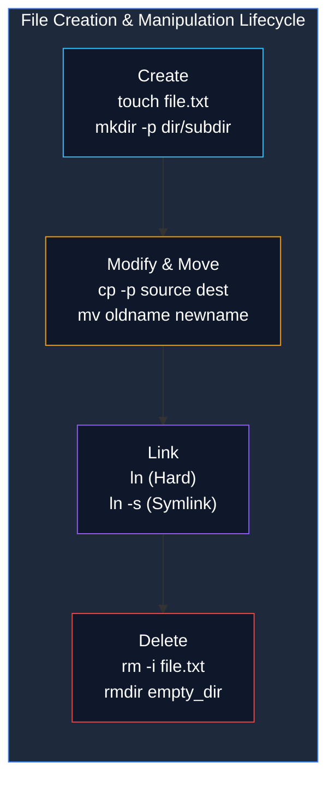

# Linux File Management and the Filesystem Hierarchy Standard (FHS)

> **Module:** System and Network Administrator (SNA) — 03 Linux Fundamentals  
> **Topic Level:** Core File & Directory Operations  
> **Previous Reference:** [02-Common-Linux-Commands.md](02-Common-Linux-Commands.md) | **Next:** [04-File-Permissions.md](04-File-Permissions.md)

---

## 🎯 Learning Objectives

By the end of this note, you will be able to:

- Explain the architecture of the **Filesystem Hierarchy Standard (FHS)** and identify the purpose of standard directories (`/etc`, `/var`, `/bin`, `/home`, `/dev`, `/proc`).
- Distinguish between **absolute paths** and **relative paths** in day-to-day administrative tasks.
- Create, copy, rename, move, and delete files and directory structures safely.
- Compare **hard links** and **symbolic (soft) links** at the inode and filesystem levels.
- Avoid catastrophic filesystem operations and adhere to defensive system management habits.

---

## 1. Introduction and Context

Unlike Windows operating systems that assign independent drive letters (`C:`, `D:`, `E:`) to different disk partitions, Unix and Linux systems organize all storage into a single unified inverted directory tree. The top of this tree is known as the **root directory**, denoted by a single forward slash (`/`).

Every physical disk, logical volume, USB drive, network share (NFS), and virtual kernel pseudofilesystem is mounted as a branch underneath this root directory. The **Filesystem Hierarchy Standard (FHS)** defines where files and directories must be located on Linux systems to ensure predictability across distributions.

```mermaid
flowchart TD
    ROOT["/ (Root Directory)"]
    ROOT --> BIN["/bin & /sbin<br/>(Essential System Binaries)"]
    ROOT --> ETC["/etc<br/>(Host Configuration Files)"]
    ROOT --> HOME["/home<br/>(Standard User Profiles)"]
    ROOT --> ROOTUSER["/root<br/>(Superuser Home)"]
    ROOT --> VAR["/var<br/>(Variable Data, Logs, Mail)"]
    ROOT --> USR["/usr<br/>(User Binaries, Libraries, Docs)"]
    ROOT --> DEV["/dev<br/>(Device Special Files)"]
    ROOT --> PROC["/proc & /sys<br/>(Kernel Virtual Info)"]
    ROOT --> TMP["/tmp<br/>(Temporary Files)"]

    style ROOT fill:#dc2626,stroke:#fff,color:#fff
    style BIN fill:#1e293b,stroke:#38bdf8,color:#fff
    style ETC fill:#1e293b,stroke:#f59e0b,color:#fff
    style HOME fill:#1e293b,stroke:#10b981,color:#fff
    style ROOTUSER fill:#1e293b,stroke:#f43f5e,color:#fff
    style VAR fill:#1e293b,stroke:#8b5cf6,color:#fff
    style USR fill:#1e293b,stroke:#38bdf8,color:#fff
    style DEV fill:#1e293b,stroke:#94a3b8,color:#fff
    style PROC fill:#1e293b,stroke:#94a3b8,color:#fff
    style TMP fill:#1e293b,stroke:#eab308,color:#fff
```



---

## 2. Definitions of Important Terminology

| Term | Definition |
|---|---|
| **Filesystem Hierarchy Standard (FHS)** | The official standard maintained by the Linux Foundation that specifies the directory layout and file placements for Unix-like operating systems. |
| **Absolute Path** | A complete file path that begins at the root directory (`/`), valid regardless of your current working directory (e.g., `/var/log/messages`). |
| **Relative Path** | A path relative to your present working directory, without a leading forward slash (e.g., `logs/audit.log` or `../sysconfig/network`). |
| **Inode (Index Node)** | A data structure on a Linux filesystem that stores metadata about a file (file size, permissions, owner, timestamps, and data block pointers), excluding its file name. |
| **Hard Link** | A direct pointer to an existing inode number; shares identical data blocks and permissions with the original file. |
| **Symbolic Link (Symlink)** | A special file type that stores the string path to another target file or directory (similar to a Windows shortcut). |

---

## 3. Key Directories of the Linux Filesystem (FHS)

| Directory | Purpose and Administrative Significance |
|---|---|
| `/` | The root of the entire hierarchy. Every partition is mounted somewhere below `/`. |
| `/bin` | Essential user binaries (e.g., `ls`, `cp`, `cat`, `bash`). (Symlinked to `/usr/bin` in modern RHEL). |
| `/sbin` | Essential system administrator binaries (e.g., `fdisk`, `ifconfig`, `reboot`, `iptables`). |
| `/etc` | Host-specific system configuration files (e.g., `/etc/passwd`, `/etc/fstab`, `/etc/ssh/sshd_config`). Contains text files, never binaries. |
| `/home` | Default parent directory for standard user home directories (e.g., `/home/student`). |
| `/root` | The home directory of the `root` superuser (separate from `/home/` to ensure root can log in even if `/home` fails to mount). |
| `/var` | Variable data that grows dynamically during normal operation (e.g., `/var/log` for logs, `/var/spool` for print/mail queues, `/var/www` for web pages). |
| `/tmp` | Temporary scratch space accessible to all users. Typically cleared on reboot or through scheduled cleanup jobs. |
| `/dev` | Device nodes representing hardware components (e.g., `/dev/sda` for primary disk, `/dev/urandom` for entropy, `/dev/null` for data disposal). |
| `/proc` | In-memory virtual filesystem providing an interface to kernel data structures and running processes (`/proc/cpuinfo`, `/proc/meminfo`, `/proc/<PID>`). |
| `/sys` | Virtual filesystem exposing kernel hardware abstraction and driver parameters. |
| `/mnt` & `/media` | Mount points for temporary manual filesystem mounts (`/mnt`) and automounted removable media (`/media`). |
| `/usr` | Secondary hierarchy containing shareable read-only software, libraries, and documentation (`/usr/share/doc`, `/usr/lib`). |

---

## 4. File and Directory Operations



### 4.1 Creating Files and Directories
```bash
# Update file timestamp, or create an empty file if it does not exist
touch report.txt

# Create a single directory in the current working directory
mkdir projects

# Create nested parent directories recursively in one step (-p)
mkdir -p /opt/backup/daily/database
```

### 4.2 Copying Files and Directories (`cp`)
```bash
# Copy a file to a new destination
cp /etc/hosts ~/hosts.backup

# Copy an entire directory recursively (-r)
cp -r /var/log/httpd ~/httpd_logs_backup

# Preserve file attributes (permissions, ownership, timestamps) (-p)
# Essential when taking configuration snapshots prior to changes
cp -p /etc/ssh/sshd_config /etc/ssh/sshd_config.orig

# Interactive mode (-i): prompt before overwriting existing files
cp -i file1.txt file2.txt
```

### 4.3 Moving and Renaming (`mv`)
```bash
# Rename a file in the same directory
mv old_report.txt new_report.txt

# Move a file to a different directory
mv report.txt /tmp/

# Move and rename simultaneously
mv config.txt /etc/app/production.conf
```

### 4.4 Removing Files and Directories (`rm` & `rmdir`)
```bash
# Remove an empty directory only (fails safely if directory contains files)
rmdir /tmp/empty_folder

# Remove a single file with confirmation prompt (-i)
rm -i obsolete.txt

# Force removal without prompting (-f)
rm -f temp.txt

# Recursively remove a directory and all of its contents (-r)
rm -rf /tmp/test_environment
```

---

## 5. Hard Links vs. Soft (Symbolic) Links

Every file consists of an **inode** (the metadata and data pointers) and at least one **directory entry** (the human-readable filename pointing to that inode).

### Comparison Matrix

| Property | Hard Link (`ln target link`) | Symbolic Link (`ln -s target link`) |
|---|---|---|
| **Inode Number** | Identical to target file (`ls -i`) | Unique inode separate from target |
| **Across Different Filesystems** | ❌ Impossible (inodes are filesystem-specific) | ✅ Allowed (stores path string) |
| **Linking to Directories** | ❌ Blocked (prevents infinite filesystem loops) | ✅ Allowed |
| **If Target File is Deleted** | ✅ Data remains accessible via the hard link | ❌ Becomes a "broken" dangling link |
| **Disk Space Consumed** | Negligible (only a directory pointer entry) | Minimal (bytes equal to target path string length) |

```bash
# Create a hard link
ln /var/data/master.db /var/backup/master_hardlink.db

# Create a symbolic link (-s)
ln -s /etc/httpd/conf/httpd.conf ~/my_web_config.conf

# Inspect inode numbers to verify linkage (-i flag)
ls -li /var/data/master.db /var/backup/master_hardlink.db
```

---

## 6. Common Mistakes & Defensive Habits

- **Executing `rm -rf /` or `rm -rf /path /to/dir` with accidental spaces**:
  - *Scenario*: Running `rm -rf / var/tmp/test` (with a space after `/`) commands the kernel to erase the entire root filesystem!
  - *Defensive Rule*: Always use tab-completion, double-check paths before pressing Enter, and avoid running wildcard deletes as root.
- **Overwriting configuration files without a timestamped backup**:
  - *Defensive Rule*: Always create a `.bak` copy preserving timestamps before editing any file in `/etc`:
    ```bash
    cp -p /etc/fstab /etc/fstab.$(date +%F).bak
    ```
- **Copying directories without `-r`**:
  - `cp /dir1 /dir2` fails with `cp: omitting directory '/dir1'`. Always provide `-r` (recursive).

---

## 7. Security Considerations

1. **World-Writable Directories (`/tmp`)**: Because `/tmp` is accessible to all users, the kernel enforces the **Sticky Bit (`t`)** so users cannot delete or rename files belonging to other users.
2. **Configuration Tampering**: Files in `/etc` should only ever be writable by `root`. Regularly audit `/etc` permissions to ensure unauthorized users cannot inject backdoors or alter system behaviors.

---

## 8. Summary & Next Steps

Understanding directory layout, pathing, and link mechanics allows administrators to manipulate system assets without causing outages. The next layer of operational control is controlling *who* can access, modify, or execute these files.

- **Next Chapter:** Master Linux ownership and permissions in [04-File-Permissions.md](04-File-Permissions.md).
- **User Accounts:** Learn how users and groups map to files in [05-User-Management.md](05-User-Management.md).
- **Quick Reference:** Consult [../cheatsheets/Linux-File-Management-Cheatsheet.md](../cheatsheets/Linux-File-Management-Cheatsheet.md).
