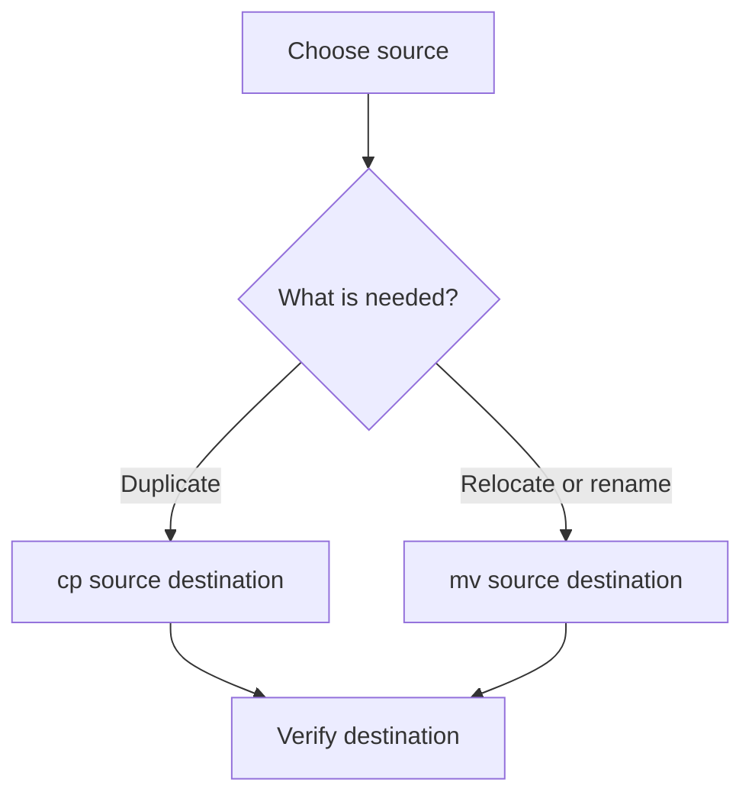

# Linux File Management

## 1. Paths and directories
Linux organizes files in a tree beginning at `/`, called the filesystem root. This is not the same as the root user account.

- Absolute path: begins with `/`, e.g. `/home/student/notes.txt`.
- Relative path: interpreted from the current directory, e.g. `notes.txt`.
- `.` means current directory; `..` means parent; `~` commonly means the user's home directory.

## 2. Common operations

| Task | Command | Purpose |
|---|---|---|
| Create file | `touch notes.txt` | Create if absent; update timestamp if present |
| Create directory | `mkdir notes` | Make a directory |
| Copy | `cp notes.txt copy.txt` | Copy file |
| Move/rename | `mv old.txt new.txt` | Move or rename |
| Change directory | `cd notes` | Change current location |
| List details | `ls -l` | Show permissions, owner, size, time |
| Read | `cat notes.txt` | Print contents |
| Remove empty directory | `rmdir notes` | Directory must be empty |
| Remove file | `rm copy.txt` | Delete file |

## 3. Redirection example
```bash
echo "First line" > server.txt
echo "Second line" >> server.txt
cat server.txt
```
Expected content is `First line` and `Second line`, each on its own line, if the commands succeed. `>` overwrites; `>>` appends.

## 4. Copy or move?


## 5. Wildcards
Common shell patterns:
- `*.txt`: names ending in `.txt`.
- `file[12].txt`: matches `file1.txt` or `file2.txt` in common shell globbing.
- `report?`: `?` matches one character.

Shell wildcards are not the same as regular expressions.

## 6. Safe habits
Check `pwd` and list files before operations. Be careful with wildcards, recursive deletion, and overwriting. Do not use elevated privileges unless needed and authorized.

## Summary
File management includes creating, reading, copying, moving, renaming, and deleting files. Understanding paths, wildcards, redirection, and permissions prevents mistakes.

## Related notes
- [Common Linux Commands](02-Common-Linux-Commands.md)
- [File Permissions](04-File-Permissions.md)
