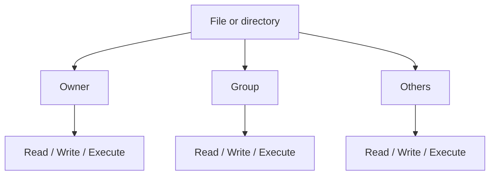

# Linux File Permissions

## 1. Purpose
Linux permissions control who can read, modify, or execute files and who can access directories.

## 2. Permission classes
- **User/owner (`u`):** file owner.
- **Group (`g`):** members of the file's associated group.
- **Others (`o`):** users who are neither owner nor in the group.

| Permission | Symbol | Regular file | Directory |
|---|---|---|---|
| Read | `r` | Read content | List entries, subject to other rules |
| Write | `w` | Modify content | Create/remove/rename entries, subject to other rules |
| Execute | `x` | Execute if valid/executable | Traverse/access entries |

## 3. Read `ls -l`
Example: `-rwxr-xr-- 1 alice developers 1200 Oct 10 10:00 script.sh`
The initial `-` means regular file; `rwx` is owner permission, `r-x` group permission, and `r--` others permission. Remaining fields include link count, owner, group, size, timestamp, and name.

## 4. Binary and octal values

| Symbol | Binary | Octal |
|---|---:|---:|
| `---` | `000` | 0 |
| `--x` | `001` | 1 |
| `-w-` | `010` | 2 |
| `-wx` | `011` | 3 |
| `r--` | `100` | 4 |
| `r-x` | `101` | 5 |
| `rw-` | `110` | 6 |
| `rwx` | `111` | 7 |

Read = 4, write = 2, execute = 1; add values to get each octal digit.

## 5. Examples
`chmod 640 example.txt` gives owner `rw-`, group `r--`, others `---`.

`chmod 667 example.txt` gives owner `rw-`, group `rw-`, others `rwx`. Others receive execute permission too, which is often unsuitable for ordinary data files.

`chmod 777 example.txt` gives everyone `rwx`. This is usually too permissive for ordinary files; use least privilege.

Symbolic example: `chmod u+x script.sh` adds execute permission for the owner.

## 6. Ownership
```bash
ls -l example.txt
chown alice example.txt
chgrp developers example.txt
```
`chown` changes owner and `chgrp` changes group, subject to privileges and policy. Do not change system-file ownership casually.

## 7. Permission classes diagram


Actual access can also depend on parent-directory permissions, ACLs, mount options, security modules, and process identity.

## Summary
Permissions use three classes and three basic permission types. Choose the minimum access needed and verify changes with `ls -l`.

## Related notes
- [User Management](05-User-Management.md)
- [Linux Permissions Cheatsheet](../cheatsheets/Linux-Permissions-Cheatsheet.md)
