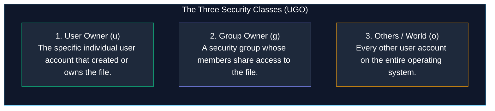
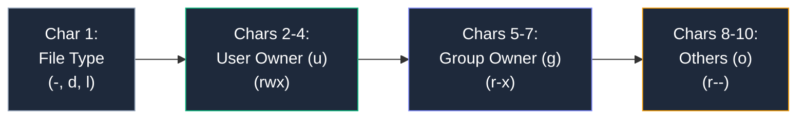
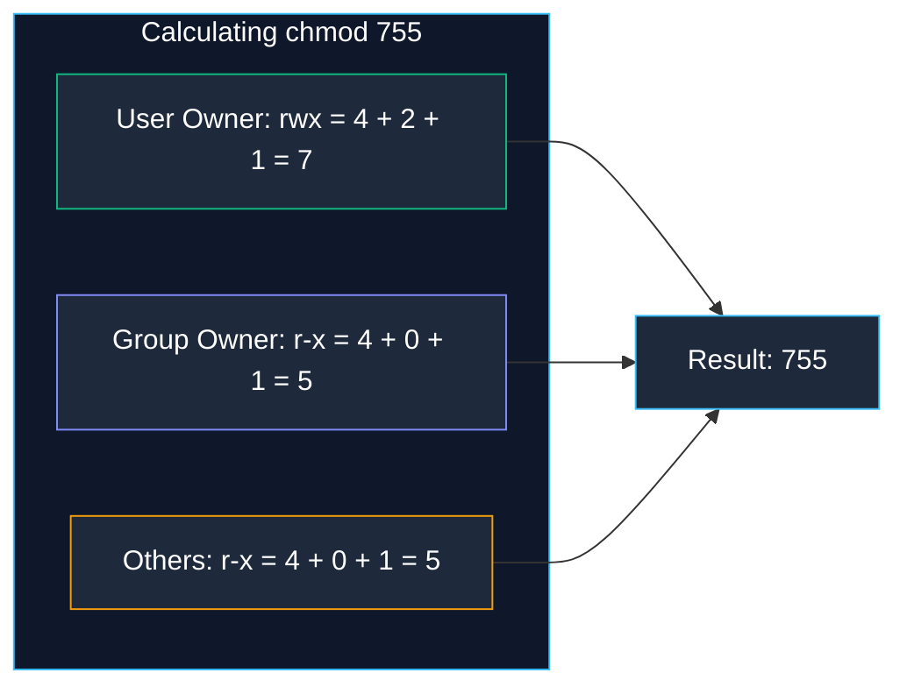
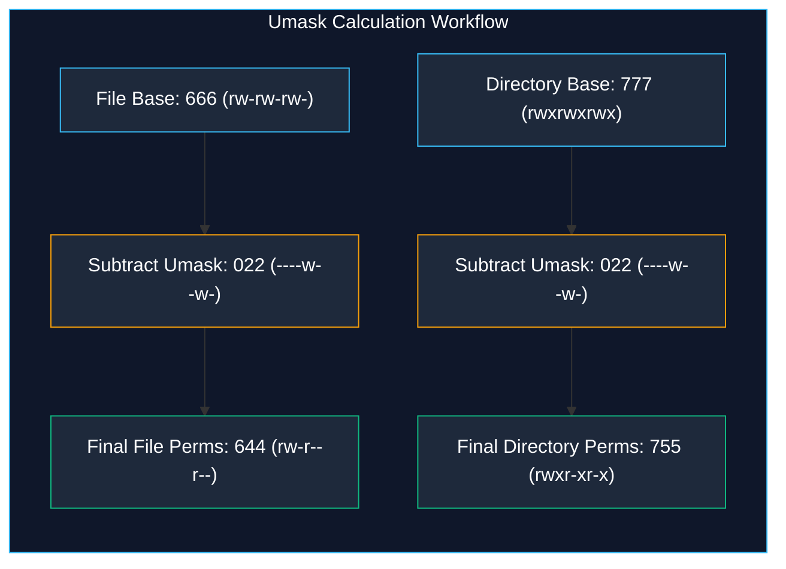
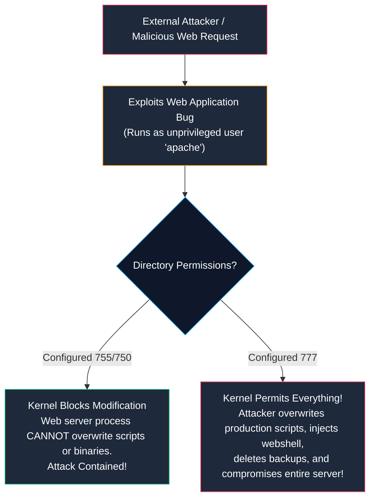

# Linux File Permissions and Access Control

> **Module:** System and Network Administrator (SNA) Foundations  
> **Topic:** Discretionary Access Control (DAC), UGO Triads, Octal chmod, Umask, and Special Bits  
> **Target Audience:** BSIT Students, Junior Linux Administrators, and Security Analysts  
> **Related Reference:** [03-File-Management.md](03-File-Management.md) | [05-User-Management.md](05-User-Management.md) | [Linux Permissions Cheatsheet](../cheatsheets/Linux-Permissions-Cheatsheet.md)

---

## 🎯 Learning Objectives

By the end of this chapter, you will be able to:

- Deconstruct the 10-character Linux file permission string into file type and **User**, **Group**, and **Others** (UGO) triads.
- Master the distinct operational behaviors of **Read (`r`)**, **Write (`w`)**, and **Execute (`x`)** on **regular files** versus **directories**.
- Calculate and convert permissions seamlessly between **Symbolic notation** (`rwxr-xr-x`) and **Octal numeric notation** (`755`).
- Modify file permissions and ownership safely using `chmod`, `chown`, and `chgrp`.
- Understand and calculate default creation permissions using the **Umask** (User File-Creation Mask).
- Explain the security architecture of special permission bits: **SUID (`4000`)**, **SGID (`2000`)**, and the **Sticky Bit (`1000`)**.
- Articulate why executing `chmod 777` is a dangerous security anti-pattern in enterprise systems.

---

## 1. The Linux Security Model: Discretionary Access Control (DAC)

Linux is inherently a multi-user, multi-tasking operating system. On a single server, dozens of different users, developers, and background service daemons run concurrently. 

To prevent an unprivileged web server process from reading private human resources records, or a student user from modifying core operating system binaries, Linux enforces **Discretionary Access Control (DAC)**.

In the DAC model:
1. Every file and directory on the storage drive has an assigned **User Owner** and a **Group Owner**.
2. The user owner has the discretion to decide who can read, write, or execute that file.
3. Access is evaluated by the Linux kernel based on **three distinct security classes**:



### 1.1 How the Kernel Evaluates Access (Precedence Order)
When a user attempts to access a file, the Linux kernel checks permissions in a strict, top-down order of precedence:
1. **Is the requesting user the User Owner?**  
   If **YES**, the kernel applies **only** the User permissions and ignores Group and Others.
2. **If NO, is the user a member of the Owning Group?**  
   If **YES**, the kernel applies **only** the Group permissions and ignores Others.
3. **If NO to both, the user is classified as Others.**  
   The kernel applies the Others permissions.

> ⚠️ **Important Concept:** Permissions are **not additive**! If a user owns a file and the user permission is set to read-only (`r--`), but the group has read-write (`rw-`), the owner **cannot** write to the file because the kernel stops evaluation at the User check!

---

## 2. Deconstructing the 10-Character Permission String

When you run `ls -l` in a Linux terminal, the first column displays a 10-character string that fully defines access to that resource:

```text
-  r w x  r - x  r - -
│  └──┬──┘  └──┬──┘  └──┬──┘
│     │        │        └── Others (o) Permissions: Read only
│     │        └─────────── Group (g) Permissions: Read and Execute
│     └──────────────────── User (u) Permissions: Read, Write, Execute
└────────────────────────── File Type Flag (- = regular file)
```



### 2.1 Character 1: The File Type Indicator
- **`-` (Dash):** A regular file (text document, compiled executable, compressed tarball, image).
- **`d` (Directory):** A directory (folder).
- **`l` (Symbolic Link):** A soft link pointing to another file.
- **`c` (Character Device):** A hardware device node transferring data character-by-character (e.g., `/dev/tty1`, `/dev/urandom`).
- **`b` (Block Device):** A hardware storage device transferring data in fixed-size blocks (e.g., `/dev/sda`, `/dev/nvme0n1`).
- **`s` (Socket):** An inter-process network communication endpoint.
- **`p` (Named Pipe / FIFO):** A first-in, first-out IPC queue.

---

## 3. File vs. Directory Permission Semantics

One of the most critical stumbling blocks for BSIT students is assuming that `r`, `w`, and `x` behave identically on files and directories. In Linux, directories are specialized files containing a lookup table of filenames and inodes. 

Consequently, permissions have completely different meanings on files versus directories:

| Permission Bit | Meaning on Regular Files | Meaning on Directories |
|:---:|---|---|
| **`r` (Read)** | The ability to open, read, and view the file's data contents (e.g., using `cat`, `less`, `head`, `cp`). | The ability to **read the directory table** and list the filenames inside using `ls`. |
| **`w` (Write)** | The ability to modify, edit, append to, or overwrite the file's data contents. | The ability to **create, delete, or rename files inside the directory**. *(Critical: Even if a file inside is read-only, if you have write permission on the parent directory, you can delete that file!)* |
| **`x` (Execute)** | The ability to run the file as an executable binary program or shell script (e.g., `./script.sh`). | The ability to **enter, traverse, and `cd` into the directory**, and read the inodes/metadata of files inside (`cd /path`). |

### 3.1 The Directory Execution (`x`) Rule
If a user has Read (`r`) permission on a directory but **lacks Execute (`x`) permission**:
- The user can run `ls` and see the filenames inside.
- However, the user **cannot `cd` into the directory**!
- Because `x` is required to access file inodes inside, running `ls -l` will display question marks `?????????` for all file permissions, sizes, and timestamps!
- **Rule for Administrators:** Directories intended for shared access must almost always have the Execute (`x`) bit enabled (`chmod 755` or `chmod 750`).

---

## 4. Octal (Numeric) vs. Symbolic Notation

Permissions can be viewed and configured using two equivalent notations: **Octal (base-8 numbers)** and **Symbolic (letters)**.

### 4.1 The Binary and Octal Mathematical Relationship
Each permission triad (`rwx`) corresponds to a 3-bit binary number. Each letter has an assigned numerical weight:

```text
Permission:   Read (r)     Write (w)     Execute (x)
Binary:          1             1              1
Value:        2^2 = 4       2^1 = 2        2^0 = 1
```

By summing the numbers present in each triad, you arrive at a single octal digit from `0` to `7`:

| Octal Value | Binary Bits | Symbolic String | Operational Meaning |
|:---:|:---:|:---:|---|
| **`7`** | `111` (`4 + 2 + 1`) | `rwx` | Full access: Read, Write, and Execute |
| **`6`** | `110` (`4 + 2 + 0`) | `rw-` | Standard read and write (no execution) |
| **`5`** | `101` (`4 + 0 + 1`) | `r-x` | Read and Execute (standard directory & script permission) |
| **`4`** | `100` (`4 + 0 + 0`) | `r--` | Read-only access |
| **`3`** | `011` (`0 + 2 + 1`) | `-wx` | Write and Execute (rarely used) |
| **`2`** | `010` (`0 + 2 + 0`) | `-w-` | Write-only access |
| **`1`** | `001` (`0 + 0 + 1`) | `--x` | Execute-only access |
| **`0`** | `000` (`0 + 0 + 0`) | `---` | Zero access: completely forbidden |

---

### 4.2 Calculating Standard Octal Permission Triads



#### Common Standard Enterprise Octal Settings:
- **`755` (`rwxr-xr-x`):** Standard for executable scripts and directories. Owner can read, write, enter; group and others can read and enter.
- **`644` (`rw-r--r--`):** Standard for regular non-executable files (documents, web pages, configs). Owner can read and write; group and others can read only.
- **`600` (`rw-------`):** Highly restricted sensitive files (private SSH keys, certificates). Only the owner can read/write; zero access for everyone else.
- **`700` (`rwx------`):** Restricted directories (e.g., user home folders, `/root`). Only the owner can enter and list files.
- **`750` (`rwxr-x---`):** Departmental directories. Owner has full control; group members can list and enter; total strangers (others) have zero access.

---

## 5. Detailed Command Explanations: `chmod`, `chown`, and `chgrp`

```
+----------------------------------------------------------------------------------------------------+
|                                PERMISSION & OWNERSHIP COMMAND INDEX                                |
+--------------+-------------------------------------+-----------------------------------------------+
| Command      | Primary Operational Function        | Key Options & Syntax Styles                   |
+--------------+-------------------------------------+-----------------------------------------------+
| chmod        | Change file/directory permissions   | Numeric (chmod 755), Symbolic (chmod u+x)     |
| chown        | Change user owner and owning group  | chown user:group target, chown -R             |
| chgrp        | Change group owner only             | chgrp group target                            |
| umask        | Display or configure creation mask  | umask, umask 027                              |
+--------------+-------------------------------------+-----------------------------------------------+
```

---

### 5.1 `chmod` — Change Mode (Permissions)

- **Purpose:** Modifies file and directory access permission bits for User, Group, and Others.
- **Syntax:**
  ```bash
  chmod [OPTIONS] MODE FILE...
  ```
  - Option `-R`: Recursive. Applies changes to a directory and every single file and subdirectory inside it.

#### Method A: Numeric (Octal) Mode
You provide three octal digits representing User, Group, and Others:
```bash
# Make a script executable by owner and readable by others
chmod 755 deploy.sh

# Protect a private SSH key so the SSH client doesn't reject it
chmod 600 ~/.ssh/id_rsa
```

#### Method B: Symbolic Mode
You target specific classes using letters:
- **Target Classes:** `u` (user), `g` (group), `o` (others), `a` (all: u+g+o).
- **Operators:** `+` (add permission), `-` (remove permission), `=` (set exact permission).
- **Permissions:** `r`, `w`, `x`.

```bash
# Add execute permission to the user owner only
chmod u+x script.sh

# Remove write permission from group and others simultaneously
chmod go-w shared_file.txt

# Set permissions for all users to read-only
chmod a=r public_notice.txt
```

- **Practical Use Case:** When a developer writes a new Python script (`script.py`), Linux creates it without execute permissions (`644`). Running `./script.py` produces `bash: ./script.py: Permission denied`. The administrator runs `chmod u+x script.py` to enable execution.
- **Common Mistakes:** Running recursive numeric changes (`chmod -R 755 /var/www/html`) on a directory that contains both folders and plain files. This makes all regular text files executable! (Best practice for mixed folders: use `find /var/www/html -type d -exec chmod 755 {} +` and `find /var/www/html -type f -exec chmod 644 {} +`).

---

### 5.2 `chown` and `chgrp` — Changing Ownership

- **Purpose:** Modifies the User Owner and/or Group Owner assigned to a file or directory.
- **Syntax:**
  ```bash
  chown [OPTIONS] USER[:GROUP] FILE...
  chgrp [OPTIONS] GROUP FILE...
  ```
- **Prerequisite Privilege:** **Only the `root` superuser can change file user ownership!** (This prevents unprivileged users from changing a file's owner to another user to bypass disk quotas or frame someone for malicious content).

#### Realistic Examples:
```bash
# Change user owner to 'student'
chown student /opt/notes.txt

# Change user owner to 'student' AND group owner to 'developers' simultaneously
chown student:developers /opt/notes.txt

# Change group ownership only (using chown with leading colon)
chown :developers /opt/notes.txt

# Change group ownership using dedicated chgrp command
chgrp developers /opt/notes.txt

# Recursively change ownership on an entire directory tree
chown -R student:developers /var/www/html
```

- **Verifying the Result:**
  ```bash
  ls -l /opt/notes.txt
  ```
  ```text
  -rw-r--r--. 1 student developers 4096 Oct 24 11:30 /opt/notes.txt
  ```

---

## 6. The User File-Creation Mask: `umask`

When a program (such as a text editor or compiler) creates a brand-new file, the program does not ask for arbitrary permissions. It requests the **maximum theoretical base permissions**:
- **Maximum Base for Regular Files:** `666` (`rw-rw-rw-`) — Files are never created with execute permissions by default for security reasons.
- **Maximum Base for Directories:** `777` (`rwxrwxrwx`) — Directories require execute permission so users can `cd` into them.

The operating system automatically subtracts (masks out) specific permission bits based on the active **`umask`** value.



### 6.1 Standard Enterprise Umask Values
To view your active shell umask, type:
```bash
umask
```
Output: `0022` (The leading zero represents special bits; the last three digits are User, Group, Others).

- **Standard Umask `022` (Standard on RHEL):**
  - Files: `666 - 022 = 644` (`rw-r--r--`).
  - Directories: `777 - 022 = 755` (`rwxr-xr-x`).
  - Group and Others cannot write to newly created files.
- **Strict Security Umask `027` (Hardened Enterprise Environments):**
  - Files: `666 - 027 = 640` (`rw-r-----`).
  - Directories: `777 - 027 = 750` (`rwxr-x---`).
  - Total strangers (Others) receive zero access to newly created files.
- **Confidential Umask `077` (High Security):**
  - Files: `666 - 077 = 600` (`rw-------`).
  - Directories: `777 - 077 = 700` (`rwx------`).
  - Only the user owner can access newly created resources.

---

## 7. Special Permission Bits: SUID, SGID, and Sticky Bit

Standard UGO permissions cannot solve all security challenges. Consider this real-world dilemma:
- In Linux, user passwords are encrypted inside `/etc/shadow`.
- `/etc/shadow` has permissions `000` (readable only by root).
- When standard user `student` runs `passwd` to change their personal password, how can `student` write their new hash into `/etc/shadow`?

Linux solves this using **Special Permission Bits**:

```
+----------------------------------------------------------------------------------------------------+
|                                    SPECIAL PERMISSION BITS INDEX                                   |
+----------+------------+--------------------+-----------------------------+-------------------------+
| Bit Name | Octal Bit  | Symbolic Indicator | Target: Files               | Target: Directories     |
+----------+------------+--------------------+-----------------------------+-------------------------+
| SUID     | 4000       | s in user (rws)    | Runs with file owner UID    | No operational effect   |
| SGID     | 2000       | s in group (rws)   | Runs with file owning GID   | Inherits parent group ID|
| Sticky   | 1000       | t in others (rwt)  | No operational effect       | Only owner can delete   |
+----------+------------+--------------------+-----------------------------+-------------------------+
```

### 7.1 Setuid (SUID — Octal `4000`)
- **How It Works:** When an executable binary with SUID is executed, the process runs with the **privileges of the file's User Owner (usually root)** rather than the privileges of the user who launched it!
- **Inspection:**
  ```bash
  ls -l /usr/bin/passwd
  ```
  ```text
  -rwsr-xr-x. 1 root root 35000 Oct 24 10:00 /usr/bin/passwd
  ```
  *(Notice the `s` in the user triad `rws`!)* Because `passwd` has SUID root, when `student` runs it, the program temporarily executes as `root`, allowing it to write to `/etc/shadow`.
- **Configuring SUID:**
  ```bash
  chmod u+s /usr/local/bin/custom_tool
  # Or via octal:
  chmod 4755 /usr/local/bin/custom_tool
  ```

### 7.2 Setgid (SGID — Octal `2000`)
- **Behavior on Directories (Crucial Enterprise Tool!):**
  - Normally, when a user creates a new file, the file's group owner is set to that user's personal primary group.
  - When SGID is set on a shared directory, **any new file created inside automatically inherits the Group Owner of the parent directory**, regardless of who created it!
- **Practical Use Case:** Collaborative department folders. An administrator creates `/opt/finance`, sets group owner to `finance`, and sets SGID:
  ```bash
  chmod g+s /opt/finance
  # Or via octal:
  chmod 2775 /opt/finance
  ```
  Now, whenever Alice or Bob creates a spreadsheet inside `/opt/finance`, the file is instantly owned by group `finance`, allowing team members to edit it seamlessly!

### 7.3 The Sticky Bit (Octal `1000`)
- **Behavior on Directories:** On a directory with world-write permissions (`777`), any user can delete any file, even files owned by other users!
- The **Sticky Bit** modifies this rule: on a shared directory with the Sticky Bit enabled, **a user can only delete or rename files that they personally own**!
- **Inspection on `/tmp`:**
  ```bash
  ls -ld /tmp
  ```
  ```text
  drwxrwxrwt. 15 root root 4096 Oct 24 12:00 /tmp
  ```
  *(Notice the `t` at the very end of the string!)* This prevents a malicious student user from deleting another student's temporary work in `/tmp`.
- **Configuring Sticky Bit:**
  ```bash
  chmod +t /shared_scratch
  # Or via octal:
  chmod 1777 /shared_scratch
  ```

---

## 8. The Critical Security Anti-Pattern: The Dangers of `chmod 777`

In beginner online forums, whenever someone encounters a "Permission Denied" error, bad advice frequently appears: *"Just run `chmod -R 777` on the folder."*

As a professional System Administrator or Blue Team security analyst, you must understand why `chmod 777` is a **critical vulnerability**:



### Why `chmod 777` (`rwxrwxrwx`) is Dangerous:
1. **Total Loss of Boundary Control:** `777` grants every single local user, guest account, and compromised service daemon the power to read, modify, overwrite, and delete the resource.
2. **Web Shell Injection:** If an Apache web root is set to `777`, an attacker exploiting a minor upload vulnerability can upload an executable PHP webshell, overwrite `index.html`, and take over the server.
3. **Automated Audit Flags:** Security scanning tools (OpenSCAP, Nessus, Qualys) flag `777` permissions as high-severity compliance violations.
4. **Daemons Reject Overly Permissive Files:** Core system services enforce security checks. For example, OpenSSH **refuses to connect** if `~/.ssh/authorized_keys` has permissions wider than `600`, deliberately protecting you from your own misconfiguration!
5. **The Professional Standard:** Identify exactly which user and group requires access, configure group memberships, and apply minimal necessary permissions (`644`, `755`, or `750`).

---

## 9. Important Points to Remember

- **UGO Order:** Discretionary Access Control evaluates permissions strictly in order: **User**, **Group**, **Others**. Evaluation stops at the first match.
- **Directory Execution:** The Execute bit (`x`) on a directory is required to enter (`cd`) and access file metadata inside.
- **Octal Values:** Read = `4`, Write = `2`, Execute = `1`. Sum them up to get values from `0` to `7`.
- **Standard Settings:** Default for files is `644` (`rw-r--r--`); default for directories and scripts is `755` (`rwxr-xr-x`).
- **Superuser Exclusivity:** Only `root` can change user ownership with `chown`.
- **Umask Subtraction:** The `umask` masks out bits from the base permissions (`666` for files, `777` for directories). Standard `022` results in `644` files and `755` directories.
- **SUID/SGID Roles:** SUID (`4000`) executes with owner privileges; SGID (`2000`) on directories enforces group inheritance; Sticky Bit (`1000`) prevents users from deleting each other's files.
- **Never 777:** Never use `chmod 777` as a quick fix. It bypasses all security boundaries and exposes servers to exploitation.

---

## 10. Key Terms Glossary

| Term | Technical Definition |
|---|---|
| **chmod** | "Change Mode"; the command used to modify file and directory access control permissions. |
| **chown** | "Change Owner"; the administrative command used to reassign file user ownership and group ownership. |
| **DAC** | Discretionary Access Control; a security model where access to resources is based on the identity of the user and group owning the file. |
| **Octal Notation** | A base-8 numbering system (digits 0–7) representing 3-bit binary permission combinations for User, Group, and Others. |
| **SGID** | Set Group ID; a special permission bit causing programs to run with group privileges, or forcing files in directories to inherit the parent group ID. |
| **Sticky Bit** | A special permission bit applied to directories (such as `/tmp`) ensuring that only the file's original owner or root can delete or rename it. |
| **SUID** | Set User ID; a special permission bit on executable files that runs the process with the privileges of the file owner (e.g., `root`). |
| **Symbolic Notation** | Representing permissions with character strings (`r`, `w`, `x`, `-`, `u`, `g`, `o`). |
| **UGO** | User, Group, Others; the three security classes evaluated by the Linux kernel when determining file access. |
| **Umask** | User File-Creation Mask; a four-digit octal value subtracted from theoretical base permissions when new files or directories are created. |

---

## 11. Practice Questions

Test your mastery of Linux permissions and access control. Attempt each question independently before consulting the answer key below.

### Question 1 (Octal Calculation)
A system administrator wants to set permissions on a sensitive database configuration file so that:
- The **User Owner** can read and write.
- The **Group Owner** can read only.
- **Others** have zero access.

What is the exact 3-digit octal command to apply these permissions?
- [A] `chmod 750 config.php`
- [B] `chmod 640 config.php`
- [C] `chmod 644 config.php`
- [D] `chmod 700 config.php`

### Question 2 (Directory Semantics)
A junior technician creates a directory with permissions `r--r--r--` (`chmod 444 my_folder`). When a user attempts to enter the directory using `cd my_folder`, the shell reports `bash: cd: my_folder: Permission denied`.
Why is the user blocked from entering the directory despite having read permission?

### Question 3 (Umask Calculation)
An enterprise security policy sets the global umask to `027` in `/etc/profile`.
When a user subsequently runs `touch report.txt` and `mkdir projects`, what will be the exact permissions (in both octal and symbolic formats) of:
1. The file `report.txt`?
2. The directory `projects`?

### Question 4 (Special Bits Scenario)
An administrator creates a shared collaboration folder `/data/sales` for the `sales` department group. Multiple sales representatives create files in this folder, but members complain that they cannot edit each other's files because newly created files are owned by each user's personal primary group.
What exact command should the administrator execute to force all newly created files in `/data/sales` to inherit the `sales` group ownership automatically?

### Question 5 (Troubleshooting Scenario)
Examine this directory listing:
```text
drwxrwxrwt. 2 root root 4096 Oct 24 14:00 /shared_drop
```
Inside `/shared_drop`, user `alice` created a file named `proposal.doc` owned by `alice:alice`.
Can user `bob` delete `proposal.doc`? Why or why not?

### Question 6 (Safety & SSH Permissions)
A student generates a new SSH keypair and copies the private key to `~/.ssh/id_rsa`. When attempting to connect to a remote server, the OpenSSH client fails with:
```text
@@@@@@@@@@@@@@@@@@@@@@@@@@@@@@@@@@@@@@@@@@@@@@@@@@@@@@@@@@@
@         WARNING: UNPROTECTED PRIVATE KEY FILE!          @
@@@@@@@@@@@@@@@@@@@@@@@@@@@@@@@@@@@@@@@@@@@@@@@@@@@@@@@@@@@
Permissions 0777 for '/home/student/.ssh/id_rsa' are too open.
It is required that your private key files are NOT accessible by others.
```
What exact command resolves this error and satisfies OpenSSH's security requirements?

---

## 12. Answer Key & Explanations

### Answer to Question 1:
**Correct Option:** **[B]**  
*Explanation:*  
- User Owner (read + write): `4 + 2 = 6`
- Group Owner (read only): `4 + 0 = 4`
- Others (zero access): `0`  
Result: `chmod 640 config.php`.

### Answer to Question 2:
**Correct Answer:**  
The directory lacks the **Execute (`x`) permission bit**! In Linux, the read (`r`) permission on a directory only allows listing filenames in the directory table. To enter, traverse, or access file inodes inside a directory with `cd`, the Execute (`x`) bit is strictly mandatory. The directory should be set to at least `chmod 755` or `chmod 750`.

### Answer to Question 3:
**Correct Answer:**  
1. **For `report.txt`:**
   - Base for files: `666` (`rw-rw-rw-`)
   - Subtract Umask: `027` (`----w-rwx`)
   - Final Octal: **`640`**
   - Final Symbolic: **`-rw-r-----`** (User: read/write; Group: read-only; Others: zero access).
2. **For `projects`:**
   - Base for directories: `777` (`rwxrwxrwx`)
   - Subtract Umask: `027` (`----w-rwx`)
   - Final Octal: **`750`**
   - Final Symbolic: **`drwxr-x---`** (User: full control; Group: read & enter; Others: zero access).

### Answer to Question 4:
**Correct Answer:**  
The administrator must set the **Setgid (SGID)** bit on the directory:
```bash
chmod g+s /data/sales
# Or using octal mode (assuming 775 base permissions):
chmod 2775 /data/sales
```
With SGID active, any file created inside `/data/sales` automatically inherits the group ownership of `/data/sales` (the `sales` group).

### Answer to Question 5:
**Correct Answer:**  
**No, Bob cannot delete the file.**  
Although the directory has world-write permissions (`rwxrwxrwt`), the presence of the **Sticky Bit** (indicated by the `t` at the end) restricts file deletion and renaming. Under the Sticky Bit, only the file's User Owner (`alice`) or the superuser (`root`) is permitted to delete `proposal.doc`.

### Answer to Question 6:
**Correct Answer:**
```bash
chmod 600 ~/.ssh/id_rsa
```
*Explanation:* `chmod 600` grants read and write permissions exclusively to the user owner (`student`), while stripping all access from Group (`0`) and Others (`0`). OpenSSH strictly demands this baseline before loading private cryptographic keys.

---

## 🔗 Related Notes & Next Steps

- **Next Chapter:** Understand account creation, `/etc/passwd`, `/etc/shadow`, and sudo delegation in [05-User-Management.md](05-User-Management.md).
- **Filesystem Traversal:** Review directory hierarchy and inode mechanics in [03-File-Management.md](03-File-Management.md).
- **Quick Reference:** Keep [cheatsheets/Linux-Permissions-Cheatsheet.md](../cheatsheets/Linux-Permissions-Cheatsheet.md) bookmarked for rapid octal calculations.
