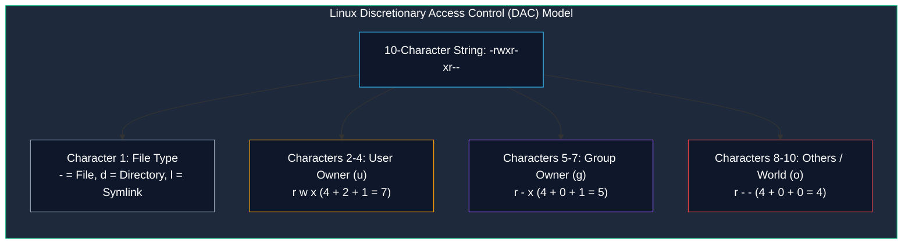

# Linux File Permissions, Ownership, and Access Control

> **Module:** System and Network Administrator (SNA) — 03 Linux Fundamentals  
> **Topic Level:** Security & Access Control  
> **Previous Reference:** [03-File-Management.md](03-File-Management.md) | **Next:** [05-User-Management.md](05-User-Management.md)

---

## 🎯 Learning Objectives

By the end of this note, you will be able to:

- Deconstruct the 10-character Linux permission string (`-rwxr-xr--`) into **File Type**, **User Owner**, **Group Owner**, and **Others**.
- Explain how permissions (**Read**, **Write**, **Execute**) differ between regular files and directories.
- Calculate and apply permissions using both **Numeric (Octal)** notation and **Symbolic** syntax.
- Understand the function and security impact of special permissions: **SUID**, **SGID**, and the **Sticky Bit**.
- Calculate effective default creation permissions using the **umask** value.
- Articulate the severe operational and security risks associated with `chmod 777`.

---

## 1. Introduction and Context

Linux is inherently a multi-user operating system designed from Unix origins. Multiple human users, system background accounts, and automated service daemons share the same kernel, memory, and physical storage.

To prevent unauthorized access, accidental file corruption, and malicious modification, the kernel strictly enforces the **Discretionary Access Control (DAC)** permission model. Every file and directory is bound to a specific owning user and an owning group. Whenever any process attempts to open, write, or execute a file, the kernel inspects the process's effective UID and GID against the file's permission bits before granting or denying access.



---

## 2. Definitions of Important Terminology

| Term | Definition |
|---|---|
| **Discretionary Access Control (DAC)** | A security policy where the owner of an object has discretionary power to determine who can read, modify, or execute that object. |
| **User (u)** | The specific user account that owns the file (usually the user who created it). |
| **Group (g)** | The primary or assigned group account that shares access to the file. |
| **Others / World (o)** | Every other user account on the system that is neither the file owner nor a member of the owning group. |
| **Octal Notation** | A base-8 numerical system (0 through 7) used to represent the three-bit binary permission combinations for user, group, and others. |
| **Umask (User File-Creation Mask)** | A four-digit octal value that specifies which permission bits are subtracted (masked out) by default when new files or directories are created. |

---

## 3. File vs. Directory Permission Semantics

One of the most common stumbling blocks for beginners and new administrators is assuming `r`, `w`, and `x` behave identically on files and directories. In Linux, directories are simply specialized files containing a table of filenames and inode numbers:

| Permission | Behavior on Regular Files | Behavior on Directories |
|:---:|---|---|
| **`r` (Read / 4)** | View or copy file contents (`cat`, `less`, `cp`). | Read directory table / list contained filenames (`ls`). |
| **`w` (Write / 2)** | Modify or overwrite file contents (`echo >`, Vim). | Add, delete, or rename files *inside* the directory. *(Note: Even if a file inside is read-only, write access on the parent directory allows deleting that file!)* |
| **`x` (Execute / 1)** | Run the file as an executable program or script (`./script.sh`). | Enter, traverse, and `cd` into the directory, and access inodes/metadata of files inside (`cd /dir`). |

> ⚠️ **Critical Rule:** If a directory lacks Execute (`x`) permission, a user cannot `cd` into it, nor can they read or write files inside it, even if read (`r`) is enabled!

---

## 4. Calculating Permissions: Octal & Symbolic

Each permission class (User, Group, Others) is represented by a 3-bit binary value:

| Binary | Symbolic | Octal Value | Description |
|:---:|:---:|:---:|---|
| `000` | `---` | **0** | No permissions |
| `001` | `--x` | **1** | Execute only |
| `010` | `-w-` | **2** | Write only |
| `011` | `-wx` | **3** | Write and Execute |
| `100` | `r--` | **4** | Read only |
| `101` | `r-x` | **5** | Read and Execute |
| `110` | `rw-` | **6** | Read and Write |
| `111` | `rwx` | **7** | Read, Write, and Execute |

### Standard Administrative Presets

- `chmod 644 file.txt`: Owner has Read/Write (`6`), Group has Read (`4`), Others have Read (`4`). Standard for configuration files and documents.
- `chmod 755 script.sh`: Owner has Full (`7`), Group has Read/Execute (`5`), Others have Read/Execute (`5`). Standard for executables, scripts, and directories.
- `chmod 600 private.key`: Owner has Read/Write (`6`), Group has None (`0`), Others have None (`0`). Mandatory standard for SSH private keys and certificates.
- `chmod 700 secret_dir`: Owner has Full (`7`), Group has None (`0`), Others have None (`0`). Standard for private user directories.

### Modifying Permissions with `chmod`

#### 1. Octal Mode
```bash
# Set configuration file to rw-r--r--
chmod 644 /etc/resolv.conf

# Set executable script to rwxr-xr-x
chmod 755 /usr/local/bin/backup.sh

# Apply permissions recursively (-R) to an entire directory tree
chmod -R 750 /opt/secure_app/
```

#### 2. Symbolic Mode
Symbolic syntax uses references (`u`, `g`, `o`, `a` for all) and operators (`+` to add, `-` to remove, `=` to set explicitly):
```bash
# Grant execute permission to the user owner only
chmod u+x deploy.sh

# Remove write permission from group and others
chmod go-w notes.txt

# Grant read/write to owner, read-only to group, remove all from others
chmod u=rw,g=r,o= private_data.txt

# Add execute permission to all classes
chmod a+x test.bin
```

---

## 5. Changing Ownership (`chown` & `chgrp`)

Only the `root` superuser can transfer file ownership to another user in standard Linux:

```bash
# Change the user owner of a file
chown student /opt/notes.txt

# Change both user owner and group owner simultaneously
chown student:developers /opt/notes.txt

# Change group owner only (using colon syntax or chgrp)
chown :developers /opt/notes.txt
chgrp developers /opt/notes.txt

# Recursively change ownership for an entire directory tree (-R)
chown -R apache:apache /var/www/html/
```

---

## 6. Special Permissions: SUID, SGID, and Sticky Bit

Standard `rwx` bits do not solve all enterprise problems. Linux provides three special permission bits:

```text
Special Octal Prefix:
4 = SUID (Set User ID)
2 = SGID (Set Group ID)
1 = Sticky Bit
```

### 1. SUID (Set User ID — Octal `4000`)
- **Symbolic Indicator:** `s` in the user execute position (`-rwsr-xr-x`).
- **Function:** When an executable file with SUID is run, it executes with the privileges of the **file owner** rather than the user who ran it.
- **Classic Example:** `/usr/bin/passwd`. Normal users must write their new hashed password to `/etc/shadow`, but `/etc/shadow` is writable only by `root`. The `/usr/bin/passwd` binary has SUID set, allowing standard users to temporarily inherit root privileges solely to update their password.

### 2. SGID (Set Group ID — Octal `2000`)
- **Symbolic Indicator:** `s` in the group execute position (`-rwxr-sr-x` or `drwxr-sr-x`).
- **Function on Directories:** Crucial for team collaboration! Any new file created inside an SGID directory automatically inherits the **group owner of the directory**, rather than the primary group of the creating user.
```bash
# Configure shared collaborative team directory
mkdir /var/projects
chgrp developers /var/projects
chmod 2775 /var/projects   # Set SGID + rwxrwxr-x
```

### 3. Sticky Bit (Octal `1000`)
- **Symbolic Indicator:** `t` in the others execute position (`drwxrwxrwt`).
- **Function on Directories:** In a world-writable directory (like `/tmp`), users can create and edit their own files. However, **only the file owner or root can delete or rename** their file.
```bash
# Set sticky bit on public scratch directory
chmod 1777 /tmp
```

---

## 7. The Umask Calculation

When a process creates a new file or directory, the operating system applies a maximum baseline and subtracts the current **umask**:

- Maximum baseline for regular files: `666` (`rw-rw-rw-` — executables never get `x` by default for safety).
- Maximum baseline for directories: `777` (`rwxrwxrwx`).

### Standard Umask `022` (Standard RHEL Default)
```text
File Baseline:      666  (rw-rw-rw-)
Minus Umask:      - 022  (----w--w-)
------------------------------------
Resulting File:     644  (rw-r--r--)

Directory Baseline: 777  (rwxrwxrwx)
Minus Umask:      - 022  (----w--w-)
------------------------------------
Resulting Directory:755  (rwxr-xr-x)
```

To view or temporarily set umask:
```bash
# View current octal umask
umask

# Set strict umask (user only; no access for group or others)
umask 077
# Result: new files get 600, new directories get 700
```

---

## 8. The Dangers of `chmod 777`

In online forums and hasty internet guides, beginners are often told: *"If you get a Permission Denied error, just run `chmod 777`."*

> 🚨 **Why `chmod 777` is a Critical Anti-Pattern:**
> - `777` (`rwxrwxrwx`) grants **every single local user and service daemon** on the system the ability to read, modify, overwrite, and delete the resource.
> - An unprivileged service (e.g., an exploited web server process like `apache` or `nginx`) can overwrite critical configuration files or inject malicious code into scripts.
> - Security auditors, automated vulnerability scanners, and operating system daemons (like OpenSSH) will reject files with excessive permissions (e.g., SSH daemon refuses to use `~/.ssh/authorized_keys` if permissions are wider than `600`).
> - **The Administrator's Rule:** Never use `777`. Identify which user or group requires access and grant only the minimum required permission (`644`, `755`, or `750` with proper group ownership).

---

## 9. Summary & Next Steps

Understanding Discretionary Access Control, symbolic and octal notation, SGID directories, and umask values forms the cornerstone of Linux system security. Next, we examine how user accounts and groups are structured and authenticated.

- **Next Chapter:** Explore user creation and `/etc/passwd` structure in [05-User-Management.md](05-User-Management.md).
- **Service Bootstrapping:** Review how service daemons run in [06-System-Initialization.md](06-System-Initialization.md).
- **Quick Reference:** Keep [../cheatsheets/Linux-Permissions-Cheatsheet.md](../cheatsheets/Linux-Permissions-Cheatsheet.md) bookmarked for instant permission calculations.
