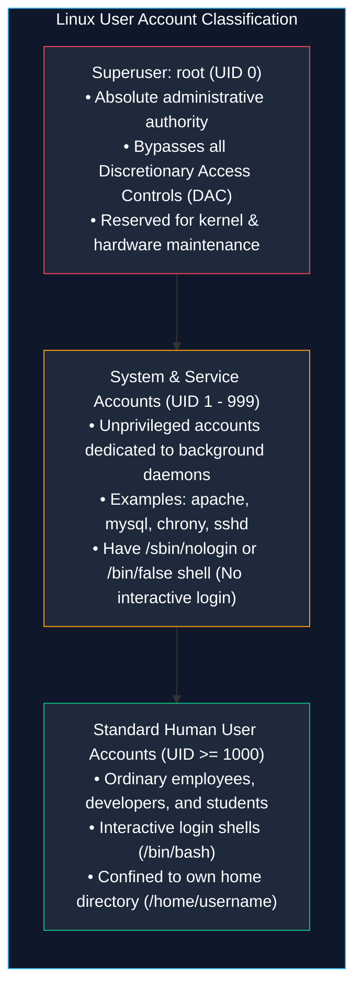

# Linux User and Group Management and Sudo Administration

> **Module:** System and Network Administrator (SNA) Foundations  
> **Topic:** User Account Lifecycle, Identity Databases, Group Inheritance, and Privilege Delegation  
> **Target Audience:** BSIT Students, Junior Linux Administrators, and Security Analysts  
> **Related Reference:** [04-File-Permissions.md](04-File-Permissions.md) | [06-System-Initialization.md](06-System-Initialization.md) | [Linux User Management Cheatsheet](../cheatsheets/Linux-User-Management-Cheatsheet.md)

---

## 🎯 Learning Objectives

By the end of this chapter, you will be able to:

- Differentiate between **Superuser (`root`)**, **System/Service accounts**, and **Regular human user accounts**.
- Decode every colon-separated field inside core authentication databases: `/etc/passwd`, `/etc/shadow`, and `/etc/group`.
- Provision, modify, lock, and delete user accounts safely using `useradd`, `usermod`, `userdel`, and `passwd`.
- Enforce enterprise password aging policies using `chage`.
- Explain Red Hat's **User Private Group (UPG)** scheme and distinguish between **Primary** and **Supplementary (Secondary)** groups.
- Contrast full environment switching (`su -`) with fine-grained privilege delegation (`sudo`).
- Safely manage the `/etc/sudoers` file using the `visudo` validation editor to avoid administrative lockout.

---

## 1. The Linux Identity and Access Management Architecture

In an enterprise IT infrastructure, hundreds of human employees, automated scripts, and system services interact with the operating system simultaneously. 

To maintain security, track individual accountability, and isolate processes, the Linux kernel identifies users not by their human names, but by unique numerical identifiers:
- **UID (User Identifier):** A unique integer assigned to every account.
- **GID (Group Identifier):** A unique integer assigned to every security group.



### 1.1 UID Range Evolution: Legacy RHEL 6 vs. Modern RHEL 7/8/9
As an administrator, you must recognize that default UID boundaries changed between operating system generations:

| Account Category | Legacy RHEL 6 Standard | Modern RHEL 7, 8, and 9 Standard |
|---|---|---|
| **Superuser (`root`)** | `UID 0` | `UID 0` |
| **System / Service Accounts** | `UID 1` through `UID 499` | `UID 1` through `UID 999` |
| **Standard User Accounts** | `UID 500` through `UID 60000` | `UID 1000` through `UID 60000` |

---

## 2. Core Identity Databases

Linux stores identity and security configurations in three world-readable or root-protected flat text files in `/etc`.

```
+----------------------------------------------------------------------------------------------------+
|                                    IDENTITY DATABASE SUMMARY                                       |
+--------------+-------------------+-----------------------------+-----------------------------------+
| File Path    | File Permissions  | Primary Storage Content     | Security Significance             |
+--------------+-------------------+-----------------------------+-----------------------------------+
| /etc/passwd  | 644 (rw-r--r--)   | User account definitions    | World-readable UID/GID mapping    |
| /etc/shadow  | 000 or 400 (r---) | Encrypted password hashes   | Highly protected authentication   |
| /etc/group   | 644 (rw-r--r--)   | Group definitions & rosters | Maps group names to members       |
+--------------+-------------------+-----------------------------+-----------------------------------+
```

---

### 2.1 `/etc/passwd` — The User Account Database

This file is world-readable (`644`) so that standard utilities (like `ls -l` or compiler tools) can translate numerical UIDs into readable usernames.

Each line defines a single user account and contains **seven colon-separated fields**:

```text
student:x:1001:1001:Standard System User:/home/student:/bin/bash
   1    2   3    4            5               6           7
```



```mermaid
flowchart LR
    F1["1. Username<br/>(student)"] --> F2["2. Password Placeholder<br/>('x' = see shadow)"]
    F2 --> F3["3. UID<br/>(1001)"]
    F3 --> F4["4. Primary GID<br/>(1001)"]
    F4 --> F5["5. GECOS / Comment<br/>(Full Name / Dept)"]
    F5 --> F6["6. Home Directory<br/>(/home/student)"]
    F6 --> F7["7. Login Shell<br/>(/bin/bash)"]

    style F1 fill:#1e293b,stroke:#38bdf8,color:#fff
    style F2 fill:#1e293b,stroke:#f59e0b,color:#fff
    style F3 fill:#1e293b,stroke:#10b981,color:#fff
    style F4 fill:#1e293b,stroke:#818cf8,color:#fff
    style F5 fill:#1e293b,stroke:#94a3b8,color:#fff
    style F6 fill:#1e293b,stroke:#38bdf8,color:#fff
    style F7 fill:#1e293b,stroke:#f43f5e,color:#fff
```

1. **Username (`student`):** The unique login name entered at authentication prompts.
2. **Password Indicator (`x`):** In early Unix, encrypted passwords were stored here. Because `/etc/passwd` is world-readable, attackers easily extracted hashes for offline cracking. Today, an `x` indicates that the password hash is securely stored inside the root-only `/etc/shadow` file.
3. **User ID (UID) (`1001`):** The unique numerical ID assigned by the kernel.
4. **Primary Group ID (GID) (`1001`):** The numerical ID of the user's primary group.
5. **GECOS / Comment Field (`Standard System User`):** Descriptive metadata: full human name, department, phone number, or office room.
6. **Home Directory (`/home/student`):** The absolute path to the user's personal working directory navigated to upon login.
7. **Login Shell (`/bin/bash`):** The command interpreter started when the user logs in. If this is set to `/sbin/nologin` or `/bin/false`, the user is prevented from logging in interactively (standard for service accounts like `apache` or `ftp`).

---

### 2.2 `/etc/shadow` — The Encrypted Password Hash Database

This file has permissions `000` (or `400`) and is readable **strictly by the `root` superuser**.

Each line contains **nine colon-separated fields**:

```text
student:$6$kF8...$abZ...:19850:0:90:7:::
   1            2          3   4  5  6 789
```

1. **Username (`student`):** The login name matching `/etc/passwd`.
2. **Encrypted Password Hash:** A cryptographically salted hash of the user's password.
   - **Hash Identifier Prefix:**
     - `$1$`: MD5 (Legacy, insecure).
     - `$5$`: SHA-256.
     - **`$6$`**: **SHA-512** (Standard on modern RHEL).
     - `$y$`: yescrypt (RHEL 9 modern standard).
   - **Account Locking Flags:** If this field begins with `!` or `*`, the account is locked and cannot log in via password authentication.
3. **Last Password Change Date (`19850`):** The date the password was last modified, expressed as the number of days since the Unix Epoch (January 1, 1970).
4. **Minimum Days (`0`):** Minimum number of days required before the user is allowed to change their password again.
5. **Maximum Days (`90`):** Maximum password validity; the user must change their password every 90 days.
6. **Warning Days (`7`):** Number of days prior to expiration that the user receives login warning notices.
7. **Inactive Days (Blank or number):** Number of days after expiration before the account is permanently disabled.
8. **Expiration Date (Blank or epoch days):** Absolute date when the account ceases to function.
9. **Reserved Field:** Reserved for future kernel developments.

---

### 2.3 `/etc/group` — Group Memberships

Contains group definitions and supplementary membership lists. Each line contains **four colon-separated fields**:

```text
developers:x:1002:student,alice,bob
    1      2  3          4
```

1. **Group Name (`developers`):** Name of the group.
2. **Group Password (`x`):** Rarely used password for group membership elevation.
3. **Group ID (GID) (`1002`):** Unique numerical identifier for the group.
4. **Group Roster / Members (`student,alice,bob`):** A comma-separated list of users for whom this group is a **supplementary (secondary)** group. *(Note: A user's primary group does NOT show up in this roster field!)*

---

## 3. Red Hat's User Private Group (UPG) Scheme

Red Hat Enterprise Linux utilizes a specialized security model called the **User Private Group (UPG)** scheme:
- Whenever an administrator creates a new user (e.g., `useradd alice`), the system automatically creates a unique group with the exact same name (`alice`) and assigns it as that user's **Primary Group**.
- Only that single user belongs to that primary group.
- Coupled with the standard umask of `022`, files are created with `-rw-r--r--` (`644`) owned by `alice:alice`. This prevents group members from accidentally writing into personal user files while simplifying collaborative directory configurations.

### Primary vs. Supplementary Groups:
- **Primary Group:** The default group assigned to files created by the user during normal work. Defined in field 4 of `/etc/passwd`. Every user has exactly one primary group.
- **Supplementary (Secondary) Groups:** Additional groups the user joins to gain departmental access (e.g., `developers`, `wheel`, `finance`). Defined in `/etc/group`. A user can belong to dozens of supplementary groups.

---

## 4. Account Lifecycle Management Commands

Administrators manage user accounts using dedicated command-line utilities.

```
+----------------------------------------------------------------------------------------------------+
|                                    ACCOUNT MANAGEMENT COMMANDS                                     |
+--------------+-------------------------------------+-----------------------------------------------+
| Command      | Primary Operational Function        | Key Options & Syntax Styles                   |
+--------------+-------------------------------------+-----------------------------------------------+
| useradd      | Create a new user account           | useradd -m -c "Comment" -s /bin/bash user     |
| usermod      | Modify an existing user account     | usermod -aG group user (Append group)         |
| userdel      | Delete a user account               | userdel -r user (Remove home directory)       |
| passwd       | Set, change, or lock user password  | passwd user, passwd -l user (Lock)            |
| chage        | Manage password aging & expiration  | chage -l user, chage -M 90 user               |
| groupadd     | Create a new security group         | groupadd group_name                           |
+--------------+-------------------------------------+-----------------------------------------------+
```

---

### 4.1 `useradd` — Provisioning New User Accounts

- **Purpose:** Creates a new user account, allocates UID/GID, initializes the user home directory, and copies shell template files from `/etc/skel`.
- **Syntax:**
  ```bash
  useradd [OPTIONS] USERNAME
  ```
- **Key Options:**
  - `-m`: Create home directory `/home/username` (default on RHEL).
  - `-c "Full Name / Comment"`: Populates field 5 (GECOS) of `/etc/passwd`.
  - `-s /path/to/shell`: Specifies login shell (e.g., `/bin/bash` or `/sbin/nologin`).
  - `-u UID`: Manually specifies a numerical User ID.
  - `-g GID/GROUP`: Specifies primary group.
  - `-G GROUP1,GROUP2`: Specifies initial supplementary groups.
- **Realistic Example: Creating an Enterprise User:**
  ```bash
  useradd -m -c "Alice Smith - Systems Engineer" -s /bin/bash -G wheel,developers alice
  ```
- **What Happens Internally:**
  1. The kernel adds an entry for `alice` into `/etc/passwd`.
  2. A matching private group `alice` is registered in `/etc/group`.
  3. A locked password entry (`!!`) is added to `/etc/shadow`.
  4. The folder `/home/alice` is created and populated with hidden environment files (`.bashrc`, `.bash_profile`) copied from the template skeleton `/etc/skel`.
  5. Ownership of `/home/alice` is set to `alice:alice` with permissions `700`.

---

### 4.2 `usermod` — Modifying Existing Accounts

- **Purpose:** Modifies existing user account parameters (shell, group memberships, home directory, expiration dates).
- **Syntax:**
  ```bash
  usermod [OPTIONS] USERNAME
  ```
- **The Critical `-aG` (Append Group) Combination:**
  - `-G GROUP`: Overwrites all current supplementary groups with the new list!
  - **`-aG GROUP` (Append Group):** Adds the user to an additional group **without removing existing memberships**!

```bash
# Safely add user 'student' to the 'wheel' administrative group
usermod -aG wheel student
```

> 🚨 **Critical Administrative Warning on `usermod -G`:**  
> If user `alice` belongs to `finance`, `management`, and `hr`, and you execute:  
> `usermod -G developers alice` (omitting the `-a` flag!)  
> The operating system **strips Alice out of finance, management, and hr**, leaving her only in `developers`!  
> **Always use `-aG`** when appending groups.

#### Other Useful `usermod` Options:
```bash
# Change a user's login shell
usermod -s /bin/zsh alice

# Lock a user account (prepends ! to password hash in /etc/shadow)
usermod -L alice

# Unlock a locked account
usermod -U alice

# Set account expiration date (YYYY-MM-DD)
usermod -e 2026-12-31 alice
```

---

### 4.3 `userdel` — Decommissioning Accounts

- **Purpose:** Removes a user account from system databases.
- **Syntax:** `userdel [OPTIONS] USERNAME`
- **Key Option:**
  - `-r` (remove): Deletes the user's home directory and mail spool along with the account.
- **Example:**
  ```bash
  # Delete user and permanently remove their /home/alice folder
  userdel -r alice
  ```
- **Best Practice for Terminations:** Never delete accounts immediately! First lock the account (`usermod -L`), change the shell to `/sbin/nologin` (`usermod -s /sbin/nologin`), and archive the home directory. Decommission permanently only after a mandatory retention period.

---

### 4.4 `chage` — Password Aging Policies

- **Purpose:** Inspects and configures password expiration, rotation policies, and aging parameters.
- **Syntax:** `chage [OPTIONS] USERNAME`
- **Options:**
  - `-l`: List current password aging parameters.
  - `-M <days>`: Set maximum password lifetime (e.g., 90 days).
  - `-m <days>`: Set minimum days between changes.
  - `-W <days>`: Set warning days prior to expiration.
  - `-d 0`: Force user to change password immediately upon next login!
- **Inspection Example:**
  ```bash
  chage -l student
  ```
- **Expected Output:**
  ```text
  Last password change                                  : Oct 24, 2026
  Password expires                                      : Jan 22, 2027
  Password inactive                                     : never
  Account expires                                       : never
  Minimum number of days between password change        : 0
  Maximum number of days between password change        : 90
  Number of days of warning before password expires     : 7
  ```
- **Enterprise Use Case: Forcing Password Change on Initial Login:**
  When provisioning a new employee, set an initial temporary password, then run:
  ```bash
  chage -d 0 newuser
  ```
  The employee will be blocked from accessing the desktop until they successfully establish a new, private password.

---

## 5. Privilege Delegation: `su -` vs. `sudo`

In Linux systems administration, executing tasks as the superuser (`root`) is routinely necessary to restart daemons, partition storage, or install packages. However, logging in directly as root is forbidden in enterprise baselines.

Administrators elevate privileges using two distinct mechanisms:

```
+----------------------------------------------------------------------------------------------------+
|                                      su - VS. sudo COMPARISON                                      |
+--------------------------+------------------------------------+------------------------------------+
| Feature                  | su - (Switch User)                 | sudo (SuperUser DO)                |
+--------------------------+------------------------------------+------------------------------------+
| Password Required        | Target user's password (root pass) | Operating user's own password      |
| Scope of Elevation       | Full, open-ended root shell        | Single command or scoped execution |
| Environment Variables    | Fully resets to root environment   | Preserves or safely sanitizes env  |
| Accountability & Audit   | Zero individual audit logging      | Every command logged in secure     |
| Privilege Granularity    | All-or-nothing (total root access) | Granular (can restrict to 1 command|
+--------------------------+------------------------------------+------------------------------------+
```

### 5.1 `su` vs. `su -` (The Crucial Dash!)
- **`su` (Switch User without Dash):** Changes your effective UID to root, but **keeps your original standard user's environment variables and `$PATH`**. This can cause configuration errors because `/sbin` and `/usr/sbin` may be missing from your path.
- **`su -` (Switch User with Dash / Login Shell):** Completely resets the shell environment, setting `$HOME` to `/root`, resetting `$PATH` to root's administrative path, and executing `/root/.bash_profile`.
- **Rule:** If you must use `su`, **always include the dash**: `su -`.

### 5.2 The `sudo` Command: The Enterprise Standard
`sudo` allows authorized users to execute individual administrative commands by entering **their own personal password**:
```bash
sudo systemctl restart httpd
```
- **Audit Logging:** Every command executed via `sudo` is permanently recorded in `/var/log/secure` (or `/var/log/auth.log` on Debian/Ubuntu):
  ```text
  Oct 24 14:15:02 server01 sudo:  student : TTY=pts/0 ; PWD=/home/student ; USER=root ; COMMAND=/bin/systemctl restart httpd
  ```
  This proves exactly who performed the action, ensuring complete administrative accountability.

---

## 6. Configuring Sudoers Safely with `visudo`

Privilege delegation rules are stored in `/etc/sudoers` and modular files under `/etc/sudoers.d/`.

### 6.1 The Golden Rule: Never Edit `/etc/sudoers` Directly with Vim!
If you edit `/etc/sudoers` directly using a plain text editor (`vim /etc/sudoers`) and accidentally make a syntax typo (like a missing comma or misspelled keyword), **`sudo` will immediately break system-wide**, permanently locking all administrators out of root access!

Instead, **always use the dedicated command**:
```bash
visudo
```
- **How `visudo` Works:** It opens `/etc/sudoers` in a temporary lock file. When you save and attempt to exit, `visudo` thoroughly parses the file for syntax errors. If a syntax error is detected, `visudo` refuses to save and prompts you to fix the error (`What now? [e,x,Q]`), guaranteeing you can never break system sudo access.

### 6.2 The `wheel` Administrative Group on RHEL
By default, Red Hat Enterprise Linux includes this pre-configured line in `/etc/sudoers`:
```text
%wheel  ALL=(ALL)   ALL
```
- `%wheel`: The percent sign `%` indicates a group name.
- `ALL=(ALL)`: Members of this group can run commands on any host as any user.
- `ALL`: Authorized to run all commands.
- **How to Grant Sudo Access on RHEL:** Simply add the user to the `wheel` group!
  ```bash
  usermod -aG wheel student
  ```

---

## 7. Important Points to Remember

- **Account Tiers:** Root is `UID 0`; system daemons run under system accounts (`1-999`); human users have `UID >= 1000`.
- **Database Roles:** `/etc/passwd` is world-readable account metadata; `/etc/shadow` contains root-only encrypted password hashes; `/etc/group` stores supplementary memberships.
- **Password Prefix:** In `/etc/shadow`, `$6$` indicates SHA-512 encryption; an initial `!` indicates a locked account.
- **Primary vs. Supplementary:** Every user has one Primary group (defined in `/etc/passwd`); supplementary groups are assigned via `usermod -aG`.
- **The Append Danger:** Always combine `-a` with `-G` when running `usermod` (`usermod -aG group user`) to avoid stripping existing secondary group memberships.
- **Safe Editing:** Never edit `/etc/sudoers` with standard editors; always use `visudo` to enforce automated syntax validation.
- **Always Include Dash:** When using `su`, always run `su -` to ensure root's full environment and `$PATH` are initialized.

---

## 8. Key Terms Glossary

| Term | Technical Definition |
|---|---|
| **GECOS** | The 5th field in `/etc/passwd` used to store administrative commentary, full human names, and office contact information. |
| **GID** | Group Identifier; a unique numerical integer representing a security group in the Linux kernel. |
| **Primary Group** | The default group assigned to newly created files by a user. Defined in field 4 of `/etc/passwd`. |
| **Supplementary Group** | Additional group memberships granted to a user to share access to departmental resources. Listed in `/etc/group`. |
| **UID** | User Identifier; a unique numerical integer representing an individual user account in the Linux kernel. |
| **UPG** | User Private Group; Red Hat's scheme where creating a user automatically creates a matching group containing only that user. |
| **visudo** | A specialized administrative tool that safely locks and edits the `/etc/sudoers` file, validating syntax before committing changes. |
| **wheel Group** | A legacy Unix administrative group pre-configured in Red Hat Enterprise Linux with full `sudo` privilege escalation rights. |

---

## 9. Practice Questions

Test your mastery of user accounts, shadow databases, and privilege delegation. Attempt each question independently before consulting the answer key below.

### Question 1 (Identity Databases)
Examine this line from `/etc/passwd`:
```text
mysql:x:27:27:MySQL Server:/var/lib/mysql:/sbin/nologin
```
What is the functional purpose of setting the 7th field to `/sbin/nologin`?
- [A] It forces MySQL to use an encrypted password.
- [B] It indicates that the MySQL database is currently stopped.
- [C] It prevents anyone from logging into this account interactively via terminal or SSH, enhancing security for service daemons.
- [D] It deletes the MySQL server if the root password expires.

### Question 2 (Shadow Decoding)
A security analyst inspects `/etc/shadow` and finds this entry:
```text
backup_user:!$6$mY8s...$kJ2...:19800:0:90:7:::
```
What does the exclamation mark `!` at the beginning of the second field signify?
- [A] The user has root superuser privileges.
- [B] The password has expired today.
- [C] The user account password is locked, preventing password-based authentication.
- [D] The password uses MD5 hashing.

### Question 3 (Group Modification Hazard)
User `dev_lead` is currently a member of supplementary groups `git_users`, `qa_testers`, and `deployers`.
An administrator runs:
```bash
usermod -G docker dev_lead
```
What unexpected operational disaster just occurred for `dev_lead`? What was the correct command?

### Question 4 (Password Expiration Scenario)
An enterprise security baseline requires that all newly created employee accounts must be forced to establish a brand-new, private password immediately upon their first login.
What exact command enforces this requirement on user `jdoe`?

### Question 5 (Sudoers Safety)
Why will a senior Linux administrator reprimand a junior technician who opens `/etc/sudoers` using `nano /etc/sudoers` or `vim /etc/sudoers`? What command must be used instead?

### Question 6 (Account Provisioning Execution)
Write the complete, single `useradd` command line to create a new user `brian` that:
1. Creates his home directory automatically.
2. Sets his full name comment to `"Brian Jones - DBA"`.
3. Sets his login shell to `/bin/bash`.
4. Adds him to the supplementary groups `wheel` and `database_admins`.

---

## 10. Answer Key & Explanations

### Answer to Question 1:
**Correct Option:** **[C]**  
*Explanation:* Background system services (like MySQL, Apache, Chrony) require a UID and GID to own files and processes with minimal privileges, but they should never have interactive terminal access. Assigning `/sbin/nologin` (or `/bin/false`) as the login shell ensures that if an attacker compromises the service, they cannot establish an interactive BASH shell session.

### Answer to Question 2:
**Correct Option:** **[C]**  
*Explanation:* A leading exclamation mark `!` (or `*`) in the password hash field of `/etc/shadow` indicates that the account is locked. The system will reject all password login attempts.

### Answer to Question 3:
**Correct Answer:**  
The administrator omitted the **`-a` (append)** flag! By executing `usermod -G docker dev_lead`, the operating system **wiped out all existing supplementary group memberships**, stripping `dev_lead` out of `git_users`, `qa_testers`, and `deployers`!  
The correct command to append a group safely is:
```bash
usermod -aG docker dev_lead
```

### Answer to Question 4:
**Correct Answer:**
```bash
chage -d 0 jdoe
```
*Explanation:* The `-d 0` option sets the "last password change date" to Epoch Day 0 (January 1, 1970). When the user attempts to log in, the operating system kernel calculates that the password has been expired for decades and forces an immediate password reset before granting shell access.

### Answer to Question 5:
**Correct Answer:**  
Editing `/etc/sudoers` with a standard text editor does not perform syntax checking. If a single typo, syntax error, or misplaced character is saved, the `sudo` subsystem fails immediately, **locking all administrators out of superuser elevation**.  
Administrators must always use:
```bash
visudo
```
`visudo` performs automated syntax validation upon saving and locks the file against simultaneous edits by multiple administrators.

### Answer to Question 6:
**Correct Answer:**
```bash
useradd -m -c "Brian Jones - DBA" -s /bin/bash -G wheel,database_admins brian
```

---

## 🔗 Related Notes & Next Steps

- **Next Chapter:** Learn how the Linux kernel boots into multi-user runlevels and systemd targets in [06-System-Initialization.md](06-System-Initialization.md).
- **Text Configuration Tools:** Master editing configuration files in [07-Vim-and-Nano.md](07-Vim-and-Nano.md).
- **Quick Reference:** Keep [cheatsheets/Linux-User-Management-Cheatsheet.md](../cheatsheets/Linux-User-Management-Cheatsheet.md) bookmarked.
