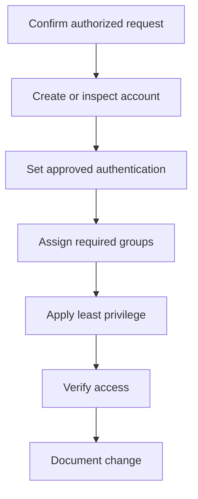

# Linux User Management

## 1. Introduction
User accounts represent identities; groups collect users so permissions can be managed for multiple people. Account management controls who can log in and what resources they can access.

## 2. Important files

| File | Purpose |
|---|---|
| `/etc/passwd` | Basic account records including username and UID |
| `/etc/shadow` | Protected password-related data on typical Linux systems |
| `/etc/group` | Group records and membership data |

Use supported tools rather than manually editing these files unless you have an authorized, well-understood reason.

## 3. Inspect identity
```bash
whoami
id
groups
```
`whoami` shows the effective username; `id` shows user and group IDs; `groups` lists group memberships.

## 4. Common account commands
```bash
useradd student1
passwd student1
id student1
groupadd students
usermod -aG students student1
```
These commands may require root privileges and may vary by configuration. `usermod -aG` appends a supplementary group; omitting `-a` can replace the supplementary group list. Verify options on the target system.

## 5. Account-management workflow


## 6. Least privilege
Grant only the access required for the task. A user who needs to read a report should not automatically receive administrative rights. Privileged group membership deserves careful review.

## 7. Removing or disabling accounts
Before changing account status or removing an account, check ownership of important files, scheduled tasks, and services. Preserve data if required and follow policy. Do not delete real accounts without understanding the impact.

## Summary
User management covers identities, groups, authentication, and permissions. Use supported tools, least privilege, and verification.

## Related notes
- [File Permissions](04-File-Permissions.md)
- [User Management Cheatsheet](../cheatsheets/Linux-User-Management-Cheatsheet.md)
