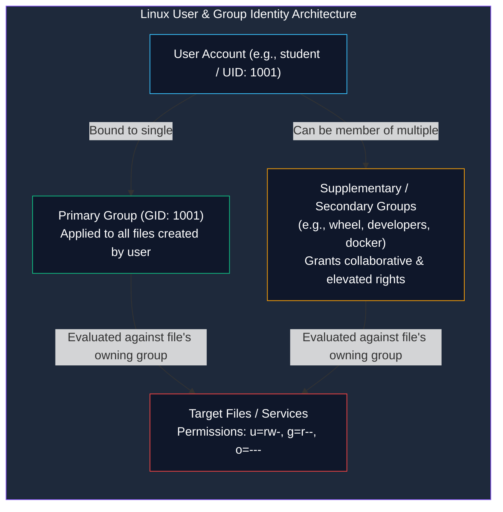

# Linux User, Group, and Identity Management

> **Module:** System and Network Administrator (SNA) — 03 Linux Fundamentals  
> **Topic Level:** Core Identity & Access Administration  
> **Previous Reference:** [04-File-Permissions.md](04-File-Permissions.md) | **Next:** [06-System-Initialization.md](06-System-Initialization.md)

---

## 🎯 Learning Objectives

By the end of this note, you will be able to:

- Deconstruct the syntax and purpose of critical identity databases: `/etc/passwd`, `/etc/shadow`, `/etc/group`, and `/etc/skel`.
- Understand the difference between **UID**, **GID**, **Primary Groups**, and **Supplementary Groups**.
- Create, modify, lock, and delete user and group accounts using standard CLI tools (`useradd`, `usermod`, `userdel`, `groupadd`).
- Explain the critical behavioral difference between `su` and `su -`.
- Configure administrative privilege delegation safely using `sudo` and the `visudo` editor.
- Identify inactive accounts and enforce password aging policies.

---

## 1. Introduction and Context

In an enterprise environment, a server is rarely accessed by a single individual. Multiple administrators, developers, auditors, and automated background daemons interact with the operating system simultaneously.

Identity management is the first line of defense. The Linux kernel does not identify users by human-readable login names like `alice` or `bob`; it identifies accounts strictly by numerical integers known as **User IDs (UIDs)** and **Group IDs (GIDs)**. The System Administrator is responsible for managing these identities, enforcing least privilege, configuring sudo delegation, and auditing inactive accounts.



---

## 2. Definitions of Important Terminology

| Term | Definition |
|---|---|
| **UID (User ID)** | A unique positive integer assigned to each user account by the kernel. `UID 0` is permanently reserved for `root`. |
| **GID (Group ID)** | A unique positive integer assigned to a group of users to facilitate shared resource access. |
| **Primary Group** | The default group assigned to a user upon creation; new files created by the user inherit this group by default. |
| **Supplementary Group** | Additional groups a user belongs to for extra privileges (e.g., adding a user to `wheel` allows sudo elevation). |
| **`/etc/skel`** | The template directory containing default profile files (`.bashrc`, `.bash_profile`) automatically copied into a newly created user's home directory. |
| **Shadow Passwords** | The security mechanism that stores salted and hashed passwords in `/etc/shadow` (readable only by root), removing password hashes from the world-readable `/etc/passwd`. |

---

## 3. Core Identity Databases

### 3.1 `/etc/passwd` (Account Database)
This file is world-readable (`644`) so system utilities and compilers can map numerical UIDs to human usernames. Each line contains **7 colon-separated fields**:

```text
student:x:1001:1001:Standard System User:/home/student:/bin/bash
   1    2   3    4            5               6           7
```

1. **Username**: Login name (`student`).
2. **Password Indicator**: `x` indicates the actual password hash is securely stored in `/etc/shadow`.
3. **UID**: Numerical User ID (`1001`). (On RHEL 6, regular users start at UID 500; on modern RHEL 7/8/9, regular users start at UID 1000).
4. **GID**: Primary Group ID (`1001`).
5. **GECOS (Comment)**: Description, full name, or office details.
6. **Home Directory**: Absolute path to user's home folder (`/home/student`).
7. **Login Shell**: Absolute path to interpreter started upon login (`/bin/bash`). If set to `/sbin/nologin` or `/bin/false`, interactive terminal login is disabled (standard for service accounts like `apache` or `mysql`).

---

### 3.2 `/etc/shadow` (Secure Password & Aging Database)
This file is restricted (`000` or `400`, readable only by `root`). Each line contains **9 colon-separated fields**:

```text
student:$6$kF8...$abZ...:19850:0:90:7:::
   1            2          3   4  5  6 789
```

1. **Username**: Matches `/etc/passwd`.
2. **Encrypted Password Hash**: Includes algorithm identifier (e.g., `$6$` indicates SHA-512, `$1$` indicates MD5, `$y$` indicates yescrypt), salt, and hash. If field contains `!!` or `*`, account has no password and is locked.
3. **Last Password Change**: Days since January 1, 1970 (Unix epoch).
4. **Minimum Days**: Days required between password changes before the user can change it again.
5. **Maximum Days**: Maximum days a password remains valid before mandatory change (password aging).
6. **Warning Days**: Days in advance the user is warned of upcoming password expiration.
7. **Inactive Days**: Days after expiration before an unused account is permanently disabled.
8. **Expiration Date**: Absolute date (in epoch days) when account expires.
9. **Reserved**: Unused field for future development.

---

### 3.3 `/etc/group` (Group Database)
World-readable file (`644`) defining group memberships:

```text
developers:x:1002:student,alice,bob
    1      2   3         4
```
1. **Group Name**: Name of group.
2. **Group Password**: Stored as `x` (passwords rarely used for groups).
3. **GID**: Group ID number.
4. **Member List**: Comma-separated list of users for whom this is a **secondary / supplementary** group.

---

## 4. Account Administration Commands

### 4.1 Creating Users (`useradd`)
```bash
# Basic user creation with default options (creates /home/john and primary group 'john')
useradd john

# Create user with custom UID, comment, and secondary groups
useradd -u 1500 -c "Network Analyst" -G wheel,developers -s /bin/bash john

# Create a system service account (no interactive login, no home directory)
useradd -r -s /sbin/nologin -M svc_backup
```

### 4.2 Setting and Managing Passwords (`passwd`)
```bash
# Set or change your own password (interactive)
passwd

# Set or reset another user's password (root only)
passwd john

# Lock an account (prepends ! to hash in /etc/shadow, preventing login)
passwd -l john

# Unlock a locked account
passwd -u john

# View account password aging and status details
passwd -S john
chage -l john
```

### 4.3 Modifying Existing Users (`usermod`)
```bash
# Add user to a secondary group (-a for append, -G for group list)
# ⚠️ WARNING: Always include -a! Without -a, existing secondary groups are wiped!
usermod -aG wheel john

# Change user login shell (e.g., disable interactive login)
usermod -s /sbin/nologin john

# Change home directory location and move existing files (-m)
usermod -d /home/john_new -m john

# Lock and unlock via usermod
usermod -L john   # Lock
usermod -U john   # Unlock
```

### 4.4 Deleting Users (`userdel`)
```bash
# Delete account record only (leaves home directory and mail spool on disk)
userdel john

# Delete account AND purge home directory and mailbox (-r for remove)
userdel -r john
```

---

## 5. Privilege Elevation: `su` vs. `su -` vs. `sudo`

### The Critical Difference: `su` vs. `su -`
```bash
# Substitute user WITHOUT simulating full login
su - root     # ✅ RECOMMENDED
su root       # ❌ RISKY ANTI-PATTERN
```

| Feature | `su root` (Without Dash) | `su - root` (With Dash) |
|---|---|---|
| **Environment Variables** | Retains standard user's `$PATH`, `$HOME`, `$USER` | Replaces with root's full clean login environment |
| **Working Directory** | Stays in previous working directory | Changes to `/root` |
| **Path Risks** | May run unauthorized binaries if user's path has `./` | Uses clean, secure system paths (`/sbin:/usr/sbin:...`) |

### Modern Administrative Standard: `sudo`
Rather than sharing the root password among multiple technicians, administrators use **`sudo` (SuperUser DO)**.
- Each administrator authenticates with **their own user password**.
- Commands executed with `sudo` are logged with timestamps and usernames in `/var/log/secure` (RHEL) or `/var/log/auth.log` (Debian).
- Membership in the **`wheel`** group grants sudo access by default on RHEL systems.

### Safely Editing the Sudoers File: `visudo`
Never open `/etc/sudoers` directly with a normal editor. A syntax error in `/etc/sudoers` can permanently lock everyone out of administrative privileges.
```bash
# Always use visudo (locks file against simultaneous edits and checks syntax before saving)
visudo
```

Typical configuration entries in `/etc/sudoers`:
```text
# Allow members of group wheel to execute any command
%wheel    ALL=(ALL)    ALL

# Allow user 'backupuser' to run only backup scripts without a password prompt
backupuser ALL=(root) NOPASSWD: /usr/local/bin/backup.sh
```

---

## 6. Common Mistakes & Defensive Troubleshooting

- **Running `usermod -G` without `-a` (Append)**:
  - *Disaster Scenario*: User belongs to `wheel`, `developers`, and `storage`. Administrator runs `usermod -G docker alice`.
  - *Result*: The user is violently removed from `wheel`, `developers`, and `storage`, losing their administrative access.
  - *Fix*: Always use `usermod -a -G <group> <user>`.
- **Manually Editing `/etc/passwd` or `/etc/shadow` with Vim**:
  - *Risk*: A misplaced character or formatting error corrupts the system authentication table.
  - *Fix*: Always use dedicated commands (`useradd`, `usermod`, `passwd`, `vipw`, `vigr`).

---

## 7. Security Considerations

1. **Enforcing Password Complexity**: In enterprise RHEL, the `pam_cracklib` (RHEL 6) or `pam_pwquality` (RHEL 7/8/9) module enforces minimum lengths, character variety, and dictionary checks.
2. **Auditing Inactive Accounts**: Terminated employees or inactive user accounts should be locked (`usermod -L`) and have their shell set to `/sbin/nologin`.

---

## 8. Summary & Next Steps

Identity management, account databases, and sudo delegation ensure accountability and control over system resources. Next, we examine how the Linux kernel boots from hardware into multi-user service runlevels.

- **Next Chapter:** Understand system boot, SysVinit, and runlevels in [06-System-Initialization.md](06-System-Initialization.md).
- **Text Editing Tools:** Learn how administrators edit configuration files in [07-Vim-and-Nano.md](07-Vim-and-Nano.md).
- **Quick Reference:** Consult [../cheatsheets/Linux-User-Management-Cheatsheet.md](../cheatsheets/Linux-User-Management-Cheatsheet.md).
