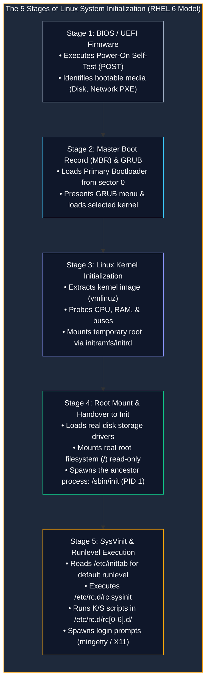

# Linux System Initialization, Boot Sequence, and Service Management

> **Module:** System and Network Administrator (SNA) — 03 Linux Fundamentals  
> **Topic Level:** System Bootstrapping & Lifecycle Control  
> **Previous Reference:** [05-User-Management.md](05-User-Management.md) | **Next:** [07-Vim-and-Nano.md](07-Vim-and-Nano.md)

---

## 🎯 Learning Objectives

By the end of this note, you will be able to:

- Outline the 5 sequential stages of the Linux boot sequence: **BIOS/UEFI**, **MBR/GRUB**, **Kernel**, **Initrd/Initramfs**, and **Init (PID 1)**.
- Master the **RHEL 6 SysVinit** operational model: `/etc/inittab`, runlevels `0` through `6`, and `/etc/rc.d/`.
- Manage service daemons and persistent startup states using `service` and `chkconfig`.
- Understand how single-user mode (Runlevel 1) is utilized for disaster recovery and lost root password resets.
- Map legacy RHEL 6 SysVinit commands and runlevels to modern `systemd` target units and `systemctl`.

---

## 1. Introduction and Context

When physical power is applied to a server motherboard, the machine begins in an uninitialized hardware state. Before web servers, databases, or terminal prompts can accept connections, the system must execute an orderly initialization sequence: hardware verification, bootloader loading, kernel extraction, driver discovery, root filesystem mounting, and service daemon activation.

Understanding system initialization is essential for emergency administration. When a server fails to boot after a kernel update, or an administrator is locked out due to a forgotten root credential, mastering boot arguments and runlevel transitions enables rapid recovery.



---

## 2. Definitions of Important Terminology

| Term | Definition |
|---|---|
| **BIOS (Basic Input/Output System)** | Legacy motherboard firmware responsible for POST testing and initiating the first storage sector bootloader. |
| **MBR (Master Boot Record)** | The first 512-byte sector of a partitioned storage drive containing stage 1 boot code and the 4-entry partition table. |
| **GRUB (Grand Unified Bootloader)** | The software program that presents the operating system boot menu, accepts kernel parameters, and unpacks the Linux kernel into RAM. |
| **initramfs / initrd** | An initial root filesystem image loaded into memory containing minimal disk drivers needed to access and mount the real hard drive root filesystem. |
| **PID 1 (`/sbin/init`)** | The first user-space process spawned by the kernel; the parent/ancestor of all executing processes on the operating system. |
| **Runlevel** | A predefined software execution state in Unix/Linux that determines which subsystems and background services are active. |

---

## 3. RHEL 6 SysVinit Architecture & Runlevels

In RHEL 6, system initialization is managed by **SysVinit** (via Upstart compatibility). The primary configuration file controlling the default system state is `/etc/inittab`.

### 3.1 Standard Runlevels (0 through 6)

| Runlevel | Mode Name | Purpose & Characteristics |
|:---:|---|---|
| **0** | **Halt** | Shuts down the operating system and powers off the physical hardware. |
| **1 / S** | **Single-User Mode** | Minimal emergency maintenance mode. No network services, no daemons, root shell only. Used for password recovery and filesystem repair. |
| **2** | **Multi-User (No Network)** | Multi-user text console without network support. |
| **3** | **Full Multi-User (CLI)** | **The standard enterprise server state.** Full networking, multi-user text console, all server daemons active. No graphical GUI. |
| **4** | **Unused / User-Defined** | Reserved for custom local configurations; rarely used. |
| **5** | **Graphical Multi-User (GUI)** | Full networking plus the X Window System / GNOME Desktop display manager. Standard for workstations. |
| **6** | **Reboot** | Shuts down all running services safely and reboots the hardware. |

### 3.2 Examining `/etc/inittab` (RHEL 6)
In RHEL 6, the default runlevel is defined by a single line in `/etc/inittab`:

```text
id:3:initdefault:
```
- Changing `3` to `5` instructs the system to boot directly into the graphical desktop.
- ⚠️ **Dangerous Mistake:** Never set `initdefault` to `0` or `6`! Doing so will trap the server in an infinite shutdown or reboot loop.

### 3.3 The Script Structure: `/etc/rc.d/`
Once the kernel launches `/sbin/init`, it executes `/etc/rc.d/rc.sysinit` to set the hostname, mount local filesystems in `/etc/fstab`, and enable swap.

Next, it enters the target runlevel directory:
- `/etc/rc.d/init.d/`: Master repository of all service management shell scripts (e.g., `network`, `sshd`, `httpd`).
- `/etc/rc.d/rc3.d/`: Symlinks pointing back to `/etc/rc.d/init.d/` for Runlevel 3.

```text
Symlink Naming Convention:
K##<service_name>   --> Kill (stop) script on entering runlevel (e.g., K15httpd)
S##<service_name>   --> Start script on entering runlevel (e.g., S55sshd)
(## represents execution priority from 00 to 99)
```

---

## 4. Service Administration in RHEL 6 (`service` & `chkconfig`)

### 4.1 Real-Time Service Control (`service`)
The `service` command executes the script inside `/etc/rc.d/init.d/` to inspect or alter the current running state:

```bash
# Check running status of a daemon
service sshd status
service httpd status

# Start, stop, or restart a daemon
service httpd start
service httpd stop
service httpd restart

# Reload configuration without dropping active connections
service sshd reload
```

### 4.2 Persistent Boot Configuration (`chkconfig`)
The `chkconfig` utility controls whether a service starts automatically across runlevels 2, 3, 4, and 5:

```bash
# List all services and their configured runlevel states
chkconfig --list

# Query status of a specific service
chkconfig --list httpd
# Output: httpd          0:off   1:off   2:off   3:on    4:on    5:on    6:off

# Enable a service to start automatically at boot (runlevels 2, 3, 4, 5)
chkconfig httpd on

# Disable a service from starting at boot
chkconfig httpd off

# Configure specific runlevels explicitly
chkconfig --level 35 httpd on
```

---

## 5. RHEL 6 SysVinit vs. Modern systemd Comparison

| Administrative Task | Legacy RHEL 6 (SysVinit) | Modern RHEL 7 / 8 / 9 (systemd) |
|---|---|---|
| **View Service Status** | `service httpd status` | `systemctl status httpd` |
| **Start / Stop Service** | `service httpd start` / `stop` | `systemctl start httpd` / `stop` |
| **Enable at Boot** | `chkconfig httpd on` | `systemctl enable httpd` |
| **Disable at Boot** | `chkconfig httpd off` | `systemctl disable httpd` |
| **List Services** | `chkconfig --list` | `systemctl list-unit-files --type=service` |
| **Switch Runlevel Live** | `init 3` or `telinit 5` | `systemctl isolate multi-user.target` |
| **Check Current Runlevel** | `runlevel` | `systemctl get-default` |
| **CLI Server Equivalent** | Runlevel 3 (`id:3:initdefault:`) | `multi-user.target` |
| **GUI Desktop Equivalent**| Runlevel 5 (`id:5:initdefault:`) | `graphical.target` |

---

## 6. Single-User Mode: Emergency Root Recovery (RHEL 6)

If an administrator loses the root password on a physical or virtual RHEL 6 system:

1. Reboot the server.
2. At the GRUB splash screen, press any key to interrupt the countdown timer.
3. Select the target kernel entry and press **`e`** (edit).
4. Highlight the line beginning with `kernel /vmlinuz...` and press **`e`** again.
5. Append a space followed by the word **`single`** (or the number **`1`**) to the end of the line:
   ```text
   ... ro root=/dev/mapper/VolGroup-lv_root rd_NO_LUKS single
   ```
6. Press **Enter** to save the temporary parameter, then press **`b`** to boot.
7. The system boots directly into a root maintenance shell without prompting for a password.
8. Reset the password immediately:
   ```bash
   passwd root
   ```
9. Reboot into standard multi-user mode:
   ```bash
   reboot
   # or: init 3
   ```

---

## 7. Common Operational Pitfalls

- **Setting `initdefault` to 0 or 6 in `/etc/inittab`**:
  - The machine will immediately shut down or reboot upon finishing kernel boot.
  - *Remediation*: Interrupt GRUB, boot into single-user mode (`1`), edit `/etc/inittab`, and correct the value to `3`.
- **Assuming `service restart` is safe during business hours**:
  - Restarting daemons drops all active socket connections. For production web or SSH services, prefer `reload` if you only altered configuration parameters.

---

## 8. Security Considerations

1. **Protecting GRUB with a Password**: Because single-user mode allows anyone with console access to reset the root password in seconds, production servers must password-protect GRUB using `grub-md5-crypt` in `/boot/grub/grub.conf`.
2. **Disabling Unnecessary Services**: Every active network daemon (e.g., legacy `telnet`, `rsh`, `vsftpd`) introduces an attack surface. Use `chkconfig <service> off` to eliminate unneeded listeners.

---

## 9. Summary & Next Steps

System initialization bridges hardware firmware with running enterprise daemons. Understanding SysVinit, runlevels, and service persistence in RHEL 6 provides foundational knowledge that translates directly into modern systemd architectures.

- **Next Chapter:** Master configuration editing in [07-Vim-and-Nano.md](07-Vim-and-Nano.md).
- **Network Traffic Analysis:** Learn packet capture with tcpdump in [../04-Networking/01-Tcpdump-Commands.md](../04-Networking/01-Tcpdump-Commands.md).
- **Quick Reference:** Consult [../cheatsheets/Linux-Commands-Cheatsheet.md](../cheatsheets/Linux-Commands-Cheatsheet.md).
