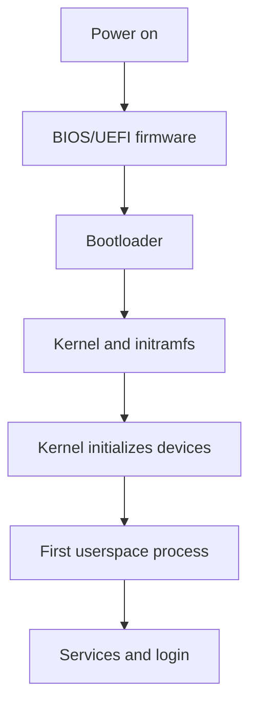

# Linux System Initialization

## 1. What is initialization?
System initialization is the sequence that starts an operating system after power-on or reboot. Firmware initializes hardware, a bootloader loads the kernel, and userspace startup brings the machine to a usable state.

## 2. Simplified startup sequence

This is conceptual; exact stages vary by machine and release.

## 3. Key components
- **BIOS/UEFI:** firmware that performs initial setup and selects a boot device.
- **Bootloader:** loads the kernel and may load an initial RAM filesystem.
- **Kernel:** manages memory, CPU scheduling, devices, and core OS functions.
- **Init system:** starts and coordinates userspace services.
- **Service:** background program providing a function.

## 4. RHEL 6 distinction
RHEL 6 commonly uses SysV init and service scripts; later RHEL releases use systemd. Do not assume `systemctl` is available on RHEL 6.

Possible inspection commands:
```bash
uname -a
runlevel
chkconfig --list
```
Command availability and output vary. Some operations require privileges.

## 5. Service commands
On a suitable RHEL 6 system, service scripts may support:
```bash
service sshd status
service sshd start
service sshd stop
```
The service must exist and commands may require root privileges. Start or stop services only when authorized because doing so can interrupt access or applications.

## 6. Startup troubleshooting
Record the exact error; determine how far startup proceeds; review relevant logs; check recent changes; and avoid repeated changes without evidence. Do not edit bootloader or filesystem settings casually.

## Summary
Startup proceeds from firmware to bootloader, kernel, and userspace initialization. Always use instructions appropriate to the installed RHEL version.

## Related notes
- [RHEL](01-Introduction-to-RHEL.md)
- [Common Linux Commands](02-Common-Linux-Commands.md)
