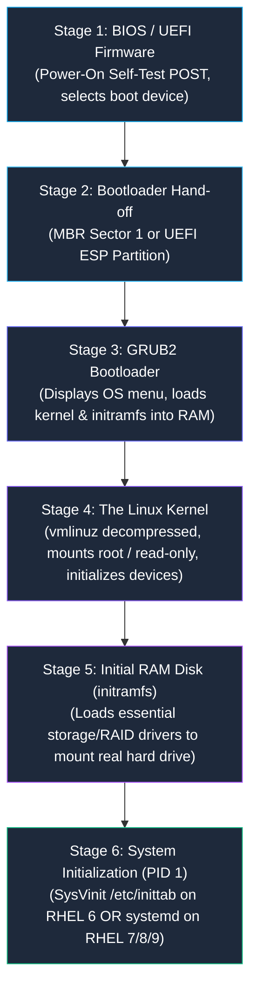
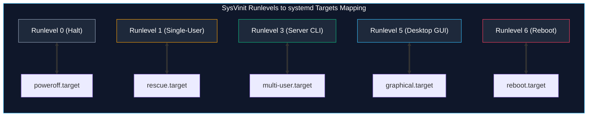
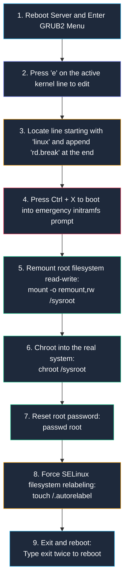

# Linux System Initialization, Boot Sequence, and Service Management

> **Module:** System and Network Administrator (SNA) Foundations  
> **Topic:** The 6 Stages of Linux Booting, Legacy SysVinit Runlevels, and Modern systemd Targets  
> **Target Audience:** BSIT Students, Junior Linux Administrators, and Infrastructure Engineers  
> **Related Reference:** [01-Introduction-to-RHEL.md](01-Introduction-to-RHEL.md) | [05-User-Management.md](05-User-Management.md) | [Linux Commands Cheatsheet](../cheatsheets/Linux-Commands-Cheatsheet.md)

---

## 🎯 Learning Objectives

By the end of this chapter, you will be able to:

- Trace the complete **6 Stages of the Linux Boot Sequence** from physical hardware power-on to the user login prompt.
- Understand the critical role of the **Grand Unified Bootloader (GRUB2)** and the **Initial RAM Filesystem (`initramfs`)**.
- Articulate the operational differences between legacy **SysVinit (RHEL 6)** and modern **systemd (RHEL 7/8/9)**.
- Map traditional numerical **SysVinit Runlevels (0–6)** to modern **systemd Target Units** (`multi-user.target`, `graphical.target`).
- Manage background services, daemons, and targets with authority using `service`/`chkconfig` on legacy systems and `systemctl` on modern systems.
- Explain the security concept of service **masking** (`systemctl mask`).
- Troubleshoot boot failures and perform an emergency single-user maintenance recovery.

---

## 1. The 6 Stages of the Linux Boot Sequence

When an administrator presses the physical power button on an enterprise server, what sequence of hardware and software events transitions the bare-metal machine into a fully functional multi-user operating system?

The boot sequence follows **six distinct, sequential stages**:



---

### 1.1 Stage 1: BIOS / UEFI Firmware
- **What Occurs:** The Motherboard's non-volatile ROM firmware executes immediately upon receiving electrical power.
- **POST (Power-On Self-Test):** The firmware verifies physical hardware health: checks that the CPU is responsive, tests RAM modules for integrity, and queries attached storage buses (NVMe, SATA, SAS).
- **Boot Priority Selection:** Searches the configured boot sequence (e.g., Internal NVMe Drive, Network PXE Boot, USB Drive) to locate a bootable drive.

### 1.2 Stage 2: Bootloader Hand-off
- **Legacy BIOS:** Reads the absolute first 512-byte sector of the storage drive, known as the **Master Boot Record (MBR)**. The MBR contains 446 bytes of primary bootloader stage-1 code.
- **Modern UEFI:** Mounts a dedicated FAT32 disk partition called the **EFI System Partition (ESP)** and executes the signed bootloader binary file located at `/EFI/redhat/grubx64.efi`.

### 1.3 Stage 3: GRUB2 (Grand Unified Bootloader)
- **What Occurs:** GRUB2 is the primary bootloader used across enterprise Linux.
- **Menu Display:** GRUB2 reads its configuration file (`/boot/grub2/grub.cfg`) and displays a graphical or text menu allowing the administrator to choose which installed kernel release to boot.
- **Loading Payloads:** Once a kernel is selected (or after a 5-second default timeout), GRUB2 loads two critical files from the `/boot` partition directly into system RAM:
  1. The compiled Linux Kernel binary image (`vmlinuz`).
  2. The Initial RAM Filesystem image (`initramfs`).

### 1.4 Stage 4: The Linux Kernel (`vmlinuz`)
- **What Occurs:** The compressed kernel image decompresses itself in RAM and seizes full control of the CPU and hardware.
- **Hardware Initialization:** Scans hardware registers, configures memory page tables, and mounts the root filesystem `/` in **read-only mode** to protect against filesystem corruption while diagnostics execute.

### 1.5 Stage 5: The Initial RAM Disk (`initramfs`)
- **The Chicken-and-Egg Problem:** In modern enterprise servers, the real root filesystem `/` is frequently stored on an encrypted drive, a complex Software RAID array, an LVM logical volume, or a remote Fiber Channel Storage Area Network (SAN). The Linux kernel cannot mount the real root filesystem without specific storage drivers! But those drivers are stored inside `/lib/modules/` on the hard drive!
- **The Solution (`initramfs`):** `initramfs` is a small temporary root filesystem bundled into RAM by GRUB2. It contains the bare-minimum storage, LVM, and filesystem drivers (e.g., ext4, xfs) necessary to initialize the real storage controller, assemble the RAID/LVM volume, and mount the real root partition `/`. Once the real root filesystem is mounted, the kernel pivots to it and discards `initramfs` from memory.

### 1.6 Stage 6: The Initialization System (PID 1)
- Once the real root filesystem is mounted read-write, the kernel launches the very first user-space program: **`/sbin/init`**, assigned **Process ID 1 (PID 1)**.
- PID 1 is the parent and ancestor of every single process that runs on the server.
- Depending on the Linux distribution release:
  - On **legacy RHEL 6**: PID 1 is **SysVinit / Upstart**.
  - On **modern RHEL 7, 8, and 9**: PID 1 is **systemd**.

---

## 2. The Great Evolution: SysVinit vs. systemd

The transition between RHEL 6 and RHEL 7 represented the most massive architectural shift in the history of Linux systems administration.

```
+----------------------------------------------------------------------------------------------------+
|                                    SysVinit VS. systemd COMPARISON                                 |
+--------------------------+------------------------------------+------------------------------------+
| Architectural Feature    | Legacy SysVinit (RHEL 6)           | Modern systemd (RHEL 7, 8, 9)      |
+--------------------------+------------------------------------+------------------------------------+
| Primary Daemon (PID 1)   | /sbin/init                         | /lib/systemd/systemd               |
| Configuration Model      | /etc/inittab & shell scripts       | Declarative Unit Files (.service)  |
| Execution Strategy       | Strict sequential shell execution  | Highly parallelized socket startup |
| State Definitions        | Numerical Runlevels (0 through 6)  | Named Target Units (.target)       |
| Service Management Tool  | service & chkconfig                | systemctl                          |
| Logging Mechanism        | Plain-text /var/log/messages       | Structured binary journalctl       |
| Process Tracking         | Fragile PID files (/var/run/*.pid) | Linux Kernel cgroups (uncheatable) |
+--------------------------+------------------------------------+------------------------------------+
```

### 2.1 Why Was SysVinit Replaced?
1. **Slow Sequential Booting:** SysVinit executed init scripts one at a time. If Script #15 took 30 seconds to initialize a network interface, Scripts #16 through #50 were forced to wait idle.
2. **Fragile Shell Scripts:** Every service was controlled by a complex, 300-line BASH script located in `/etc/rc.d/init.d/`. Maintaining custom scripts across thousands of servers was prone to human syntax errors.
3. **Flawed Process Tracking:** If an Apache web server daemon spawned worker threads and crashed without cleaning up its `/var/run/httpd.pid` file, SysVinit could not determine if the process was actually dead or alive.

### 2.2 Why systemd Dominates Modern Linux
Created by Lennart Poettering and adopted across RHEL, Debian, Ubuntu, and Arch, **systemd** solved these challenges:
- **Parallel Activation:** Services launch concurrently. If Service B needs Service A, systemd opens a listening network socket in advance, buffering requests so both services can initialize simultaneously.
- **Declarative Configuration:** Replaced 300-line shell scripts with clean, 15-line `.service` unit files.
- **cgroups Process Tracking:** Utilizes Linux Control Groups (cgroups). When a service starts, all child processes are tagged inside a kernel cgroup. If an administrator runs `systemctl stop httpd`, systemd terminates all spawned worker processes cleanly, leaving zero orphaned processes.

---

## 3. SysVinit Mechanics: The 7 Runlevels (RHEL 6 Focus)

On legacy Red Hat Enterprise Linux 6 systems, system initialization states are categorized into **seven numerical runlevels**:

| Runlevel | Operational Name | Environment Description |
|:---:|---|---|
| **`0`** | **Halt** | Shuts down the operating system and powers off physical hardware safely. |
| **`1` / `S`** | **Single-User Mode** | Emergency recovery mode. Boots directly into a root shell with **zero networking** and no background daemons. Used to reset forgotten root passwords or repair corrupted disks. |
| **`2`** | **Multi-User (No Network)** | Multiple users can log in locally, but network interfaces are disabled. |
| **`3`** | **Full Multi-User (CLI)** | **The standard server runlevel**. Full networking, multi-user logins, and all background services enabled in text command-line mode. |
| **`4`** | **Unused / User-Defined** | Reserved for custom administrative configurations. |
| **`5`** | **Graphical Multi-User (GUI)** | Identical to Runlevel 3, but automatically launches the X Window system and a graphical desktop display manager (GNOME / X11). |
| **`6`** | **Reboot** | Shuts down all running services and immediately reboots the server. |

### 3.1 The `/etc/inittab` File on RHEL 6
On RHEL 6, the default boot runlevel is configured inside `/etc/inittab` via the `initdefault` directive:
```text
id:3:initdefault:
```
*(Meaning: The server boots by default into Runlevel 3 - Full Multi-User CLI)*.

### 3.2 Legacy Service Control: `service` and `chkconfig`
- **Controlling Active Daemons in Memory:**
  ```bash
  # Check current status of Apache web server
  service httpd status

  # Start, stop, or restart a service
  service httpd start
  service httpd stop
  service httpd restart
  ```
- **Configuring Boot Behavior Across Runlevels (`chkconfig`):**
  ```bash
  # Check at which runlevels httpd starts automatically
  chkconfig --list httpd
  # Output: httpd 0:off 1:off 2:off 3:on 4:on 5:on 6:off

  # Enable httpd to start automatically on reboots (sets runlevels 2, 3, 4, 5 to ON)
  chkconfig httpd on

  # Disable httpd from starting automatically
  chkconfig httpd off
  ```

---

## 4. Modern systemd Mechanics: Units and Targets (RHEL 7/8/9 Focus)

In modern Linux, numerical runlevels are replaced by **systemd Target Units** (`.target`). A target is an encapsulation grouping together multiple systemd services.



### 4.1 Common systemd Unit Types
systemd manages diverse operating system resources, differentiated by their file extensions:
- **`.service`**: Background daemons (e.g., `sshd.service`, `httpd.service`).
- **`.target`**: Groupings of units representing system states (e.g., `multi-user.target`).
- **`.socket`**: IPC or network sockets that activate services on-demand.
- **`.mount`**: Filesystem mount points (automatically generated from `/etc/fstab`).
- **`.timer`**: Scheduled automation tasks (modern replacement for `cron`).

---

## 5. Detailed Command Explanations: `systemctl`

On modern RHEL 7, 8, and 9 systems, all service management, boot target control, and state queries are consolidated into a single administrative binary: **`systemctl`**.

```
+----------------------------------------------------------------------------------------------------+
|                                    systemctl COMMAND CHEATSHEET                                    |
+--------------------------+------------------------------------+------------------------------------+
| Command Syntax           | Operational Meaning                | Permanent Boot Impact?             |
+--------------------------+------------------------------------+------------------------------------+
| systemctl start <unit>   | Start service in memory right now  | NO (Temporary until next reboot)   |
| systemctl stop <unit>    | Terminate running service process  | NO (Temporary until next reboot)   |
| systemctl restart <unit> | Stop and immediately restart daemon| NO (Temporary)                     |
| systemctl reload <unit>  | Reread configuration without drop  | NO (Zero connection drop)          |
| systemctl status <unit>  | Inspect live status, PID, and logs | Read-only inspection               |
| systemctl enable <unit>  | Configure service to start at boot | YES (Creates systemd symlink)      |
| systemctl disable <unit> | Stop service from starting at boot | YES (Deletes systemd symlink)      |
| systemctl mask <unit>    | Completely prevent service start   | YES (Symlinks unit to /dev/null)   |
+--------------------------+------------------------------------+------------------------------------+
```

---

### 5.1 Inspecting Service Status: `systemctl status`

- **Purpose:** Checks whether a service is actively running, loaded in memory, its main Process ID (PID), memory consumption, and recent log messages.
- **Example Execution:**
  ```bash
  systemctl status httpd
  ```
- **Expected Output:**
  ```text
  ● httpd.service - The Apache HTTP Server
       Loaded: loaded (/usr/lib/systemd/system/httpd.service; enabled; vendor preset: disabled)
       Active: active (running) since Wed 2026-10-24 10:15:20 EDT; 2h 45min ago
         Docs: man:httpd.service(8)
     Main PID: 2450 (httpd)
       Status: "Total requests: 120; Idle/Busy workers 100/0;Requests/sec: 0.012"
        Tasks: 213 (limit: 23120)
       Memory: 28.5M
          CPU: 1.450s
       CGroup: /system.slice/httpd.service
               ├─2450 /usr/sbin/httpd -DFOREGROUND
               ├─2452 /usr/sbin/httpd -DFOREGROUND
               └─2453 /usr/sbin/httpd -DFOREGROUND

  Oct 24 10:15:20 server01 systemd[1]: Starting The Apache HTTP Server...
  Oct 24 10:15:20 server01 systemd[1]: Started The Apache HTTP Server.
  ```
- **Interpreting the Output:**
  - `loaded (...; enabled; ...)`: The unit file exists on disk. `enabled` means systemd has created a symlink to start it on boot.
  - `active (running)`: The daemon is currently executing healthy in RAM.
  - `Main PID: 2450`: The parent process ID.
  - `CGroup: ...`: Lists all spawned child worker threads cleanly tracked inside systemd's control group.
  - Trailing lines: The most recent log entries emitted by the daemon.

---

### 5.2 Boot Automation: `enable` vs. `disable`

- **`systemctl enable httpd`**: Does **NOT** start the service right now! It creates a symbolic link in `/etc/systemd/system/multi-user.target.wants/` pointing to the unit file, ensuring the service starts on subsequent reboots.
- **`systemctl start httpd`**: Starts the service right now in memory, but does **NOT** configure it to survive a reboot!
- **The Modern Shortcut (`--now`):**
  ```bash
  # Enable for boot AND start immediately in one single command!
  systemctl enable --now httpd
  ```

---

### 5.3 The Ultimate Service Lock: `systemctl mask`

In enterprise security, an administrator may wish to guarantee that a dangerous or deprecated service (like `telnet.socket` or `iptables`) can **never** be started—neither automatically at boot, nor manually by another junior administrator, nor as an automated dependency of another service.

- **The Command:**
  ```bash
  systemctl mask iptables
  ```
- **How It Works:** systemd deletes any existing unit configuration and creates a symbolic link pointing directly to `/dev/null`:
  ```text
  Created symlink /etc/systemd/system/iptables.service → /dev/null.
  ```
- **Result:** If anyone attempts to start it (`systemctl start iptables`), systemd immediately rejects the request:
  ```text
  Failed to start iptables.service: Unit iptables.service is masked.
  ```
- **To Reverse the Mask:**
  ```bash
  systemctl unmask iptables
  ```

---

### 5.4 Managing Default Boot Targets

- **Check Current Default Target:**
  ```bash
  systemctl get-default
  ```
  *(Output: `multi-user.target`)*
- **Change Default Boot Target (Switch from GUI to Headless Server CLI):**
  ```bash
  systemctl set-default multi-user.target
  ```
- **Switch Targets Immediately Without Rebooting:**
  ```bash
  # Immediately switch running system into graphical desktop mode
  systemctl isolate graphical.target
  ```

---

## 6. Emergency Boot Recovery: The `rd.break` Procedure

What happens when an administrator forgets the root password, or an error in `/etc/fstab` causes the system to halt mid-boot? On modern RHEL systems, administrators use the kernel boot argument **`rd.break`** to regain root control.



> ⚠️ **Critical SELinux Requirement (`/.autorelabel`):**  
> If you reset the root password inside `/sysroot` without creating `/.autorelabel`, the newly updated `/etc/shadow` file will lack the mandatory SELinux security context label. Upon normal reboot, SELinux will block the login process, and your new password will fail! Running `touch /.autorelabel` instructs the kernel to scan and re-label all files during the next boot.

---

## 7. Important Points to Remember

- **The 6 Boot Stages:** BIOS/UEFI -> Bootloader (MBR/ESP) -> GRUB2 -> Kernel (`vmlinuz`) -> Initial RAM Disk (`initramfs`) -> Initialization System (PID 1).
- **initramfs Necessity:** Provides temporary drivers in RAM so the kernel can assemble storage arrays and mount the real root partition `/`.
- **RHEL 6 vs Modern RHEL:** RHEL 6 uses SysVinit (`service`, `chkconfig`, `/etc/inittab`, runlevels 0-6); RHEL 7/8/9 uses systemd (`systemctl`, unit files, targets).
- **Target Equivalencies:** Runlevel 3 (Standard Server CLI) = `multi-user.target`; Runlevel 5 (Desktop GUI) = `graphical.target`; Runlevel 1 (Recovery) = `rescue.target`.
- **Enable vs Start:** `systemctl start` affects memory right now; `systemctl enable` creates a symlink to start at boot. Use `systemctl enable --now` for both.
- **Service Masking:** `systemctl mask` links a unit to `/dev/null`, preventing it from being started manually, automatically, or by dependency.
- **Root Recovery Step:** Always remember `touch /.autorelabel` when performing emergency password resets in single-user mode on SELinux systems.

---

## 8. Key Terms Glossary

| Term | Technical Definition |
|---|---|
| **cgroups** | Control Groups; a Linux kernel feature used by systemd to aggregate and isolate process hierarchies and limit CPU/RAM resources. |
| **chkconfig** | The legacy administrative command on RHEL 6 used to configure service startup across SysV runlevels. |
| **GRUB2** | Grand Unified Bootloader version 2; the modular enterprise bootloader that presents OS selection menus and loads the kernel into RAM. |
| **initramfs** | Initial RAM Filesystem; a temporary root filesystem loaded into memory containing drivers required to mount the real disk root. |
| **PID 1** | Process ID 1; the initial user-space process spawned by the Linux kernel that acts as the parent of all other system processes. |
| **Runlevel** | A predefined operating state on legacy SysVinit Linux systems represented by digits 0 through 6. |
| **systemctl** | The central command-line management utility used to inspect and control the systemd system and service manager. |
| **systemd** | A modern Linux system and service manager providing parallel startup, socket activation, and target unit encapsulation. |
| **Target Unit** | A systemd unit file (ending in `.target`) grouping multiple service dependencies to define a desired system state. |
| **vmlinuz** | The compressed, bootable Linux kernel executable binary file stored in the `/boot` partition. |

---

## 9. Practice Questions

Test your mastery of system initialization, boot sequences, and service management. Attempt each question independently before consulting the answer key below.

### Question 1 (Boot Sequence Analysis)
What critical operational problem does the **Initial RAM Filesystem (`initramfs`)** solve during the Linux boot sequence?
- [A] It verifies user passwords before starting the shell.
- [B] It provides the temporary kernel drivers required to initialize storage controllers and mount the real root partition `/`.
- [C] It formats swap memory every time the server boots.
- [D] It compiles the BASH shell from source code into RAM.

### Question 2 (Runlevel to Target Mapping)
An enterprise server is running RHEL 9. The administrator wants to configure the system to boot into a text-only, multi-user command-line environment without launching a graphical desktop.
Which target should be set as default?
- [A] `systemctl set-default graphical.target`
- [B] `systemctl set-default rescue.target`
- [C] `systemctl set-default multi-user.target`
- [D] `systemctl set-default runlevel3.target`

### Question 3 (Service Management Command Interpretation)
A technician runs `systemctl enable mariadb`.
Does this command start the MariaDB database service in memory right now? Explain the precise operational effect of this command.

### Question 4 (Security & Service Control)
An administrator discovers that an insecure legacy daemon (`rsh.socket`) is installed on an enterprise server. The administrator runs `systemctl stop rsh.socket` and `systemctl disable rsh.socket`.
However, another automated script on the system periodically calls `systemctl start rsh.socket`, re-enabling it. What exact command completely blocks the service from ever starting, even if called by scripts?

### Question 5 (Troubleshooting Scenario)
A junior administrator attempts to start a service on a legacy RHEL 6 production server using:
```bash
systemctl start network
```
The shell responds with `bash: systemctl: command not found`.
What is the cause of this error, and what is the exact command to restart networking on RHEL 6?

### Question 6 (Emergency Recovery)
During an emergency root password recovery using `rd.break`, the administrator remounts `/sysroot` read-write, runs `chroot /sysroot`, and changes the root password using `passwd`.
If the administrator immediately types `exit` and reboots without running `touch /.autorelabel`, what failure will occur upon normal system startup on an SELinux-enforcing server?

---

## 10. Answer Key & Explanations

### Answer to Question 1:
**Correct Option:** **[B]**  
*Explanation:* The kernel cannot access storage drivers stored on the real hard drive until the hard drive is mounted. `initramfs` is loaded into memory directly by GRUB2, providing the essential kernel modules (LVM, RAID, XFS, SATA/NVMe drivers) required to access and mount the real storage drive.

### Answer to Question 2:
**Correct Option:** **[C]**  
*Explanation:* On modern systemd systems, `multi-user.target` is the direct equivalent of legacy Runlevel 3 (full networking, multi-user CLI, no GUI). Option [D] is invalid syntax.

### Answer to Question 3:
**Correct Answer:**  
**No, it does not start the service right now.**  
`systemctl enable` only configures **boot automation**. It creates a symbolic link in `/etc/systemd/system/` ensuring the service starts automatically on future system reboots. The service remains stopped in active memory until `systemctl start mariadb` is executed (or if `systemctl enable --now mariadb` was used).

### Answer to Question 4:
**Correct Answer:**
```bash
systemctl mask rsh.socket
```
*Explanation:* Masking links the unit file directly to `/dev/null`. Even if an automated script or another service attempts to invoke `systemctl start rsh.socket`, systemd will refuse with `Unit rsh.socket is masked`.

### Answer to Question 5:
**Correct Answer:**  
The server is running legacy **RHEL 6**, which utilizes the **SysVinit** service manager rather than modern systemd. The `systemctl` binary does not exist on RHEL 6.  
The correct legacy command is:
```bash
service network restart
```

### Answer to Question 6:
**Correct Answer:**  
The administrator will be **unable to log in with the new root password**, and the boot process may fail authentication. Because `/etc/shadow` was modified from outside the normal SELinux operating context, the file lacks valid SELinux security context labels. In `Enforcing` mode, SELinux blocks the login daemon from reading the unlabelled shadow file. Creating `/.autorelabel` forces an automated background security relabeling of the entire filesystem during the subsequent boot cycle.

---

## 🔗 Related Notes & Next Steps

- **Next Chapter:** Master configuration file text editing using Vim and Nano in [07-Vim-and-Nano.md](07-Vim-and-Nano.md).
- **Network Protocol Analysis:** Begin packet capture and inspection with [../04-Networking/01-Tcpdump-Commands.md](../04-Networking/01-Tcpdump-Commands.md).
- **Quick Reference:** Keep [cheatsheets/Linux-Commands-Cheatsheet.md](../cheatsheets/Linux-Commands-Cheatsheet.md) bookmarked.
