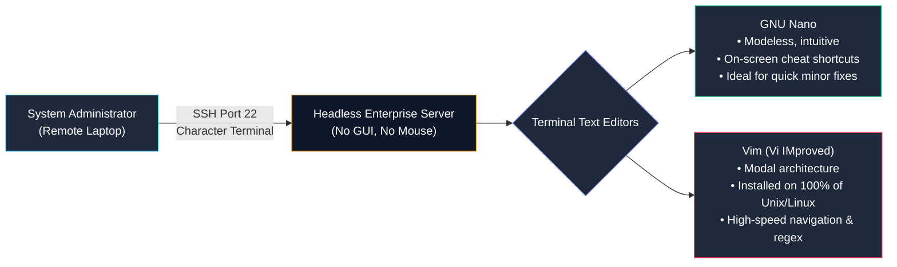
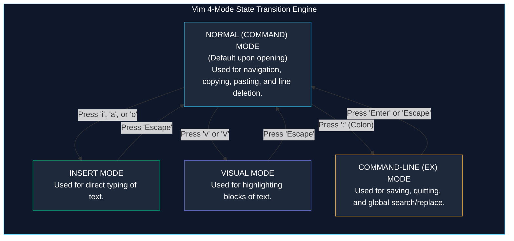

# Command-Line Text Editing with Vim and Nano

> **Module:** System and Network Administrator (SNA) Foundations  
> **Topic:** Terminal-Based Text Editors, Modal Editing, Keybindings, and Swap Recovery  
> **Target Audience:** BSIT Students, Junior System Administrators, and Support Engineers  
> **Related Reference:** [02-Common-Linux-Commands.md](02-Common-Linux-Commands.md) | [03-File-Management.md](03-File-Management.md) | [Vim and Nano Cheatsheet](../cheatsheets/Vim-and-Nano-Cheatsheet.md)

---

## 🎯 Learning Objectives

By the end of this chapter, you will be able to:

- Articulate why terminal-based text editors are indispensable for managing headless enterprise Linux servers.
- Edit, save, search, and navigate configuration files comfortably using **GNU Nano**.
- Master the **Modal Editing Paradigm** of **Vim (Vi IMproved)**: transition seamlessly between **Normal**, **Insert**, **Visual**, and **Command-Line (Ex)** modes.
- Execute essential Vim navigation shortcuts, line cuts (`dd`), yanks (`yy`), and pastes (`p`) without touching a computer mouse.
- Perform global search-and-replace operations in Vim using regular expressions (`:%s/old/new/g`).
- Diagnose and resolve Vim **swap file collisions** (`.swp`) caused by network drops or crashed terminal sessions.
- Select the appropriate editor for specific administrative scenarios based on speed, availability, and task complexity.

---

## 1. Why Terminal Text Editors are Essential

In desktop operating systems, editing a file is trivial: you double-click the file, a graphical window opens (such as Notepad or VS Code), you click with your mouse, type changes, and press `Ctrl + S`.

In the enterprise server world, however:
- **Headless Architecture:** Over 95% of enterprise Linux servers operate **headless** (without a monitor, graphics card, or graphical user interface like GNOME or KDE) to maximize performance, save RAM, and reduce the attack surface.
- **Remote SSH Administration:** Administrators connect across the internet or local networks using **Secure Shell (SSH)** command-line sessions.
- **Configuration as Text:** In Linux, everything from network interfaces (`/etc/sysconfig/network-scripts/`), web daemons (`/etc/httpd/conf/httpd.conf`), DNS resolvers (`/etc/resolv.conf`), and user accounts (`/etc/passwd`) is configured in plain ASCII text files.

To manage enterprise Linux, you must master text editors that run entirely inside an SSH character terminal window.



The two standard terminal editors in enterprise Linux are **GNU Nano** and **Vim**.

---

## 2. GNU Nano: The Intuitive, Modeless Editor

**GNU Nano** is a modeless, user-friendly editor designed as an open-source clone of the classical Unix Pine email editor (Pico).

### 2.1 The Modeless Concept
Nano is **modeless**: every key you press on your keyboard immediately types that character into the document, just like standard word processors. Special commands (like saving, exiting, and searching) are triggered by holding down the `Ctrl` key.

### 2.2 Understanding the Nano Terminal Interface
When you launch Nano (`nano /etc/hosts`), the screen divides into three zones:

```text
  GNU nano 5.6.1                   File: /etc/hosts                              
127.0.0.1   localhost localhost.localdomain
::1         localhost localhost.localdomain
192.168.1.10 server01.lab.local server01
                                                                                 
^G Help      ^O WriteOut  ^W Where Is  ^K Cut       ^T Execute   ^C Location
^X Exit      ^R Read File ^\ Replace   ^U Paste     ^J Justify   ^_ Go To Line
```

- **Top Bar:** Shows the Nano software version, the filename being edited, and whether the buffer has been modified (indicated by `[Modified]`).
- **Middle Area:** The active text editing window.
- **Bottom Two Lines (Shortcut Bar):** A built-in cheatsheet of available commands.
  - The caret symbol **`^`** represents the **`Ctrl`** key. For example, `^O` means hold `Ctrl` and press `O`.
  - The letter **`M-`** represents the **`Alt`** (Meta) key.

---

### 2.3 Essential Nano Shortcut Reference

```
+----------------------------------------------------------------------------------------------------+
|                                    GNU NANO SHORTCUT SUMMARY                                       |
+-------------------+------------------------------------+-------------------------------------------+
| Shortcut          | Command Name                       | Operational Purpose                       |
+-------------------+------------------------------------+-------------------------------------------+
| Ctrl + O          | WriteOut (Save)                    | Saves file to disk without exiting editor |
| Ctrl + X          | Exit                               | Closes Nano (prompts to save if modified) |
| Ctrl + W          | Where Is (Search)                  | Searches for text strings forward in file |
| Ctrl + K          | Cut Line (Kill)                    | Deletes current line and copies to buffer |
| Ctrl + U          | Uncut Line (Paste)                 | Pastes the copied buffer at cursor        |
| Ctrl + C          | Location                           | Displays current line number & column     |
| Ctrl + _          | Go To Line                         | Prompts for line number to jump directly  |
| Alt + U           | Undo                               | Reverses the last editing action          |
| Alt + E           | Redo                               | Re-applies the last undone editing action |
+-------------------+------------------------------------+-------------------------------------------+
```

### 2.4 Editing Workflow in Nano
1. **Open a File:** `nano /etc/motd`
2. **Type Changes:** Use arrow keys to position the cursor and type normally.
3. **Save Changes:** Press `Ctrl + O`. Nano prompts: `File Name to Write: /etc/motd`. Press `Enter` to confirm.
4. **Exit:** Press `Ctrl + X`. If you forgot to save, Nano asks: `Save modified buffer? (Y/N)`. Press `Y` then `Enter`.

---

## 3. Vim (Vi IMproved): The Enterprise Standard

While Nano is simple and friendly, **Vim** is the undisputed master editor of enterprise system administration. 

### Why Every Administrator Must Learn Vim:
1. **Universal Ubiquity:** `vi` / `vim` is installed on **100% of all Unix, Linux, BSD, and macOS systems by default**. On stripped-down minimal container images or single-user disaster recovery shells where Nano is missing, Vim is always present.
2. **Extreme Speed & Efficiency:** In Vim, your hands never leave the home row of the keyboard. You never touch a mouse. An experienced administrator can delete 20 lines, jump to line 400, search-and-replace an IP address, and save the file in under 3 seconds.
3. **Modal Power:** Vim treats typing text and manipulating text as two completely separate operations.

---

## 4. The Vim Modal Editing Paradigm

The single greatest hurdle for BSIT students learning Vim is typing characters and seeing the editor beep or delete lines unexpectedly. This happens because **Vim is a Modal Editor**.

Vim operates in **four distinct modes**:



### 4.1 The Four Modes Defined:
1. **Normal Mode (Command Mode):**
   - The default mode when Vim opens.
   - Keys do **not** type letters on the screen; instead, they execute navigation and text-manipulation commands (e.g., `dd` deletes a line, `u` undos, `x` deletes a character).
2. **Insert Mode:**
   - The mode where you type text into the document.
   - Indicated at the bottom left of the terminal by: `-- INSERT --`.
3. **Visual Mode:**
   - Used to highlight text blocks using arrow keys for selective copying or deletion.
   - Indicated at the bottom left by: `-- VISUAL --` (character-wise) or `-- VISUAL LINE --`.
4. **Command-Line (Ex) Mode:**
   - Triggered by typing a colon **`:`** while in Normal Mode.
   - The cursor moves to the bottom line of the screen. Used for writing to disk (`:w`), quitting (`:q`), and complex search-and-replace commands.

---

## 5. Comprehensive Vim Command and Keybinding Reference

```
+----------------------------------------------------------------------------------------------------+
|                                      VIM MASTER KEYBINDING MATRIX                                  |
+-------------------+------------------------------------+-------------------------------------------+
| Key Sequence      | Mode Used In                       | Operational Action Performed              |
+-------------------+------------------------------------+-------------------------------------------+
| i                 | Normal -> Insert                   | Insert text BEFORE current cursor         |
| a                 | Normal -> Insert                   | Append text AFTER current cursor          |
| o                 | Normal -> Insert                   | Open NEW blank line BELOW cursor & insert |
| O                 | Normal -> Insert                   | Open NEW blank line ABOVE cursor & insert |
| Escape            | Any Mode -> Normal                 | Return immediately to Normal Mode         |
| h, j, k, l        | Normal Mode Navigation             | Left (h), Down (j), Up (k), Right (l)     |
| w / b             | Normal Mode Navigation             | Jump forward word (w) / backward word (b) |
| 0 / $             | Normal Mode Navigation             | Jump to start of line (0) / end of line($)|
| gg / G            | Normal Mode Navigation             | Jump to top of file (gg) / bottom (G)     |
| <num>G (e.g. 45G) | Normal Mode Navigation             | Jump directly to line number (Line 45)    |
| dd                | Normal Mode Editing                | Delete (cut) current entire line          |
| <num>dd (e.g. 5dd)| Normal Mode Editing                | Delete (cut) 5 consecutive lines          |
| yy                | Normal Mode Editing                | Yank (copy) current entire line to buffer |
| p / P             | Normal Mode Editing                | Paste buffer below cursor (p) / above (P) |
| u / Ctrl + r      | Normal Mode Editing                | Undo last action (u) / Redo action (Ctrl+r|
| /pattern          | Normal Mode Search                 | Search forward for pattern (n=next, N=prev|
| :w                | Command-Line Mode                  | Write (save) file to disk                 |
| :q                | Command-Line Mode                  | Quit Vim (fails if unsaved changes exist) |
| :wq or :x or ZZ   | Command-Line Mode                  | Save changes and quit Vim cleanly         |
| :q!               | Command-Line Mode                  | Force quit IMMEDIATELY, discarding changes|
| :%s/old/new/g     | Command-Line Mode                  | Global search and replace throughout file |
| :set number       | Command-Line Mode                  | Turn on line numbering display            |
+-------------------+------------------------------------+-------------------------------------------+
```

---

### 5.1 Step-by-Step Vim Editing Walkthrough

Let us practice the golden workflow every administrator uses to edit an enterprise configuration file:

#### Step 1: Open the Target File
```bash
vim /etc/resolv.conf
```
*You enter Vim in **Normal Mode**.*

#### Step 2: Navigate Without the Mouse
- Move down using `j`, up using `k`.
- Jump to the end of the file by pressing `G`.
- Jump back to the top by pressing `gg`.

#### Step 3: Transition to Insert Mode
- Position your cursor and press **`i`** to insert text before the cursor, or press **`o`** to open a brand-new line beneath the cursor.
- Notice `-- INSERT --` appears at the bottom of the screen.
- Type your changes:
  ```text
  nameserver 8.8.8.8
  ```

#### Step 4: Return to Normal Mode
- **Always press `Escape` immediately after finishing typing!**
- The `-- INSERT --` prompt vanishes. You are safely back in Normal Mode where keys cannot accidentally type garbage into the file.

#### Step 5: Save and Quit
- Press **`:`** to enter Command-Line Mode.
- Type **`wq`** (write and quit) and press **`Enter`**.
- The file is saved to disk and you are returned to your shell prompt.

---

### 5.2 Advanced Search and Replace (`:%s`)

Administrators frequently need to replace an obsolete IP address or domain name across hundreds of lines in a configuration file.

The Vim search-and-replace syntax follows this structure:

```text
:[range]s / [target_pattern] / [replacement_text] / [flags]
```

- **`%`**: Represents the entire file from line 1 to the end.
- **`s`**: Substitute command.
- **`g` (Global flag):** Replaces **all** occurrences on every line (without `g`, Vim replaces only the first occurrence on each line).
- **`c` (Confirm flag):** Prompts for interactive confirmation (`y/n`) before making each individual substitution.

#### Examples:
```vim
" Replace every occurrence of '192.168.1.10' with '192.168.1.50' across the entire file
:%s/192.168.1.10/192.168.1.50/g

" Replace 'http' with 'https' across the entire file, asking for confirmation each time
:%s/http/https/gc
```

---

## 6. Diagnosing and Resolving Vim Swap File Collisions

A classic dilemma encountered by every Linux administrator occurs when editing a file over SSH and your Wi-Fi drops, your laptop battery dies, or another administrator opens the same file simultaneously.

When you reconnect and run `vim /etc/httpd/conf/httpd.conf`, Vim halts and throws this alarming screen:

```text
E325: ATTENTION
Found a swap file by the name "/etc/httpd/conf/.httpd.conf.swp"
          owned by: root   dated: Wed Oct 24 14:10:02 2026
         file name: /etc/httpd/conf/httpd.conf
          modified: YES
         user name: root   host name: server01.lab.local
        process ID: 4120 (still running)
While opening file "/etc/httpd/conf/httpd.conf"
             dated: Wed Oct 24 13:45:10 2026

(1) Another program may be editing the same file.
(2) An edit session for this file crashed.

Swap file already exists!
[O]pen Read-Only, (E)dit anyway, (R)ecover, (D)elete it, (Q)uit, (A)bort:
```

```mermaid
flowchart TD
    CRASH["SSH Session Disconnects or Crashes<br/>Vim leaves hidden .filename.swp file on disk"] --> REOPEN["Administrator reopens file in Vim<br/>Vim detects existing swap file and displays E325 Warning"]
    REOPEN --> CHOICE{"Is another administrator actively editing?"}
    CHOICE -->|YES| QUIT["Press [Q] to Quit!<br/>Do not overwrite colleague's active session."]
    CHOICE -->|NO (It was my dropped session)| RECOVER["Step 1: Press [R] to Recover unsaved buffer in memory<br/>Step 2: Inspect changes & Save file with :wq<br/>Step 3: Manually delete the swap file: rm .filename.swp"]

    style CRASH fill:#1e293b,stroke:#f43f5e,color:#fff
    style REOPEN fill:#0f172a,stroke:#38bdf8,color:#fff
    style CHOICE fill:#1e293b,stroke:#f59e0b,color:#fff
    style QUIT fill:#1e293b,stroke:#94a3b8,color:#fff
    style RECOVER fill:#1e293b,stroke:#10b981,color:#fff
```

### 6.1 The 3-Step Swap Recovery Procedure:
1. **Press `R` (Recover):** Vim reads the hidden `.httpd.conf.swp` file and reconstructs your unsaved edits into active memory.
2. **Save the Recovered File:** Verify the text and type **`:wq`** to write the recovered buffer to disk.
3. **Delete the Hidden Swap File!**  
   *Vim does not delete the swap file automatically.* If you reopen the file, the error will appear again! You must delete it manually:
   ```bash
   rm /etc/httpd/conf/.httpd.conf.swp
   ```

---

## 7. Vim vs. Nano: Administrator Comparison

| Feature | GNU Nano | Vim (Vi IMproved) |
|---|---|---|
| **Architecture** | Modeless (types text immediately) | Modal (Normal, Insert, Visual, Ex) |
| **Learning Curve** | Extremely low (intuitive within 2 minutes) | Moderate to high (requires deliberate practice) |
| **Ubiquity** | Present on most desktop/server installs | Present on **100% of all Unix/Linux systems** |
| **Editing Speed** | Moderate (requires arrow keys and Ctrl combos) | Lightning fast (home row navigation, repeat commands) |
| **Regex Search/Replace** | Basic text search | Advanced regular expressions and global substitutions |
| **Macro Automation** | None | Powerful keystroke recording and macro playback (`q`) |
| **Recommended Use Case** | Quick emergency edits for beginners | Professional daily systems administration and coding |

---

## 8. Important Points to Remember

- **Headless Necessity:** Production enterprise Linux servers run without graphical desktop environments; terminal text editors are mandatory.
- **Nano Simplicity:** Nano is modeless; special operations use `Ctrl` (indicated by `^` on screen). `Ctrl + O` writes out (saves); `Ctrl + X` exits.
- **Vim Modal Rule:** In Vim, you must transition into **Insert Mode** (`i`, `a`, `o`) to type text, and **always press `Escape`** to return to Normal Mode.
- **Normal Mode Power:** `dd` cuts a line; `yy` copies a line; `p` pastes; `u` undos; `gg` jumps to top; `G` jumps to bottom.
- **Safe Vim Quitting:** `:wq` saves and exits; `:q!` force-exits discarding all changes.
- **Global Replace:** `:%s/search/replace/g` replaces every occurrence in the entire document.
- **Swap Resolution:** If Vim crashes, press `R` to recover, `:wq` to save, and `rm .filename.swp` to remove the residual lock file.

---

## 9. Key Terms Glossary

| Term | Technical Definition |
|---|---|
| **Ex Mode** | Command-Line mode in Vim triggered by typing `:`, used for executing global commands, saving, and exiting. |
| **Headless Server** | A computer system operating without a dedicated physical monitor, keyboard, mouse, or graphical desktop environment. |
| **Insert Mode** | The operational state in Vim where typed keystrokes are directly inserted into the text buffer. |
| **Modal Editing** | A software interface design where keys perform different functions depending on the active operational mode of the editor. |
| **Normal Mode** | The default command state of Vim used for navigating, searching, cutting, copying, and deleting text. |
| **Swap File (`.swp`)** | A hidden temporary file created by Vim recording real-time buffer edits to enable recovery in the event of a system crash. |
| **Visual Mode** | A selection mode in Vim (`v` or `V`) used to highlight blocks or lines of text for manipulation. |
| **Yank** | The Unix/Vim terminology for copying text into memory without deleting it (triggered by `yy` or `y`). |

---

## 10. Practice Questions

Test your mastery of terminal text editing. Attempt each question independently before consulting the answer key below.

### Question 1 (Vim Modal Mechanics)
A student opens Vim to edit a file, immediately types the word `server`, and looks at the screen. To the student's surprise, the letters do not appear; instead, the cursor jumped down several lines and the editor beeped.
What fundamental mistake did the student make?
- [A] The student did not have root permissions.
- [B] The file was corrupted on disk.
- [C] The student was in **Normal Mode** and did not press `i`, `a`, or `o` to enter **Insert Mode** before typing.
- [D] The keyboard layout was set to German.

### Question 2 (Nano Shortcuts)
In the GNU Nano shortcut bar at the bottom of the screen, you see the notation:
```text
^O WriteOut
```
What exact physical keystroke combination does this represent?
- [A] Hold `Shift` and press `O`
- [B] Hold `Ctrl` and press `O`
- [C] Hold `Alt` and press `O`
- [D] Press the caret `^` key followed by `O`

### Question 3 (Vim Navigation)
An administrator is reviewing a 1,000-line Apache configuration file in Vim. The administrator wants to jump directly to line `450` without pressing the down arrow 450 times.
What command accomplishes this in Normal Mode?
- [A] `450j`
- [B] `450G`
- [C] `:goto 450`
- [D] `Ctrl + 450`

### Question 4 (Vim Search and Replace)
Write the exact Command-Line Mode command in Vim to replace all occurrences of `PORT 8080` with `PORT 443` across the entire file without prompting for confirmation.

### Question 5 (Emergency Exiting)
A junior technician accidentally modifies a critical system file in Vim. The technician realizes a mistake was made and wants to exit immediately **without saving any changes**.
What exact key sequence should the technician press?
- [A] `:q` followed by `Enter`
- [B] `Ctrl + C`
- [C] `Escape`, followed by `:q!`, followed by `Enter`
- [D] `:wq!` followed by `Enter`

### Question 6 (Swap File Collision Scenario)
Explain why running `rm .filename.swp` is necessary **after** recovering a crashed file in Vim with the `[R]` option. What will happen if you do not delete the swap file?

---

## 11. Answer Key & Explanations

### Answer to Question 1:
**Correct Option:** **[C]**  
*Explanation:* Vim opens by default in **Normal Mode**, where keys are mapped to navigational commands (e.g., `s` deletes a character and enters insert mode, `e` jumps to the end of a word, `r` replaces a single character). To type text into a file, the user must first enter **Insert Mode** by pressing `i`, `a`, or `o`.

### Answer to Question 2:
**Correct Option:** **[B]**  
*Explanation:* In terminal conventions and GNU Nano documentation, the caret `^` represents the **`Ctrl`** key. `^O` means `Ctrl + O` (WriteOut / Save).

### Answer to Question 3:
**Correct Option:** **[B]**  
*Explanation:* In Vim Normal Mode, typing a number followed by capital `G` jumps directly to that line number (`450G`). Alternatively, entering Command-Line mode and typing `:450` followed by `Enter` also jumps directly to line 450.

### Answer to Question 4:
**Correct Answer:**
```vim
:%s/PORT 8080/PORT 443/g
```
- `%`: Apply to entire file.
- `s`: Substitute.
- `PORT 8080`: Search pattern.
- `PORT 443`: Replacement text.
- `g`: Global (replace all occurrences per line).

### Answer to Question 5:
**Correct Option:** **[C]**  
*Explanation:* Pressing `Escape` ensures the user is in Normal Mode. Typing `:q!` (quit force) commands Vim to terminate immediately and discard all buffer modifications, leaving the original file on disk untouched. Plain `:q` would fail with `E37: No write since last change`.

### Answer to Question 6:
**Correct Answer:**  
Vim does not automatically delete the hidden `.filename.swp` file upon recovery to prevent accidental data loss. If you do not delete it manually, **the `E325: ATTENTION` swap file warning will appear every single time** anyone opens that file in Vim in the future. Once the recovered file has been saved to disk with `:wq`, the swap file is redundant and must be removed with `rm .filename.swp`.

---

## 🔗 Related Notes & Next Steps

- **Next Module (Networking):** Begin packet sniffing and protocol inspection with [../04-Networking/01-Tcpdump-Commands.md](../04-Networking/01-Tcpdump-Commands.md).
- **Text Filtering & Parsing:** Master text pattern matching using regex in [../04-Networking/02-Regular-Expressions.md](../04-Networking/02-Regular-Expressions.md).
- **Quick Reference:** Keep [cheatsheets/Vim-and-Nano-Cheatsheet.md](../cheatsheets/Vim-and-Nano-Cheatsheet.md) bookmarked.
