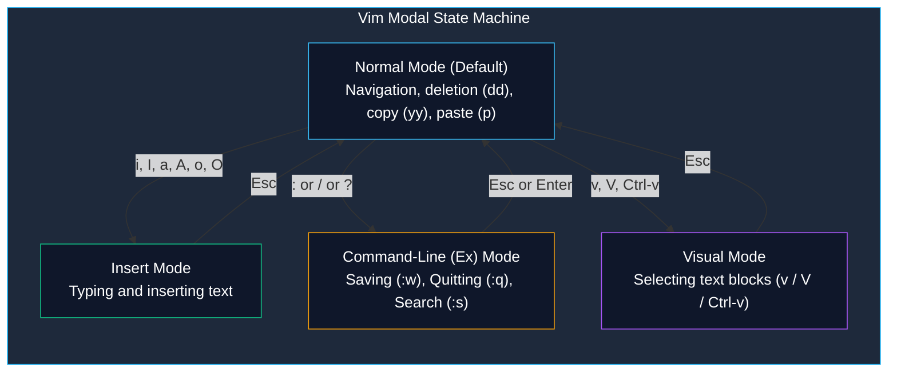

# Terminal Text Editors: Vim and Nano

> **Module:** System and Network Administrator (SNA) — 03 Linux Fundamentals  
> **Topic Level:** Configuration File Editing & Terminal Workflows  
> **Previous Reference:** [06-System-Initialization.md](06-System-Initialization.md) | **Next:** [../04-Networking/01-Tcpdump-Commands.md](../04-Networking/01-Tcpdump-Commands.md)

---

## 🎯 Learning Objectives

By the end of this note, you will be able to:

- Understand why terminal-based text editors are indispensable for headless server administration.
- Open, edit, search, save, and exit files using the modeless **Nano** editor.
- Navigate the **modal architecture** of **Vim** across its four core operating modes: **Normal**, **Insert**, **Command-Line**, and **Visual**.
- Execute text manipulation shortcuts in Vim: cutting (`dd`), copying (`yy`), pasting (`p`), undoing (`u`), and redoing (`Ctrl-r`).
- Perform regex search and global string replacement across documents (`:%s/old/new/g`).
- Resolve Vim swap file conflicts (`.filename.swp`) following unexpected SSH drops or system reboots.

---

## 1. Introduction and Context

On headless enterprise Linux servers, graphical editors like Notepad++, Sublime Text, or VS Code are unavailable. Furthermore, during single-user disaster recovery or network degradation, the only tool available to edit network scripts (`ifcfg-eth0`), firewall rules, or DNS configurations is an in-terminal text editor.

The two standard editors encountered on Linux systems are:
1. **Nano**: A straightforward, modeless editor ideal for beginners and quick minor edits.
2. **Vim (Vi IMproved)**: A highly efficient, keyboard-driven modal editor pre-installed on virtually every Unix/Linux distribution in the world. Mastery of Vim is a prerequisite for professional Linux systems administration.



---

## 2. Definitions of Important Terminology

| Term | Definition |
|---|---|
| **Modal Editor** | An editor where keystrokes perform different functions depending on the current "mode" (e.g., in Normal mode, pressing `d` deletes; in Insert mode, pressing `d` types the letter 'd'). |
| **Modeless Editor** | An editor (like Nano or Windows Notepad) where keystrokes always type characters directly into the document, with commands accessed via shortcut keys (e.g., `Ctrl+O`). |
| **Normal Mode** | The default operational mode in Vim used for document navigation, text deletion, copying, and buffer management. |
| **Insert Mode** | The editing state in Vim where typed keys are inserted directly as text into the document buffer. |
| **Command-Line (Ex) Mode** | The mode entered by pressing `:` in Normal mode used to execute filesystem writes, line jumping, pattern replacements, and exits. |
| **Swap File (`.swp`)** | A hidden recovery file created automatically by Vim while editing to preserve unsaved changes in case of an abrupt power loss or terminal disconnect. |

---

## 3. Working with Nano (The Beginner-Friendly Editor)

Nano is modeless and displays its primary keyboard shortcuts at the bottom of the terminal screen.

### Notation Guide
- `^` indicates the **Control (`Ctrl`)** key (e.g., `^O` means press `Ctrl + O`).
- `M-` indicates the **Meta / Alt** key (e.g., `M-U` means press `Alt + U`).

```bash
# Open an existing file or create a new file with nano
nano /etc/hosts
```

### Essential Nano Shortcuts

| Shortcut | Action | Description |
|---|---|---|
| `Ctrl + O` | WriteOut (Save) | Prompts for confirmation to write buffer to disk (press Enter). |
| `Ctrl + X` | Exit | Closes Nano; prompts to save if unsaved changes exist. |
| `Ctrl + W` | Where Is (Search) | Prompts for a search string and jumps to the first match. |
| `Ctrl + K` | Cut Line | Cuts the current line into the clipboard buffer. |
| `Ctrl + U` | Uncut (Paste) | Pastes the recently cut line at the current cursor position. |
| `Ctrl + C` | Current Position | Displays current line number and column position. |
| `Ctrl + _` | Go to Line | Prompts for a line number and jumps directly to it. |

---

## 4. Working with Vim (The Enterprise Standard)

### 4.1 Entering and Switching Modes
When you open a file with `vim /etc/resolv.conf`, you start in **Normal Mode**.

- To enter **Insert Mode**:
  - `i`: Insert text before the cursor.
  - `I`: Insert text at the beginning of the current line.
  - `a`: Append text after the cursor.
  - `A`: Append text at the end of the current line.
  - `o`: Open a new blank line below the current line and enter Insert mode.
  - `O`: Open a new blank line above the current line and enter Insert mode.
- To return to **Normal Mode**:
  - Press **`Esc`** at any time.

---

### 4.2 Navigation in Normal Mode

While arrow keys generally work, efficient administrators keep their hands anchored on the home row:

```text
       k (Up)
  h (Left)   l (Right)
       j (Down)
```

- `w`: Jump forward to the start of the next word.
- `b`: Jump backward to the start of the previous word.
- `0` (zero): Jump to the absolute beginning of the current line.
- `$` (dollar): Jump to the end of the current line.
- `gg`: Jump to the very first line of the document.
- `G`: Jump to the very last line of the document.
- `:<number>G` or `:<number>`: Jump directly to line `<number>` (e.g., `:45` jumps to line 45).

---

### 4.3 Editing Operations (Cut, Copy, Paste, Undo)

Execute these commands from **Normal Mode**:

| Command | Action | Description |
|---|---|---|
| `x` | Delete Character | Deletes the single character under the cursor. |
| `dd` | Delete (Cut) Line | Deletes the entire current line and stores it in the paste buffer. |
| `3dd` | Delete Multiple Lines | Deletes 3 lines starting from the current line. |
| `dw` | Delete Word | Deletes from the cursor to the end of the word. |
| `yy` | Yank (Copy) Line | Copies the entire current line into the paste buffer. |
| `3yy` | Yank Multiple Lines | Copies 3 lines starting from the current line. |
| `p` | Paste Below | Pastes the copied/cut buffer below the current line. |
| `P` | Paste Above | Pastes the copied/cut buffer above the current line. |
| `u` | Undo | Undoes the last action. |
| `Ctrl + r` | Redo | Redoes the last undone action. |

---

### 4.4 Searching & Replacing

#### Searching
In Normal Mode:
1. Type `/` followed by the search pattern and press Enter:
   ```text
   /PermitRootLogin
   ```
2. Press **`n`** to jump to the next matching occurrence.
3. Press **`N`** to jump to the previous matching occurrence.

#### Search and Replace (Command-Line Mode)
```vim
" Replace first occurrence of 'old' with 'new' on the current line
:s/old/new/

" Replace ALL occurrences of 'old' with 'new' on the current line
:s/old/new/g

" Replace ALL occurrences of 'old' with 'new' across the ENTIRE file
:%s/old/new/g

" Replace with confirmation prompt for each match (c flag)
:%s/192.168.1.50/192.168.1.100/gc
```

---

### 4.5 Saving and Exiting Vim

From Normal Mode, type `:` followed by the command:

| Command | Behavior |
|---|---|
| `:w` | **Write**: Saves changes to disk without exiting. |
| `:wq` | **Write and Quit**: Saves changes and exits Vim. |
| `:x` | **Exit**: Saves only if modifications were made, then exits (preferred). |
| `:q` | **Quit**: Exits Vim (fails if unsaved modifications exist). |
| `:q!` | **Force Quit**: Discards all unsaved modifications and exits immediately. |
| `:set number` | Enables line numbers on the left margin. |
| `:set nonumber`| Disables line numbers. |

---

## 5. Troubleshooting Vim Swap Files (`.filename.swp`)

If your terminal window closes unexpectedly while editing (or the SSH session drops), Vim retains a hidden swap file (e.g., `/etc/httpd/conf/.httpd.conf.swp`).

When you reopen the file, Vim presents an alert:

```text
E325: ATTENTION
Found a swap file by the name ".httpd.conf.swp"
[O]pen Read-Only, (E)dit anyway, (R)ecover, (D)elete it, (Q)uit, (A)bort:
```

### Standard Recovery Procedure
1. Press **`R`** to **Recover** the unsaved changes from the swap file.
2. Review the recovered file. If it contains your intended edits, save it:
   ```vim
   :wq
   ```
3. ⚠️ **Critical Step:** Vim does NOT delete the swap file automatically. You must manually delete the hidden `.swp` file, or the prompt will reappear every time:
   ```bash
   rm /etc/httpd/conf/.httpd.conf.swp
   ```

---

## 6. Common Mistakes & Defensive Habits

- **Getting "Trapped" in Vim**:
  - *Symptom*: Pressing keys causes beeps, unexpected deletions, or strange characters.
  - *Remedy*: Press `Esc` three times to guarantee you are in Normal Mode. Type `:q!` and press Enter to exit cleanly without modifying the file.
- **Accidentally Editing Production Files Directly**:
  - *Defensive Rule*: Always make a timestamped backup copy before running `vim /etc/config`:
    ```bash
    cp -p /etc/ssh/sshd_config /etc/ssh/sshd_config.$(date +%F).bak
    ```

---

## 7. Security Considerations

1. **Escaping from Restricted Shells**: Attackers who obtain a restricted shell (rbash) often use Vim's shell spawn capability (`:!/bin/bash` or `:sh`) to escape restrictions. On hardened systems, sensitive binaries and sudo rules should avoid granting unrestricted Vim execution.
2. **Reviewing `~/.viminfo`**: Vim records search history, jump marks, and recent command lines in `~/.viminfo`. Review this file during forensic investigations to identify configuration changes made by an intruder.

---

## 8. Summary & Next Steps

Proficiency in Vim and Nano ensures you can comfortably configure services and fix broken operating systems in any terminal environment. Now that we have covered core Linux administration, we transition to network packet analysis.

- **Next Module:** Inspect live network packets with tcpdump in [../04-Networking/01-Tcpdump-Commands.md](../04-Networking/01-Tcpdump-Commands.md).
- **String Filtering:** Learn advanced pattern matching in [../04-Networking/02-Regular-Expressions.md](../04-Networking/02-Regular-Expressions.md).
- **Quick Reference:** Consult [../cheatsheets/Vim-and-Nano-Cheatsheet.md](../cheatsheets/Vim-and-Nano-Cheatsheet.md).
