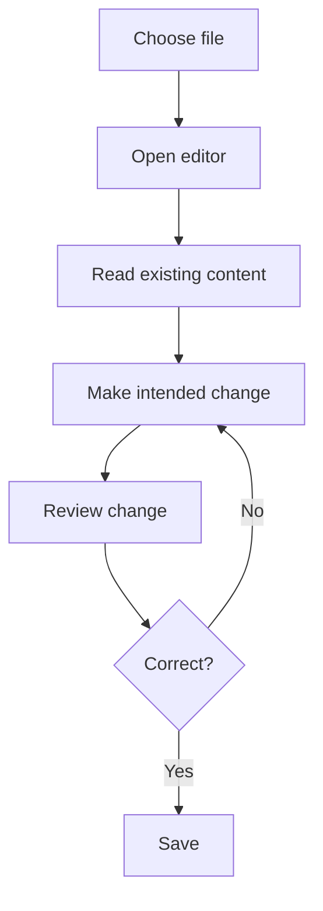

# Vim and Nano Text Editors

## 1. Why terminal editors?
Administrators edit configuration files, scripts, and notes. Vim and Nano work in a terminal and can be useful on servers without a graphical desktop. Editing configuration can affect availability, so read files first and back up important settings.

## 2. Vim
Vim is a modal editor. The meaning of keys depends on the mode:
- **Normal mode:** navigate and run editing commands.
- **Insert mode:** type text.
- **Command-line mode:** enter commands beginning with `:`.

| Action | Command |
|---|---|
| Open file | `vim filename` |
| Insert text | `i` |
| Return to normal mode | `Esc` |
| Save | `:w` |
| Quit | `:q` |
| Save and quit | `:wq` |
| Quit without saving | `:q!` |
| Delete line | `dd` in normal mode |
| Copy/yank line | `yy` |
| Paste | `p` |
| Undo | `u` |
| Search | `/word`, Enter |
| Next match | `n` |
| First/last line | `gg` / `G` |

`:q!` discards unsaved changes in the current editing session.

## 3. Nano
Nano is designed to be approachable and normally shows shortcut hints at the bottom.

| Action | Common shortcut |
|---|---|
| Open file | `nano filename` |
| Save | `Ctrl+O`, then Enter |
| Exit | `Ctrl+X` |
| Search | `Ctrl+W` |
| Cut line | `Ctrl+K` |
| Paste cut text | `Ctrl+U` |

In Nano shortcut hints, `^` usually means Ctrl. Details can vary by version.

## 4. Editing workflow

## 5. Brief history
The Unix `vi` editor emerged in the 1970s, associated with Bill Joy and BSD Unix. Vim (“Vi IMproved”) was first released by Bram Moolenaar in the early 1990s. Emacs is a separate, extensible editor with its own history.

## Safe editing
Confirm the path, read current content, make a backup when appropriate, change only what is needed, and validate the configuration before reloading a service.

## Related notes
- [Vim and Nano Cheatsheet](../cheatsheets/Vim-and-Nano-Cheatsheet.md)
