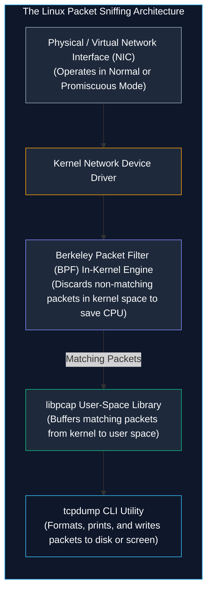
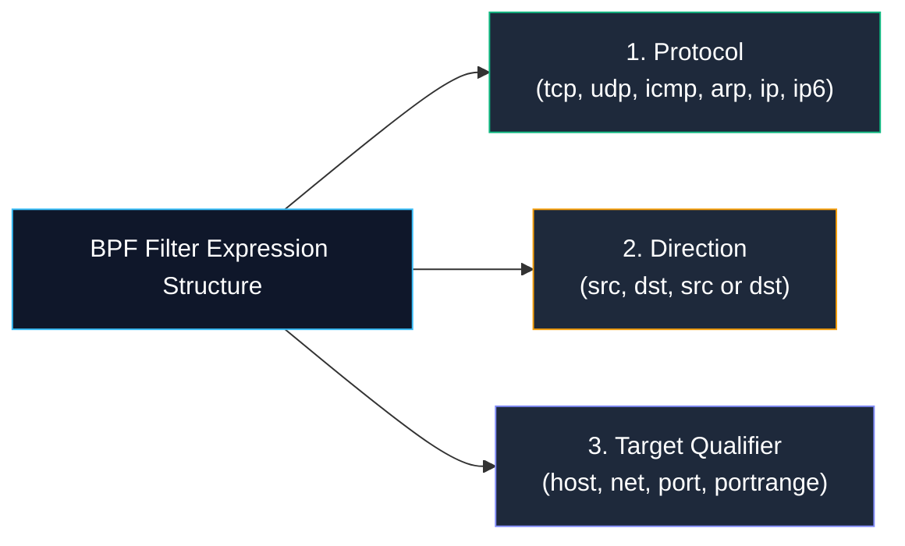
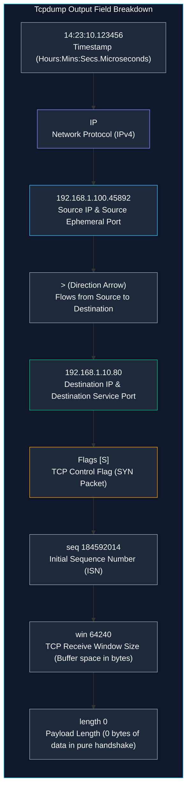

# Packet Analysis and Network Troubleshooting with Tcpdump

> **Module:** System and Network Administrator (SNA) Foundations  
> **Topic:** Network Packet Sniffing, BPF Filtering, Packet Header Dissection, and PCAP Triage  
> **Target Audience:** BSIT Students, Network Administrators, and Blue Team SOC Analysts  
> **Related Reference:** [02-Regular-Expressions.md](02-Regular-Expressions.md) | [Tcpdump Cheatsheet](../cheatsheets/Tcpdump-Cheatsheet.md)

---

## 🎯 Learning Objectives

By the end of this chapter, you will be able to:

- Understand the internal mechanics of packet capture using the **libpcap** library and the **Berkeley Packet Filter (BPF)** virtual machine.
- Select target network interfaces and capture packets safely without causing DNS lookup storms using `-nn`.
- Construct high-precision **BPF filter expressions** utilizing protocols, directions, hosts, subnets, and ports.
- Dissect and interpret raw `tcpdump` terminal output, including timestamps, IP headers, port addressing, and **TCP control flags (`[S]`, `[S.]`, `[.]`, `[P]`, `[F]`, `[R]`)**.
- Capture packet payloads in Hexadecimal and ASCII formats (`-X`) to analyze unencrypted network application data.
- Read and write industry-standard **PCAP (Packet Capture)** files (`-w` and `-r`) for forensic analysis in Wireshark.
- Troubleshoot real-world network failures: DNS timeouts, TCP connection refusals, and SYN flood attacks.

---

## 1. What is Packet Sniffing and Why Tcpdump?

When a network issue occurs—such as a web server refusing connections, an API timing out, or a suspected malware infection exfiltrating data—log files only show part of the story. Server logs record what an application *thinks* happened; **network packets show what *actually* occurred on the wire**.

**Packet sniffing** (or packet capture) is the interception and analysis of data frames as they travel across a physical or virtual network interface.

While graphical tools like **Wireshark** are popular on desktop operating systems, enterprise servers operate headless without graphical displays. **`tcpdump`** is the premier, industry-standard command-line packet analyzer for Linux and Unix environments.



### 1.1 The Role of Promiscuous Mode and Permissions
- **Normal Mode:** A Network Interface Card (NIC) only accepts frames addressed to its own hardware MAC address, broadcast frames (`ff:ff:ff:ff:ff:ff`), and joined multicast groups. All other frames are ignored by hardware.
- **Promiscuous Mode:** When `tcpdump` starts, it instructs the NIC driver to enter promiscuous mode, capturing **all packets** passing across the network segment regardless of destination.
- **Root Privileges:** Because packet sniffing allows eavesdropping on sensitive network traffic (passwords, emails, session tokens), **only the `root` superuser** (or users granted `CAP_NET_RAW` and `CAP_NET_ADMIN` Linux capabilities) can run `tcpdump`.
- **Legal and Ethical Warning:** Sniffing packets on unauthorized networks is illegal under federal and international cybersecurity laws. Only capture traffic on your personal homelab, university lab machines, or networks where you possess explicit, written administrative authorization.

---

## 2. Command Syntax and Essential Flag Reference

The general syntax of `tcpdump` follows this structure:

```text
tcpdump   [options]   [filter_expression]
   │          │               │
Command   Capture Flags   BPF Filter Query
```

```
+----------------------------------------------------------------------------------------------------+
|                                    TCPDUMP ESSENTIAL FLAGS INDEX                                   |
+----------+------------------------------------+----------------------------------------------------+
| Flag     | Primary Function                   | Operational Significance                           |
+----------+------------------------------------+----------------------------------------------------+
| -D       | List available interfaces          | Shows all physical, virtual, and loopback NICs     |
| -i <nic> | Select capture interface           | Specifies target (e.g., eth0, any)                 |
| -n       | Disable IP address resolution      | Displays raw numbers instead of hostnames          |
| -nn      | Disable IP AND Port resolution     | Prevents DNS lookup storms (CRITICAL BEST PRACTICE)|
| -c <num> | Limit packet capture count         | Automatically stops capture after N packets        |
| -w <file>| Write raw packets to PCAP file     | Saves binary packets to disk for Wireshark analysis|
| -r <file>| Read packets from PCAP file        | Analyzes previously captured offline dump          |
| -v, -vv  | Increase protocol verbosity        | Shows TTL, IP IDs, TOS, and protocol options       |
| -X       | Dump Hex and ASCII payload         | Displays unencrypted application data on screen    |
| -A       | Dump ASCII payload only            | Formats packet as readable text (HTTP, SMTP)       |
| -s 0     | Set snapshot length to maximum     | Captures entire packet without truncation (65535B) |
+----------+------------------------------------+----------------------------------------------------+
```

---

### 2.1 The Golden Rule of System Administration: Always Use `-nn`!

When you run `tcpdump` without flags:
1. Every time a packet arrives, `tcpdump` attempts to perform a **reverse DNS lookup** to resolve the IP address into a human hostname (e.g., resolving `142.250.190.46` to `lga34s36-in-f14.1e100.net`).
2. It attempts to translate port numbers into service names (e.g., translating port `80` to `http` or port `22` to `ssh`).

> 🚨 **Why Omitting `-nn` is Dangerous:**  
> If you are sniffing traffic during a network outage or troubleshooting a DNS server failure, `tcpdump` will generate its own DNS query for **every single packet captured**. These DNS queries are captured by `tcpdump`, triggering *more* DNS queries in an infinite recursive loop! This floods the network and locks your terminal.  
> **Always include `-nn`**:
> ```bash
> tcpdump -nn -i eth0
> ```

---

## 3. Berkeley Packet Filter (BPF) Syntax

If you run `tcpdump` on a busy 10-Gigabit enterprise server, millions of packets will scroll across the screen every second. You must use **Berkeley Packet Filter (BPF)** expressions to capture only the exact traffic you need.

BPF expressions are evaluated inside the Linux kernel before packets are copied to user space, making them exceptionally fast and lightweight.



### 3.1 BPF Filter Primitives

| Primitive Category | Syntax Keyword | Real-World Example | Operational Meaning |
|---|---|---|---|
| **Protocol** | `tcp`, `udp`, `icmp`, `arp` | `tcpdump -nn -i eth0 icmp` | Captures only ICMP ping requests and replies |
| **Host Address** | `host <IP>` | `tcpdump -nn -i eth0 host 192.168.1.50` | Captures traffic where 192.168.1.50 is sender OR receiver |
| **Direction** | `src`, `dst` | `tcpdump -nn -i eth0 src host 10.0.0.15` | Captures traffic originating strictly FROM 10.0.0.15 |
| **Subnet / Network** | `net <CIDR>` | `tcpdump -nn -i eth0 net 192.168.10.0/24` | Captures traffic to or from any host in the /24 subnet |
| **Port** | `port <num>` | `tcpdump -nn -i eth0 port 53` | Captures DNS traffic on UDP or TCP port 53 |
| **Port Range** | `portrange <start-end>` | `tcpdump -nn -i eth0 portrange 20-25` | Captures FTP, SSH, Telnet, and SMTP traffic |

### 3.2 Boolean Logic Combinations
Filters can be combined using logical operators:
- **`and` (or `&&`):** Both conditions must be met.
- **`or` (or `||`):** Either condition may be met.
- **`not` (or `!`):** Excludes matching traffic.

> 💡 **Best Practice:** Always enclose complex BPF filter queries in single quotes `'...'` so the shell does not misinterpret characters like `&&`, `||`, or `!`.

#### Realistic Examples:
```bash
# Capture web traffic (HTTP or HTTPS) to or from a specific database server
tcpdump -nn -i eth0 'host 192.168.1.50 and (port 80 or port 443)'

# Capture all traffic EXCEPT your own SSH management session (port 22)
tcpdump -nn -i eth0 'not port 22'

# Capture DNS requests sent strictly to the corporate domain controller
tcpdump -nn -i eth0 'dst host 192.168.1.2 and port 53'
```

---

## 4. Dissecting Tcpdump Output: Packet Header Anatomy

To the untrained eye, a raw `tcpdump` line looks like a string of random characters. However, every field represents a specific component of the IP and TCP headers.

Consider this real packet captured during a client web request:

```text
14:23:10.123456 IP 192.168.1.100.45892 > 192.168.1.10.80: Flags [S], seq 184592014, win 64240, options [mss 1460,sackOK,TS val 289123 ecr 0], length 0
```



### 4.1 Decoding the TCP Control Flags
The TCP protocol governs connection reliability using 1-bit control flags in the TCP header. `tcpdump` formats these inside brackets `[...]`:

| Flag Symbol | TCP Flag Name | Meaning and Role in State Machine |
|:---:|---|---|
| **`[S]`** | **SYN** (Synchronize) | **Connection Initiation**: Sent by client to establish connection (Step 1 of 3-Way Handshake). |
| **`[S.]`** | **SYN-ACK** | **Connection Acknowledged**: Server agrees to connect (Step 2 of 3-Way Handshake). Notice the dot `.` means ACK! |
| **`[.]`** | **ACK** (Acknowledgment) | **Connection Established**: Client confirms handshake (Step 3), or acknowledges received data. |
| **`[P]`** or **`[P.]`** | **PSH** (Push) | **Data Transmission**: Sender requests receiver to push buffered data immediately to application. |
| **`[F]`** or **`[F.]`** | **FIN** (Finish) | **Graceful Termination**: Sender has finished transmitting data and requests clean closure. |
| **`[R]`** | **RST** (Reset) | **Abrupt Rejection**: The port is closed, firewall rejected connection, or session crashed. |

---

## 5. Capturing and Inspecting Application Payloads (`-X` and `-A`)

Sometimes examining packet headers is insufficient; an administrator needs to inspect the actual payload content (e.g., verifying if a client is sending valid HTTP headers or debugging an unencrypted API query).

### 5.1 Hex and ASCII Dump (`-X`)
Adding `-X` prints the packet payload in both Hexadecimal (left) and printable ASCII characters (right):

```bash
tcpdump -nn -i eth0 -X -c 1 'port 80'
```

```text
14:30:05.100200 IP 192.168.1.100.52140 > 192.168.1.10.80: Flags [P.], seq 1:85, ack 1, length 84
    0x0000:  4500 007c a120 4000 4006 f12a c0a8 0164  E..|..@.@..*...d
    0x0010:  c0a8 010a cbac 0050 0b12 3456 0c34 5678  .......P..4V.4Vx
    0x0020:  8018 01f5 fe70 0000 0101 080a 0012 3456  .....p........4V
    0x0030:  4745 5420 2f69 6e64 6578 2e68 746d 6c20  GET./index.html.
    0x0040:  4854 5450 2f31 2e31 0d0a 486f 7374 3a20  HTTP/1.1..Host:.
    0x0050:  7365 7276 6572 3031 0d0a 0d0a            server01....
```
- **ASCII Decoding (Right Column):** Notice lines `0x0030` through `0x0050`! You can clearly read the unencrypted HTTP request: `GET /index.html HTTP/1.1 Host: server01`.

---

## 6. Saving and Analyzing PCAP Files (`-w` and `-r`)

In enterprise incident response, an administrator captures traffic on a production Linux server and transfers the binary capture file to a security workstation for graphical dissection in **Wireshark**.

### 6.1 Writing to PCAP (`-w`)
```bash
# Capture 1,000 packets of DNS traffic and write directly to disk in binary format
tcpdump -nn -i eth0 -w dns_troubleshoot.pcap -c 1000 'port 53'
```
- The terminal displays only a counter: `Got 1000`. Raw network packets are written directly into `dns_troubleshoot.pcap`.

### 6.2 Reading from PCAP (`-r`)
You can re-read and filter the saved PCAP file offline as many times as necessary without recapturing traffic:
```bash
# Read the PCAP file and display only packets originating from host 192.168.1.100
tcpdump -nn -r dns_troubleshoot.pcap 'src host 192.168.1.100'
```

---

## 7. Real-World Troubleshooting Scenarios

### Scenario 1: Diagnosing a Closed Port ("Connection Refused")
- **Symptom:** A web browser reports `Connection Refused` when connecting to `192.168.1.10:80`.
- **Administrator Action:** Run `tcpdump -nn -i eth0 'host 192.168.1.10 and port 80'`.
- **Observed Trace:**
  ```text
  14:40:01 IP 192.168.1.100.41200 > 192.168.1.10.80: Flags [S], seq 100, length 0
  14:40:01 IP 192.168.1.10.80 > 192.168.1.100.41200: Flags [R.], seq 0, ack 101, length 0
  ```
- **Root Cause Deduction:** Notice the immediate response is **`Flags [R.]` (Reset-ACK)**! The server operating system actively rejected the connection because the network link is healthy, but **no application daemon was listening on port 80** (`httpd` service was stopped!).

### Scenario 2: Detecting a SYN-Flood Denial of Service Attack
- **Symptom:** Server CPU spikes to 100%, and legitimate users cannot connect.
- **Administrator Action:** Run `tcpdump -nn -i eth0 'tcp[tcpflags] & tcp-syn != 0 and tcp[tcpflags] & tcp-ack == 0'`.
- **Observed Trace:** Thousands of lines per second showing `Flags [S]` from thousands of spoofed random IP addresses with zero subsequent `Flags [.]` acknowledgments.
- **Root Cause Deduction:** The server is under a classic SYN-Flood attack attempting to exhaust the kernel's TCP connection backlog queue. The administrator immediately enables SYN cookies (`sysctl -w net.ipv4.tcp_syncookies=1`).

---

## 8. Important Points to Remember

- **Tcpdump Purpose:** Intercepts and analyzes raw packets on the wire; the command-line equivalent of Wireshark.
- **Always Use `-nn`:** Disables DNS and service port name resolution, preventing catastrophic DNS recursion loops and screen latency.
- **Promiscuous Mode:** Allows the network card to capture all packets passing across the physical medium, requiring root privileges.
- **BPF Filtering:** BPF expressions filter packets inside kernel memory, dramatically reducing CPU overhead and capture file size.
- **TCP Handshake Flags:** `[S]` = SYN (Step 1), `[S.]` = SYN-ACK (Step 2), `[.]` = ACK (Step 3).
- **RST Meaning:** A `[R]` (Reset) packet indicates that a port is closed, or a firewall actively rejected the connection.
- **PCAP Standard:** `-w file.pcap` writes binary packets to disk; `-r file.pcap` reads offline captures.

---

## 9. Key Terms Glossary

| Term | Technical Definition |
|---|---|
| **Berkeley Packet Filter (BPF)** | An in-kernel virtual machine architecture that evaluates packet filtering expressions before copying data to user space. |
| **libpcap** | The foundational C/C++ user-space programming library providing a standardized API for network packet capture across Unix-like systems. |
| **PCAP** | Packet Capture; a standardized binary file format used to record network packet streams for analysis in tcpdump and Wireshark. |
| **Promiscuous Mode** | A network interface controller mode that causes the card to pass all received traffic to the CPU, not just frames addressed to its MAC address. |
| **RST Flag** | Reset; a 1-bit control flag in the TCP header sent to immediately terminate a connection or reject an unauthorized connection attempt. |
| **SYN Flag** | Synchronize; the 1-bit TCP control flag sent to initiate the three-way handshake and synchronize initial sequence numbers (ISNs). |
| **Three-Way Handshake** | The TCP connection establishment process consisting of three packets: SYN, SYN-ACK, and ACK. |

---

## 10. Practice Questions

Test your mastery of packet analysis and tcpdump operations. Attempt each question independently before consulting the answer key below.

### Question 1 (Operational Best Practice)
Why must an administrator almost always include the **`-nn`** flag when executing `tcpdump` during live server troubleshooting?
- [A] `-nn` forces tcpdump to save output to a file.
- [B] `-nn` enables promiscuous mode on wireless cards.
- [C] `-nn` disables both hostname (DNS) resolution and port name resolution, preventing DNS query loops and terminal lag.
- [D] `-nn` enables encryption on captured packets.

### Question 2 (BPF Filter Construction)
Write a complete `tcpdump` command to capture traffic on interface `eth1` that:
1. Disables all name resolution.
2. Captures traffic to or from the subnet `10.50.0.0/16`.
3. Restricts capture strictly to UDP traffic on port `53` (DNS).
4. Stops automatically after capturing exactly 50 packets.

### Question 3 (TCP Flag Interpretation)
An administrator runs `tcpdump` and observes the following packet exchange:
```text
10:00:01 IP 10.0.0.5.50120 > 10.0.0.1.22: Flags [S], seq 1000, length 0
10:00:01 IP 10.0.0.1.22 > 10.0.0.5.50120: Flags [S.], seq 4000, ack 1001, length 0
10:00:01 IP 10.0.0.5.50120 > 10.0.0.1.22: Flags [.], seq 1001, ack 4001, length 0
```
What fundamental networking process was just successfully completed?
- [A] A file was completely downloaded via SFTP.
- [B] The TCP Three-Way Handshake was completed, successfully establishing a connection.
- [C] The SSH daemon rejected the connection due to an invalid password.
- [D] An attacker successfully conducted a port scan.

### Question 4 (Troubleshooting Analysis)
A client workstation attempts to connect to an internal web server at `192.168.1.200:443`.
The client reports that the browser hangs for 60 seconds and then displays `Connection Timed Out`.
`tcpdump` shows the client sending multiple `Flags [S]` packets, but **zero response packets ever return** from the server.
What is the most likely root cause?
- [A] The web server port is closed and sent a Reset `[R]`.
- [B] An intermediate network firewall dropped the packets silently without sending a rejection.
- [C] The client has an invalid MAC address.
- [D] The web server hard drive is full.

### Question 5 (PCAP File Operations)
An incident responder wants to capture all traffic on interface `any` involving host `192.168.1.5` and save the raw packet stream into a file named `investigation.pcap` so it can be opened in Wireshark.
What is the exact command line?

---

## 11. Answer Key & Explanations

### Answer to Question 1:
**Correct Option:** **[C]**  
*Explanation:* By default, `tcpdump` attempts to reverse-resolve every IP address into a domain hostname and every port into a service name. During an outage, this triggers hundreds of DNS queries, causing significant terminal screen lag and potentially creating a recursive DNS feedback loop on the network. `-nn` forces numeric-only display.

### Answer to Question 2:
**Correct Answer:**
```bash
tcpdump -nn -i eth1 -c 50 'net 10.50.0.0/16 and udp and port 53'
```

### Answer to Question 3:
**Correct Option:** **[B]**  
*Explanation:* The trace illustrates the standard **TCP Three-Way Handshake**:
1. Client sends `Flags [S]` (SYN).
2. Server responds with `Flags [S.]` (SYN-ACK).
3. Client acknowledges with `Flags [.]` (ACK).  
The TCP session is now fully established in the `ESTABLISHED` state.

### Answer to Question 4:
**Correct Option:** **[B]**  
*Explanation:* If a port is closed on a reachable host, the operating system kernel immediately returns a **Reset (`[R]`)** packet ("Connection Refused"). When a connection times out with zero response packets, it indicates that a firewall (such as `iptables`, `firewalld`, or a network perimeter appliance) is silently dropping (discarding) the SYN packets without emitting an ICMP Unreachable or TCP RST notification.

### Answer to Question 5:
**Correct Answer:**
```bash
tcpdump -nn -i any -w investigation.pcap 'host 192.168.1.5'
```

---

## 🔗 Related Notes & Next Steps

- **Next Chapter:** Master string extraction, log parsing, and regex tokens in [02-Regular-Expressions.md](02-Regular-Expressions.md).
- **Physical Disk Storage:** Compare MBR and GPT partition structures in [../05-Disk-Management/01-MBR-vs-GPT.md](../05-Disk-Management/01-MBR-vs-GPT.md).
- **Quick Reference:** Keep [cheatsheets/Tcpdump-Cheatsheet.md](../cheatsheets/Tcpdump-Cheatsheet.md) bookmarked for rapid syntax lookup.
