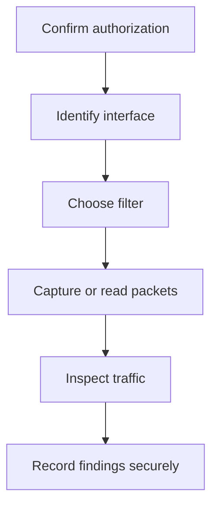

# Tcpdump Commands

## 1. What is tcpdump?
`tcpdump` is a command-line packet analyzer used to capture or read network packets. It can help investigate connectivity and network behavior. Capture only on networks and devices where you have authorization.

## 2. Syntax
`tcpdump [options] [filter expression]`

Options control capture and output; a filter expression selects packets.

## 3. Common commands
```bash
tcpdump -D
tcpdump -i eth0
tcpdump -nn -i eth0
tcpdump -c 20 -i eth0
tcpdump -r capture.pcap
tcpdump -i eth0 -w capture.pcap
```
`-D` lists interfaces where supported; `-i` selects an interface; `-nn` disables name resolution; `-c` limits packet count; `-r` reads a capture; `-w` writes one. Interface names vary and some operations require elevated privileges.

## 4. Filters
```bash
tcpdump -i eth0 host 192.0.2.10
tcpdump -i eth0 port 53
tcpdump -i eth0 tcp
tcpdump -i eth0 udp
tcpdump -i eth0 'tcp and port 443'
tcpdump -i eth0 'host 192.0.2.10 and port 53'
```
`192.0.2.0/24` is reserved for documentation; replace examples with authorized lab addresses. Quote combined filters so the shell passes the expression intact.

## 5. Capture workflow


## 6. What to inspect
Look at source and destination addresses, ports, protocol, TCP flags, timing, and repeated connection attempts. A single packet rarely proves the cause of a problem; correlate with logs and endpoint behavior.

## 7. If no packets appear
Check the interface, whether traffic is passing through it, capture permissions, and whether the filter is too restrictive. PCAP files can contain sensitive information and must be stored and shared carefully.

## Summary
Select the correct interface, use focused filters, protect captured data, and interpret packet evidence alongside other sources.

## Related notes
- [Regular Expressions](02-Regular-Expressions.md)
- [Tcpdump Cheatsheet](../cheatsheets/Tcpdump-Cheatsheet.md)
