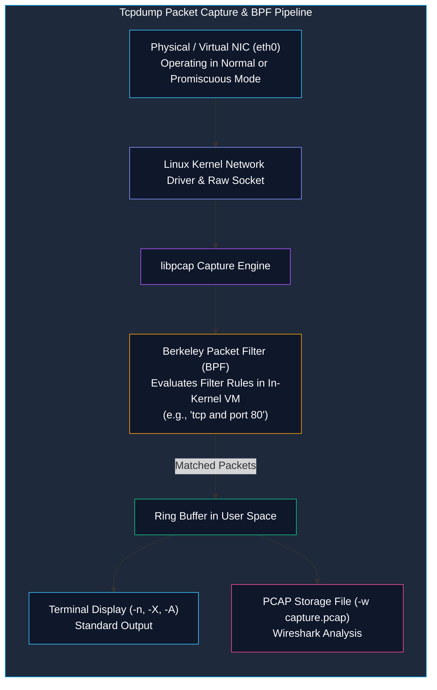

# Network Packet Analysis with Tcpdump

> **Module:** System and Network Administrator (SNA) — 04 Networking  
> **Topic Level:** Protocol Inspection & Packet Capture  
> **Previous Reference:** [../03-Linux-Fundamentals/07-Vim-and-Nano.md](../03-Linux-Fundamentals/07-Vim-and-Nano.md) | **Next:** [02-Regular-Expressions.md](02-Regular-Expressions.md)

---

## 🎯 Learning Objectives

By the end of this note, you will be able to:

- Explain the architecture of network packet capture using the **libpcap** library and the **Berkeley Packet Filter (BPF)** engine.
- Capture, filter, and inspect live network frames directly from the Linux terminal using `tcpdump`.
- Understand the critical importance of disabling DNS and port name resolution (`-n` and `-nn`) during triage.
- Construct complex BPF filtering expressions combining protocols, source/destination hosts, networks, and port ranges.
- Capture raw packets to standard PCAP files (`-w`) and analyze historical captures (`-r`) for forensics and Wireshark inspection.
- Inspect packet payloads in ASCII (`-A`) and combined Hex/ASCII (`-X`).

---

## 1. Introduction and Context

When diagnosing service outages, routing failures, firewall drops, or suspected malware communication, log files only tell half the story. Logs show what an application *believed* happened; packets show what *actually crossed the physical wire*.

**Tcpdump** is the premier command-line packet analysis utility in Unix and Linux environments. Built on the open-source **libpcap** library, tcpdump captures raw Ethernet frames directly from network interface cards (NICs) before firewall inspection or protocol processing occurs. For both System Administrators and Blue Team security defenders, tcpdump is the definitive tool for real-time network visibility.



---

## 2. Definitions of Important Terminology

| Term | Definition |
|---|---|
| **Packet Sniffer** | Software or hardware that intercepts and logs traffic passing over a digital network. |
| **libpcap** | The foundational C library that provides a portable framework for low-level network traffic capture across Unix-like systems. |
| **Berkeley Packet Filter (BPF)** | A highly efficient in-kernel virtual machine bytecode interpreter that filters packets immediately in memory, discarding non-matching frames before copying data to user space. |
| **Promiscuous Mode** | A network card configuration that passes all received network frames to the CPU for processing, rather than only frames addressed specifically to the card's MAC address. |
| **PCAP (Packet Capture)** | The standard open file format (`.pcap`) used by tcpdump, Wireshark, Snort, and Zeek to store recorded network packet streams. |
| **Snaplen (Snapshot Length)** | The maximum number of bytes captured from each packet (defaulting to the full 65535-byte frame in modern tcpdump, or truncated in older versions). |

---

## 3. Essential Tcpdump Command-Line Options

Running `tcpdump` with no arguments captures all packets across the lowest-numbered interface and prints thousands of lines of unformatted text. Administrators control capture scope using command switches:

| Option | Flag Name | Purpose & Practical Benefit |
|---|---|---|
| `-i <interface>` | Interface | Specifies the network interface to listen on (e.g., `-i eth0` or `-i any`). |
| `-n` | No Name Resolution | Do not resolve IP addresses to DNS hostnames. **Prevents DNS lag and flooding.** |
| `-nn` | No Port Resolution | Do not convert port numbers to protocol names (prints `80` instead of `http`, `22` instead of `ssh`). |
| `-c <count>` | Count | Exits tcpdump automatically after capturing `<count>` matching packets. |
| `-v`, `-vv`, `-vvv` | Verbose | Increases output detail (TTL, IP ID, checksums, flags, options). |
| `-w <file.pcap>` | Write File | Writes raw binary packet data to a file for later analysis. |
| `-r <file.pcap>` | Read File | Reads and parses packets from a previously recorded PCAP file. |
| `-s <len>` | Snaplen | Defines snapshot length in bytes (`-s 0` captures the complete packet without truncation). |
| `-X` | Hex and ASCII | Dumps packet headers and payloads in both hexadecimal and human-readable ASCII. |
| `-A` | ASCII Only | Prints packet payloads in pure ASCII (ideal for inspecting plaintext HTTP, SMTP, or FTP). |
| `-e` | Ethernet Header | Prints link-level data link headers (source and destination MAC addresses). |
| `-q` | Quick Output | Prints less protocol information per line for faster viewing. |

---

## 4. Constructing Berkeley Packet Filter (BPF) Syntax

BPF expressions filter traffic so you capture only the exact conversation needed. BPF rules are composed of **Primitives** linked by **Logical Operators**.

### 4.1 Filter Primitives

#### 1. Host and Network Primitives
```bash
# Capture packets involving a specific IP (source or destination)
tcpdump -i eth0 -nn host 192.168.1.50

# Capture packets originating from a specific source IP
tcpdump -i eth0 -nn src host 192.168.1.50

# Capture packets destined for a specific target IP
tcpdump -i eth0 -nn dst host 10.0.0.1

# Capture an entire CIDR subnet
tcpdump -i eth0 -nn net 192.168.1.0/24
```

#### 2. Port and Protocol Primitives
```bash
# Capture ICMP (Ping) packets only
tcpdump -i eth0 -nn icmp

# Capture DNS traffic (UDP port 53)
tcpdump -i eth0 -nn udp and port 53

# Capture SSH traffic (port 22)
tcpdump -i eth0 -nn port 22

# Capture traffic within a port range
tcpdump -i eth0 -nn portrange 20-25
```

---

### 4.2 Combining Rules with Logical Operators

BPF supports three logical operators:
- **AND**: `and` or `&&`
- **OR**: `or` or `||`
- **NOT**: `not` or `!`

```bash
# Capture web traffic (HTTP or HTTPS) to/from host 192.168.1.100
tcpdump -i eth0 -nn host 192.168.1.100 and \( port 80 or port 443 \)

# Capture all traffic EXCEPT SSH (avoids terminal flooding when connected via SSH!)
tcpdump -i eth0 -nn not port 22

# Capture outbound DNS queries originating from the local server
tcpdump -i eth0 -nn src host 192.168.1.10 and udp dst port 53
```
*(Note: Parentheses `\(` and `\)` must be escaped with a backslash so the BASH shell does not interpret them as subshells).*

---

### 4.3 Advanced Filtering: TCP Flags

Administrators can inspect specific TCP header control bits to detect SYN scans, port probes, or reset packets:

```bash
# Capture TCP SYN packets (Connection initiation / SYN scan detection)
tcpdump -i eth0 -nn "tcp[tcpflags] & tcp-syn != 0 and tcp[tcpflags] & tcp-ack == 0"

# Capture TCP RST packets (Connection rejected or forcefully closed)
tcpdump -i eth0 -nn "tcp[tcpflags] & tcp-rst != 0"
```

---

## 5. Practical Administrative Use Cases

### 1. The "Clean Terminal" Live Inspection
When logged into a remote Linux server over SSH, running `tcpdump` immediately creates an infinite loop: tcpdump captures a packet -> prints it to SSH -> generating another SSH packet -> which tcpdump captures!
```bash
# Always exclude your own SSH session when sniffing over a remote terminal:
tcpdump -i eth0 -nn not port 22
```

### 2. Capturing Traffic to a File for Wireshark Analysis
```bash
# Capture 1,000 full packets on eth0 and save to capture.pcap
tcpdump -i eth0 -s 0 -c 1000 -w /tmp/incident_capture.pcap

# Read and inspect the saved pcap file without touching the network:
tcpdump -r /tmp/incident_capture.pcap -nn -X | head -n 30
```

### 3. Inspecting Plaintext HTTP Credentials
```bash
# Capture HTTP POST/GET requests and display readable ASCII payload
tcpdump -i eth0 -nn -A -s 0 port 80
```

---

## 6. Common Mistakes & Defensive Troubleshooting

- **Running without `-n` or `-nn`**:
  - *Symptom*: Output pauses for 5 to 30 seconds between packets, and CPU spikes.
  - *Cause*: Tcpdump is attempting reverse DNS lookups for every single IP address in the packet stream, generating hundreds of outbound DNS queries.
  - *Fix*: Always include `-nn` in your command line.
- **Buffer Drops under High Traffic**:
  - *Symptom*: Tcpdump reports `packets dropped by kernel` upon exit.
  - *Cause*: The volume of traffic overwhelmed the kernel ring buffer before tcpdump could process it.
  - *Fix*: Apply strict BPF filters to reduce captured packet volume, or increase the buffer size with `-B <buffer_size_kb>`.

---

## 7. Security Considerations

1. **Root Privileges Required**: Capturing packets on raw sockets requires superuser privileges (`root` or `CAP_NET_RAW` / `CAP_NET_ADMIN` capabilities).
2. **Promiscuous Mode Security Alert**: Placing a NIC into promiscuous mode allows an administrator to inspect packets directed to other hosts on an unswitched network or hub. Blue Team network monitors and endpoint detection agents alert whenever promiscuous mode is enabled.
3. **Sensitive Data Exposure in PCAP Files**: PCAP files capture unencrypted passwords, session tokens, and database queries. Store PCAP files in restricted directories (`chmod 600`) and delete them immediately after analysis.

---

## 8. Summary & Next Steps

Tcpdump provides definitive ground truth about network conversations, latency, port states, and protocol compliance. Now that you can capture network traffic, the next step is learning how to parse and extract targeted indicators using regular expressions.

- **Next Chapter:** Master pattern matching in [02-Regular-Expressions.md](02-Regular-Expressions.md).
- **Storage Subsystems:** Learn how disk partitions are managed in [../05-Disk-Management/01-MBR-vs-GPT.md](../05-Disk-Management/01-MBR-vs-GPT.md).
- **Quick Reference:** Keep [../cheatsheets/Tcpdump-Cheatsheet.md](../cheatsheets/Tcpdump-Cheatsheet.md) open for instant BPF filter lookups.
