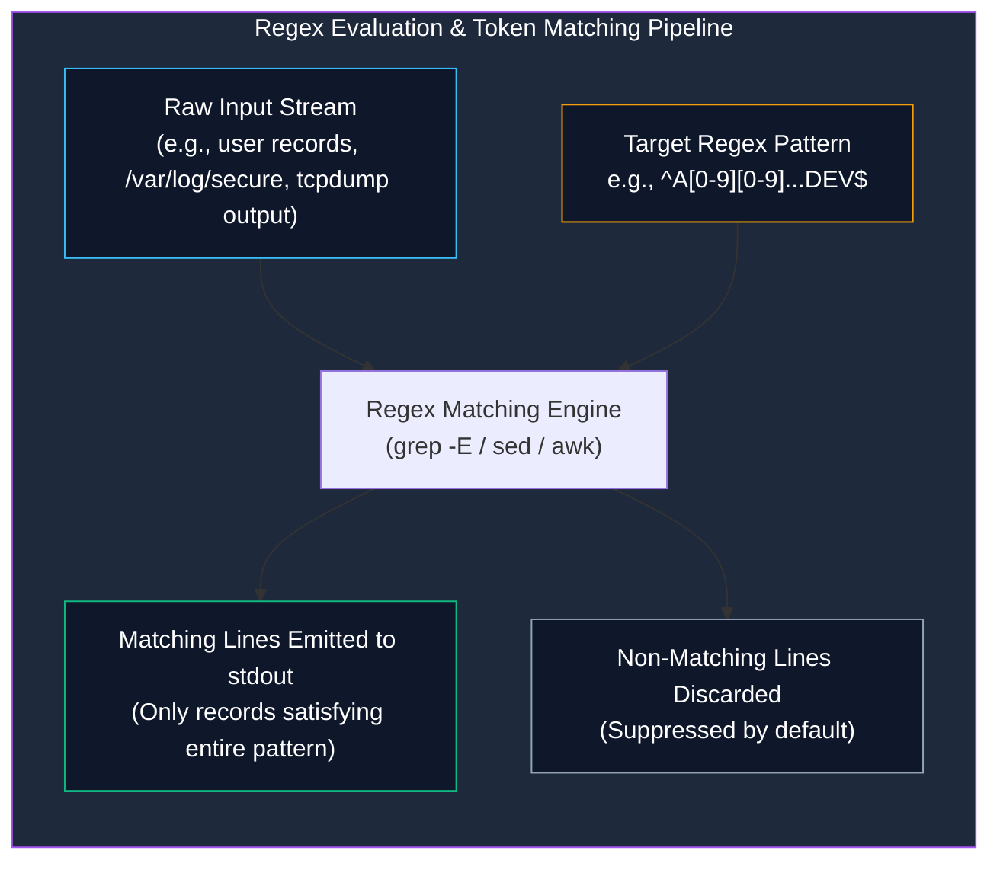

# Regular Expressions (Regex) in Linux Administration

> **Module:** System and Network Administrator (SNA) — 04 Networking  
> **Topic Level:** Pattern Matching & Text Processing  
> **Previous Reference:** [01-Tcpdump-Commands.md](01-Tcpdump-Commands.md) | **Next:** [../05-Disk-Management/01-MBR-vs-GPT.md](../05-Disk-Management/01-MBR-vs-GPT.md)

---

## 🎯 Learning Objectives

By the end of this note, you will be able to:

- Differentiate between **Shell Globbing (wildcards)** and **Regular Expressions (Regex)**.
- Distinguish between **Basic Regular Expressions (BRE)** and **Extended Regular Expressions (ERE)**.
- Master line and word boundary anchors (`^` and `$`).
- Build character classes (`[0-9]`, `[a-zA-Z]`, `[^0-9]`) and repetition quantifiers.
- Apply practical regex filters used in administrative text processing (such as `^A`, `[0-9][0-9]`, and `DEV$`).
- Utilize regex pattern matching inside command-line utilities (`grep`, `egrep`, `sed`, `awk`).

---

## 1. Introduction and Context

In System and Network Administration, automated tools generate enormous volumes of text data every second: web access logs, firewall drop alerts, authentication journals (`/var/log/secure`), and packet captures.

A human administrator cannot manually read 100,000 log lines to locate an IP address or anomalous user account. **Regular Expressions (Regex)** provide a formalized, concise syntax for searching, extracting, and manipulating string patterns. Whether validating personnel record IDs, filtering failed login attempts, or crafting Snort intrusion detection rules, regex is an essential operational skill.



---

## 2. Definitions of Important Terminology

| Term | Definition |
|---|---|
| **Regular Expression (Regex)** | A specialized sequence of characters defining a search pattern used by string-searching algorithms. |
| **Shell Globbing** | The shell's native filename expansion mechanism (`*.txt`, `file?.log`), which uses different rules than regular expressions! |
| **BRE (Basic Regular Expressions)** | The original POSIX regex standard used by default in `grep` and `sed`. Characters like `+`, `?`, `{`, and `(` are treated as literal characters unless escaped with a backslash. |
| **ERE (Extended Regular Expressions)** | The modern POSIX standard used in `egrep` or `grep -E`. Metacharacters like `+`, `?`, `|`, and `()` are treated as operators natively without backslashes. |
| **Anchor** | A metacharacter that binds a match to a specific positional boundary in the line (`^` for start, `$` for end). |
| **Character Class / Set** | A bracketed list (`[...]`) that matches any single character contained within the brackets. |

---

## 3. Shell Globbing vs. Regular Expressions

Beginners frequently confuse shell wildcards with regular expressions:

| Character | Meaning in Shell Globbing (Filename Matching) | Meaning in Regular Expressions (Text Searching) |
|:---:|---|---|
| `*` | Matches **zero or more arbitrary characters** (e.g., `ls *.log`). | Matches **zero or more occurrences of the preceding character** (e.g., `a*` matches `""`, `"a"`, `"aa"`). |
| `?` | Matches **exactly one arbitrary character** (e.g., `cat file?.txt`). | Matches **zero or one occurrence of the preceding character** (in ERE). |
| `.` | Matches a literal period in a filename. | Matches **any single character** (except newline). |
| `^` | No special meaning (treated as literal). | **Anchor**: Matches the start of the line. |
| `$` | Variable expansion prefix (e.g., `$USER`). | **Anchor**: Matches the end of the line. |

---

## 4. Core Regex Metacharacters and Syntax

### 4.1 Positional Anchors

- **`^` (Caret)**: Matches the absolute beginning of a line.
  ```bash
  # Match lines starting with capital letter 'A'
  grep "^A" records.txt

  # Match lines starting with 'root'
  grep "^root" /etc/passwd
  ```

- **`$` (Dollar)**: Matches the absolute end of a line.
  ```bash
  # Match lines ending with 'DEV'
  grep "DEV$" records.txt

  # Match lines ending with '/bin/bash' (users with interactive shells)
  grep "/bin/bash$" /etc/passwd
  ```

- **`^$` (Empty Line)**: Matches lines with zero characters between start and end.
  ```bash
  # Count blank lines in a configuration file
  grep -c "^$" /etc/httpd/conf/httpd.conf

  # Filter out blank lines and comment lines (clean config review)
  grep -v "^#" /etc/httpd/conf/httpd.conf | grep -v "^$"
  ```

---

### 4.2 The Any-Character Matcher: `.` (Dot)

The period (`.`) matches any single character:
```bash
# Matches 'c', followed by any character, followed by 't' ('cat', 'cot', 'c9t', 'c t')
grep "c.t" document.txt

# Matches lines having at least 10 characters
grep ".........." file.txt
```

---

### 4.3 Character Classes (`[...]`)

Bracket expressions match any single character enclosed:

| Pattern | Meaning | Example Matches |
|---|---|---|
| `[0-9]` | Any single decimal digit | `0`, `1`, `7`, `9` |
| `[a-z]` | Any single lowercase letter | `a`, `b`, `z` |
| `[A-Z]` | Any single uppercase letter | `A`, `B`, `Z` |
| `[a-zA-Z]` | Any single alphabetic letter | `d`, `R`, `k` |
| `[^0-9]` | **Negation**: Any single character that is **NOT** a digit | `a`, `!`, ` `, `@` |
| `[aeiou]` | Any single lowercase vowel | `a`, `e`, `i`, `o`, `u` |

---

## 5. Practical Pattern Matching Examples

In system and network administration, administrators routinely process structured text exports, employee rosters, and inventory logs. Consider a sample record file named `records.txt`:

```text
Ali-21-OPS
Ahmed-23-DEV
Bilal-19-SEC
Ayesha-22-DEV
Usman-20-OPS
```

### Pattern 1: Lines Starting with `A`
```bash
grep "^A" records.txt
# Output:
# Ali-21-OPS
# Ahmed-23-DEV
# Ayesha-22-DEV
```

### Pattern 2: Matching Specific Digit Lengths
- Single digit: `[0-9]`
- Exactly two digits: `[0-9][0-9]`
- Exactly three digits: `[0-9][0-9][0-9]`

```bash
# Match records with two-digit numerical identifiers
grep "-[0-9][0-9]-" records.txt
```

### Pattern 3: Lines Ending with a Specific Role or Department
```bash
grep "DEV$" records.txt
# Output:
# Ahmed-23-DEV
# Ayesha-22-DEV
```

### Pattern 4: Combining Anchors, Digits, and Role Identifiers
Find records where the name begins with `A`, followed by any characters, containing a 2-digit number, and ending in department `DEV`:
```bash
grep -E "^A.*[0-9][0-9].*DEV$" records.txt
```

---

## 6. BRE vs. ERE: When to Use `grep -E` (or `egrep`)

In **Basic Regular Expressions (BRE)**, the characters `+` (one or more), `?` (zero or one), `|` (alternation / OR), and `{m,n}` (quantifiers) are treated as literal text. To use them as operators, they must be escaped: `\+`, `\?`, `\|`.

In **Extended Regular Expressions (ERE)**, these characters are operators by default:

```bash
# Alternation (OR) using ERE (-E flag)
grep -E "OPS|DEV" records.txt

# Quantifier: one or more digits (+ operator)
grep -E "[0-9]+" log.txt

# Optional character (? operator: matches 'http' or 'https')
grep -E "https?" web_log.txt
```

---

## 7. Common Operational Pitfalls

- **Forgetting Quotes Around Patterns**:
  - Running `grep ^A *` allows the shell to expand `*` as a wildcard before grep receives the argument!
  - **Always enclose regex patterns in quotes**: `grep '^A' filename.txt`.
- **Confusing `.*` with Shell `*`**:
  - In regex, `.*` means "any character (`.`), repeated zero or more times (`*`)".
  - Writing `grep 'A*'` matches strings with zero 'A's (matching every line in the file!). Use `A.*` to match 'A' followed by anything.

---

## 8. Security Considerations

1. **Regular Expression Denial of Service (ReDoS)**: Inefficient or deeply nested regex patterns (e.g., `(a+)+$`) can cause regex engines to consume 100% CPU time through catastrophic backtracking when evaluating long non-matching strings.
2. **Log Tampering Audits**: Administrators use regex in security triage to extract IPv4 addresses (`[0-9]{1,3}\.[0-9]{1,3}\.[0-9]{1,3}\.[0-9]{1,3}`) and detect brute-force SSH logins in `/var/log/secure`.

---

## 9. Summary & Next Steps

Regular expressions empower administrators to filter vast amounts of text into actionable intelligence. With command-line utilities, permissions, and network analysis covered, we now turn to physical and logical disk management.

- **Next Module:** Compare disk partition schemes in [../05-Disk-Management/01-MBR-vs-GPT.md](../05-Disk-Management/01-MBR-vs-GPT.md).
- **Logical Volume Management:** Learn dynamic storage pooling in [../05-Disk-Management/02-RAID-and-LVM.md](../05-Disk-Management/02-RAID-and-LVM.md).
- **Quick Reference:** Consult [../cheatsheets/Regular-Expressions-Cheatsheet.md](../cheatsheets/Regular-Expressions-Cheatsheet.md).
