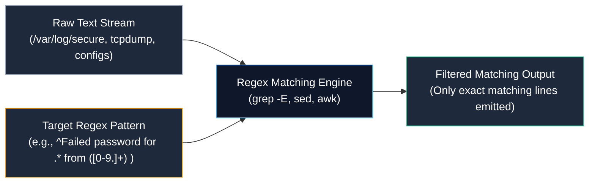

# Regular Expressions (Regex) in Systems and Network Administration

> **Module:** System and Network Administrator (SNA) Foundations  
> **Topic:** Text Parsing, Pattern Matching Engines, BRE vs. ERE, and Log Triage  
> **Target Audience:** BSIT Students, Linux Administrators, and Security Analysts  
> **Related Reference:** [01-Tcpdump-Commands.md](01-Tcpdump-Commands.md) | [02-Common-Linux-Commands.md](../03-Linux-Fundamentals/02-Common-Linux-Commands.md) | [Regular Expressions Cheatsheet](../cheatsheets/Regular-Expressions-Cheatsheet.md)

---

## 🎯 Learning Objectives

By the end of this chapter, you will be able to:

- Differentiate clearly between **Shell Globbing (wildcards)** and **Regular Expressions (Regex)**.
- Distinguish between **Basic Regular Expressions (BRE)** and **Extended Regular Expressions (ERE)**.
- Anchor search queries to line boundaries using the caret (`^`) and dollar sign (`$`).
- Construct character sets and bracket classes (`[0-9]`, `[a-zA-Z]`, `[^0-9]`).
- Apply repetition quantifiers (`*`, `+`, `?`, `{m,n}`) to match dynamic strings.
- Formulate complex administrative filters using alternation (`|`) and grouping (`()`) with `grep -E`.
- Parse real-world enterprise log files (`/var/log/secure`, web access logs) to extract IP addresses and identify security events.
- Protect systems against catastrophic regex backtracking (Regular Expression Denial of Service — ReDoS).

---

## 1. What is a Regular Expression?

In modern enterprise IT environments, servers, firewalls, and applications generate millions of lines of text logs every single hour:
- An Apache or Nginx web server records every web request in `/var/log/httpd/access_log`.
- An OpenSSH server records every authentication attempt in `/var/log/secure`.
- An intrusion detection sensor (such as Snort or Suricata) records packet alerts.

A human administrator cannot manually read 500,000 log lines to find an attacker or identify a failing database connection. 

A **Regular Expression (Regex)** is a formalized, mathematical syntax used to describe, match, search, and extract specific character patterns within continuous streams of text.



---

## 2. Shell Wildcards (Globbing) vs. Regular Expressions

The most common source of confusion for BSIT students is mixing up **Shell Globbing** with **Regular Expressions**. While they share some characters (`*`, `?`), their internal meanings are completely different:

```
+----------------------------------------------------------------------------------------------------+
|                                    GLOBBING VS. REGEX COMPARISON                                   |
+--------------------------+------------------------------------+------------------------------------+
| Characteristic           | Shell Wildcards (Globbing)         | Regular Expressions (Regex)        |
+--------------------------+------------------------------------+------------------------------------+
| Evaluated By             | The BASH Shell interpreter         | Application / Utility (grep, sed)  |
| Primary Purpose          | Matching filenames on disk         | Matching text patterns inside data |
| Meaning of '*'           | Matches 0 or more ANY characters   | Repeats PRECEDING token 0 or more  |
| Meaning of '?'           | Matches exactly ONE character      | (ERE) Matches preceding token 0/1  |
| Target Commands          | ls, cp, mv, rm                     | grep, sed, awk, vim, python        |
| Example                  | ls *.log                           | grep "error.*timeout" server.log   |
+--------------------------+------------------------------------+------------------------------------+
```

- **Globbing Example (`ls *.txt`):** The shell looks at the hard drive, finds all files ending in `.txt`, and replaces `*.txt` with the list of matching filenames before executing `ls`.
- **Regex Example (`grep "A.*Z" file.txt`):** The program `grep` opens `file.txt` and searches inside line by line, finding lines containing the letter `A`, followed by any characters (`.*`), followed by `Z`.

---

## 3. The Two Standards: BRE vs. ERE

When working with command-line text utilities, regex engines follow two major POSIX standards:

### 3.1 Basic Regular Expressions (BRE)
- **Used by:** Traditional `grep` and `sed`.
- In BRE, the special metacharacters `+` (one or more), `?` (zero or one), `|` (alternation / OR), and `{m,n}` (quantifiers) are treated as **literal characters**!
- To make them act as special operators in BRE, you must escape them with a backslash: `\+`, `\?`, `\|`, `\{m,n\}`.

### 3.2 Extended Regular Expressions (ERE)
- **Used by:** Modern `grep -E` (or `egrep`), `awk`, and Python/Perl regex engines.
- In ERE, `+`, `?`, `|`, `( )`, and `{m,n}` are treated as **active operators by default** without needing backslashes.
- **Rule for Administrators:** Always use **`grep -E`** (or enclose patterns in single quotes) when crafting complex filters to avoid backslash clutter.

---

## 4. Core Regex Metacharacters and Syntax

```
+----------------------------------------------------------------------------------------------------+
|                                      REGEX OPERATORS QUICK INDEX                                   |
+----------+------------------------------------+----------------------------------------------------+
| Token    | Name                               | Operational Matching Behavior                      |
+----------+------------------------------------+----------------------------------------------------+
| ^        | Caret Anchor                       | Matches the absolute start of a line               |
| $        | Dollar Anchor                      | Matches the absolute end of a line                 |
| .        | Dot / Period                       | Matches any single character (except newline)      |
| [...]    | Character Class                    | Matches any single character enclosed in brackets  |
| [^...]   | Negated Character Class            | Matches any single character NOT enclosed          |
| *        | Kleene Star Quantifier             | Matches preceding token 0 or more times            |
| +        | Plus Quantifier (ERE)              | Matches preceding token 1 or more times (mandatory)|
| ?        | Question Mark (ERE)                | Matches preceding token 0 or 1 time (optional)     |
| {m,n}    | Range Quantifier (ERE)             | Matches preceding token between m and n times      |
| \|       | Alternation (ERE)                  | Logical OR between expressions                     |
| (...)    | Grouping (ERE)                     | Groups tokens together into a single unit          |
+----------+------------------------------------+----------------------------------------------------+
```

---

### 4.1 Positional Anchors: `^` and `$`

Anchors do not match physical characters; they match **positions** on a line.

#### `^` — Caret (Start of Line)
Forces the match to occur at the absolute beginning of the line:
```bash
# Match lines starting with the word 'root'
grep "^root" /etc/passwd

# Output:
# root:x:0:0:root:/root:/bin/bash
```

#### `$` — Dollar (End of Line)
Forces the match to occur at the absolute end of the line:
```bash
# Match users configured with interactive BASH login shells
grep "/bin/bash$" /etc/passwd
```

#### `^$` — Matching Empty Lines
If a line starts (`^`) and immediately ends (`$`) with zero characters in between, it is an empty blank line:
```bash
# Count how many empty blank lines exist in a configuration file
grep -c "^$" /etc/httpd/conf/httpd.conf
```

---

### 4.2 The Any-Character Matcher: `.` (Dot)

The period (`.`) matches **any single character** (a letter, digit, space, or symbol):
```bash
# Matches 'r', followed by any single character, followed by 't' ('root', 'r1t', 'r-t')
grep "r.t" /etc/passwd
```
- **The Classic `.*` Combo:** A dot followed by a star (`.*`) means *"any character, repeated zero or more times"*. It matches any arbitrary sequence of text.

---

### 4.3 Character Classes (`[...]`) and Ranges

Square brackets match **any single character** enclosed within the set:

| Expression | Meaning | Example Matches |
|---|---|---|
| `[0-9]` | Any single numerical digit | `0`, `3`, `7`, `9` |
| `[a-z]` | Any single lowercase letter | `a`, `k`, `z` |
| `[A-Z]` | Any single uppercase letter | `A`, `M`, `Z` |
| `[a-zA-Z]` | Any single alphabet letter | `d`, `R`, `k` |
| `[0-9a-fA-F]` | Any single hexadecimal character | `4`, `c`, `F` |
| `[aeiou]` | Any single lowercase vowel | `a`, `e`, `i`, `o`, `u` |

#### Negated Classes (`[^...]`):
Placing a caret `^` as the **first character** inside brackets negates the set:
- `[^0-9]`: Matches any character that is **NOT** a digit.
- `[^a-zA-Z]`: Matches any character that is **NOT** an alphabet letter (symbols, spaces, numbers).

---

### 4.4 Repetition Quantifiers

Quantifiers determine how many times the **immediately preceding token** must appear:


- **`*` (Zero or More):**
  - `grep "colou*r" file.txt` matches `color` (0 'u's), `colour` (1 'u'), and `colouuur`.
- **`+` (One or More — ERE):**
  - `grep -E "[0-9]+" file.txt` matches strings containing at least one consecutive digit.
- **`?` (Zero or One — ERE):**
  - `grep -E "https?" web.log` matches both `http` and `https`.
- **`{n}` (Exactly n times):**
  - `grep -E "[0-9]{4}" file.txt` matches four consecutive digits (e.g., years like `2026`).
- **`{min,max}` (Between min and max):**
  - `grep -E "[0-9]{1,3}" file.txt` matches between 1 and 3 digits.

---

### 4.5 Alternation (`|`) and Grouping (`()`)

In Extended Regular Expressions (`grep -E`), the pipe `|` represents a logical **OR** condition:

```bash
# Match log lines containing either 'ERROR' or 'WARNING' or 'CRITICAL'
grep -E "ERROR|WARNING|CRITICAL" /var/log/messages
```

Using parentheses `()` groups tokens together so operators apply to the entire group:
```bash
# Matches 'server01' or 'server02' or 'server03'
grep -E "server(01|02|03)" inventory.txt
```

---

## 5. Practical Administrative Regex Workflows

### 5.1 Cleaning Configuration Files
Enterprise configuration files (like Apache or SSH) are filled with hundreds of comment lines starting with `#` and empty lines. To view only active, functional settings:
```bash
grep -v "^#" /etc/httpd/conf/httpd.conf | grep -v "^$"
```
- `grep -v "^#"`: Drops all lines starting with a comment.
- `grep -v "^$"`: Drops all empty lines.

---

### 5.2 Extracting Valid IPv4 Addresses
An IPv4 address consists of four blocks of numbers (each 1 to 3 digits) separated by literal dots:
```bash
grep -E -o "[0-9]{1,3}\.[0-9]{1,3}\.[0-9]{1,3}\.[0-9]{1,3}" /var/log/httpd/access_log
```
- **The `-o` (Only matching) Flag:** Extracts **only the matching IP string itself**, rather than printing the entire 200-character log line!
- **Escaping the Dot (`\.`):** Because the dot `.` normally matches *any* character, you must escape it with a backslash `\.` to match a literal period!

---

### 5.3 Parsing Structured Administrative Records
Consider a user inventory file `records.txt`:
```text
Ali-21-OPS
Ahmed-23-DEV
Bilal-19-SEC
Ayesha-22-DEV
Usman-20-OPS
```

1. **Find records starting with capital 'A':**
   ```bash
   grep "^A" records.txt
   # Matches: Ali, Ahmed, Ayesha
   ```
2. **Find records belonging to department DEV:**
   ```bash
   grep "DEV$" records.txt
   # Matches: Ahmed-23-DEV, Ayesha-22-DEV
   ```
3. **Find records with two-digit age/identifiers:**
   ```bash
   grep "-[0-9][0-9]-" records.txt
   ```
4. **Combine Anchors, Digits, and Departments:**
   ```bash
   # Name starts with 'A', has 2-digit ID, belongs to DEV:
   grep -E "^A.*[0-9]{2}.*DEV$" records.txt
   ```

---

## 6. Common Pitfalls and Security Considerations

### 6.1 Pitfall 1: Forgetting Quotes Around Regex Patterns
- If you execute: `grep ^A * file.txt` without quotes, the BASH shell expands `*` as a wildcard before `grep` ever receives the command!
- **The Golden Rule:** Always wrap regular expressions inside **single quotes**:
  ```bash
  grep '^A.*[0-9]' file.txt
  ```

### 6.2 Pitfall 2: Confusing `.*` with Shell `*`
- In the shell, `*` means "anything".
- In regex, `*` means "repeat the preceding character 0 or more times".
- If you write `grep 'A*'` expecting to find lines with 'A', Vim and grep will match lines containing **zero 'A's**—matching literally every single line in the entire file!
- To match 'A' followed by anything in regex, use **`A.*`**.

### 6.3 Security: Regular Expression Denial of Service (ReDoS)
Inefficiently authored regular expressions (particularly those with nested repetition quantifiers, such as `(a+)+$`) cause regex engines to enter **catastrophic backtracking** when evaluating long strings that fail to match. An attacker can submit an intentionally crafted 50-character string that causes a web server or firewall regex engine to consume 100% CPU capacity for hours, causing a denial of service!

---

## 7. Important Points to Remember

- **Globbing vs. Regex:** Shell globbing matches filenames on disk; regular expressions match text character patterns inside streams.
- **BRE vs. ERE:** BRE treats `+`, `?`, `|` as literal characters; ERE (`grep -E`) treats them as active repetition and logic operators.
- **Boundary Anchors:** `^` anchors to the beginning of the line; `$` anchors to the end. `^$` matches completely empty lines.
- **Literal Escaping:** The period `.` matches any character; use `\.` to match a literal period.
- **Character Classes:** `[0-9]` matches any single digit; `[^0-9]` matches any non-digit.
- **Always Quote Patterns:** Enclose regex patterns in single quotes `'...'` to prevent shell wildcard expansion.
- **Only-Matching Flag:** Use `grep -E -o` to extract only the matching pattern (e.g., raw IP addresses) from log files.

---

## 8. Key Terms Glossary

| Term | Technical Definition |
|---|---|
| **Anchor** | A regex token (`^` or `$`) that matches a specific position on a line (start or end) rather than a physical character. |
| **Backtracking** | The process where a regex engine backs up through previously evaluated states when a speculative path fails to match. |
| **Basic Regular Expressions (BRE)** | The classical POSIX regex standard requiring backslashes to activate extended operators like `\+`, `\?`, and `\|`. |
| **Character Class** | A set of characters enclosed in square brackets `[...]` matching any single character contained within the set. |
| **Extended Regular Expressions (ERE)** | A modern POSIX regex standard implemented via `grep -E` that natively enables operators like `+`, `?`, `|`, and `{m,n}`. |
| **Negated Class** | A bracket expression beginning with a caret `[^...]` matching any character not present in the defined set. |
| **Quantifier** | A regex character (`*`, `+`, `?`, `{m,n}`) defining the repetition count of the preceding token. |
| **ReDoS** | Regular Expression Denial of Service; an algorithmic attack exploiting catastrophic backtracking in poorly written regexes. |

---

## 9. Practice Questions

Test your mastery of regular expressions and text pattern filtering. Attempt each question independently before consulting the answer key below.

### Question 1 (Metacharacter Differentiation)
In regular expressions, what is the precise difference between the character `.` and the wildcard `*` used in shell globbing?
- [A] There is no difference; both match any character.
- [B] In regex, `.` matches any single character, whereas `*` is a quantifier that repeats the preceding token zero or more times.
- [C] `.` matches numbers only; `*` matches letters only.
- [D] `.` matches the start of a line; `*` matches the end.

### Question 2 (Log Cleaning Filter)
An administrator needs to read `/etc/rsyslog.conf` while stripping away all lines that begin with a `#` comment symbol as well as all empty blank lines.
Which piped command accomplishes this?
- [A] `cat /etc/rsyslog.conf | grep -E "^#|^$"`
- [B] `grep -v "^#" /etc/rsyslog.conf | grep -v "^$"`
- [C] `grep -c "^#" /etc/rsyslog.conf`
- [D] `find /etc/rsyslog.conf -name "[^#]"`

### Question 3 (Regex Syntax Construction)
Write a regular expression using `grep -E` that matches any line in a text file that:
1. Starts with the word `Server`.
2. Followed by a hyphen `-`.
3. Followed by exactly three numerical digits.
4. Ends with either `.corp` or `.local`.

### Question 4 (Command Interpretation)
Examine this command:
```bash
grep -E -i "^(error|critical|fatal):" /var/log/application.log
```
Explain precisely what lines will be extracted from the log file.

### Question 5 (Troubleshooting Scenario)
A junior technician runs:
```bash
grep ^A* /tmp/names.txt
```
The technician complains that the command returned every single line in the file, including lines starting with `John`, `Bob`, and `Mary`.
Explain to the technician the two mistakes made in this command.

---

## 10. Answer Key & Explanations

### Answer to Question 1:
**Correct Option:** **[B]**  
*Explanation:* In regex, the dot `.` matches any single character. The star `*` is not a standalone wildcard; it is a **quantifier** that applies to the token directly preceding it, matching that token 0 or more times. In shell globbing, `*` matches zero or more arbitrary characters.

### Answer to Question 2:
**Correct Option:** **[B]**  
*Explanation:* The `-v` flag inverts matches. The first `grep -v "^#"` drops all lines starting with a comment character. The second `grep -v "^$"` drops all empty lines. Option [A] uses normal matching without `-v`, which would print *only* comments and blank lines!

### Answer to Question 3:
**Correct Answer:**
```bash
grep -E "^Server-[0-9]{3}\.(corp|local)$" filename.txt
```
- `^Server-`: Anchors match to line start with `Server-`.
- `[0-9]{3}`: Exactly three numerical digits.
- `\.`: Literal dot (escaped).
- `(corp|local)$`: Alternation matching `corp` or `local` anchored to line end.

### Answer to Question 4:
**Correct Answer:**  
The command performs a case-insensitive (`-i`) search for lines that **begin** (`^`) with either the word `error:`, `critical:`, or `fatal:`.  
Example matching lines:
- `ERROR: Failed to allocate memory`
- `Critical: Database connection lost`
- `fatal: terminating process 4120`

### Answer to Question 5:
**Correct Answer:**  
1. **Unquoted Expression:** The expression `^A*` was not enclosed in quotes, allowing the shell to attempt glob expansion before grep executed.
2. **Misunderstanding `*`:** The regex `^A*` means *"match lines starting with 0 or more 'A's"*. Because every single line in the universe contains zero or more 'A's at the start, **every line in the file matches**!  
To find lines starting with 'A' followed by anything, the technician should have written:
```bash
grep '^A.*' /tmp/names.txt
# Or simply:
grep '^A' /tmp/names.txt
```

---

## 🔗 Related Notes & Next Steps

- **Next Module (Storage Management):** Compare MBR and GPT partitioning schemes in [../05-Disk-Management/01-MBR-vs-GPT.md](../05-Disk-Management/01-MBR-vs-GPT.md).
- **Logical Volume Management:** Learn dynamic storage pools and RAID in [../05-Disk-Management/02-RAID-and-LVM.md](../05-Disk-Management/02-RAID-and-LVM.md).
- **Quick Reference:** Keep [cheatsheets/Regular-Expressions-Cheatsheet.md](../cheatsheets/Regular-Expressions-Cheatsheet.md) bookmarked.
