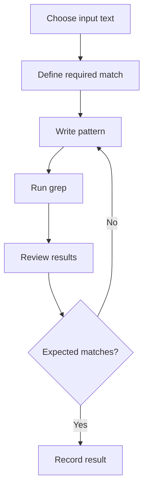

# Regular Expressions

## 1. Definition
A **regular expression (regex)** is a pattern used to find text matching a rule. Regex is useful for searching logs, filtering output, and finding records. Different tools support different regex dialects.

## 2. Example data
```text
Ali BSIT
Ayesha BSCS
Ahmed BSIT
Sara BSCS
```

Search for lines containing `BSIT`:
```bash
grep 'BSIT' students.txt
```

## 3. Common patterns

| Pattern | Meaning | Example |
|---|---|---|
| `^A` | Line begins with A | `grep '^A' students.txt` |
| `BSIT` | Contains literal BSIT | `grep 'BSIT' students.txt` |
| `BSCS$` | Line ends with BSCS | `grep 'BSCS$' students.txt` |
| `[0-9]` | Contains a digit | `grep '[0-9]' file.txt` |
| `[0-9][0-9]` | Two consecutive digits | `grep '[0-9][0-9]' file.txt` |
| `^[A-Z]` | Starts with uppercase English letter | `grep '^[A-Z]' file.txt` |

`BSCS$` will not match a line such as `Ayesha BSCS 24`, because the line ends in `24`, not `BSCS`.

## 4. Anchors and character classes
- `^` matches the beginning of a line.
- `$` matches the end of a line.
- `[0-9]` matches one digit.
- `[A-Z]` usually matches an uppercase letter range; locale can affect ranges.

## 5. Basic and extended regex
`grep` normally uses basic regular expressions. `grep -E` enables extended regular expressions, for example:
```bash
grep -E 'cat|dog' animals.txt
```
This matches lines containing `cat` or `dog` in extended-regex mode.

## 6. Workflow


## 7. Common mistakes
- Using `$` when the term is not at line end.
- Forgetting that `.` commonly matches any single character.
- Forgetting to quote patterns.
- Assuming every tool uses the same regex syntax.
- Testing on too little sample data.

## Summary
Regex describes text patterns. Anchors identify line boundaries and character classes match sets of characters. Test patterns against representative data.

## Related notes
- [Tcpdump](01-Tcpdump-Commands.md)
- [Regular Expressions Cheatsheet](../cheatsheets/Regular-Expressions-Cheatsheet.md)
