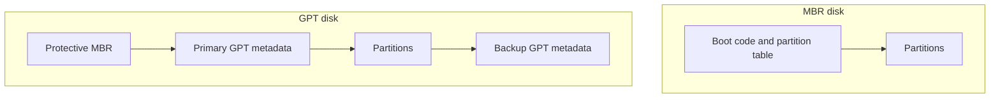

# MBR vs GPT

## 1. Partitioning
Disk partitioning divides a storage device into logical regions called partitions. MBR and GPT are partition-table formats, not filesystems.

## 2. MBR
**Master Boot Record (MBR)** is an older partitioning scheme. Its traditional table supports four primary entries; one can be an extended partition containing logical partitions. With traditional 512-byte sectors, its addressing commonly limits capacity to about 2 TiB.

## 3. GPT
**GUID Partition Table (GPT)** is a newer scheme that supports large disks, stores primary and backup partition-table metadata, and uses integrity checks. The partition-count limit depends on the operating system and tools. GPT is common with UEFI systems, although actual boot arrangements vary.

## 4. Comparison

| Feature | MBR | GPT |
|---|---|---|
| Age | Older | Newer |
| Traditional entries | Four primary entries, with extended/logical workaround | Many; limit depends on implementation |
| Large disks | Traditional layout limited to about 2 TiB | Supports much larger disks |
| Backup table | No equivalent standard backup table | Backup table/header |
| Integrity checks | Limited | CRC-based checks |
| Common boot association | Legacy BIOS | UEFI |

## 5. Conceptual layout

This diagram is conceptual, not sector-accurate.

## 6. Choosing a scheme
Consider firmware, operating-system compatibility, disk capacity, existing data, and the task requirements. Do not convert partition tables casually; data may become inaccessible.

## 7. Inspect before modifying
```bash
lsblk
fdisk -l
```
These commands can help inspect devices on Linux; availability and output vary. Some require elevated privileges. Never assume a device name. Identify the correct disk and back up important data before any partitioning.

## Summary
MBR is older and has traditional limits; GPT supports larger disks and redundant metadata. Choose based on compatibility and actual system requirements.

## Related notes
- [RAID and LVM](02-RAID-and-LVM.md)
- [Disk Management Cheatsheet](../cheatsheets/Disk-Management-Cheatsheet.md)
