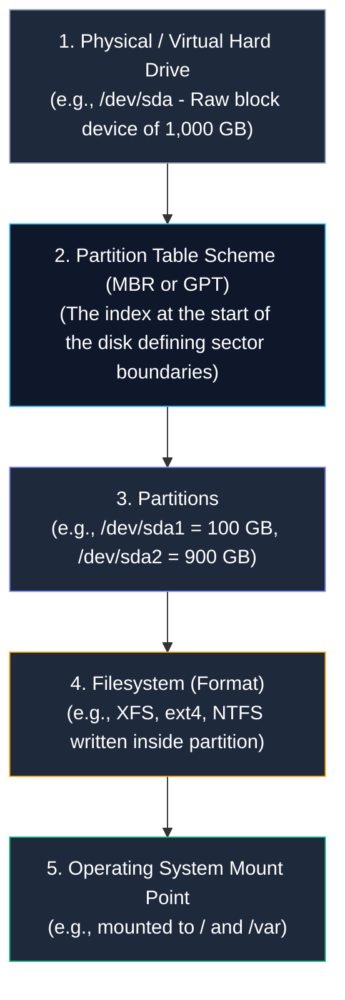
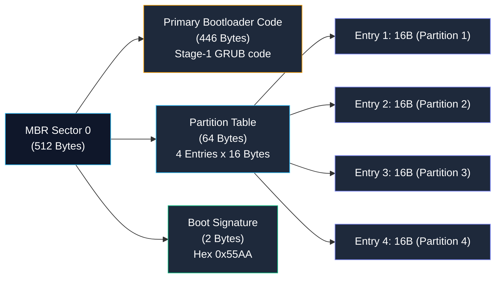
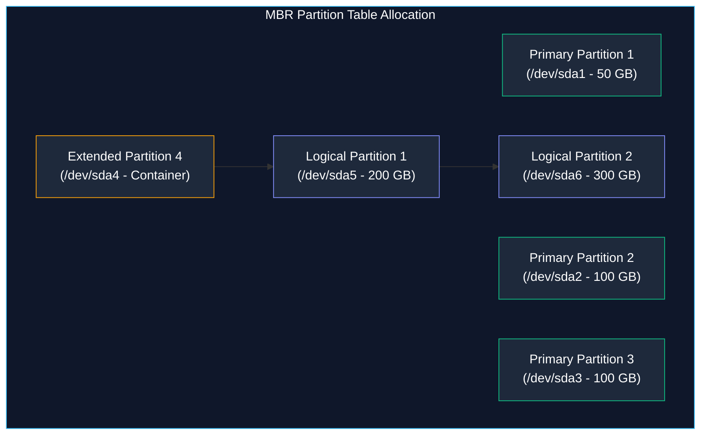
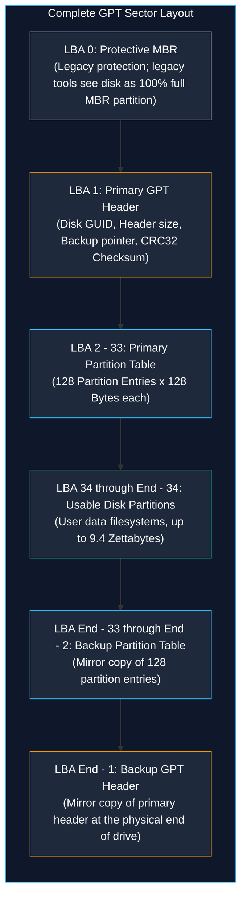

# Disk Partitioning Schemes: MBR vs. GPT Architecture

> **Module:** System and Network Administrator (SNA) Foundations  
> **Topic:** Storage Subsystems, Master Boot Record (MBR), GUID Partition Tables (GPT), and Firmware Hand-off  
> **Target Audience:** BSIT Students, Storage Administrators, and Systems Engineers  
> **Related Reference:** [02-RAID-and-LVM.md](02-RAID-and-LVM.md) | [03-Linux-Fundamentals/06-System-Initialization.md](../03-Linux-Fundamentals/06-System-Initialization.md) | [Disk Management Cheatsheet](../cheatsheets/Disk-Management-Cheatsheet.md)

---

## 🎯 Learning Objectives

By the end of this chapter, you will be able to:

- Distinguish clearly between a **physical storage device**, a **partition table**, a **partition**, and a **filesystem**.
- Deconstruct the 512-byte **Master Boot Record (MBR)** sector: Boot Code (446B), Partition Table (64B), and Magic Number (2B).
- Explain the mathematical reason behind the **2.2 Terabyte (2 TiB) limitation** of MBR using 32-bit Logical Block Addressing (LBA).
- Navigate the extended/logical partition workaround used by MBR to surpass the 4-primary-partition boundary.
- Analyze the architecture of the **GUID Partition Table (GPT)**: Protective MBR, Primary Header, 128 Partition Entries, and Backup GPT Headers.
- Inspect block devices, partition tables, and disk layouts safely using `lsblk`, `fdisk -l`, `gdisk`, and `parted`.
- Select the appropriate partitioning scheme based on motherboard firmware (Legacy BIOS vs. UEFI) and disk capacity.

---

## 1. Fundamentals: Physical Disks, Partitions, and Filesystems

Before comparing partition schemes, let us clarify a fundamental distinction that frequently confuses computer science and IT students:



1. **The Physical Disk (`/dev/sda`):** The raw physical hardware drive (NVMe SSD, SATA HDD, or virtual disk image). It consists of raw sectors numbered sequentially from 0 upward.
2. **The Partition Table (MBR or GPT):** An architectural roadmap written at the very beginning of the drive. It tells the operating system kernel: *"Partition 1 starts at Sector 2048 and ends at Sector 209715199."*
3. **The Partition (`/dev/sda1`):** A logical subdivision of the physical drive isolated from other partitions.
4. **The Filesystem (`ext4`, `xfs`):** The internal data structure (inodes, allocation bitmaps, directories) created *inside* a partition by formatting it (`mkfs.xfs /dev/sda1`).
5. **The Mount Point (`/var`):** The directory path in the Linux tree where that formatted partition is attached so applications can read and write files.

### Why Do We Partition Storage?
- **Operating System Isolation:** Separating core system files (`/`) from user files (`/home`) and log files (`/var`). If an application floods `/var/log` with massive logs, only the `/var` partition fills up, preventing the core operating system (`/`) from crashing.
- **Multiple Operating Systems (Dual-Booting):** Allows installing Linux and Windows on independent partitions of the same physical drive.
- **Security Boundaries:** Sensitive partitions (such as `/tmp` or `/home`) can be mounted with restrictive flags (`noexec`, `nosuid`) so users cannot execute unauthorized binary malware.

---

## 2. The Master Boot Record (MBR) Scheme

Introduced by IBM in 1983 for PC-DOS 2.0, the **Master Boot Record (MBR)** is the classical partitioning standard used for nearly four decades on personal computers and legacy servers.

### 2.1 The 512-Byte Sector 0 Anatomy
On an MBR disk, the entire partition scheme and stage-1 bootloader are crammed into the very first 512-byte sector of the hard drive (Sector 0 / LBA 0):

```text
+----------------------------------------------------------------------------------------------------+
|                                    MBR SECTOR 0 (512 BYTES TOTAL)                                  |
+------------------------------------------+-----------------------------------+---------------------+
| 1. Primary Bootloader Code               | 2. Partition Table Entries        | 3. Magic Number     |
| 446 Bytes                                | 64 Bytes (4 entries x 16B each)   | 2 Bytes (0x55AA)    |
+------------------------------------------+-----------------------------------+---------------------+
```



1. **Primary Boot Code (446 Bytes):** The initial assembly language code executed by the motherboard BIOS. It reads the partition table, locates the partition flagged as "Active/Bootable", and loads the next boot stage into RAM.
2. **Partition Table (64 Bytes):** Exactly 64 bytes were allocated for the partition table. Because each partition record requires 16 bytes of metadata (boot flag, start sector, end sector, total sectors, filesystem type ID), **MBR physically can hold only 4 Primary Partition records** ($64 \div 16 = 4$).
3. **Magic Number (2 Bytes):** Contains the hexadecimal signature `0x55AA`. The BIOS checks for this exact signature to confirm the drive is valid and bootable.

---

### 2.2 The 4-Partition Limit and the Extended/Logical Workaround
Because the MBR table only has space for 4 records, how could a system run with 6 partitions?

Engineers devised a workaround using **Extended Partitions**:
- A disk can have **up to 4 Primary Partitions**, OR **up to 3 Primary Partitions + 1 Extended Partition**.
- An **Extended Partition** does not store data directly. Instead, it acts as a secondary container holding a linked chain of **Logical Partitions** (`/dev/sda5`, `/dev/sda6`, etc.).



*(Notice: Primary partitions are numbered 1 through 4. Logical partitions on Linux **always start at number 5**, even if partitions 2 and 3 do not exist!)*

---

### 2.3 The 2.2 Terabyte (2 TiB) Storage Ceiling

The fatal limitation that ended MBR's dominance in modern enterprise data centers is its **inability to address storage drives larger than 2.19 Terabytes**.

#### The Mathematical Proof:
In MBR, sector addresses are stored in a **32-bit integer** field:
1. The maximum numerical value that a 32-bit unsigned binary integer can hold is:
   $$2^{32} = 4,294,967,296\text{ sectors}$$
2. Traditional hard drives format physical sectors at **512 bytes per sector**:
   $$4,294,967,296\text{ sectors} \times 512\text{ bytes/sector} = 2,199,023,255,552\text{ bytes}$$
3. Dividing by $1024^4$ converts bytes to tebibytes:
   $$\frac{2,199,023,255,552\text{ bytes}}{1,099,511,627,776} = 2.0\text{ TiB}\ (2.199\text{ TB})$$

**The Operational Consequence:** If you buy an 8 Terabyte enterprise hard drive and format it with an MBR partition table, **the operating system can only use the first 2.2 TB**! The remaining 5.8 Terabytes of disk space is physically invisible to the kernel and completely wasted.

### 2.4 Single Point of Failure (SPOF)
On an MBR disk, the partition table exists in **one and only one place**: Sector 0. If Sector 0 develops a bad block, or if an administrator accidentally overwrites it using `dd if=/dev/zero of=/dev/sda bs=512 count=1`, the entire partition table is destroyed instantly. The operating system cannot find any partitions, and all data is lost.

---

## 3. The GUID Partition Table (GPT) Scheme

To overcome the architectural ceilings of MBR, Intel developed the **GUID Partition Table (GPT)** as part of the modern **Unified Extensible Firmware Interface (UEFI)** specification.



---

### 3.1 Architectural Pillars of GPT

#### 1. Astronomical Capacity (64-Bit LBA)
GPT uses **64-bit integer addresses** to index sectors:
- $2^{64} = 18,446,744,073,709,551,616\text{ sectors}$.
- At 512 bytes per sector, GPT supports drives up to **9.4 Zettabytes (9.4 billion Terabytes)**! GPT will not run out of capacity for generations.

#### 2. Native Support for 128 Partitions
GPT allocates a minimum of 16,384 bytes for partition entries. With each partition entry consuming 128 bytes of metadata, GPT natively supports **128 Primary Partitions** without needing clumsy extended or logical partition workarounds.

#### 3. Unique Identifiers: The GUID
Every partition and every disk formatted with GPT is assigned a globally unique 128-bit **Globally Unique Identifier (GUID)** (e.g., `2843104d-01b2-4d2a-b789-9e812401f822`). This eliminates drive mapping confusion when storage drives are moved between server ports or SAN controllers.

#### 4. Automatic Backup & Redundancy
GPT maintains **two identical copies** of its partition table:
- **Primary GPT:** Stored at the physical start of the drive (LBA 1 to 33).
- **Secondary (Backup) GPT:** Stored at the absolute physical end of the drive (the last 33 sectors).
If Sector 1 is corrupted by a power surge or software error, the UEFI firmware and Linux kernel detect the error and automatically reconstruct the partition table from the backup table at the end of the drive!

#### 5. CRC32 Integrity Checksums
GPT headers contain **Cyclic Redundancy Check (CRC32)** checksums. During boot, the system recalculates the checksums of the headers and partition tables. If a single bit of metadata is corrupted, the system detects the error immediately rather than writing corrupted data to disk.

#### 6. The Protective MBR (LBA 0)
At LBA 0, GPT writes a dummy "Protective MBR".
- If an older operating system or legacy partitioning tool (which knows nothing about GPT) scans the drive, the Protective MBR tells the tool: *"This entire disk is occupied by a single, unknown partition of maximum size."*
- This prevents legacy tools from assuming the drive is blank and accidentally overwriting the GPT headers!

---

## 4. Comprehensive Comparison: MBR vs. GPT

```
+----------------------------------------------------------------------------------------------------+
|                                    MBR VS. GPT ARCHITECTURAL MATRIX                                |
+--------------------------+------------------------------------+------------------------------------+
| Dimension                | Master Boot Record (MBR)           | GUID Partition Table (GPT)         |
+--------------------------+------------------------------------+------------------------------------+
| Introduced Year          | 1983 (IBM PC-DOS 2.0)              | 2005 (UEFI Specification)          |
| Maximum Disk Capacity    | 2.2 Terabytes (2.0 TiB)            | 9.4 Zettabytes (8.0 ZiB)           |
| Addressing Bit Width     | 32-bit Logical Block Addressing    | 64-bit Logical Block Addressing    |
| Primary Partition Limit  | Strictly 4 Primary Partitions      | 128 Partitions natively            |
| Extended Partitions      | Required to exceed 4 partitions    | Obsolete (Not used or needed)      |
| Redundant Backup Table   | NONE (Single Point of Failure)     | YES (Mirrored at end of storage)   |
| Integrity Verification   | None (No checksums)                | CRC32 Checksums on header & entries|
| Disk & Partition Naming  | Sequential integers only           | Unique 128-bit GUIDs               |
| Motherboard Firmware     | Legacy BIOS                        | Modern UEFI (Unified EFI)          |
| Linux Partitioning Tool  | fdisk                              | gdisk, parted                      |
+--------------------------+------------------------------------+------------------------------------+
```

---

## 5. Inspecting Block Devices and Partitions in Linux

Administrators must inspect storage devices thoroughly before creating filesystems or altering partition layouts.

```
+----------------------------------------------------------------------------------------------------+
|                                      STORAGE INSPECTION COMMANDS                                   |
+----------+------------------------------------+----------------------------------------------------+
| Command  | Primary Purpose                    | Key Options & Syntax Styles                        |
+----------+------------------------------------+----------------------------------------------------+
| lsblk    | Tree view of block devices & mounts| lsblk, lsblk -f (Filesystems), lsblk -p (Full Path)|
| fdisk -l | List partition table (MBR/GPT)     | fdisk -l /dev/sda                                  |
| gdisk -l | Detailed GPT inspection            | gdisk -l /dev/sda                                  |
| parted   | Query disk labels and alignment    | parted -l, parted /dev/sda print                   |
+----------+------------------------------------+----------------------------------------------------+
```

---

### 5.1 `lsblk` — List Block Devices (The Best First Step!)

- **Purpose:** Displays all available storage drives, partitions, LVM volumes, and optical drives in a clean visual hierarchy.
- **Example Execution:**
  ```bash
  lsblk -f
  ```
- **Expected Output:**
  ```text
  NAME             FSTYPE      FSVER LABEL UUID                                 MOUNTPOINTS
  sda                                                                           
  ├─sda1           xfs                   2843104d-01b2-4d2a-b789-9e812401f822   /boot
  └─sda2           LVM2_member           uY8f12-mK32-901a-8812-7712-4412-110022 
    ├─rhel-root    xfs                   44018210-4120-4491-a120-112001928374   /
    ├─rhel-var     xfs                   88102934-1123-4122-bc01-998811223344   /var
    └─rhel-swap    swap                  11029348-7712-4412-ba01-778811223344   [SWAP]
  sdb                                                                           
  └─sdb1           ext4                  77102934-0012-4111-cc01-558811223344   /data
  ```
- **Interpreting the Output:**
  - `sda` is the first physical drive.
  - `sda1` is partition 1, formatted as `xfs`, mounted on `/boot`.
  - `sda2` is configured as a Physical Volume for LVM, subdivided into logical volumes for `/`, `/var`, and swap.
  - `sdb` is a second physical drive with partition `sdb1` mounted on `/data`.

---

### 5.2 `fdisk -l` — Detailed Partition Table Examination

- **Purpose:** Queries low-level partition table metadata, sector sizes, and disk model information.
- **Syntax:** `fdisk -l [DEVICE]`
- **Example Output (GPT Disk):**
  ```text
  Disk /dev/sda: 500 GiB, 536870912000 bytes, 1048576000 sectors
  Disk model: Micron_5300_MTFD
  Units: sectors of 1 * 512 = 512 bytes
  Sector size (logical/physical): 512 bytes / 512 bytes
  I/O size (minimum/optimal): 512 bytes / 512 bytes
  Disklabel type: gpt
  Disk identifier: 2843104D-01B2-4D2A-B789-9E812401F822

  Device       Start        End    Sectors  Size Type
  /dev/sda1     2048    2099199    2097152    1G EFI System
  /dev/sda2  2099200 1048573951 1046474752  499G Linux LVM
  ```
- **Crucial Identifier:** Look at **`Disklabel type: gpt`**! This explicitly tells the administrator that the drive uses GPT. On an MBR drive, this line reads **`Disklabel type: dos`**.

---

## 6. Enterprise Storage Naming Conventions in Linux

In Linux, device filenames under `/dev` follow standardized hardware naming rules:

| Device Path Pattern | Underlying Hardware Type | Example Partition |
|---|---|---|
| **`/dev/sd[a-z]`** | SCSI, SATA, or USB attached storage drives | `/dev/sda1`, `/dev/sdb2` |
| **`/dev/nvme[0-9]n[0-9]`** | High-speed Non-Volatile Memory Express (NVMe) PCIe SSDs | `/dev/nvme0n1p1` (Controller 0, Namespace 1, Partition 1) |
| **`/dev/vd[a-z]`** | VirtIO virtual disk drives inside KVM/QEMU virtual machines | `/dev/vda1`, `/dev/vdb1` |
| **`/dev/hd[a-z]`** | Legacy IDE (PATA) ribbon cable drives (Legacy RHEL 6) | `/dev/hda1`, `/dev/hdc` (often CD-ROM) |

> 🚨 **Critical Safety Directive:** Never assume a drive is `/dev/sdb` or `/dev/hdc` without verifying! In modern Linux, drive letters (`sda`, `sdb`) can shift between reboots if storage cables are reordered or USB drives are inserted. Always verify the drive model and size using `lsblk` before running destructive partitioning tools!

---

## 7. Important Points to Remember

- **MBR Sector 0:** Contains 446 bytes of boot code, 64 bytes for 4 partition table entries (16 bytes each), and the `0x55AA` boot signature.
- **MBR 2.2 TiB Limit:** Caused by 32-bit Logical Block Addressing: $2^{32} \times 512\text{ bytes} \approx 2.19\text{ TB}$. Drives larger than 2.2 TB cannot be fully utilized under MBR.
- **Extended Workaround:** MBR bypasses the 4-partition limit using 1 extended partition containing multiple logical partitions (numbered 5 and higher).
- **GPT Zettabyte Scale:** GPT uses 64-bit LBA ($9.4\text{ ZB}$ capacity) and natively supports 128 partitions.
- **GPT Redundancy:** Maintains a primary table at LBA 1–33 and a backup mirror copy at the physical end of the disk.
- **Protective MBR:** Stored at LBA 0 on GPT disks to prevent legacy MBR tools from erroneously identifying the drive as blank and overwriting data.
- **Tool Selection:** Use `fdisk` for MBR disks; use `gdisk` or `parted` for modern GPT disks.

---

## 8. Key Terms Glossary

| Term | Technical Definition |
|---|---|
| **CRC32** | Cyclic Redundancy Check 32-bit; an error-detecting code used by GPT headers to verify that partition tables have not been corrupted. |
| **EFI System Partition (ESP)** | A dedicated FAT32 partition on GPT disks containing UEFI bootloaders, kernel images, and firmware utility drivers. |
| **Extended Partition** | A specialized MBR partition entry that acts as a container holding secondary logical partitions. |
| **GUID** | Globally Unique Identifier; a 128-bit pseudo-random number used in GPT to guarantee globally unique partition identities. |
| **LBA** | Logical Block Addressing; a standard scheme used to locate individual 512-byte or 4096-byte storage sectors sequentially from 0 upward. |
| **Master Boot Record (MBR)** | The legacy 512-byte sector at the beginning of a disk containing boot code, the 4-entry partition table, and the boot signature. |
| **Protective MBR** | A dummy partition table written to LBA 0 of GPT disks to prevent legacy MBR disk utilities from destroying GPT metadata. |
| **UEFI** | Unified Extensible Firmware Interface; the modern motherboard firmware specification that replaced legacy BIOS. |

---

## 9. Practice Questions

Test your mastery of storage architectures, MBR limitations, and GPT layouts. Attempt each question independently before consulting the answer key below.

### Question 1 (Mathematical Architecture)
Why is an MBR-partitioned storage drive physically incapable of addressing more than 2.2 Terabytes of storage when using standard 512-byte sectors?
- [A] Because the Linux kernel limits all hard drives to 2 Terabytes.
- [B] Because MBR uses a 32-bit integer for sector addresses: $2^{32} \times 512\text{ bytes} \approx 2.19\text{ TB}$.
- [C] Because the SATA cable protocol only transmits 32 bits of electrical data.
- [D] Because BIOS firmware cannot count higher than 10,000 sectors.

### Question 2 (GPT Redundancy)
A storage server suffers a power flicker while writing data. Sector 1 (LBA 1, Primary GPT Header) develops an uncorrectable read error.
How does a modern UEFI operating system recover from this failure on a GPT disk?
- [A] The system prompts the user to reformat the drive.
- [B] The kernel reads the Protective MBR at LBA 0 to rebuild the files.
- [C] The system reads the Secondary (Backup) GPT Header and Partition Table mirrored at the physical end of the drive and restores the primary table.
- [D] The system reverts the disk into an MBR drive.

### Question 3 (Partition Numbering Conventions)
An administrator formats an MBR disk with 2 Primary Partitions (`/dev/sda1` and `/dev/sda2`) and 1 Extended Partition (`/dev/sda3`).
Inside the Extended Partition, the administrator creates two Logical Partitions.
What will be the exact Linux device node names assigned to those two logical partitions?
- [A] `/dev/sda4` and `/dev/sda5`
- [B] `/dev/sda3a` and `/dev/sda3b`
- [C] `/dev/sda5` and `/dev/sda6`
- [D] `/dev/sda1_logical` and `/dev/sda2_logical`

### Question 4 (Disk Inspection Interpretation)
Examine this line from `fdisk -l /dev/nvme0n1`:
```text
Disklabel type: dos
```
What does `Disklabel type: dos` indicate to the administrator?
- [A] The drive was formatted with MS-DOS FAT16.
- [B] The drive uses the legacy Master Boot Record (MBR) partition scheme.
- [C] The drive uses modern GUID Partition Tables (GPT).
- [D] The drive is infected with a DOS boot sector virus.

### Question 5 (Enterprise Storage Architecture Scenario)
An enterprise procurement department orders ten 16-Terabyte NVMe storage drives for a new database cluster running RHEL 9 on modern Dell PowerEdge servers with UEFI firmware.
A junior technician suggests using MBR so that older backup scripts will be compatible.
As the senior administrator, explain why MBR is completely unacceptable for this deployment and identify two specific technical benefits GPT provides.

---

## 10. Answer Key & Explanations

### Answer to Question 1:
**Correct Option:** **[B]**  
*Explanation:* The MBR sector layout was engineered in 1983 with a 32-bit field for sector addresses. With 512 bytes per sector, the maximum addressable capacity is $2^{32} \times 512 = 2,199,023,255,552\text{ bytes} \approx 2.19\text{ TB}$.

### Answer to Question 2:
**Correct Option:** **[C]**  
*Explanation:* GPT eliminates the Single Point of Failure present in MBR by writing a complete duplicate copy of the GPT Header and Partition Table to the last 33 sectors of the physical drive. If the primary table at LBA 1–33 is damaged, the system automatically restores data from the backup table at the end of the disk.

### Answer to Question 3:
**Correct Option:** **[C]**  
*Explanation:* On Linux, partition numbers 1 through 4 are strictly reserved for Primary or Extended partitions. Logical partitions located inside an extended container are **always assigned numbers 5 and higher**. Therefore, the two logical partitions are `/dev/sda5` and `/dev/sda6`.

### Answer to Question 4:
**Correct Option:** **[B]**  
*Explanation:* In Linux utilities (`fdisk`, `parted`), the term `dos` denotes the classical **Master Boot Record (MBR)** partition scheme (originating from MS-DOS). GPT disks are explicitly identified as `Disklabel type: gpt`.

### Answer to Question 5:
**Correct Answer:**  
1. **Capacity Loss:** MBR can only address 2.2 Terabytes. On a 16-Terabyte physical drive, MBR would leave **13.8 Terabytes of disk space unusable and wasted**!
2. **Two Benefits of GPT:**
   - **Full Capacity Utilization:** GPT uses 64-bit LBA, easily addressing the full 16 Terabytes (and up to 9.4 Zettabytes).
   - **Data Integrity & Resilience:** GPT includes CRC32 checksums and a mirrored backup partition table at the end of the drive, preventing server downtime from sector-0 corruption.

---

## 🔗 Related Notes & Next Steps

- **Next Chapter:** Combine partitions into dynamic storage pools with RAID and LVM in [02-RAID-and-LVM.md](02-RAID-and-LVM.md).
- **Remote Server Management:** Connect remotely to Linux servers from Windows in [../06-Remote-File-Management/01-PuTTY-and-WinSCP.md](../06-Remote-File-Management/01-PuTTY-and-WinSCP.md).
- **Quick Reference:** Consult [../cheatsheets/Disk-Management-Cheatsheet.md](../cheatsheets/Disk-Management-Cheatsheet.md).
