# Disk Partitioning: MBR vs. GPT Architecture

> **Module:** System and Network Administrator (SNA) — 05 Disk Management  
> **Topic Level:** Storage Architecture & Hardware Partitioning  
> **Previous Reference:** [../04-Networking/02-Regular-Expressions.md](../04-Networking/02-Regular-Expressions.md) | **Next:** [02-RAID-and-LVM.md](02-RAID-and-LVM.md)

---

## 🎯 Learning Objectives

By the end of this note, you will be able to:

- Understand the purpose of disk partitioning and Linux storage device naming conventions (`/dev/sda`, `/dev/sdb`, `/dev/nvme0n1`).
- Deconstruct the 512-byte **Master Boot Record (MBR)** layout, including boot code, partition table, and boot signature.
- Explain the technical limitations of MBR: 4 primary partitions and the **2.2 Terabyte (TiB)** addressable ceiling.
- Describe the architecture of the **GUID Partition Table (GPT)**: Protective MBR, primary/backup headers, and CRC32 checksums.
- Safely inspect partition tables and block devices using `lsblk`, `fdisk -l`, and `blkid`.
- Distinguish between partition tools (`fdisk` for MBR, `gdisk` / `parted` for GPT).

---

## 1. Introduction and Context

Before a physical hard drive, solid-state drive (SSD), or virtual disk image can store operating system files, databases, or user homes, the raw storage medium must be carved into logical boundaries known as **partitions**.

Partitioning isolates system components. For instance, mounting `/var` or `/home` on independent partitions ensures that an out-of-control log file or large user download cannot consume all available space on the root (`/`) filesystem and crash the operating system kernel.

Two primary partition table standards exist in modern computing:
1. **Master Boot Record (MBR)**: Introduced with IBM PC DOS in 1983; the traditional standard paired with legacy BIOS firmware (and standard in RHEL 6).
2. **GUID Partition Table (GPT)**: Introduced as part of the Unified Extensible Firmware Interface (UEFI) specification; the modern standard required for drives larger than 2 Terabytes.

```mermaid
flowchart TD
    subgraph Comparison["MBR vs. GPT Partition Layout Architecture"]
        direction TB

        subgraph MBRLayout["Master Boot Record (MBR Layout)"]
            M1["Sector 0 (512 Bytes)<br/>• 446B: Bootstrap Code (Stage 1)<br/>• 64B: Partition Table (4 x 16B entries)<br/>• 2B: Boot Signature (0x55AA)"]
            M2["Primary / Extended Partitions<br/>(Max 4 Primary, or 3 Primary + 1 Extended)<br/>Ceiling: 2.2 Terabytes"]
            M3["No Backup Header at End of Disk<br/>(Single Point of Failure)"]
            M1 --> M2 --> M3
        end

        subgraph GPTLayout["GUID Partition Table (GPT Layout)"]
            G1["LBA 0: Protective MBR (Prevents legacy tools from overwriting)"]
            G2["LBA 1: Primary GPT Header (Disk GUID, CRC32, Partition Array Pointer)"]
            G3["LBA 2-33: Primary Partition Table (128 Partition Entries default)"]
            G4["Usable Storage Space (Partitions 1 through 128...)<br/>Ceiling: 9.4 Zettabytes (9.4 Billion TB)"]
            G5["End of Disk: Backup GPT Table & Backup GPT Header (Self-Healing)"]
            G1 --> G2 --> G3 --> G4 --> G5
        end
    end

    style Comparison fill:#1e293b,stroke:#3b82f6,color:#fff
    style MBRLayout fill:#0f172a,stroke:#f59e0b,color:#fff
    style GPTLayout fill:#0f172a,stroke:#10b981,color:#fff
```



---

## 2. Definitions of Important Terminology

| Term | Definition |
|---|---|
| **Block Device** | A storage device that transfers data in fixed-size blocks (e.g., hard drives, SSDs, USB drives), represented in Linux under `/dev/`. |
| **LBA (Logical Block Addressing)** | A linear scheme specifying the location of data blocks on storage devices (beginning with LBA 0 at the first 512-byte or 4096-byte sector). |
| **Primary Partition** | An independent partition defined directly within the master partition table (MBR supports up to 4; GPT supports at least 128). |
| **Extended Partition** | A special container partition in MBR used to bypass the 4-partition limit; contains a linked list of **Logical Partitions**. |
| **Protective MBR** | A legacy MBR sector placed at LBA 0 on GPT disks that defines a single pseudo-partition spanning the entire drive, preventing older MBR-only utilities from misidentifying the disk as blank and overwriting data. |
| **CRC32 Checksum** | A cyclic redundancy code embedded in GPT headers used to detect header corruption and trigger automatic restoration from the secondary backup header. |

---

## 3. Linux Storage Device Naming Conventions

The Linux kernel assigns standardized device node names under the `/dev` directory based on the bus controller and storage type:

| Device Node | Hardware Interface / Controller Type |
|---|---|
| `/dev/sda`, `/dev/sdb`, `/dev/sdc` | SATA, SCSI, SAS hard drives, SSDs, and USB flash drives (`sd` = SCSI Device). Letters denote physical drives in discovery order. |
| `/dev/sda1`, `/dev/sda2` | Partitions 1 and 2 on the primary drive `/dev/sda`. |
| `/dev/vda`, `/dev/vdb` | Virtual block devices using KVM / QEMU `virtio-blk` paravirtualized drivers. |
| `/dev/nvme0n1`, `/dev/nvme0n1p1` | High-speed PCIe Non-Volatile Memory Express (NVMe) solid-state storage. `p1` denotes Partition 1. |
| `/dev/hda`, `/dev/hdb` *(Legacy)* | Ancient IDE (PATA) parallel ribbon-cable drives. Rarely seen in modern servers. |

> ⚠️ **Verification Rule:** Never assume a secondary drive is named `/dev/sdb` or `/dev/hdc`. Always run `lsblk` before issuing disk commands to confirm target device identities!

---

## 4. Master Boot Record (MBR) Deep Dive

### 4.1 Sector 0 Breakdown (512 Bytes)
In MBR systems, the very first 512-byte sector of the storage medium holds three distinct structures:

```text
+-------------------------------------------------------+
|  Bytes 0 - 445 (446 Bytes):  Stage 1 Boot Code        |
|  (Initial bootstrap code executed by BIOS)            |
+-------------------------------------------------------+
|  Bytes 446 - 509 (64 Bytes): Master Partition Table   |
|  (4 partition entries x 16 Bytes per entry)           |
+-------------------------------------------------------+
|  Bytes 510 - 511 (2 Bytes):  Boot Signature (0x55AA)  |
|  (Magic number validating a bootable sector)          |
+-------------------------------------------------------+
```

### 4.2 The 2.2 Terabyte Mathematical Limit
Why does MBR fail on disks larger than 2.2 Terabytes?
- MBR uses a 32-bit field to store the starting sector and sector count for each partition.
- Maximum 32-bit integer: $2^{32} = 4,294,967,296$ sectors.
- Standard sector size: $512$ bytes.
- Maximum addressable capacity:
  $$4,294,967,296 \times 512 \text{ bytes} = 2,199,023,255,552 \text{ bytes} \approx 2.199 \text{ TiB (2.2 TB)}$$
If you attach a 4 Terabyte drive to an MBR system, approximately 1.8 Terabytes will be completely inaccessible to the operating system!

---

## 5. GUID Partition Table (GPT) Deep Dive

Developed to replace MBR, GPT removes all historical architectural constraints:

1. **Massive Capacity**: Uses 64-bit logical block addressing.
   $$2^{64} \times 512 \text{ bytes} \approx 9.4 \text{ Zettabytes (9.4 Billion Terabytes)}$$
2. **Abundant Partitions**: Linux supports 128 partitions by default without needing complex extended or logical partitions.
3. **Globally Unique Identifiers (GUIDs)**: Every disk and partition has a unique 128-bit GUID, preventing drive naming confusion when cables or drive bays are swapped.
4. **Data Redundancy & Self-Healing**: A duplicate backup copy of the GPT header and partition table is automatically stored at the final sectors of the physical disk. If the primary header is damaged, the kernel automatically restores it from the backup.

---

## 6. Comprehensive MBR vs. GPT Comparison

| Architectural Feature | Master Boot Record (MBR) | GUID Partition Table (GPT) |
|---|---|---|
| **Firmware Requirement** | Legacy BIOS (or UEFI in Legacy CSM mode) | Native UEFI |
| **Max Physical Drive Size** | 2.2 Terabytes | 9.4 Zettabytes |
| **Max Primary Partitions** | 4 (or 3 Primary + 1 Extended) | 128 (default in Linux) |
| **Partition Table Backup** | ❌ None (Single point of failure at Sector 0) | ✅ Secondary backup at end of disk |
| **Integrity Verification** | ❌ None | ✅ CRC32 checksums on headers & tables |
| **Primary CLI Tool** | `fdisk` | `gdisk` or `parted` |
| **Standard in RHEL 6** | ✅ Default standard | Supported for secondary data disks |
| **Standard in RHEL 8/9** | Supported for legacy disks | ✅ Default standard for all installations |

---

## 7. Non-Destructive Inspection Commands

Always inspect existing block devices before executing partition commands:

```bash
# List all block devices, sizes, mount points, and partition trees in a clean table
lsblk

# Display detailed partition table geometry across all disks (requires root)
fdisk -l

# Display filesystem types and Universally Unique Identifiers (UUIDs)
blkid

# Display parted partition table details for a specific disk
parted /dev/sda print
```

---

## 8. Common Mistakes & Defensive Safety Warnings

> 🚨 **CRITICAL SAFETY DIRECTIVE:**
> - Partitioning tools (`fdisk`, `gdisk`, `parted`) and filesystem formatting tools (`mkfs.ext4`, `mkfs.xfs`) are **destructive**.
> - Writing a new partition table or running a formatting command on the wrong disk identifier (e.g., formatting `/dev/sda` instead of an empty `/dev/sdb`) will **destroy all data immediately**.
> - Always double-check target disk capacity and mount points using `lsblk` before running any partitioning command.
> - Never run formatting commands on devices currently hosting active mounted filesystems.

---

## 9. Security Considerations

1. **Covert Storage in Unallocated Sectors**: Malware and rootkits can hide malicious payloads in unallocated sectors between the MBR boot code and the start of the first partition (often referred to as the MBR gap / LBA 1-2047).
2. **UEFI Secure Boot**: GPT is tightly integrated with UEFI Secure Boot, which uses cryptographic signatures embedded in the firmware to ensure that only authenticated bootloaders and kernels execute during startup.

---

## 10. Summary & Next Steps

Partitioning establishes the foundational layout of storage hardware. While physical partitions provide rigid separation, enterprise servers frequently require dynamic storage pools that can span multiple physical drives and expand on-the-fly.

- **Next Chapter:** Explore software RAID redundancy and Logical Volume Management in [02-RAID-and-LVM.md](02-RAID-and-LVM.md).
- **Remote File Management:** Transfer files securely between Windows and Linux in [../06-Remote-File-Management/01-PuTTY-and-WinSCP.md](../06-Remote-File-Management/01-PuTTY-and-WinSCP.md).
- **Quick Reference:** Consult [../cheatsheets/Disk-Management-Cheatsheet.md](../cheatsheets/Disk-Management-Cheatsheet.md).
