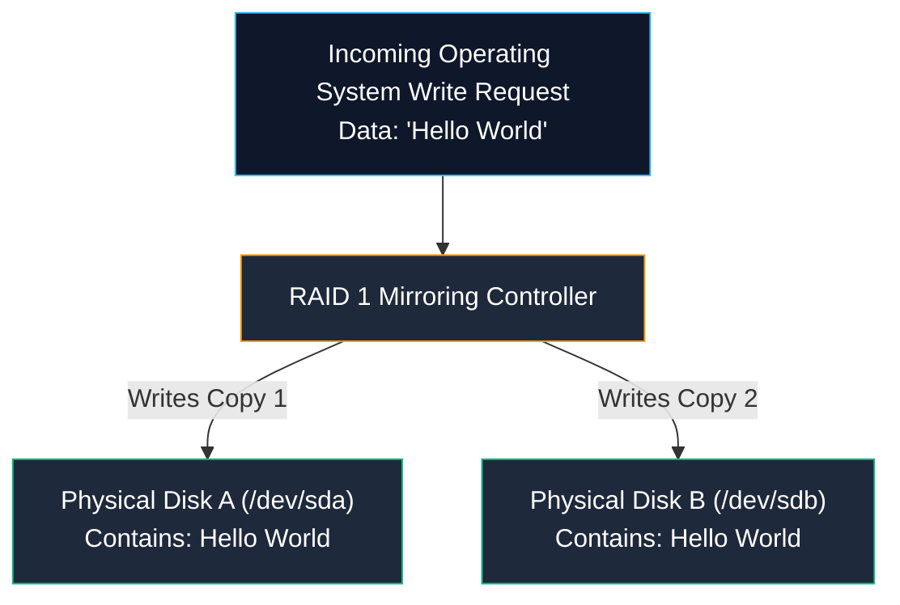
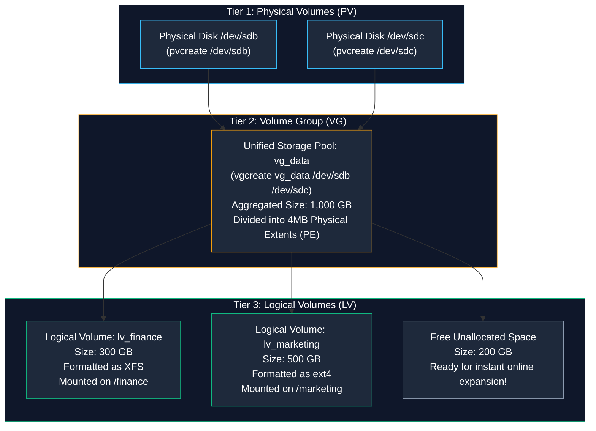
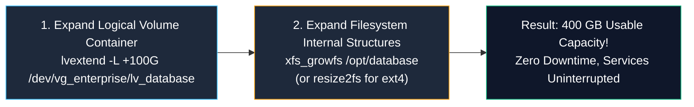

# Storage Redundancy and Dynamic Pooling: RAID and LVM

> **Module:** System and Network Administrator (SNA) Foundations  
> **Topic:** Hardware/Software RAID Levels, Physical Volumes, Volume Groups, and Dynamic Logical Volumes  
> **Target Audience:** BSIT Students, Storage Administrators, and Systems Engineers  
> **Related Reference:** [01-MBR-vs-GPT.md](01-MBR-vs-GPT.md) | [03-Linux-Fundamentals/03-File-Management.md](../03-Linux-Fundamentals/03-File-Management.md) | [Disk Management Cheatsheet](../cheatsheets/Disk-Management-Cheatsheet.md)

---

## 🎯 Learning Objectives

By the end of this chapter, you will be able to:

- Articulate why static disk partitioning fails in enterprise production environments and how **LVM** provides dynamic flexibility.
- Compare the operational mechanics, capacity calculations, fault tolerance, and trade-offs of core **RAID levels (0, 1, 5, 6, 10)**.
- Dissect the **3-Tier LVM Architecture**: **Physical Volumes (PV)**, **Volume Groups (VG)**, and **Logical Volumes (LV)**.
- Execute the complete lifecycle commands to initialize PVs (`pvcreate`), create storage pools (`vgcreate`), and carve out virtual partitions (`lvcreate`).
- Perform an **online filesystem expansion** without unmounting or taking services offline using `lvextend` and `xfs_growfs` / `resize2fs`.
- Understand the role of **Physical Extents (PE)** inside a Volume Group.
- Explain why hardware mirroring (RAID 1) protects against equipment failure but **never replaces verified data backups**.

---

## 1. The Enterprise Storage Dilemma

In traditional computing, an administrator partitions a hard drive into static slices (`/dev/sda1`, `/dev/sda2`), formats them with a filesystem, and mounts them. 

However, in an enterprise data center, static partitioning leads to two catastrophic operational challenges:

### Challenge 1: The Capacity Wall
Imagine you allocate 50 GB to `/var` on a static partition. Six months later, your corporate database grows and `/var` hits 100% capacity!
- With traditional static partitions, you cannot easily expand `/var` because the adjacent disk sectors are already occupied by `/home`!
- You would be forced to take the server offline, boot into an emergency recovery disk, back up data, delete partitions, resize boundaries, and pray that data is not corrupted.

### Challenge 2: Physical Hardware Failure
Hard drives are mechanical and electronic devices with moving platters or NAND flash cells. They fail routinely. If a database server runs on a single physical hard drive and that drive burns out, the entire company suffers a complete, unrecoverable data disaster.

Enterprise system administration solves these challenges using two complementary technologies:
1. **RAID (Redundant Array of Independent Disks):** Combines multiple physical hard drives into a single redundant storage unit to protect against hardware failure and boost speed.
2. **LVM (Logical Volume Manager):** Virtualizes and pools storage space, allowing administrators to shrink, expand, and move partitions dynamically **while the operating system remains online**!

---

## 2. RAID: Redundant Array of Independent Disks

**RAID** combines two or more physical disk drives into a single coordinated logical array managed by a dedicated **Hardware RAID Controller** card or the Linux kernel's **Software RAID subsystem (`mdadm`)**.

```
+----------------------------------------------------------------------------------------------------+
|                                    MASTER RAID COMPARISON MATRIX                                   |
+----------+-----------------------+-------------+------------------+----------------+---------------+
| RAID Lvl | Primary Architecture  | Min. Disks  | Usable Capacity  | Fault Tolerance| Best For      |
+----------+-----------------------+-------------+------------------+----------------+---------------+
| RAID 0   | Striping (No parity)  | 2 Disks     | 100% (Sum of all)| ZERO (0 Disks) | Scratch cache |
| RAID 1   | Mirroring             | 2 Disks     | 50% (Smallest)   | 1 Disk failure | OS Boot drives|
| RAID 5   | Distributed Parity    | 3 Disks     | (N - 1) x Size   | 1 Disk failure | File servers  |
| RAID 6   | Dual Distributed Part | 4 Disks     | (N - 2) x Size   | 2 Disk failures| Large storage |
| RAID 10  | Mirrored Stripes(1+0) | 4 Disks     | 50% (Sum / 2)    | Up to 2 Disks* | Databases (DB)|
+----------+-----------------------+-------------+------------------+----------------+---------------+
```

---

### 2.1 Core RAID Levels Analyzed

#### RAID 0 (Striping — High Performance, Zero Redundancy)
- **How It Works:** Data is split into chunks (stripes) and written across all drives simultaneously.
- **Advantage:** Maximum read and write speeds; 100% of disk capacity is usable.
- **The Fatal Flaw:** **Zero fault tolerance!** If a single drive in a 4-disk RAID 0 array fails, **100% of all data across the entire array is destroyed** because every file is fragmented across all drives.
- **Use Case:** Non-critical video rendering scratch disks or temporary cache buffers where performance is paramount and data loss does not matter.

#### RAID 1 (Mirroring — Pure Redundancy)
- **How It Works:** Every block of data written to Disk A is written identically to Disk B simultaneously.
- **Advantage:** Exceptional read speeds (the controller can read different blocks from both drives at the same time) and high reliability. The system continues operating seamlessly if one disk physically burns out.
- **Disadvantage:** Storage capacity is cut in half ($50\%$). Two 1-Terabyte drives yield only 1 Terabyte of usable space.
- **Use Case:** Enterprise server operating system boot drives (`/boot` and `/`).



#### RAID 5 (Block-Level Striping with Distributed Parity)
- **How It Works:** Data blocks are striped across drives, but a mathematical **Parity Block** (calculated via XOR logic) is distributed evenly across all drives.
- **Fault Tolerance:** If any single drive fails, the RAID controller reads the remaining data and parity blocks to mathematically reconstruct the missing data in real time!
- **Capacity:** Capacity of one drive is consumed by parity: $(N - 1) \times \text{Size}$. Three 2 TB drives yield $4\text{ TB}$ usable space.
- **Disadvantage:** Slower write performance due to parity calculation overhead ("write penalty").

#### RAID 6 (Dual Distributed Parity)
- **How It Works:** Similar to RAID 5, but calculates **two completely independent parity schemes** distributed across all drives.
- **Fault Tolerance:** Can survive the **simultaneous failure of any TWO drives** without data loss!
- **Capacity:** $(N - 2) \times \text{Size}$.
- **Use Case:** High-density enterprise storage arrays containing massive 16 TB+ hard drives where drive rebuild times can take days.

#### RAID 10 (RAID 1+0 — Mirrored Stripes)
- **How It Works:** Combines the speed of RAID 0 with the redundancy of RAID 1. Disks are configured in mirrored pairs, and data is striped across the mirrors.
- **Use Case:** Mission-critical enterprise database servers (Oracle, PostgreSQL, Microsoft SQL) demanding maximum write performance and robust fault tolerance.

---

### 2.2 The Fundamental Rule: RAID is NOT a Backup!

Every year, junior technicians make the fatal mistake of assuming that because their server has RAID 1 or RAID 5, they do not need backups.

> 🚨 **Why RAID is Never a Backup:**  
> - **Accidental Deletion:** If an administrator accidentally runs `rm -rf /data`, the command instantly deletes the files from **both** mirrored disks simultaneously!
> - **Ransomware & Corruption:** If malware encrypts a database, the encrypted blocks are mirrored in real time to all member drives.
> - **Catastrophic Facility Disasters:** Power surges, lightning strikes, hardware controller board failures, and fire will destroy all physical drives inside the server simultaneously.  
> **RAID provides Hardware Availability (uptime); Backups provide Point-in-Time Data Recovery.**

---

## 3. Logical Volume Management (LVM) Architecture

While RAID protects against physical drive crashes, **Logical Volume Management (LVM)** abstracts physical storage into a flexible, virtualized pool.

LVM operates in a strict, **3-tier architectural hierarchy**:



### 3.1 Tier 1: Physical Volume (PV)
- A **Physical Volume (PV)** is a physical storage drive (`/dev/sdb`) or disk partition (`/dev/sdb1`) initialized with LVM metadata headers using the `pvcreate` command.
- Initializing a PV marks it as ready to be pooled into an LVM group.

### 3.2 Tier 2: Volume Group (VG)
- A **Volume Group (VG)** is the central storage pool. It combines one or more Physical Volumes into a single consolidated pool of storage space.
- **Physical Extents (PE):** Inside a Volume Group, storage is carved into small, uniform chunks called **Physical Extents** (default size is **4 Megabytes**). A Volume Group is essentially a giant collection of 4MB LEGO blocks.

### 3.3 Tier 3: Logical Volume (LV)
- A **Logical Volume (LV)** is a virtual partition carved out of the Volume Group pool.
- An LV is allocated a specific number of Physical Extents (e.g., an LV of 100 GB consists of 25,600 four-megabyte extents).
- To the Linux kernel, a Logical Volume behaves **identically to a physical hard drive partition**. It appears under `/dev/mapper/` (e.g., `/dev/mapper/vg_data-lv_finance`), is formatted with a filesystem (`mkfs.xfs`), and is mounted to a directory.

---

## 4. LVM Command Line Administration

LVM command names follow a clean, consistent naming convention across the three tiers:

```
+----------------------------------------------------------------------------------------------------+
|                                      LVM COMMAND MATRIX                                            |
+--------------------------+-----------------------+------------------------+------------------------+
| Operation                | Physical Volume (PV)  | Volume Group (VG)      | Logical Volume (LV)    |
+--------------------------+-----------------------+------------------------+------------------------+
| Create                   | pvcreate              | vgcreate               | lvcreate               |
| Scan for existing        | pvscan                | vgscan                 | lvscan                 |
| Display Brief Summary    | pvs                   | vgs                    | lvs                    |
| Display Detailed Report  | pvdisplay             | vgdisplay              | lvdisplay              |
| Extend / Grow Size       | pvresize              | vgextend               | lvextend               |
| Remove / Delete          | pvremove              | vgremove               | lvremove               |
+--------------------------+-----------------------+------------------------+------------------------+
```

---

### 4.1 Step-by-Step Walkthrough: Building an LVM Storage Stack

Let us build an enterprise LVM storage volume from scratch using two raw 500GB disks (`/dev/sdb` and `/dev/sdc`):

#### Step 1: Initialize the Physical Volumes
```bash
pvcreate /dev/sdb /dev/sdc
```
- *Output:* `Physical volume "/dev/sdb" successfully created.`
- *Verification:* `pvs`

#### Step 2: Create the Volume Group Pool
Combine both disks into a unified 1,000 GB Volume Group named `vg_enterprise`:
```bash
vgcreate vg_enterprise /dev/sdb /dev/sdc
```
- *Output:* `Volume group "vg_enterprise" successfully created`
- *Verification:* `vgs` (Displays: `vg_enterprise  2 PVs  0 LVs  0 SN  999.99g  999.99g free`)

#### Step 3: Carve Out a Logical Volume
Create a 300 GB Logical Volume named `lv_database` allocated from `vg_enterprise`:
```bash
lvcreate -L 300G -n lv_database vg_enterprise
```
- `-L 300G`: Specifies size in Gigabytes.
- `-n lv_database`: Specifies the name of the Logical Volume.
- `vg_enterprise`: Specifies the source Volume Group pool.
- *Verification:* `lvs`

#### Step 4: Format with a Filesystem (XFS)
```bash
mkfs.xfs /dev/vg_enterprise/lv_database
```

#### Step 5: Mount to the Filesystem
```bash
mkdir -p /opt/database
mount /dev/vg_enterprise/lv_database /opt/database
```

---

## 5. The Ultimate Power of LVM: Online Expansion

Months later, the database team reports that `/opt/database` is at 95% capacity! With traditional partitions, this causes an emergency outage. 

With LVM, an administrator can **expand the Logical Volume and the filesystem online in 10 seconds without unmounting or restarting any services!**



### The 2-Step Expansion Procedure:

#### Step 1: Extend the Logical Volume Container
Add 100 GB from the Volume Group's free pool to the Logical Volume:
```bash
lvextend -L +100G /dev/vg_enterprise/lv_database
```
*(Now the underlying block device is 400 GB, but the XFS filesystem inside still thinks it is 300 GB).*

#### Step 2: Grow the Filesystem Inside
- **For XFS Filesystems (Default on RHEL 7/8/9):**
  ```bash
  # Note: xfs_growfs takes the MOUNT POINT as argument, NOT the device name!
  xfs_growfs /opt/database
  ```
- **For ext4 Filesystems (Standard on RHEL 6 / Debian):**
  ```bash
  # Note: resize2fs takes the DEVICE NAME as argument!
  resize2fs /dev/vg_enterprise/lv_database
  ```

#### The Professional All-in-One Shortcut (`-r`):
Modern `lvextend` includes the **`-r` (resizefs)** option, which extends the logical volume and automatically triggers the correct underlying filesystem resize tool in a single command!
```bash
lvextend -r -L +100G /dev/vg_enterprise/lv_database
```

---

## 6. Combining Hardware RAID and LVM: The Enterprise Storage Stack

In real-world commercial enterprise servers, administrators do not choose between RAID and LVM—they **use both together** in a layered architecture:

```text
[ Application / User Files ]
             │
      [ Filesystem ]         (XFS or ext4 mounted on /var)
             │
   [ LVM Logical Volume ]    (Dynamic resizing, snapshots)
             │
    [ LVM Volume Group ]     (Consolidated storage pool)
             │
  [ LVM Physical Volume ]    (Block device abstraction)
             │
   [ Hardware RAID 10 ]      (Provides disk failure tolerance and speed)
             │
[ Physical Hard Drives ]     (4x 4TB Enterprise SAS Drives in Server Chassis)
```

1. **At the bottom:** Four physical hard drives are installed in the server rack.
2. **Hardware RAID:** The hardware controller pairs them into a **RAID 10** array, presenting a single, high-performance, fault-tolerant block device to the Linux operating system.
3. **LVM Layer:** Linux initializes this device as an **LVM Physical Volume** and Volume Group.
4. **Logical Volumes:** The administrator flexibly carves out LVs for `/`, `/var`, `/home`, and `/opt`.
5. **Result:** The server achieves **both** physical hardware crash resilience (RAID) and total dynamic administrative flexibility (LVM)!

---

## 7. Important Points to Remember

- **RAID Purpose:** Combines physical drives to deliver hardware redundancy and/or read/write performance.
- **RAID Levels:**
  - RAID 0: Speed only, 0 redundancy.
  - RAID 1: Mirroring (50% capacity, survives 1 disk failure).
  - RAID 5: Parity ($N-1$ capacity, survives 1 disk failure).
  - RAID 6: Dual parity ($N-2$ capacity, survives 2 disk failures).
  - RAID 10: Mirrored stripes (50% capacity, high speed and redundancy).
- **RAID is NOT a Backup:** Mirroring replicates accidental file deletion, virus encryption, and database corruption immediately.
- **LVM 3 Tiers:** Physical Volumes (PV) -> Volume Groups (VG) -> Logical Volumes (LV).
- **Physical Extents (PE):** The fundamental 4MB building blocks allocated within a Volume Group.
- **Online Expansion:** LVM logical volumes and XFS/ext4 filesystems can be extended live while mounted with zero server downtime.
- **Resize Syntax:** Use `xfs_growfs <mountpoint>` for XFS; use `resize2fs <device>` for ext4. Or use `lvextend -r` to handle both automatically.

---

## 8. Key Terms Glossary

| Term | Technical Definition |
|---|---|
| **Logical Volume (LV)** | A virtual block device carved out of an LVM Volume Group, behaving identically to a physical partition. |
| **LVM** | Logical Volume Manager; a storage virtualization subsystem allowing dynamic allocation and expansion of storage devices. |
| **Physical Extent (PE)** | The smallest allocatable unit of storage in an LVM Volume Group, defaulting to 4 Megabytes. |
| **Physical Volume (PV)** | An underlying physical drive or partition initialized with LVM metadata headers using `pvcreate`. |
| **RAID** | Redundant Array of Independent Disks; an architecture combining multiple hard drives for fault tolerance or performance. |
| **Software RAID** | RAID functionality managed directly by the Linux kernel using the `mdadm` utility without specialized hardware controllers. |
| **Striping** | Dividing data across multiple physical disk drives sequentially to increase parallel read and write speeds (RAID 0). |
| **Volume Group (VG)** | The central storage pool in LVM aggregating one or more Physical Volumes into a unified pool of Physical Extents. |

---

## 9. Practice Questions

Test your mastery of storage redundancy, RAID calculations, and LVM operations. Attempt each question independently before consulting the answer key below.

### Question 1 (RAID Capacity Calculation)
An enterprise file server is built with four 4-Terabyte hard drives configured in a **RAID 5** array.
What is the total usable storage capacity available to the operating system?
- [A] 16 Terabytes
- [B] 8 Terabytes
- [C] 12 Terabytes
- [D] 4 Terabytes

### Question 2 (RAID Fault Tolerance)
Which of the following RAID levels can survive the **simultaneous physical failure of any two hard drives** without losing data?
- [A] RAID 0
- [B] RAID 1 (2-drive mirror)
- [C] RAID 5
- [D] RAID 6

### Question 3 (LVM Hierarchy Sequencing)
Arrange the following storage management layers in the correct sequence from raw hardware up to user file access:
- [1] Format Filesystem (mkfs.xfs)
- [2] Initialize Physical Volume (pvcreate)
- [3] Mount to directory path (/var)
- [4] Create Volume Group pool (vgcreate)
- [5] Carve out Logical Volume (lvcreate)

### Question 4 (Online Storage Expansion Scenario)
A critical web server's `/var` partition (an XFS filesystem on Logical Volume `/dev/vg_system/lv_var`) is at 98% capacity. The Volume Group `vg_system` has 200 GB of free unallocated space.
Write the complete command line sequence to expand the logical volume by 50 GB and grow the XFS filesystem **online without taking down the web server**.

### Question 5 (Safety & Backup Principles)
A junior administrator argues: *"Our database server uses hardware RAID 1 mirroring. Because both hard drives hold identical real-time copies of all records, our data is completely safe and we do not need to purchase offsite backup storage."*
How should a senior administrator refute this claim? Provide two distinct failure modes where RAID 1 will completely fail to protect data.

---

## 10. Answer Key & Explanations

### Answer to Question 1:
**Correct Option:** **[C]**  
*Explanation:* The usable storage capacity of a RAID 5 array is calculated as $(N - 1) \times \text{Drive Size}$, where $N$ is the number of drives. With four 4-TB drives:
$$\text{Capacity} = (4 - 1) \times 4\text{ TB} = 3 \times 4\text{ TB} = 12\text{ TB}$$
The equivalent of one drive ($4\text{ TB}$) is dedicated to distributed parity.

### Answer to Question 2:
**Correct Option:** **[D]**  
*Explanation:* RAID 6 utilizes dual distributed parity schemes across all drives, allowing it to withstand the simultaneous loss of **any two physical hard drives** with zero data loss. RAID 5 can only survive 1 drive failure; RAID 0 survives 0 drive failures.

### Answer to Question 3:
**Correct Sequence:**  
**[2] pvcreate** ──> **[4] vgcreate** ──> **[5] lvcreate** ──> **[1] mkfs.xfs** ──> **[3] mount**  
*Explanation:* Physical block devices are initialized into PVs, pooled into a VG, carved into an LV, formatted with a filesystem, and mounted to a directory path.

### Answer to Question 4:
**Correct Answer:**  
Using the standard two-step method:
```bash
lvextend -L +50G /dev/vg_system/lv_var
xfs_growfs /var
```
*(Or using the all-in-one shortcut):*
```bash
lvextend -r -L +50G /dev/vg_system/lv_var
```
*Note: `xfs_growfs` takes the active mount point `/var`, not the raw device node.*

### Answer to Question 5:
**Correct Answer:**  
RAID 1 provides **hardware fault tolerance**, not data protection:
1. **Accidental Deletion & Administrative Errors:** If a user or script executes a delete command (`rm -rf` or `DROP TABLE customers;`), the deletion occurs instantly across **both** mirrored drives. There is no historical version to restore.
2. **Ransomware / Malicious Encryption:** If ransomware infects the database, the encrypted files are mirrored in real time to both disks.
3. **Hardware Controller / Power Catastrophes:** A lightning strike, power supply surge, or failed RAID controller card can fry both physical hard drives simultaneously.  
Only offsite, air-gapped, point-in-time **backups** protect against software corruption, human error, and ransomware.

---

## 🔗 Related Notes & Next Steps

- **Next Module (Remote Administration):** Master remote SSH management and SFTP transfers with PuTTY and WinSCP in [../06-Remote-File-Management/01-PuTTY-and-WinSCP.md](../06-Remote-File-Management/01-PuTTY-and-WinSCP.md).
- **Partition Table Schemes:** Review MBR limits and GPT sector architectures in [01-MBR-vs-GPT.md](01-MBR-vs-GPT.md).
- **Quick Reference:** Keep [cheatsheets/Disk-Management-Cheatsheet.md](../cheatsheets/Disk-Management-Cheatsheet.md) bookmarked.
