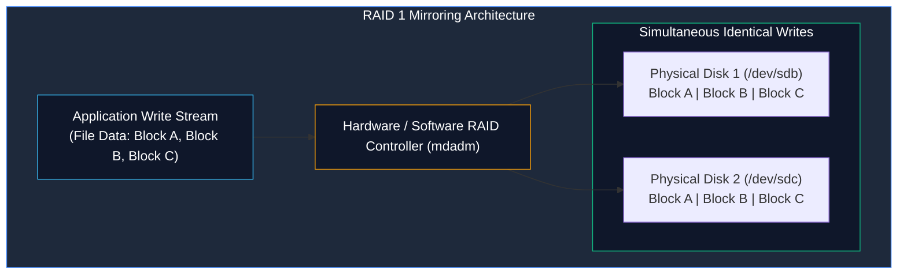
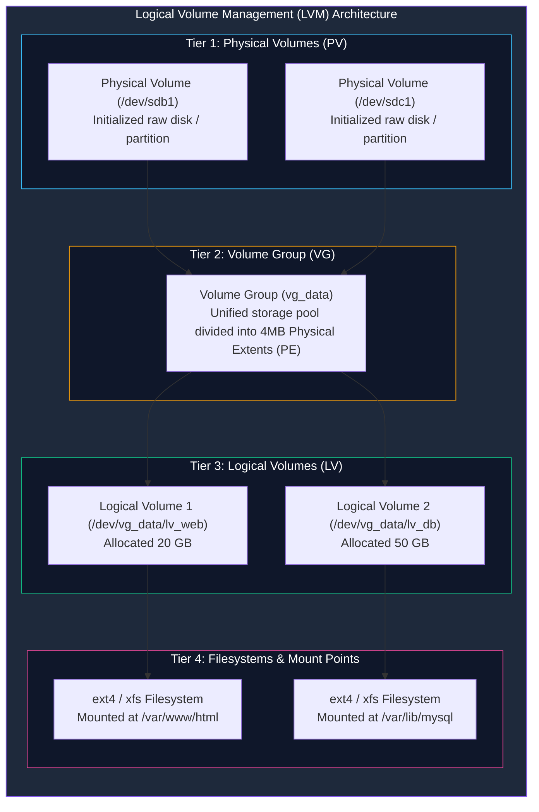

# Storage Architecture: RAID Redundancy and Logical Volume Management (LVM)

> **Module:** System and Network Administrator (SNA) — 05 Disk Management  
> **Topic Level:** Enterprise Storage & Volume Administration  
> **Previous Reference:** [01-MBR-vs-GPT.md](01-MBR-vs-GPT.md) | **Next:** [../06-Remote-File-Management/01-PuTTY-and-WinSCP.md](../06-Remote-File-Management/01-PuTTY-and-WinSCP.md)

---

## 🎯 Learning Objectives

By the end of this note, you will be able to:

- Differentiate between **Hardware RAID** and **Software RAID (`mdadm`)**.
- Compare core RAID levels: **RAID 0 (Striping)**, **RAID 1 (Mirroring)**, **RAID 5 (Distributed Parity)**, and **RAID 10 (1+0)**.
- Understand why traditional disk partitions are rigid and how **Logical Volume Management (LVM)** solves storage elasticity.
- Deconstruct the 3-tier LVM architecture: **Physical Volumes (PV)**, **Volume Groups (VG)**, and **Logical Volumes (LV)**.
- Trace the administrative workflow for provisioning LVM storage: `pvcreate` -> `vgcreate` -> `lvcreate` -> `mkfs` -> `mount`.
- Understand how online volume extension (`lvextend`) and filesystem resizing operate without service downtime.

---

## 1. Introduction and Context

In traditional computing environments, filesystems are formatted directly on top of rigid physical disk partitions (e.g., formatting `/dev/sda1` as `ext4`). If your web server runs out of disk space on `/var/www`, you face a severe operational crisis: you must power down the server, insert a larger disk, copy data over, or attempt dangerous partition resizing.

Enterprise infrastructure solves this challenge through two complementary technologies:
1. **RAID (Redundant Array of Independent Disks)**: Protects against physical disk hardware failure and accelerates I/O performance by combining multiple physical disks into an array.
2. **LVM (Logical Volume Management)**: Adds an abstraction layer above physical disks, pooling storage into dynamic Volume Groups that can be resized, partitioned, and spanned across physical disks on-the-fly while the server remains online.

---

## 2. Part 1: Redundant Array of Independent Disks (RAID)

### 2.1 Core RAID Levels Comparison

| RAID Level | Strategy | Minimum Disks | Usable Storage Capacity | Fault Tolerance | Primary Use Case |
|:---:|---|:---:|:---:|:---:|---|
| **RAID 0** | Striping (Blocks alternated across disks) | 2 | Sum of all disks ($N \times \text{Size}$) | ❌ **Zero**. If 1 disk fails, all data is permanently lost. | Non-critical temporary scratch storage where pure speed is the only goal. |
| **RAID 1** | Mirroring (Identical clone on both disks) | 2 | 50% ($1 \times \text{Size}$) | ✅ Withstands failure of 1 drive. | Operating system boot drives, critical transactional logs. |
| **RAID 5** | Striping with Distributed Parity | 3 | $(N - 1) \times \text{Size}$ | ✅ Withstands failure of any 1 drive. | Balanced file servers with read-heavy workloads. |
| **RAID 6** | Striping with Dual Distributed Parity | 4 | $(N - 2) \times \text{Size}$ | ✅ Withstands failure of any 2 drives simultaneously. | Enterprise storage arrays and large archival pools. |
| **RAID 10** | Striped Mirrors (Combines RAID 1 + RAID 0) | 4 | 50% ($\frac{N}{2} \times \text{Size}$) | ✅ Withstands loss of 1 drive per mirrored pair. | High-performance enterprise relational databases. |



### 2.2 Software RAID Inspection on Linux (`mdadm`)
```bash
# Inspect real-time status of all active software RAID arrays
cat /proc/mdstat

# Display exhaustive diagnostic details for a specific RAID array
mdadm --detail /dev/md0
```

> ⚠️ **The Golden Rule of Storage:** **RAID is NOT a backup!** RAID protects against sudden mechanical drive failures. It does not protect against accidental deletion, corrupted databases, malware encryption, or catastrophic site disasters.

---

## 3. Part 2: Logical Volume Management (LVM)

### 3.1 The 3-Tier LVM Architecture

LVM replaces rigid partition boundaries with a dynamic 3-layer storage hierarchy:



1. **Physical Volumes (PV)**: Raw block devices (e.g., `/dev/sdb`, `/dev/sdc1`) that have been labeled with an LVM header using `pvcreate`.
2. **Volume Group (VG)**: A storage pool created by combining one or more PVs. The VG carves the combined physical storage into equal-sized chunks called **Physical Extents (PE)** (typically 4 Megabytes by default).
3. **Logical Volume (LV)**: A virtual block device carved out of the Volume Group using `lvcreate`. The operating system treats an LV exactly like a standard hard drive partition (`/dev/vg_data/lv_web` or `/dev/mapper/vg_data-lv_web`).

---

## 4. Complete Step-by-Step LVM Deployment Workflow

Suppose you add a secondary physical disk `/dev/sdb` to a server and wish to provision a 10 GB Logical Volume mounted at `/data`:

### Step 1: Initialize the Physical Volume
```bash
# Tag the block device for LVM use
pvcreate /dev/sdb1

# Verify creation
pvs
pvdisplay /dev/sdb1
```

### Step 2: Create the Volume Group
```bash
# Create a Volume Group named 'vg_storage' containing the Physical Volume
vgcreate vg_storage /dev/sdb1

# Verify volume group capacity and Physical Extent size
vgs
vgdisplay vg_storage
```

### Step 3: Carve Out a Logical Volume
```bash
# Create a 10 GB Logical Volume named 'lv_data' from 'vg_storage'
lvcreate -L 10G -n lv_data vg_storage

# Verify logical volume creation
lvs
lvdisplay /dev/vg_storage/lv_data
```

### Step 4: Format with a Filesystem
```bash
# Format with ext4 (standard on RHEL 6)
mkfs.ext4 /dev/vg_storage/lv_data

# Or format with xfs (standard on modern RHEL 7/8/9)
# mkfs.xfs /dev/vg_storage/lv_data
```

### Step 5: Mount and Configure Persistence in `/etc/fstab`
```bash
# Create mount directory and mount immediately
mkdir -p /data
mount /dev/vg_storage/lv_data /data

# Confirm active mount and free disk capacity
df -h /data
```

To persist the mount across system reboots, add an entry to `/etc/fstab`:
```text
/dev/mapper/vg_storage-lv_data    /data    ext4    defaults    1 2
```

---

## 5. Elastic Resizing: Extending an LVM Volume Live

When `/data` nears 100% capacity, administrators extend the Logical Volume and its filesystem without taking services offline:

### Step 1: Extend the Logical Volume
```bash
# Add 5 Gigabytes to the existing logical volume
lvextend -L +5G /dev/vg_storage/lv_data
```

### Step 2: Expand the Underlying Filesystem
Extending the container block device (`LV`) does not automatically expand the filesystem structures inside:
```bash
# If using ext4 (RHEL 6 standard):
resize2fs /dev/vg_storage/lv_data

# If using xfs (RHEL 8/9 standard):
xfs_growfs /data
```

---

## 6. Common Mistakes & Troubleshooting

- **Shrinking Filesystems Recklessly**:
  - While `ext4` can theoretically be shrunk offline (unmounted), `XFS` filesystems **CANNOT be reduced in size**. Attempting to shrink an XFS volume will corrupt the filesystem.
  - *Best Practice*: Grow volumes conservatively as needed rather than over-allocating.
- **Forgetting `/etc/fstab` Syntax**:
  - A typo in `/etc/fstab` will cause the server to halt during boot in "emergency mode". Always test your `/etc/fstab` entry before rebooting by running `mount -a`. If `mount -a` reports no errors, your syntax is valid.

---

## 7. Security Considerations

1. **Volume Encryption (LUKS)**: Physical drives removed from decommissioned servers can be read by unauthorized parties. In enterprise environments, Linux Unified Key Setup (LUKS) encryption is applied beneath LVM (`cryptsetup luksFormat`) to ensure data-at-rest encryption.
2. **Mount Hardening Options in `/etc/fstab`**: For partitions storing user uploads (such as `/tmp` or `/var/tmp`), enforce security options in `/etc/fstab`:
   ```text
   /dev/mapper/vg_system-lv_tmp  /tmp  ext4  defaults,nodev,nosuid,noexec  1 2
   ```
   (`noexec` prevents running scripts/binaries; `nosuid` blocks privilege escalation).

---

## 8. Summary & Next Steps

RAID protects enterprise data against physical hardware failure, while LVM provides the elasticity needed to adapt to growing storage demands without downtime. Now that internal server storage is configured, we examine how administrators manage Linux servers remotely from Windows management workstations.

- **Next Module:** Remote server management with PuTTY and WinSCP in [../06-Remote-File-Management/01-PuTTY-and-WinSCP.md](../06-Remote-File-Management/01-PuTTY-and-WinSCP.md).
- **Practical Cheatsheets:** Review the [../cheatsheets/Disk-Management-Cheatsheet.md](../cheatsheets/Disk-Management-Cheatsheet.md).
