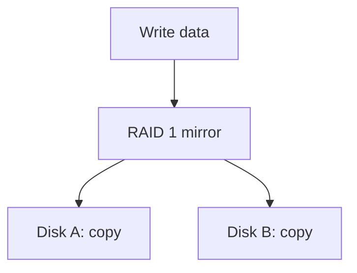
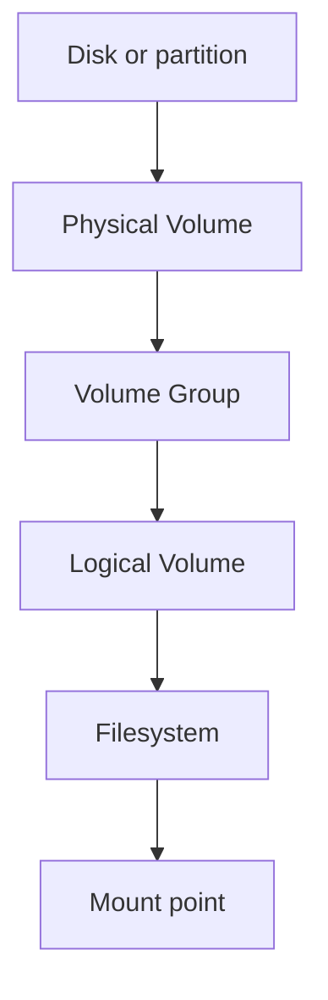

# RAID and Logical Volume Management (LVM)

## 1. Difference
**RAID** combines physical disks for properties such as redundancy or performance, depending on level. **LVM** creates a flexible storage-management layer that lets administrators allocate storage through logical volumes. Neither replaces backups.

## 2. RAID 1
RAID 1 mirrors data across two or more disks. With a two-disk mirror, the same data is written to both members. Usable capacity is approximately the size of the smallest member.

RAID 1 can help survive certain disk failures, but it does not protect against accidental deletion, malware, corruption replicated to both disks, or site loss.

## 3. LVM terms
- **Physical Volume (PV):** disk or partition initialized for LVM.
- **Volume Group (VG):** storage pool formed from PVs.
- **Logical Volume (LV):** virtual block device allocated from a VG.
- **Filesystem:** structure placed on a suitable block device to store files.
- **Mount point:** directory where a filesystem is made accessible.

## 4. RAID vs LVM

| Feature | RAID | LVM |
|---|---|---|
| Main purpose | Redundancy and/or performance | Flexible storage allocation |
| Combines physical disks | According to RAID implementation | Pools PVs into a VG |
| Protects from disk failure | Some levels do | Not by itself |
| Replaces backup | No | No |

RAID and LVM can be combined in different designs. Understand the actual layout first.

## 5. Safe storage work
Before partitioning, RAID, LVM, or formatting:
1. Confirm hostname and environment.
2. Inspect devices and existing partitions.
3. Identify the target disk positively.
4. Back up data that matters.
5. Understand whether commands overwrite or initialize a device.
6. Follow the exact lab instructions.
7. Verify the result without assuming success.

Commands that initialize, format, or modify disks can destroy data. This note does not provide a blind destructive procedure.

## Summary
RAID 1 mirrors data for some disk-failure scenarios. LVM manages storage through PVs, VGs, and LVs. Neither replaces a tested backup and recovery process.

## Related notes
- [MBR vs GPT](01-MBR-vs-GPT.md)
- [Disk Management Cheatsheet](../cheatsheets/Disk-Management-Cheatsheet.md)
