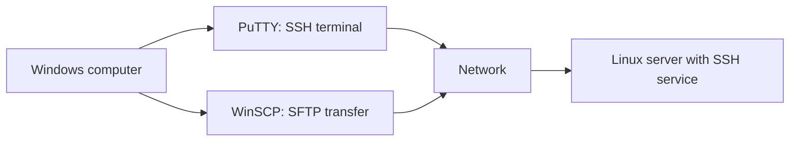

# PuTTY and WinSCP

## 1. Purpose
PuTTY and WinSCP are Windows applications often used to administer Linux servers remotely.

- **PuTTY:** terminal access, commonly over SSH.
- **WinSCP:** file transfer, commonly using SFTP.

## 2. SSH and SFTP
**SSH (Secure Shell)** provides encrypted remote login and command execution. Its default TCP port is 22, unless configured differently.

**SFTP (SSH File Transfer Protocol)** transfers files over SSH. It is different from traditional FTP. Use an approved secure transfer method when handling sensitive data.

## 3. Connection diagram

## 4. Before connecting
Obtain the correct server IP/hostname, port, authorized username, and approved password or key. Confirm the SSH service is running and reachable. Connect only to systems you are authorized to administer.

## 5. PuTTY workflow
1. Open PuTTY.
2. Enter the server address.
3. Select SSH and confirm the configured port.
4. Connect and review the host-key prompt.
5. Verify the host key through a trusted method where possible.
6. Authenticate and run commands appropriate to your account.

Do not blindly accept unexpected host-key changes.

## 6. WinSCP workflow
1. Open WinSCP and create a session.
2. Choose SFTP if supported by the server.
3. Enter address, port, and username.
4. Authenticate using the approved method.
5. Check the remote directory before transferring files.
6. Transfer only authorized files.

Linux permissions still control what the account can read or modify.

## 7. Troubleshooting

| Symptom | Checks |
|---|---|
| Timeout | Address, routing, firewall, server reachability |
| Connection refused | SSH service and listening port |
| Authentication failure | Username, authentication method, account status |
| Host-key warning | Verify whether the server was rebuilt or key changed legitimately |
| Permission denied | Remote directory and account permissions |

These are possible causes, not guaranteed diagnoses.

## 8. Security
Use authorized accounts, verify host keys, prefer SFTP over unencrypted FTP, protect credentials, and avoid exposing old RHEL 6 systems to the public internet.

## Summary
PuTTY provides remote terminal access; WinSCP provides file transfer. Both depend on correct network settings, authentication, server configuration, and permissions.

## Related notes
- [PuTTY and WinSCP Cheatsheet](../cheatsheets/PuTTY-and-WinSCP-Cheatsheet.md)
- [Common Linux Commands](../03-Linux-Fundamentals/02-Common-Linux-Commands.md)
