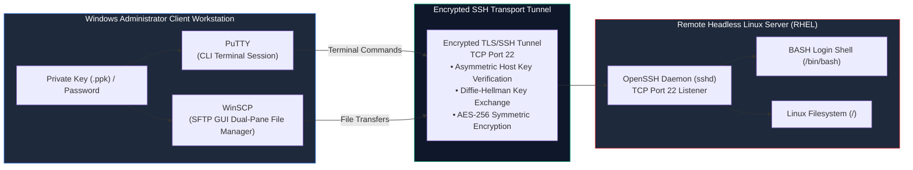

# Remote Server Administration: PuTTY and WinSCP

> **Module:** System and Network Administrator (SNA) — 06 Remote File Management  
> **Topic Level:** Cross-Platform Remote Administration  
> **Previous Reference:** [../05-Disk-Management/02-RAID-and-LVM.md](../05-Disk-Management/02-RAID-and-LVM.md) | **Next:** [../cheatsheets/README.md](../cheatsheets/README.md)

---

## 🎯 Learning Objectives

By the end of this note, you will be able to:

- Explain the cryptographic architecture of **Secure Shell (SSH)** and **SSH File Transfer Protocol (SFTP)** on TCP port 22.
- Configure and save remote Linux terminal sessions in **PuTTY** from a Windows management workstation.
- Generate and manage asymmetric key pairs using **PuTTYgen** (`.ppk` vs OpenSSH format) for passwordless authentication.
- Establish graphical remote file management sessions using **WinSCP** to upload, download, and synchronize files safely.
- Understand host key fingerprint verification and prevent Man-in-the-Middle (MITM) attacks.
- Avoid common remote management mistakes and enforce SSH security baselines.

---

## 1. Introduction and Context

In modern enterprise data centers, system administrators rarely sit in front of physical server consoles inside cold server rooms. Server racks are maintained in centralized data centers or cloud facilities. Administrators work from desktop client workstations—predominantly running Microsoft Windows—and connect to remote headless Linux servers over the network.

Legacy administrative protocols like **Telnet** (port 23) and **FTP** (port 21) transmit commands, filenames, and authentication passwords across the network in clear, unencrypted plaintext, allowing anyone with a packet sniffer (like `tcpdump` or Wireshark) to capture credentials.

To secure remote operations, enterprise environments strictly mandate the **SSH (Secure Shell)** protocol. For Windows administrative clients, **PuTTY** and **WinSCP** represent the standard software toolchain for remote terminal access and secure file transfers.



---

## 2. Definitions of Important Terminology

| Term | Definition |
|---|---|
| **SSH (Secure Shell)** | A cryptographic network protocol operating over TCP port 22 used for secure remote login, terminal execution, and tunneling. |
| **SFTP (SSH File Transfer Protocol)** | A secure file transfer subsystem running directly over an established SSH tunnel, providing encrypted file browsing, uploading, and downloading. |
| **SCP (Secure Copy Protocol)** | A legacy command-line file copy mechanism running over SSH, largely superseded by SFTP. |
| **PuTTY** | A widely adopted open-source terminal emulator and SSH client for Microsoft Windows. |
| **WinSCP** | An open-source graphical SFTP, FTP, WebDAV, and S3 client for Microsoft Windows featuring a dual-pane explorer interface. |
| **PuTTYgen** | The key generation utility bundled with PuTTY used to create and convert RSA/Ed25519 key pairs into PuTTY's native `.ppk` format. |
| **Host Key Fingerprint** | A cryptographic hash of the server's public key presented to the client during initial connection to guarantee server identity. |

---

## 3. Remote Terminal Management with PuTTY

### 3.1 Initial Connection Setup
1. Launch PuTTY on your Windows workstation.
2. In the **Session** category on the left:
   - **Host Name (or IP address)**: Enter the server's IP (e.g., `192.168.1.100`).
   - **Port**: `22` (default).
   - **Connection type**: Select **SSH**.
3. Under **Saved Sessions**, enter a recognizable label (e.g., `RHEL-Web01`) and click **Save**.
4. Click **Open** to initialize the connection.

### 3.2 Host Key Verification Alert
Upon your first connection to a new server, PuTTY displays a security alert:

```text
The server's host key is not cached in the registry. You have no guarantee
that the server is the computer you think it is.
If you trust this host, press Yes to add the key to PuTTY's cache.
```

- **Administrative Action**: In an enterprise setting, verify that the presented fingerprint matches the server's actual host key (generated at `/etc/ssh/ssh_host_rsa_key.pub` on the server).
- Press **Yes** to cache the key in the Windows Registry (`HKCU\Software\SimonTatham\PuTTY\SshHostKeys`).
- If this alert appears on a server you previously connected to, **do not proceed blindly!** A changed host key indicates either the server was reinstalled, or someone is attempting a **Man-in-the-Middle (MITM)** attack.

---

## 4. SSH Key-Based Authentication with PuTTYgen

Entering a password for every administrative login is tedious and leaves servers vulnerable to brute-force credential stuffing. The enterprise standard is **Public Key Authentication**:

```text
+-----------------------+                    +-----------------------+
|  Windows Client       |                    |  Remote Linux Server  |
|  (Holds PRIVATE Key)  |                    |  (Holds PUBLIC Key)   |
|  file.ppk (SECRET)    |                    |  ~/.ssh/authorized_keys
+-----------------------+                    +-----------------------+
           │                                             │
           └────── Cryptographic Challenge/Response ─────┘
                   (Zero Passwords Sent Across Network)
```

### Step 1: Generate Key Pair with PuTTYgen
1. Launch **PuTTYgen** on Windows.
2. Under *Parameters* at the bottom, select **RSA** (minimum 2048 or 4096 bits) or **Ed25519**.
3. Click **Generate** and move your mouse randomly over the blank area to generate entropy.
4. Enter a strong **Key passphrase** to encrypt the private key on your Windows laptop.
5. Click **Save private key** to save your `.ppk` file (e.g., `id_rsa_admin.ppk`).

### Step 2: Install Public Key on Linux Server
1. Copy the public key text directly from the top box in PuTTYgen:
   ```text
   ssh-rsa AAAAB3NzaC1yc2EAAAADAQABAAABAQC3... rsa-key-20261024
   ```
2. Log in to your Linux server and append this text into your user's `authorized_keys` file:
   ```bash
   mkdir -p ~/.ssh
   chmod 700 ~/.ssh
   echo "ssh-rsa AAAAB3NzaC1yc...==" >> ~/.ssh/authorized_keys
   chmod 600 ~/.ssh/authorized_keys
   ```

### Step 3: Configure PuTTY to Use the Private Key
1. In PuTTY, load your saved session.
2. Navigate to **Connection** -> **SSH** -> **Auth** (or **Auth** -> **Credentials** in newer PuTTY releases).
3. Under *Private key file for authentication*, click **Browse** and select your `.ppk` file.
4. Return to **Session** and click **Save**.
5. When connecting, you will be prompted for your local key passphrase instead of the server password.

---

## 5. Graphical Remote File Management with WinSCP

While PuTTY provides terminal CLI access, transferring files (such as database dumps, backup tarballs, or website assets) is far more efficient using **WinSCP**.

### 5.1 Connection Configuration
1. Open WinSCP.
2. Select **File protocol**: `SFTP` (Port 22).
3. Enter **Host name**, **User name**, and password (or click **Advanced** -> **SSH** -> **Authentication** and attach your `.ppk` private key).
4. Click **Login**.

### 5.2 The Dual-Pane Interface

```text
+-----------------------------------+-----------------------------------+
| LEFT PANE: Local Machine (Windows)| RIGHT PANE: Remote Server (Linux) |
| C:\Users\Admin\Desktop\           | /var/www/html/                    |
|-----------------------------------|-----------------------------------|
| [..]                              | [..]                              |
| index.html                        | index.html                        |
| styles.css                        | styles.css                        |
| app.js                            | config.php                        |
+-----------------------------------+-----------------------------------+
```

- **Uploading**: Drag files from the Left Pane (Windows) to the Right Pane (Linux).
- **Downloading**: Drag files from the Right Pane (Linux) to the Left Pane (Windows).
- **In-Place Editing**: Double-clicking a text configuration file on the Linux side opens it in an internal editor; saving immediately updates the file on the remote server over SFTP.
- **Permission Auditing**: Right-clicking a remote file and selecting **Properties** reveals octal permissions (`0644`), user owner, and group owner, allowing administrators to modify permissions graphically.

---

## 6. Common Mistakes & Troubleshooting

- **Permissions on `~/.ssh/` Too Open**:
  - *Symptom*: Key-based login fails; the server continues prompting for a password despite public key placement.
  - *Root Cause*: OpenSSH strictly enforces the `StrictModes` security directive. If `~/.ssh` is writable by group or others (`chmod 777` or `chmod 755`), or if `authorized_keys` is not `600`, OpenSSH **refuses to use the key**.
  - *Remediation*:
    ```bash
    chmod 700 ~/.ssh
    chmod 600 ~/.ssh/authorized_keys
    ```
- **Line Ending Incompatibilities (CRLF vs. LF)**:
  - Windows files use `CRLF` (`\r\n`) line terminators, while Linux uses `LF` (`\n`). If you edit a Bash shell script on Windows and upload it, the Linux kernel will fail to execute it:
    ```text
    /bin/bash^M: bad interpreter: No such file or directory
    ```
  - *Fix*: Configure WinSCP transfer mode to **Text / ASCII** for scripts, or run `dos2unix script.sh` on the Linux server.

---

## 7. Security Considerations

1. **Disable SSH Root Login**: Production servers should never allow direct root logins over SSH. Edit `/etc/ssh/sshd_config` and enforce:
   ```text
   PermitRootLogin no
   ```
2. **Disable Password Authentication**: Once public key authentication is verified, eliminate brute-force attack vectors by disabling passwords in `/etc/ssh/sshd_config`:
   ```text
   PasswordAuthentication no
   ```
3. **Change Default SSH Port**: Moving SSH from port 22 to an alternate high port (e.g., 2222) stops 99% of automated Internet botnet probes, dramatically reducing log noise in `/var/log/secure`.

---

## 8. Summary & Next Steps

PuTTY and WinSCP bridge desktop client management with remote headless Linux administration. Combined with SSH key pairs, they deliver encrypted, audited, and reliable access across enterprise networks.

- **Review the Cheatsheet Index:** Browse all high-density reference cards in [../cheatsheets/README.md](../cheatsheets/README.md).
- **Remote Cheatsheet:** Keep [../cheatsheets/PuTTY-and-WinSCP-Cheatsheet.md](../cheatsheets/PuTTY-and-WinSCP-Cheatsheet.md) bookmarked for quick setup syntax.
- **Course Hub:** Return to the main [SNA Section README](../README.md).
