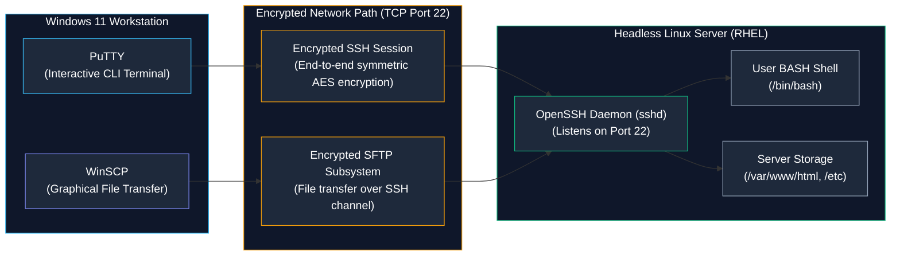
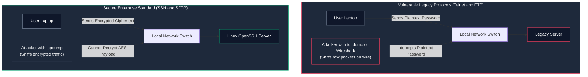
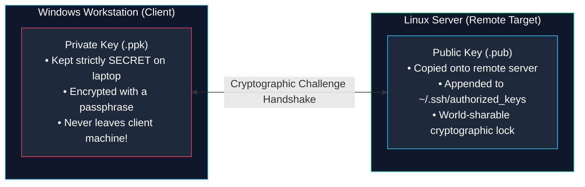

# Remote Linux Administration with PuTTY and WinSCP

> **Module:** System and Network Administrator (SNA) Foundations  
> **Topic:** Secure Shell (SSH), SFTP File Transfers, PuTTYgen Cryptography, and Session Hardening  
> **Target Audience:** BSIT Students, Windows/Linux Infrastructure Administrators, and Support Engineers  
> **Related Reference:** [03-Linux-Fundamentals/02-Common-Linux-Commands.md](../03-Linux-Fundamentals/02-Common-Linux-Commands.md) | [03-Linux-Fundamentals/04-File-Permissions.md](../03-Linux-Fundamentals/04-File-Permissions.md) | [PuTTY and WinSCP Cheatsheet](../cheatsheets/PuTTY-and-WinSCP-Cheatsheet.md)

---

## 🎯 Learning Objectives

By the end of this chapter, you will be able to:

- Articulate the security hazards of legacy cleartext protocols (**Telnet**, **FTP**) and explain why **SSH** and **SFTP** are mandatory in enterprise networks.
- Configure, save, and optimize remote terminal sessions using **PuTTY**.
- Decode and properly respond to the **SSH Host Key Verification** prompt ("Trust-On-First-Use").
- Generate modern asymmetric cryptographic keypairs using **PuTTYgen** and deploy public keys to a Linux server's `~/.ssh/authorized_keys` file.
- Transfer files, database dumps, and application assets seamlessly using **WinSCP**'s dual-pane interface.
- Understand the technical consequences of Windows (**CRLF**) versus Linux (**LF**) line breaks during text file transfers.
- Troubleshoot common remote connection errors: "Connection Refused", "Connection Timed Out", and "Host Key Mismatch".

---

## 1. The Heterogeneous Enterprise Environment

In real-world corporate IT environments, client computing and server infrastructure rarely share the same operating system:
- Over 85% of corporate workstations and enterprise laptops run **Microsoft Windows 10 or 11 Enterprise**.
- Over 80% of backend server infrastructure, cloud instances, and virtualization hypervisors run **Linux (Red Hat Enterprise Linux, Ubuntu Server, Debian)**.

As an Information Technology (BSIT) professional, you will spend your daily career sitting at a Windows desktop workstation while configuring, monitoring, and transferring files to headless Linux servers across data centers.

To bridge this operational gap, administrators utilize two foundational open-source tools:
1. **PuTTY:** A high-performance terminal emulator that establishes encrypted **Secure Shell (SSH)** command-line sessions.
2. **WinSCP:** A graphical file manager that transfers files securely using the **SSH File Transfer Protocol (SFTP)**.



---

## 2. Security Protocols: SSH/SFTP vs. Cleartext Legacy (Telnet/FTP)

In early computing networks, administrators used **Telnet** (TCP port 23) for command-line access and **FTP** (TCP port 21) for file transfers. 

Both protocols transmit all data, usernames, and passwords in **unencrypted plain text across the wire**:



### Why Cleartext is Forbidden in Enterprise Environments:
If an attacker or rogue insider on the network runs `tcpdump` or Wireshark, any Telnet or FTP session exposes the root password immediately.
- **SSH (Secure Shell — TCP Port 22):** Utilizes strong asymmetric cryptography (RSA, Ed25519) to negotiate session keys, followed by high-speed symmetric encryption (AES-256-GCM, ChaCha20) for all terminal keystrokes.
- **SFTP (SSH File Transfer Protocol):** Transfers files through the exact same encrypted SSH tunnel on port 22, guaranteeing confidentiality and cryptographic integrity verification (HMAC).

---

## 3. Mastering PuTTY: Configuration and Optimization

When launching PuTTY, the configuration tree allows customizing connection parameters before establishing a session.

### 3.1 Establishing and Saving Sessions
1. **Host Name (or IP address):** Enter the server's network address (e.g., `192.168.1.100` or `server01.lab.local`).
2. **Port:** Verify the default is **`22`** (or the custom SSH port configured by your organization).
3. **Connection Type:** Ensure **`SSH`** is selected.
4. **Saving the Session:** Type a descriptive label (e.g., `RHEL-Web01-Production`) in the **Saved Sessions** box and click **Save**. On subsequent days, simply double-click the saved name to connect instantly!

---

### 3.2 The First Connection: Understanding the SSH Host Key Alert

When connecting to a Linux server for the very first time, PuTTY halts and displays this modal warning:

```text
+----------------------------------------------------------------------------------------------------+
|                                      PuTTY SECURITY ALERT                                          |
+----------------------------------------------------------------------------------------------------+
| The server's host key is not cached in the registry. You have no guarantee that the                |
| server is the computer you think it is.                                                            |
|                                                                                                    |
| The server's ssh-ed25519 key fingerprint is:                                                       |
| ssh-ed25519 255 SHA256:uY8f12/mK32+901a8812771244121100223344556677                               |
|                                                                                                    |
| If you trust this host, press "Accept" to add the key to PuTTY's cache.                            |
| If you want to carry on connecting just once, press "Connect Once".                                |
| If you do not trust this host, press "Cancel" to abandon the connection.                           |
+----------------------------------------------------------------------------------------------------+
```

#### What is This Alert?
Every SSH server possesses an asymmetric **Host Key** generated during operating system installation. This key acts as the server's cryptographic fingerprint.
- **Trust-On-First-Use (TOFU):** Because your client computer has never connected to this server before, PuTTY displays the fingerprint.
- If you click **Accept**, PuTTY records this fingerprint inside the Windows Registry under `HKCU\Software\SimonTatham\PuTTY\SshHostKeys`.
- On future connections, PuTTY compares the server's key against the registry cache silently. If they match, the connection proceeds without any prompts.

#### The Man-in-the-Middle (MitM) Danger!
If you connect on a Tuesday and PuTTY suddenly screams:
```text
WARNING - POTENTIAL SECURITY BREACH! The server's host key does not match the one cached in the registry!
```
This indicates one of two possibilities:
1. **Legitimate:** The administrator reinstalled the Linux operating system or regenerated SSH host keys.
2. **Malicious:** A network attacker has hijacked your DNS or IP routing and is intercepting your connection (**Man-in-the-Middle attack**) to steal your password!  
**Rule:** Never click "Accept" on a host-key mismatch warning without verifying with the server administrator first.

---

### 3.3 Crucial PuTTY Optimization Settings

#### 1. Preventing Session Timeouts (Keepalive)
By default, enterprise firewalls drop idle TCP connections after 5–15 minutes of inactivity. When you return from lunch, your PuTTY window is frozen.
- **The Fix:** In PuTTY, navigate to **Connection** (left pane) -> Set **Seconds between keepalives** to **`30`**.
- PuTTY will send a microscopic null packet every 30 seconds to keep the firewall state table active.

#### 2. Fixing Corrupted Character Display (UTF-8 Encoding)
If line-drawing characters in commands like `top` or `ncurses` appear as strange symbols (`├─`):
- Navigate to **Window** -> **Translation** -> Set **Remote character set** to **`UTF-8`**.

---

## 4. SSH Public Key Authentication with PuTTYgen

Entering a password every time you log in is slow and exposes servers to automated dictionary brute-force attacks. Enterprise administrators strictly enforce **SSH Public Key Authentication**.

### 4.1 The Asymmetric Cryptographic Model
Public key authentication uses an asymmetric mathematical keypair:



1. **The Public Key:** Acts like an open padlock. You copy it to every Linux server you administer. It is completely safe to share publicly.
2. **The Private Key:** Acts like the physical key that opens that padlock. You keep it securely on your Windows laptop, protected with a strong passphrase.

---

### 4.2 Step-by-Step Key Generation and Deployment

#### Step 1: Generate Keypair with PuTTYgen
1. Launch **PuTTYgen** (installed alongside PuTTY).
2. Under **Parameters**, select **Ed25519** (modern, ultra-fast 256-bit elliptic curve) or **RSA** with **4096 bits**.
3. Click **Generate** and move your mouse randomly inside the blank area to generate cryptographic entropy.
4. Enter a strong **Key passphrase** (protects the private key if your laptop is stolen).
5. Click **Save private key** and save it as `my_key.ppk`.

#### Step 2: Deploy Public Key to Linux Server
1. In PuTTYgen, highlight and copy the text inside the top box labeled:  
   `Public key for pasting into OpenSSH authorized_keys file:`.
2. Connect to the Linux server using your standard password.
3. Create the hidden `.ssh` directory and set strict permissions:
   ```bash
   mkdir -p ~/.ssh
   chmod 700 ~/.ssh
   ```
4. Edit the `authorized_keys` file using Vim or Nano:
   ```bash
   vim ~/.ssh/authorized_keys
   ```
5. Paste the public key string as a single unbroken line and save (`:wq`).
6. Set mandatory file permissions:
   ```bash
   chmod 600 ~/.ssh/authorized_keys
   ```

#### Step 3: Configure PuTTY to Use the Private Key
1. Open PuTTY -> Load your saved session.
2. Navigate to **Connection** -> **SSH** -> **Auth** -> **Credentials**.
3. Under **Private key file for authentication**, click **Browse** and select your `my_key.ppk` file.
4. Navigate back to **Session** and click **Save**.
5. Connect! PuTTY authenticates automatically using the cryptographic keypair.

---

## 5. WinSCP: Graphical Secure File Transfers

While PuTTY provides command execution, moving files (such as database dumps, software installers, or website assets) is far more efficient using **WinSCP**.

### 5.1 The Dual-Pane Interface

```text
+----------------------------------------+----------------------------------------+
| LOCAL SITE: C:\Users\student\Documents | REMOTE SITE: /var/www/html             |
+----------------------------------------+----------------------------------------+
| Name                 Size   Changed    | Name                 Size   Changed    |
| [..]                            UP-DIR | [..]                            UP-DIR |
| project_specs.docx   45KB   10/24 10:00| index.html            2KB   10/24 09:30|
| website_assets.zip  120MB   10/24 11:15| styles.css           14KB   10/24 09:35|
| database_backup.sql 500MB   10/24 12:00| images/                      DIR       |
+----------------------------------------+----------------------------------------+
| [F5 Copy]   [F6 Move]   [F7 NewFolder] | [F8 Delete]   [F9 Properties]          |
+----------------------------------------+----------------------------------------+
```

- **Left Pane (Local Site):** Your local Windows file system.
- **Right Pane (Remote Site):** The remote Linux server file tree starting at your user's home folder.
- **Drag-and-Drop:** Dragging a file from left to right initiates an encrypted SFTP upload; dragging right to left downloads the file to Windows.

---

### 5.2 Transfer Modes: Text (ASCII) vs. Binary

A subtle trap that breaks scripts transferred between Windows and Linux is **Line Break Encoding**:
- **Microsoft Windows Line Breaks (CRLF):** Uses two characters at the end of each line: Carriage Return (`\r`) + Line Feed (`\n`).
- **Linux / Unix Line Breaks (LF):** Uses only a single Line Feed (`\n`).

#### The Shell Script Failure:
If you write a bash script in Windows Notepad and upload it to Linux:
- Linux reads the carriage return `\r` as part of the command name!
- When you execute `./script.sh`, the Linux kernel fails with:
  ```text
  /bin/bash^M: bad interpreter: No such file or directory
  ```
- **The Solution:** In WinSCP, transfer scripts in **Text (ASCII) mode** (which strips `\r` automatically), or run the `dos2unix` utility on the Linux server:
  ```bash
  dos2unix script.sh
  ```

### 5.3 Permissions in WinSCP
WinSCP strictly respects the Linux kernel's Discretionary Access Control (DAC):
- If you log in as standard user `student`, WinSCP cannot upload files directly into `/etc` or `/var/www/html` because `student` does not have write permissions to those folders!
- **Best Practice:** Upload files to `/tmp` or your home directory `/home/student`, then switch to PuTTY to move them using `sudo mv` with elevated privileges.

---

## 6. Troubleshooting Common Remote Connection Failures

```
+----------------------------------------------------------------------------------------------------+
|                                    REMOTE CONNECTION ERROR MATRIX                                  |
+-----------------------------+------------------------------------+---------------------------------+
| Error Message               | Underlying Root Cause              | Step-by-Step Remediation        |
+-----------------------------+------------------------------------+---------------------------------+
| Network error:              | - Target IP address is incorrect   | - Ping the server IP            |
| Connection timed out        | - Intermediate firewall dropping 22| - Verify network route & VPN    |
|                             | - Server is powered off            | - Check cloud security groups   |
+-----------------------------+------------------------------------+---------------------------------+
| Network error:              | - SSH daemon (sshd) is stopped     | - Check sshd: systemctl status  |
| Connection refused          | - Server listening on non-std port | - Verify port with netstat/ss   |
+-----------------------------+------------------------------------+---------------------------------+
| Access Denied               | - Incorrect password entered       | - Reset user password           |
|                             | - User account is locked in shadow | - Unlock: usermod -U username   |
|                             | - PermitRootLogin is set to 'no'   | - Log in as named user and sudo |
+-----------------------------+------------------------------------+---------------------------------+
| Disconnected: No supported  | - Server requires SSH keys         | - Load private .ppk in PuTTY    |
| authentication methods      | - Password auth disabled in sshd   | - Verify authorized_keys on host|
+-----------------------------+------------------------------------+---------------------------------+
| Server key does not match   | - Host key changed (MitM or OS rein| - Verify key fingerprint; delete|
| registry cache warning      | - IP reassigned to different host  |   stale key from Windows reg    |
+-----------------------------+------------------------------------+---------------------------------+
```

---

## 7. Important Points to Remember

- **Cleartext Insecurity:** Telnet and FTP pass passwords in raw cleartext. Enterprise systems mandate **SSH (Port 22)** and **SFTP**.
- **PuTTY Purpose:** Provides encrypted terminal command execution; WinSCP provides graphical SFTP file transfers.
- **Host Key TOFU:** The first connection caches the server's public host key fingerprint. Unexpected key mismatch warnings indicate server rebuilds or Man-in-the-Middle attacks.
- **Keepalive Setting:** Configure PuTTY to send keepalives every 30 seconds to prevent firewalls from terminating idle connections.
- **Asymmetric Key Roles:** The Private Key (`.ppk`) remains secret on your Windows client; the Public Key (`.pub`) is appended to `~/.ssh/authorized_keys` on the Linux server.
- **Mandatory SSH Permissions:** The Linux kernel and OpenSSH reject keys if permissions are too wide! `~/.ssh` must be `700`; `authorized_keys` must be `600`.
- **Line Ending Conflicts:** Windows uses CRLF (`\r\n`); Linux uses LF (`\n`). Use `dos2unix` to strip carriage returns from scripts created on Windows.

---

## 8. Key Terms Glossary

| Term | Technical Definition |
|---|---|
| **Asymmetric Cryptography** | A cryptographic system using mathematically linked keypairs: a public key for encryption and a private key for decryption. |
| **CRLF** | Carriage Return / Line Feed (`\r\n`); the standard ASCII end-of-line delimiter used by Microsoft Windows. |
| **Host Key** | A unique cryptographic keypair identifying an SSH server to connecting clients, preventing server impersonation. |
| **OpenSSH** | The premier open-source suite of secure networking utilities implementing the SSH protocol (daemon: `sshd`). |
| **Pageant** | The PuTTY Authentication Agent; a background Windows program that holds decrypted private keys in memory for single-sign-on. |
| **PPK** | PuTTY Private Key; the proprietary file format used by PuTTY to store private cryptographic keys. |
| **PuTTYgen** | The key generation utility bundled with PuTTY used to create, convert, and manage RSA and Ed25519 keypairs. |
| **SFTP** | SSH File Transfer Protocol; a secure network protocol running over TCP port 22 providing encrypted file transfers. |
| **TOFU** | Trust On First Use; the security model where a client accepts and caches an unknown server host key upon initial connection. |

---

## 9. Practice Questions

Test your mastery of remote administration, SSH cryptography, and file transfers. Attempt each question independently before consulting the answer key below.

### Question 1 (Protocol Security)
Why do enterprise security compliance standards strictly prohibit the use of **Telnet** (port 23) and **FTP** (port 21) across corporate networks?
- [A] Because they consume significantly more network bandwidth than SSH.
- [B] Because they transmit all user credentials and payload data in unencrypted cleartext, enabling packet sniffers to steal passwords.
- [C] Because they cannot run on Linux servers.
- [D] Because they do not support IPv4 addressing.

### Question 2 (SSH Key Permissions)
An administrator generates a new keypair in PuTTYgen, appends the public key to `/home/student/.ssh/authorized_keys`, and configures PuTTY to use the `.ppk` file.
However, when connecting, the server ignores the key and prompts for a password.
Checking `/var/log/secure` reveals:
```text
Authentication refused: bad ownership or modes for file /home/student/.ssh/authorized_keys
```
What exact command line resolves this permission error?
- [A] `chmod 777 /home/student/.ssh/authorized_keys`
- [B] `chmod 600 /home/student/.ssh/authorized_keys`
- [C] `chmod +x /home/student/.ssh/authorized_keys`
- [D] `chown root /home/student/.ssh/authorized_keys`

### Question 3 (Host Key Alert Scenario)
An administrator connects to a Linux server via PuTTY and receives a warning stating:
*"The server's host key does not match the one cached in the registry."*
Identify the two distinct operational possibilities that can cause this alert to appear.

### Question 4 (Windows vs. Linux Line Breaks)
A developer creates a bash deployment script `install.sh` on Windows 11 and uploads it to an enterprise RHEL 9 server using WinSCP in Binary mode.
When the administrator attempts to run `./install.sh`, the terminal responds:
```text
bash: ./install.sh: /bin/bash^M: bad interpreter: No such file or directory
```
Explain the exact technical cause of this error and state how to fix it on the Linux server.

### Question 5 (Troubleshooting Connection Refusal)
A technician attempts to connect to a new Linux server at `192.168.1.150` via PuTTY.
The terminal immediately displays:
```text
Network error: Connection refused
```
The technician verifies that the server responds to ICMP ping requests (`ping 192.168.1.150` succeeds).
What is the most likely root cause on the Linux server?

---

## 10. Answer Key & Explanations

### Answer to Question 1:
**Correct Option:** **[B]**  
*Explanation:* Telnet and FTP lack encryption. Any network attacker running `tcpdump` or Wireshark on the network segment can read passwords and session data directly out of raw packet payloads. SSH and SFTP enforce end-to-end symmetric encryption (AES-256) and cryptographic integrity checks.

### Answer to Question 2:
**Correct Option:** **[B]**  
*Explanation:* OpenSSH includes strict built-in security checks (`StrictModes yes`). If `authorized_keys` has permissions wider than read/write for the user owner (`600` or `rw-------`), OpenSSH assumes the key might have been tampered with by other local users and deliberately ignores it. The directory `~/.ssh` must also be set to `700`.

### Answer to Question 3:
**Correct Answer:**  
1. **Legitimate Administrative Action:** The remote server was reinstalled, had its operating system upgraded, or the administrator regenerated the host keys in `/etc/ssh/`.
2. **Malicious Attack (Man-in-the-Middle):** An attacker on the local network or internet has spoofed the server's IP address or poisoned DNS cache to redirect the PuTTY session to a rogue machine to harvest credentials.

### Answer to Question 4:
**Correct Answer:**  
- **Cause:** Windows text editors append a Carriage Return (`\r` or `^M`) and a Line Feed (`\n`) to the end of each line (CRLF). Linux expects only Line Feed (`\n`). The Linux kernel attempts to locate an interpreter named `/bin/bash\r`, which does not exist!
- **Fix:** Run the `dos2unix` utility on the Linux server to strip out all hidden carriage returns:
  ```bash
  dos2unix install.sh
  ```
  *(Or in Vim: `:set ff=unix` followed by `:wq`)*.

### Answer to Question 5:
**Correct Answer:**  
The network link and IP routing are healthy (proven by successful ping), but **the OpenSSH service daemon (`sshd`) is stopped** on the Linux server, or it is configured to listen on a non-standard port! The Linux kernel's TCP stack received the SYN packet on port 22, detected that no process was listening, and returned a **Reset (`[R]`)** packet ("Connection Refused"). The administrator must start the service using `systemctl start sshd`.

---

## 🔗 Related Notes & Next Steps

- **Course Review:** Revisit foundational command syntax in [../03-Linux-Fundamentals/02-Common-Linux-Commands.md](../03-Linux-Fundamentals/02-Common-Linux-Commands.md).
- **Navigation Hub:** Browse all topics and cheatsheets in the [SNA Index](../README.md).
- **Quick Reference:** Keep [cheatsheets/PuTTY-and-WinSCP-Cheatsheet.md](../cheatsheets/PuTTY-and-WinSCP-Cheatsheet.md) bookmarked.
