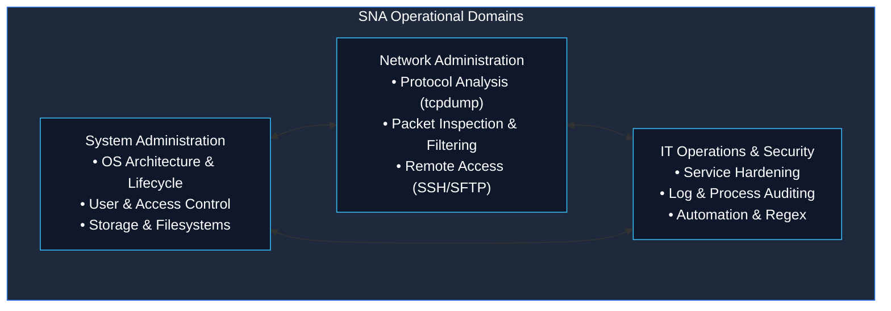

```mermaid
flowchart LR
    S1["1. Foundations<br/>(Intro & Certs)"] --> S2["2. Linux Core<br/>(RHEL, CLI, Files)"]
    S2 --> S3["3. Access & Boot<br/>(Perms, Users, Init, Editors)"]
    S3 --> S4["4. Networking<br/>(Tcpdump & Regex)"]
    S4 --> S5["5. Storage<br/>(MBR/GPT & LVM)"]
    S5 --> S6["6. Remote Admin<br/>(PuTTY & WinSCP)"]

    style S1 fill:#1e293b,stroke:#0ea5e9,color:#fff
    style S2 fill:#1e293b,stroke:#3b82f6,color:#fff
    style S3 fill:#1e293b,stroke:#6366f1,color:#fff
    style S4 fill:#1e293b,stroke:#8b5cf6,color:#fff
    style S5 fill:#1e293b,stroke:#a855f7,color:#fff
    style S6 fill:#1e293b,stroke:#ec4899,color:#fff
```

<p align="center">
  
</p>

# System and Network Administrator (SNA) Foundations

> **Foundational Learning Notes & Technical Reference**  
> A free and open-source guide for anyone who wants to learn Systems & Network Administration.  
> Includes enterprise server administration concepts, legacy and modern Red Hat Enterprise Linux (RHEL) operational models, networking utilities, disk partitioning, and quick-reference cheatsheets.

---

## 📌 Section Overview

The **System and Network Administrator (SNA)** section is a dedicated curriculum module inside the *Blue Team Handbook*. While defensive security analysts spend significant time triaging alerts and analyzing attack telemetry, effective defense is impossible without understanding the underlying operating system architecture, networking stack, identity management, and server administration practices.

This section organizes foundational notes, practical workflows, and field reference cheatsheets for learners, self-taught enthusiasts, and IT administrators alike.



---

## 🗂️ Module Directory Structure

```text
System-and-Network-Administrator/
├── README.md                                 # This navigation hub
├── 01-Introduction-to-SNA.md                 # SNA roles, duties, infrastructure layers
├── 02-SNA-Certifications.md                  # Industry vendor & neutral credentials
│
├── 03-Linux-Fundamentals/                    # Enterprise Linux foundations
│   ├── 01-Introduction-to-RHEL.md            # Red Hat Enterprise Linux architecture & release history
│   ├── 02-Common-Linux-Commands.md           # Core navigation, text filters, execution semantics
│   ├── 03-File-Management.md                 # Directory hierarchy, path resolution, links
│   ├── 04-File-Permissions.md                # UGO, octal/symbolic chmod, umask, security risks
│   ├── 05-User-Management.md                 # /etc/passwd, shadow, group, useradd, usermod, sudo
│   ├── 06-System-Initialization.md           # BIOS, MBR, GRUB, SysVinit (RHEL 6) vs modern systemd
│   └── 07-Vim-and-Nano.md                    # Modal editing workflows, shortcuts, operational rescue
│
├── 04-Networking/                            # Protocol capture & string parsing
│   ├── 01-Tcpdump-Commands.md                # Packet sniffing, BPF syntax, hex analysis
│   └── 02-Regular-Expressions.md             # BRE/ERE engines, regex filters with grep/sed/awk
│
├── 05-Disk-Management/                       # Storage architecture & volume management
│   ├── 01-MBR-vs-GPT.md                      # Partition tables, sector layouts, UEFI vs Legacy BIOS
│   └── 02-RAID-and-LVM.md                    # Software RAID levels & Physical/Volume/Logical architecture
│
├── 06-Remote-File-Management/                # Cross-platform administration
│   └── 01-PuTTY-and-WinSCP.md                # Secure Shell (SSH) and SFTP management from Windows clients
│
└── cheatsheets/                              # High-density operational reference cards
    ├── README.md                             # Index of all cheatsheets
    ├── Linux-Commands-Cheatsheet.md          # Essential CLI operations
    ├── Linux-File-Management-Cheatsheet.md   # File tree & manipulation
    ├── Linux-Permissions-Cheatsheet.md       # Numeric & symbolic access control
    ├── Linux-User-Management-Cheatsheet.md   # Identity & group control
    ├── Vim-and-Nano-Cheatsheet.md            # Text editor keybindings
    ├── Tcpdump-Cheatsheet.md                 # Network capture filters
    ├── Regular-Expressions-Cheatsheet.md     # Regex patterns & POSIX classes
    ├── Disk-Management-Cheatsheet.md         # Partitioning & LVM syntax
    └── PuTTY-and-WinSCP-Cheatsheet.md        # Session configuration & transfer
```

---

## 🧭 Suggested Learning Order

To build a solid operational foundation, work through the topics in this sequential order:



1. **Foundations**: Start with [01-Introduction-to-SNA.md](01-Introduction-to-SNA.md) and [02-SNA-Certifications.md](02-SNA-Certifications.md) to understand operational scope, responsibilities, and industry roadmaps.
2. **Enterprise Linux Environment**: Read [03-Linux-Fundamentals/01-Introduction-to-RHEL.md](03-Linux-Fundamentals/01-Introduction-to-RHEL.md) and [03-Linux-Fundamentals/02-Common-Linux-Commands.md](03-Linux-Fundamentals/02-Common-Linux-Commands.md) to master command syntax and the RHEL environment.
3. **Filesystem & Access Controls**: Study [03-Linux-Fundamentals/03-File-Management.md](03-Linux-Fundamentals/03-File-Management.md), [03-Linux-Fundamentals/04-File-Permissions.md](03-Linux-Fundamentals/04-File-Permissions.md), and [03-Linux-Fundamentals/05-User-Management.md](03-Linux-Fundamentals/05-User-Management.md).
4. **Bootstrapping & Configuration**: Examine [03-Linux-Fundamentals/06-System-Initialization.md](03-Linux-Fundamentals/06-System-Initialization.md) (SysVinit vs systemd) and [03-Linux-Fundamentals/07-Vim-and-Nano.md](03-Linux-Fundamentals/07-Vim-and-Nano.md).
5. **Network Inspection & Parsing**: Master network packet capture in [04-Networking/01-Tcpdump-Commands.md](04-Networking/01-Tcpdump-Commands.md) and string processing in [04-Networking/02-Regular-Expressions.md](04-Networking/02-Regular-Expressions.md).
6. **Storage Architecture**: Learn physical partitioning in [05-Disk-Management/01-MBR-vs-GPT.md](05-Disk-Management/01-MBR-vs-GPT.md) and dynamic pooling in [05-Disk-Management/02-RAID-and-LVM.md](05-Disk-Management/02-RAID-and-LVM.md).
7. **Remote Administration**: Bridge Windows management workstations with headless Linux servers in [06-Remote-File-Management/01-PuTTY-and-WinSCP.md](06-Remote-File-Management/01-PuTTY-and-WinSCP.md).

---

## ⚡ Notes vs. Cheatsheets

| Feature | Detailed Notes (`0X-.../*.md`) | Cheatsheets (`cheatsheets/*.md`) |
|---|---|---|
| **Primary Audience** | Learning, study preparation, understanding theory | Quick lookup at the terminal during maintenance |
| **Depth** | Exhaustive explanations, mechanics, edge cases | Condensed syntax, command flags, typical one-liners |
| **Diagrams** | Architecture flows, state diagrams, data structures | Compact ASCII / tables only |
| **Safety Warnings** | Detailed incident analysis and failure modes | Explicit visual badges (`⚠️ DESTRUCTIVE`) |

When working on a live system, keep the [Cheatsheets Directory](cheatsheets/README.md) bookmarked. When building deep conceptual understanding or preparing for technical certifications, read the full foundational notes.

---

## ⚙️ Environment Notice: RHEL 6 vs. Modern Enterprise Linux

A key component of this section is real-world legacy compatibility. Many enterprise environments, industrial control platforms, and older servers maintain legacy **Red Hat Enterprise Linux 6 (RHEL 6)** installations alongside modern RHEL 8/9 or Ubuntu Server deployments.

- **Service Management**: RHEL 6 utilizes `service <daemon> <action>` and `chkconfig <daemon> <on|off>`, while modern platforms use `systemctl <action> <daemon>`.
- **System Initialization**: RHEL 6 uses `/etc/inittab`, SysV runlevels `0` through `6`, and scripts under `/etc/rc.d/init.d/`. Modern systems use systemd targets (`multi-user.target`, `graphical.target`).
- **Storage Subsystems**: Traditional MBR partitioning schemes (`fdisk`) are standard in RHEL 6 environments with BIOS firmware, while modern UEFI installations default to GPT (`gdisk` / `parted`).

All notes in this section clearly indicate whether a command applies to legacy RHEL 6 SysVinit, modern systemd, or POSIX-standard Linux utilities.
