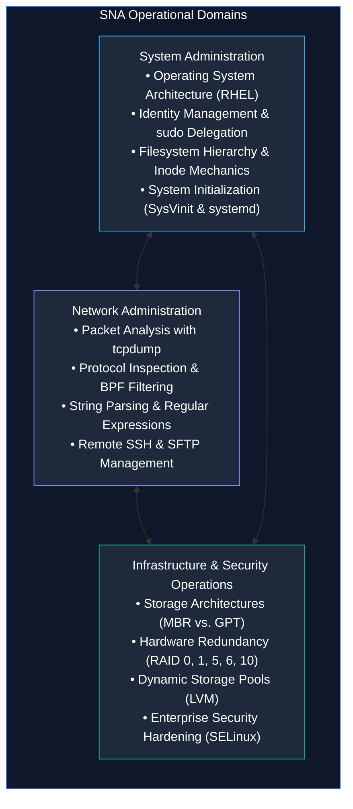

<p align="center">
  
</p>

# System and Network Administrator (SNA) Foundations

> **Comprehensive Technical Notes & Operational Reference for BSIT Students**  
> A structured curriculum covering enterprise server administration, Linux operating system internals, legacy and modern Red Hat Enterprise Linux (RHEL) operational models, networking utilities, disk architecture, and field cheatsheets.

---

## 📌 Section Overview

The **System and Network Administrator (SNA)** section is an essential foundational component of the *Blue Team Handbook*. 

In modern cybersecurity and enterprise IT operations, defensive analysts and security engineers cannot defend systems they do not understand. Effective threat detection, incident triage, and server hardening require a thorough, hands-on understanding of operating system architectures, network packet flows, identity databases, storage subsystems, and remote administrative tools.

This curriculum organizes foundational university study notes, practical command syntax, and high-density operational cheatsheets into an accessible, step-by-step learning resource.



---

## 🗂️ Complete Curriculum Table of Contents

```text
System-and-Network-Administrator/
├── README.md                                 # This master navigation and curriculum hub
├── 01-Introduction-to-SNA.md                 # Roles, system lifecycle, inspection commands, SLA/HA
├── 02-SNA-Certifications.md                  # Vendor-neutral vs specific pathways, homelab setup
│
├── 03-Linux-Fundamentals/                    # Enterprise Linux Operating System Foundations
│   ├── 01-Introduction-to-RHEL.md            # RHEL architecture, ecosystem pipeline, RHEL 6 vs 9
│   ├── 02-Common-Linux-Commands.md           # CLI grammar, streams, redirection, pipelines, search
│   ├── 03-File-Management.md                 # FHS tree, paths, inodes, hard vs soft links, tar
│   ├── 04-File-Permissions.md                # DAC, UGO triads, octal chmod, umask, SUID/SGID/Sticky
│   ├── 05-User-Management.md                 # /etc/passwd, shadow, group, useradd, usermod, visudo
│   ├── 06-System-Initialization.md           # 6 Boot stages, SysVinit runlevels, systemd targets
│   └── 07-Vim-and-Nano.md                    # Modal editing, Vim keybindings, swap file recovery
│
├── 04-Networking/                            # Protocol Analysis & Text Parsing
│   ├── 01-Tcpdump-Commands.md                # Packet sniffing, BPF filters, TCP flags, PCAP triage
│   └── 02-Regular-Expressions.md             # Globbing vs regex, BRE vs ERE, log parsing, ReDoS
│
├── 05-Disk-Management/                       # Storage Subsystems & Dynamic Pooling
│   ├── 01-MBR-vs-GPT.md                      # Sector 0 layout, 2.2 TiB limit, GPT redundancy
│   └── 02-RAID-and-LVM.md                    # RAID 0/1/5/6/10, LVM PV/VG/LV, online volume growth
│
├── 06-Remote-File-Management/                # Cross-Platform Remote Administration
│   └── 01-PuTTY-and-WinSCP.md                # SSH/SFTP, PuTTYgen keypairs, CRLF vs LF line endings
│
├── assignments/                              # Structured Academic Coursework & Lab Assignments
│   ├── README.md                             # Assignments hub and student submission guidelines
│   └── Assignment-01-Linux-File-System-Hierarchy.md # Detailed FHS assignment with lab exercises
│
└── cheatsheets/                              # High-Density Operational Field Reference Cards
    ├── README.md                             # Cheatsheet index and quick-lookup directory
    ├── Linux-Commands-Cheatsheet.md          # Navigation, file viewing, and process commands
    ├── Linux-File-Management-Cheatsheet.md   # Path operations, file manipulation, and tar syntax
    ├── Linux-Permissions-Cheatsheet.md       # Octal conversion matrix, umask, and special bits
    ├── Linux-User-Management-Cheatsheet.md   # User lifecycle, shadow field structure, and sudo
    ├── Vim-and-Nano-Cheatsheet.md            # Modal transitions, shortcuts, and swap resolution
    ├── Tcpdump-Cheatsheet.md                 # Sniffing flags, BPF syntax, and TCP flag decoding
    ├── Regular-Expressions-Cheatsheet.md     # Metacharacters, quantifiers, and field filters
    ├── Disk-Management-Cheatsheet.md         # Block inspection, MBR/GPT, and LVM 3-tier syntax
    └── PuTTY-and-WinSCP-Cheatsheet.md        # Session configuration, keys, and transfer modes
```

---

## 📝 Coursework & Practical Assignments

To bridge the gap between classroom theory and real-world system administration, practical assignments are provided with step-by-step terminal exercises, architectural diagrams, and self-assessment answer keys:

* **[Assignment 01: Linux Filesystem Hierarchy Standard (FHS)](assignments/Assignment-01-Linux-File-System-Hierarchy.md)**  
  *Detailed examination of the unified inverted tree (`/`), Windows drive letters vs. Linux mount points, the three "roots" (`/`, `root`, `/root`), 18 primary FHS directories, dynamic virtual filesystems (`/proc`, `/sys`), and 5 hands-on terminal lab exercises.*
* **[Assignments Hub & Guidelines](assignments/README.md)**  
  *Master index of all academic coursework and practical guidelines for terminal-based practice.*

---

## 🧭 Recommended Learning Sequence

To build a solid operational and theoretical foundation, work through the chapters in this structured pedagogical order:

```mermaid
flowchart LR
    S1["1. Foundations<br/>(Intro & Certs)"] --> S2["2. Linux Core<br/>(RHEL, CLI, Files)"]
    S2 --> S3["3. Access & Boot<br/>(Perms, Users, Init, Editors)"]
    S3 --> S4["4. Networking<br/>(Tcpdump & Regex)"]
    S4 --> S5["5. Storage<br/>(MBR/GPT & LVM)"]
    S5 --> S6["6. Remote Admin<br/>(PuTTY & WinSCP)"]

    style S1 fill:#1e293b,stroke:#0ea5e9,color:#fff
    style S2 fill:#1e293b,stroke:#3b82f6,color:#fff
    style S3 fill:#1e293b,stroke:#6366f1,color:#fff
    style S4 fill:#1e293b,stroke:#8b5cf6,color:#fff
    style S5 fill:#1e293b,stroke:#a855f7,color:#fff
    style S6 fill:#1e293b,stroke:#ec4899,color:#fff
```



1. **Foundations:** Start with [01-Introduction-to-SNA.md](01-Introduction-to-SNA.md) and [02-SNA-Certifications.md](02-SNA-Certifications.md) to understand administrative responsibilities, operational lifecycles, and industry career pathways.
2. **Enterprise Linux Environment:** Master the RHEL architecture in [03-Linux-Fundamentals/01-Introduction-to-RHEL.md](03-Linux-Fundamentals/01-Introduction-to-RHEL.md) and command-line mechanics in [03-Linux-Fundamentals/02-Common-Linux-Commands.md](03-Linux-Fundamentals/02-Common-Linux-Commands.md).
3. **Filesystem & Access Controls:** Study the FHS tree in [03-Linux-Fundamentals/03-File-Management.md](03-Linux-Fundamentals/03-File-Management.md), Discretionary Access Control in [03-Linux-Fundamentals/04-File-Permissions.md](03-Linux-Fundamentals/04-File-Permissions.md), and user identities in [03-Linux-Fundamentals/05-User-Management.md](03-Linux-Fundamentals/05-User-Management.md).
4. **Bootstrapping & Configuration Tools:** Analyze the 6 boot stages and systemd in [03-Linux-Fundamentals/06-System-Initialization.md](03-Linux-Fundamentals/06-System-Initialization.md) and master terminal text editing in [03-Linux-Fundamentals/07-Vim-and-Nano.md](03-Linux-Fundamentals/07-Vim-and-Nano.md).
5. **Network Analysis & Text Parsing:** Learn network sniffing and packet analysis in [04-Networking/01-Tcpdump-Commands.md](04-Networking/01-Tcpdump-Commands.md) and pattern filtering in [04-Networking/02-Regular-Expressions.md](04-Networking/02-Regular-Expressions.md).
6. **Physical & Logical Storage:** Compare partition tables in [05-Disk-Management/01-MBR-vs-GPT.md](05-Disk-Management/01-MBR-vs-GPT.md) and configure RAID arrays and LVM pools in [05-Disk-Management/02-RAID-and-LVM.md](05-Disk-Management/02-RAID-and-LVM.md).
7. **Cross-Platform Remote Administration:** Connect Windows management workstations to Linux servers in [06-Remote-File-Management/01-PuTTY-and-WinSCP.md](06-Remote-File-Management/01-PuTTY-and-WinSCP.md).

---

## ⚡ Detailed Notes vs. Quick-Reference Cheatsheets

| Dimension | Detailed Notes (`0X-.../*.md`) | Cheatsheets (`cheatsheets/*.md`) |
|---|---|---|
| **Primary Goal** | Deep conceptual learning, exam preparation, and understanding underlying mechanisms | Rapid command syntax lookup during live terminal operations |
| **Depth** | Exhaustive explanations, working principles, edge cases, and architectural diagrams | Dense command tables, flags, and high-frequency one-liners |
| **Pedagogical Features** | Key points to remember, comprehensive glossaries, practice questions, and answer keys | Minimal text; maximum syntax density |
| **Usage Scenario** | Studying for university exams, RHCSA, CCNA, or understanding *why* systems behave as they do | Working in a live SSH terminal or troubleshooting an active incident |

When working on active lab machines, keep the [Cheatsheets Directory](cheatsheets/README.md) bookmarked. When building core knowledge, read the full chapter notes.

---

## ⚙️ Environment and Legacy Compatibility: RHEL 6 vs. Modern RHEL

A major component of real-world enterprise system administration is recognizing **operating system version differences**:
- Many enterprise organizations, banking platforms, and industrial control environments continue to run legacy **Red Hat Enterprise Linux 6 (RHEL 6)** servers alongside modern RHEL 8 and 9 installations.
- **Service Management:** RHEL 6 uses `service` and `chkconfig`, while modern RHEL uses `systemctl`.
- **System Initialization:** RHEL 6 uses SysVinit `/etc/inittab` and numerical runlevels `0–6`; modern RHEL uses systemd target units (`multi-user.target`, `graphical.target`).
- **Networking:** RHEL 6 uses `ifconfig` and `route` (`net-tools`); modern RHEL uses `ip addr` and `ip route` (`iproute2`).

All notes in this curriculum clearly distinguish between legacy RHEL 6 and modern enterprise standards so you will never be caught off guard in a commercial data center.

---

## 🛡️ Administrative Safety Directives

Commands that format storage drives, alter partition boundaries, change permissions recursively, or modify network interfaces carry inherent operational risk:
1. **Always Verify Your Target:** Run `pwd` before deleting files, and run `lsblk` before partitioning a drive. Never blindly execute destructive commands on assumed disk names like `/dev/sdb` or `/dev/hdc`.
2. **Isolate Legacy Systems:** RHEL 6 is a legacy operating system that has reached End-of-Life (EOL). Practice on RHEL 6 only in isolated, non-routed virtual machines. Never expose legacy systems directly to untrusted public networks.
3. **Practice in a Disposable VM:** Conduct all storage, permission, and service experiments inside a local Type-2 hypervisor (Oracle VirtualBox, VMware Workstation) using free Red Hat Developer subscriptions or Rocky Linux.
