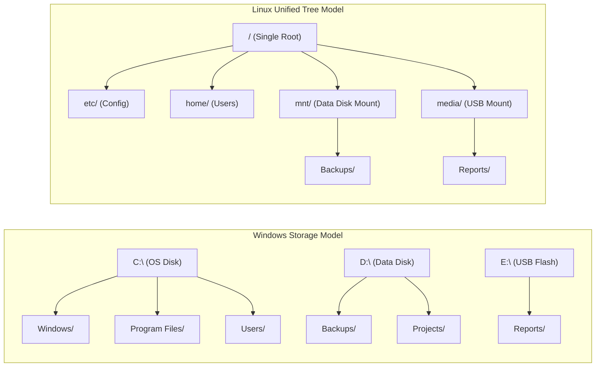
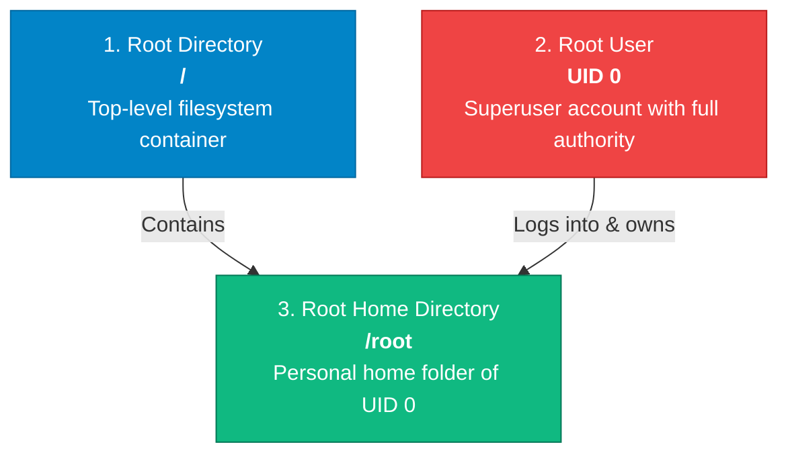

# System and Network Administration (SNA)
# Assignment 01: Linux Filesystem Hierarchy Standard (FHS)

> **Course:** BSIT — System and Network Administration (SNA)  
> **Topic:** Linux Operating System Architecture & Directory Organization  
> **Document Type:** Coursework Assignment & Comprehensive Study Reference  

---

## 📌 Assignment Overview & Short Description

### What This Assignment Is About
This assignment provides a comprehensive, hands-on exploration of the **Linux Filesystem Hierarchy Standard (FHS)**. In Linux, all files, storage volumes, connected hardware devices, system configuration files, running process metrics, and administrative utilities are structured beneath a single inverted tree originating at the **root directory (`/`)**. 

Unlike operating systems such as Microsoft Windows—which allocate separate drive letters (`C:\`, `D:\`, `E:\`) to individual physical or logical disks—Linux treats every attached device and storage volume as a branch attached to this unified directory tree. 

### Why This Assignment Is Essential for Systems Administrators
For an aspiring System and Network Administrator, navigating the filesystem hierarchy is not merely academic theory—it is the bedrock of server configuration, routine maintenance, security hardening, and incident triage:
- When troubleshooting service failures or unauthorized access attempts, administrators immediately inspect `/var/log`.
- When configuring network interfaces, firewall rules, or user security policies, administrators modify configuration text files in `/etc`.
- When investigating high memory or CPU consumption without third-party monitoring tools, administrators query live kernel data directly through `/proc`.
- When managing persistent storage, attaching SAN/NAS volumes, or partitioning block devices, administrators interact with `/dev`, `/mnt`, and `/media`.

Mastering the FHS allows administrators to navigate any Unix-like server with speed and confidence.

---

## 🧠 Core Objectives & Student Learning Outcomes

By completing this assignment and its associated exercises, students will be able to:
1. **Explain the structural difference** between Windows volume-letter storage schemes and the unified Linux inverted-tree directory model.
2. **Clearly distinguish between the three "roots"**: The root directory (`/`), the superuser account (`root`), and the superuser home directory (`/root`).
3. **Identify and map all 18 primary FHS directories**, detailing their specific system roles, contents, and security considerations.
4. **Distinguish between physical files on disk and dynamic virtual filesystems** maintained entirely in memory by the Linux kernel (`/proc` and `/sys`).
5. **Execute practical command-line inspection tasks** to locate configuration files, monitor real-time logs, verify device nodes, and check storage mount points.

---


---

## 1. Introduction: The Linux Inverted Tree vs. Windows Drive Letters

In traditional personal computer operating systems such as Microsoft Windows, storage devices are treated as independent, top-level drive letters:
- Primary hard drive partition: `C:\`
- Secondary partition or data drive: `D:\`
- Removable USB flash drive: `E:\`

Each drive maintains its own isolated root folder (`C:\`, `D:\`). To access files across multiple storage drives, users and applications must explicitly switch between drive letters.



### Key Differences Matrix

| Architectural Feature | Windows Storage Architecture | Linux Filesystem Hierarchy (FHS) |
|---|---|---|
| **Root Design** | Multiple root nodes (`C:\`, `D:\`, `E:\`). | Single, unified root node (`/`). |
| **Path Separator** | Backslash (`\`) (e.g., `C:\Windows\System32`). | Forward slash (`/`) (e.g., `/usr/bin`). |
| **Drive Addition** | Assigned a new drive letter by the OS. | Mounted to an existing directory (a "mount point"). |
| **Case Sensitivity** | Case-insensitive by default (`File.txt` == `file.txt`). | Case-sensitive (`File.txt` $\neq$ `file.txt`). |
| **Hardware Abstraction** | Managed through device manager interfaces. | Represented as special files in `/dev`. |

---

## 2. What Is a File System?

A **file system** is the underlying logical data structure and set of algorithms that an operating system uses to organize, store, index, retrieve, and manage data on physical or virtual storage devices (such as NVMe SSDs, SATA hard drives, SAN LUNs, and optical disks).

Without a file system, a storage device is merely an unorganized sequence of raw binary sectors. The file system provides:
1. **Directory Structure:** A predictable hierarchical naming convention for files and folders.
2. **Metadata Storage:** Tracking file sizes, ownership, modification timestamps, access rights, and physical disk block locations using data structures such as **Inodes**.
3. **Space Management:** Allocating free disk blocks to newly created files and managing free space lists.
4. **Data Integrity:** Preventing corruption during sudden power failures using journaling mechanisms (e.g., XFS, ext4).

In Linux, the organization of directories is standardized by the **Filesystem Hierarchy Standard (FHS)**, maintained by the Linux Foundation. This ensures that software developers, system administrators, and security analysts can rely on standard file locations across diverse Linux distributions (such as Red Hat Enterprise Linux, Rocky Linux, Ubuntu, Debian, and SUSE).

---

## 3. The Root Directory (`/`) and The Three "Roots"

The absolute top level of the Linux filesystem hierarchy is represented by a single forward slash:
```bash
/
```
Every directory, subfolder, mounted filesystem, and hardware device file on the system exists as a descendant branch of this single directory.

### ⚠️ Crucial Distinction: Demystifying the Three "Roots"
Beginning systems administration students frequently confuse three distinct technical concepts that all share the word **root**:



| Term | Technical Definition | Key Characteristics |
|---|---|---|
| **`/` (Root Directory)** | The top-most directory in the entire filesystem tree. | Shared starting point for all system folders. Every path begins here. |
| **`root` (Root User)** | The administrative superuser account in Linux. | Holds User ID `0` (UID 0). Bypasses standard file permission restrictions. |
| **`/root` (Root Home)** | The private home directory of the `root` superuser. | Located directly under `/`. Permissions are restricted (`700`) so regular users cannot read it. |

> [!IMPORTANT]
> Regular user home directories are stored inside `/home/<username>` (e.g., `/home/alice`). However, the `root` user's home directory is `/root`, placed directly on the root partition so the superuser can log in and repair the system even if the `/home` partition is corrupt or unmounted during boot.

---

## 4. Master Architectural Layout of the Linux FHS

Below is the standard layout of the primary directories defined by the Filesystem Hierarchy Standard:

```text
/
├── bin   -> usr/bin    # Essential user binaries (UsrMerge)
├── boot                # Static bootloader, kernel, and initramfs files
├── dev                 # Special hardware and device nodes
├── etc                 # Host-specific system-wide configuration
├── home                # User personal home directories
├── lib   -> usr/lib    # Essential shared libraries and kernel modules
├── lib64 -> usr/lib64  # 64-bit shared system libraries
├── media               # Automatic mount point for removable storage
├── mnt                 # Temporary manual mount point for administrators
├── opt                 # Add-on application software packages
├── proc                # Dynamic virtual filesystem for kernel and process states
├── root                # Home directory of the root superuser (UID 0)
├── run                 # Volatile runtime data since system boot
├── sbin  -> usr/sbin   # Essential system administration binaries
├── srv                 # Site-specific data served by this system
├── sys                 # Dynamic virtual filesystem for hardware subsystem models
├── tmp                 # Temporary scratch directory (cleared periodically)
├── usr                 # Secondary hierarchy for user-space utilities and libraries
└── var                 # Variable files: dynamic logs, spool, databases, and caches
```

---

## 5. In-Depth Directory Breakdown & Administrator Scenarios

---

### 5.1. `/bin` — Essential User Command Binaries

#### Purpose & Architecture
The `/bin` directory contains the foundational, executable command-line programs required for fundamental system operation. Historically, `/bin` contained the minimal set of binaries needed to boot, repair, or restore a system into single-user recovery mode before secondary partitions (such as `/usr`) were mounted.

#### Key Binaries
`ls`, `cp`, `mv`, `rm`, `cat`, `chmod`, `chown`, `pwd`, `date`, `mkdir`, `bash`, `sh`.

#### 💡 Modern Linux Note: The UsrMerge Architecture
On modern Linux distributions (such as RHEL 7/8/9, Fedora, Rocky Linux, Debian, and Ubuntu), `/bin` is no longer a separate standalone folder. It is implemented as a symbolic link pointing directly to `/usr/bin`:
```bash
$ ls -ld /bin
lrwxrwxrwx. 1 root root 7 Aug 10 2024 /bin -> usr/bin
```
This consolidation (known as **UsrMerge**) simplifies package management and allows `/usr` to be mounted as a single, read-only system image across enterprise installations.

#### Practical SysAdmin Inspection
```bash
# Verify the binary location of the copy utility
$ which cp
/usr/bin/cp

# Inspect file type and ELF architecture
$ file /bin/ls
/bin/ls: ELF 64-bit LSB pie executable, x86-64, version 1 (SYSV), dynamically linked...
```

---

### 5.2. `/boot` — Static Bootloader & Kernel Files

#### Purpose & Architecture
The `/boot` directory stores all critical files required to initialize the operating system during the early stages of boot, before the Linux kernel is running. 

#### Key Files
- **`vmlinuz-<kernel-version>`:** The compressed Linux kernel binary executable.
- **`initramfs-<kernel-version>.img`:** The Initial RAM Filesystem image containing minimal disk and storage drivers required to locate and mount the real root partition.
- **`grub2/grub.cfg`:** The primary configuration script for the GRUB2 bootloader.
- **`System.map`:** The kernel symbol lookup table used for kernel debugging.

#### Practical SysAdmin Inspection
```bash
$ ls -lh /boot
total 214M
-rw-------. 1 root root 5.2M Nov 12 14:22 System.map-5.14.0-427.el9.x86_64
-rw-r--r--. 1 root root 206K Nov 12 14:22 config-5.14.0-427.el9.x86_64
drwx------. 5 root root 4.0K Nov 12 14:30 grub2
-rw-------. 1 root root  42M Nov 12 14:25 initramfs-5.14.0-427.el9.x86_64.img
-rwxr-xr-x. 1 root root  14M Nov 12 14:22 vmlinuz-5.14.0-427.el9.x86_64
```
*Administrator Note:* If the `/boot` partition fills up to $100\%$ capacity due to accumulated old kernels, package updates will fail. Administrators routinely remove outdated kernels using `dnf remove --oldinstallonly`.

---

### 5.3. `/dev` — Device Special Files

#### Purpose & Architecture
In Unix and Linux, **"everything is a file."** Hardware components, storage disks, physical input peripherals, and system communication ports are represented in user space as special device nodes inside `/dev`. 

Applications do not communicate with hardware through proprietary APIs; they read from and write to these device files using standard filesystem calls.

#### Device Categories
1. **Block Devices (`b`):** Transfer data in fixed-size blocks with buffering (e.g., hard drives, SSDs, partitions).
2. **Character Devices (`c`):** Stream data character-by-character sequentially without buffering (e.g., serial ports, keyboards, terminal consoles).
3. **Pseudo-Devices:** Virtual software devices provided by the kernel for administrative tasks.

#### Key Device Nodes
- `/dev/sda`, `/dev/sdb`: Primary and secondary SATA/SAS/SCSI storage disks.
- `/dev/nvme0n1`: First Non-Volatile Memory Express (NVMe) solid-state storage device.
- `/dev/sda1`: First partition on the primary storage disk.
- `/dev/null`: The "black hole" device. Any data written to `/dev/null` is immediately discarded; reading from it returns an immediate End-Of-File (EOF).
- `/dev/zero`: Produces an infinite stream of null bytes (`0x00`), commonly used to initialize swap files or zero-fill disk images.
- `/dev/urandom`: Cryptographically secure pseudo-random number generator.

#### Practical SysAdmin Inspection
```bash
# Inspect block storage devices and pseudo-devices
$ ls -l /dev/sda /dev/null /dev/zero
crw-rw-rw-. 1 root root 1, 3 Oct 24 10:00 /dev/null
brw-rw----. 1 root disk 8, 0 Oct 24 10:00 /dev/sda
crw-rw-rw-. 1 root root 1, 5 Oct 24 10:00 /dev/zero
```
*Explanation:* Notice the first character of the permission string: `b` indicates a block device, while `c` designates a character device. The numbers `8, 0` represent the major and minor numbers used by the kernel to identify the device driver and physical unit.

---

### 5.4. `/etc` — Host-Specific System Configuration Files

#### Purpose & Architecture
The `/etc` directory is the nerve center of a Linux system. It stores editable, system-wide plain-text configuration files and startup scripts. Binaries are never stored in `/etc`.

#### Key Configuration Files & Subdirectories
- `/etc/passwd`: User account database (usernames, UIDs, GIDs, home paths, login shells).
- `/etc/shadow`: Secure hashed user passwords, account expiration, and password aging metrics.
- `/etc/group`: Defines local user groups and group memberships.
- `/etc/fstab`: Filesystem table defining storage partitions and their automatic mount options at boot.
- `/etc/hostname`: Static hostname of the server.
- `/etc/hosts`: Local static hostname-to-IP lookup mapping.
- `/etc/resolv.conf`: DNS nameservers and domain search paths.
- `/etc/ssh/sshd_config`: Daemon configuration for secure remote OpenSSH server management.
- `/etc/systemd/`: Unit configuration files for systemd service control.

#### Practical SysAdmin Inspection
```bash
# View network hostname configuration
$ cat /etc/hostname
server01.enterprise.local

# Check DNS resolver configuration
$ cat /etc/resolv.conf
nameserver 8.8.8.8
nameserver 1.1.1.1
```
*Production Best Practice:* Always create a timestamped backup before modifying files in `/etc`:
```bash
sudo cp -p /etc/ssh/sshd_config /etc/ssh/sshd_config.bak.$(date +%F)
```

---

### 5.5. `/home` — User Personal Home Directories

#### Purpose & Architecture
The `/home` directory hosts the individual workspaces of regular (non-root) users. Each user is assigned a dedicated subdirectory (e.g., `/home/john`, `/home/sara`).

#### Typical Contents
- User documents, projects, and downloads.
- User-specific environment configuration files (hidden files prefixed with a dot, such as `.bashrc`, `.bash_profile`, `.vimrc`).
- SSH authentication keys (`~/.ssh/authorized_keys`).

#### Practical SysAdmin Inspection
```bash
$ ls -ld /home/student
drwx------. 5 student student 4096 Oct 24 11:30 /home/student
```
*Security Note:* User home directories are typically restricted to permissions `700` (`rwx------`) or `750` (`rwxr-x---`) so unauthorized users on the same server cannot read each other's private data.

---

### 5.6. `/lib` and `/lib64` — Shared System Libraries

#### Purpose & Architecture
The `/lib` (and `/lib64` on 64-bit systems) directory stores shared programmatic libraries (similar to `.dll` files in Windows) required by system binaries in `/bin` and `/sbin`. It also houses kernel modules (device drivers) under `/lib/modules/<kernel-version>/`.

#### Key Files
- Dynamically linked shared objects (`libc.so.*`, `libpthread.so.*`).
- Loadable kernel modules (`.ko` files).

On modern systems, `/lib` and `/lib64` are symlinked to `/usr/lib` and `/usr/lib64`.

#### Practical SysAdmin Inspection
```bash
# Check the shared library dependencies of an executable binary
$ ldd /bin/ls
    linux-vdso.so.1 (0x00007ffc9f7fd000)
    libselinux.so.1 => /lib64/libselinux.so.1 (0x00007f354ab7d000)
    libc.so.6 => /lib64/libc.so.6 (0x00007f354a976000)
    /lib64/ld-linux-x86-64.so.2 (0x00007f354abd5000)
```

---

### 5.7. `/media` — Removable Storage Mount Points

#### Purpose & Architecture
The `/media` directory serves as an automatic mount point for removable storage media connected to the system. When an administrator plugs in a USB flash drive, external hard drive, or DVD on modern desktop or server operating systems running desktop managers or automount daemons (such as `udisks2`), subdirectories are automatically generated under `/media/<username>/<volume-label>`.

---

### 5.8. `/mnt` — Temporary Administrative Mount Point

#### Purpose & Architecture
The `/mnt` directory is designated for system administrators to **manually** mount filesystems, storage partitions, or network shares temporarily. 

Unlike `/media` (which is automated), `/mnt` is entirely manual. For example, during incident recovery or data migration, an administrator mounts an external partition to `/mnt`:

#### Practical SysAdmin Workflow
```bash
# Manually mount an external partition
$ sudo mount /dev/sdb1 /mnt

# Verify the filesystem is mounted
$ df -h /mnt
Filesystem      Size  Used Avail Use% Mounted on
/dev/sdb1        50G  4.2G   46G   9% /mnt

# Cleanly unmount after work is completed
$ sudo umount /mnt
```

---

### 5.9. `/opt` — Optional Third-Party Software Packages

#### Purpose & Architecture
The `/opt` (optional) directory provides a self-contained installation location for commercial software, third-party applications, and proprietary enterprise tools that do not conform to standard Linux package directory distribution.

Unlike native system software (which distributes binaries into `/usr/bin`, libraries into `/usr/lib`, and configuration into `/etc`), applications installed in `/opt` maintain their own internal structure:
```text
/opt/
└── google/
    └── chrome/
        ├── google-chrome (binary)
        ├── cron/
        └── lib/
```
Examples include Google Chrome (`/opt/google/chrome`), security agents like Splunk Forwarder (`/opt/splunkforwarder`), and database systems.

---

### 5.10. `/proc` — Virtual Kernel & Process Information Filesystem

#### Purpose & Architecture
The `/proc` directory is **not stored on any physical disk**. It is a **virtual pseudo-filesystem** created and maintained entirely in volatile RAM by the Linux kernel.

It serves as an interactive communication window into the kernel's live memory state, exposing system hardware metrics, memory allocation, and information about every currently running process.

#### Key Virtual Nodes
- `/proc/cpuinfo`: Detailed hardware metrics regarding physical and virtual CPU cores.
- `/proc/meminfo`: Real-time system memory and swap utilization metrics.
- `/proc/version`: Linux kernel build version and compiler information.
- `/proc/uptime`: Total seconds the system has been continuously running.
- `/proc/<PID>/`: Dedicated directory for each active process (e.g., `/proc/1/` contains runtime details for PID 1, systemd).

#### Practical SysAdmin Inspection
```bash
# Query total physical memory directly from the kernel
$ grep MemTotal /proc/meminfo
MemTotal:       16249912 kB

# Inspect the command-line invocation of process PID 1
$ cat /proc/1/cmdline
/usr/lib/systemd/systemd--switched-root--system--deserialize=31
```
*Key Takeaway:* Files in `/proc` consume 0 bytes of disk space because they are generated dynamically when an administrator or tool queries them.

---

### 5.11. `/root` — Home Directory of the Superuser

#### Purpose & Architecture
The `/root` directory (pronounced "slash-root") is the private home directory of the `root` administrative account. 

#### Why Is `/root` Not in `/home`?
Regular user accounts reside in `/home` (e.g., `/home/student`), which is frequently configured on a separate disk partition or network storage volume (NFS). If that separate partition fails to mount during boot, regular users cannot log in. 

Because `/root` resides directly on the root (`/`) filesystem partition, the system administrator can always authenticate, access administrative shell history (`/root/.bash_history`), and perform disaster recovery even in minimal emergency rescue environments.

#### Practical SysAdmin Inspection
```bash
$ sudo ls -la /root
total 32
dr-xr-x---.  4 root root 4096 Oct 24 09:00 .
dr-xr-xr-x. 18 root root 4096 Oct 24 08:30 ..
-rw-------.  1 root root 1420 Oct 24 09:05 .bash_history
-rw-r--r--.  1 root root   18 Dec 28  2023 .bash_logout
-rw-r--r--.  1 root root  141 Dec 28  2023 .bash_profile
-rw-r--r--.  1 root root  492 Dec 28  2023 .bashrc
```

---

### 5.12. `/run` — Runtime Volatile Information

#### Purpose & Architecture
The `/run` directory is a memory-backed filesystem (`tmpfs`) that stores volatile runtime operational data generated since the system was powered on. 

#### Key Contents
- **PID Files (`*.pid`):** Contain the process IDs of running background system services (daemons), preventing duplicate instances from starting.
- **UNIX Domain Sockets:** Used for inter-process communication (IPC) between daemons and local clients.
- **Service Locks:** Ensuring exclusive hardware or software resource access.

Because `/run` resides in RAM, its entire contents are cleared automatically whenever the system shuts down or reboots.

#### Practical SysAdmin Inspection
```bash
# View the process ID of the running SSH daemon
$ cat /run/sshd.pid
1048
```

---

### 5.13. `/sbin` — Essential System Administration Binaries

#### Purpose & Architecture
The `/sbin` (System Binaries) directory contains non-trivial executable commands reserved primarily for the system administrator (`root`) to manage hardware, network routing, partition disks, and initialize system state changes.

#### Key Binaries
`reboot`, `shutdown`, `fdisk`, `parted`, `ip`, `iptables`, `fsck`, `mkfs`, `lvm`, `sysctl`.

#### Modern Symlink Status
Like `/bin`, on modern Linux distributions `/sbin` is symlinked directly to `/usr/sbin`.

#### Practical SysAdmin Inspection
```bash
# Attempting to run sbin commands as a non-privileged user shows permission or path restrictions:
$ which fdisk
/usr/sbin/fdisk

# Inspecting execution requirements
$ fdisk -l /dev/sda
fdisk: cannot open /dev/sda: Permission denied
```
*Explanation:* While regular users might view help manuals for tools in `/sbin`, executing commands that alter storage, routing tables, or hardware states requires elevated privileges via `sudo`.

---

### 5.14. `/srv` — Site-Specific Service Data

#### Purpose & Architecture
The `/srv` directory contains site-specific, payload data that the host server provides to network clients via web, FTP, or repository services. 

#### Standard Enterprise Uses
- Web server documents: `/srv/www/` or `/srv/http/`
- FTP download directories: `/srv/ftp/`
- Version control repositories: `/srv/git/` or `/srv/svn/`

Using `/srv` provides an isolated, standard location for application data that is distinct from application code in `/usr` and dynamic logs in `/var`.

---

### 5.15. `/sys` — Hardware & Kernel Subsystem Virtual Filesystem

#### Purpose & Architecture
Like `/proc`, `/sys` is a virtual in-memory filesystem (`sysfs`). While `/proc` focuses primarily on processes and general kernel metrics, `/sys` exposes a structured, object-oriented model of all hardware devices, physical buses (PCIe, USB), device drivers, and power management states recognized by the Linux kernel.

#### Key Virtual Nodes
- `/sys/class/net/`: Network interface properties (MAC addresses, operational carrier states, link speeds).
- `/sys/block/`: Physical block storage devices and queue settings.

#### Practical SysAdmin Inspection
```bash
# Query the operational link state of the primary Ethernet interface
$ cat /sys/class/net/eth0/operstate
up

# Check the physical hardware MAC address directly from the kernel
$ cat /sys/class/net/eth0/address
00:15:5d:01:ca:42
```

---

### 5.16. `/tmp` — Temporary Scratch Directory

#### Purpose & Architecture
The `/tmp` directory provides a universally writable scratchpad workspace where applications, compilers, and users can create short-lived files during active sessions.

#### Security & Permissions: The Sticky Bit
Because every user on the system has write access to `/tmp`, Linux protects user files using a special security mechanism known as the **Sticky Bit** (indicated by the `t` at the end of the permission string):

```bash
$ ls -ld /tmp
drwxrwxrwt. 14 root root 4096 Oct 24 12:00 /tmp
```

*How the Sticky Bit Works:*
- Without the sticky bit, anyone with write access to a directory could delete or rename other users' files inside that directory.
- With the sticky bit (`chmod 1777 /tmp`), a user can only delete or rename files that they **personally own**, preventing malicious or accidental deletion of other users' work.

On modern systems, `/tmp` is frequently mounted as a RAM-backed `tmpfs` volume or cleaned automatically every 24–48 hours using `systemd-tmpfiles-clean`.

---

### 5.17. `/usr` — User Applications & System Resources

#### Purpose & Architecture
The `/usr` (Historically: "User System Resources") directory contains the vast majority of compiled user-space software, system utilities, libraries, and documentation. 

`/usr` is intended to contain **sharable, read-only data**. In large enterprise clusters, `/usr` can be mounted read-only across hundreds of client workstations from a centralized network server.

#### Major Subdirectories
- `/usr/bin`: Primary user programs (compilers, python runtimes, text editors, utilities).
- `/usr/sbin`: Non-essential administrative server daemons and utilities.
- `/usr/lib` & `/usr/lib64`: Shared libraries and architecture-dependent application engines.
- `/usr/local`: Software compiled locally by the administrator from source code without using official distribution packages.
- `/usr/share`: Architecture-independent shared assets, documentation manuals (`/usr/share/man`), and icons.

#### Practical SysAdmin Inspection
```bash
# View man page documentation paths
$ ls -d /usr/share/man/man1
/usr/share/man/man1
```

---

### 5.18. `/var` — Frequently Changing Variable Data

#### Purpose & Architecture
While `/usr` contains static, read-only data, `/var` (Variable) stores data that changes continuously and unpredictably during normal operating system execution. 

#### Critical Subdirectories for Administrators
- **`/var/log`:** System, kernel, authentication, and application log files.
- **`/var/spool`:** Queued tasks waiting for processing (print queues, cron schedules, outgoing mail).
- **`/var/lib`:** Dynamic state data maintained by applications and database engines (e.g., MySQL databases in `/var/lib/mysql`).
- **`/var/cache`:** Cached application data, package manager metadata (`/var/cache/dnf` or `/var/cache/apt`).

#### Practical SysAdmin Inspection: Monitoring Logs in `/var/log`
```bash
# Check primary system log files
$ ls -l /var/log/messages /var/log/secure
-rw-------. 1 root root 482910 Oct 24 12:30 /var/log/messages
-rw-------. 1 root root  28410 Oct 24 12:28 /var/log/secure

# Monitor failed SSH authentication attempts in real time
$ sudo tail -f /var/log/secure | grep "Failed password"
```

> [!WARNING]
> **Production Disk Space Hazard:** If a server experiences an unhandled application loop, service crash, or brute-force attack, log files in `/var/log` can rapidly expand and consume all available disk space. In production environments, administrators allocate `/var` or `/var/log` to an independent disk partition to prevent log floods from halting the core operating system.

---

## 6. Comprehensive Summary Reference Matrix

| Directory | Primary Category | Typical Contents | Dynamic or Static | Persistence Across Reboot |
|---|---|---|---|---|
| **`/`** | Root | Starting anchor of the entire filesystem | Static | Persistent |
| **`/bin`** | Binaries | Essential user commands (`ls`, `cp`, `cat`) | Static | Persistent |
| **`/boot`** | OS Boot | Linux kernel (`vmlinuz`), GRUB2, initramfs | Static | Persistent |
| **`/dev`** | Devices | Device nodes (`/dev/sda`, `/dev/null`) | Dynamic (devtmpfs) | Recreated on boot |
| **`/etc`** | Configuration | Host-wide text configuration (`passwd`, `fstab`) | Static | Persistent |
| **`/home`** | User Data | Regular user workspaces (`/home/username`) | Variable | Persistent |
| **`/lib`** | Libraries | Shared libraries and kernel modules | Static | Persistent |
| **`/media`** | Mounts | Automatic mount point for removable drives | Dynamic | Volatile |
| **`/mnt`** | Mounts | Manual temporary administrative mount point | Static / Admin | Persistent (mount is temporary) |
| **`/opt`** | Applications | Add-on, third-party software packages | Static | Persistent |
| **`/proc`** | Kernel Virtual | Process IDs, CPU/memory status | Dynamic (procfs) | In-Memory (RAM only) |
| **`/root`** | User Data | Superuser home directory | Variable | Persistent |
| **`/run`** | Runtime State | Running daemon PID files and socket pipes | Dynamic (tmpfs) | Volatile (cleared on reboot) |
| **`/sbin`** | Binaries | System administration tools (`ip`, `fdisk`) | Static | Persistent |
| **`/srv`** | Service Data | Web/FTP payload served by the machine | Variable | Persistent |
| **`/sys`** | Kernel Virtual | Hardware device model and bus tree | Dynamic (sysfs) | In-Memory (RAM only) |
| **`/tmp`** | Scratch | Temporary files with sticky bit (`1777`) | Variable | Cleared periodically / reboot |
| **`/usr`** | Userland OS | Applications, libraries, manuals | Static | Persistent |
| **`/var`** | Variable Data | Dynamic system logs (`/var/log`), mail queues | Variable | Persistent |

---

## 7. Hands-On Student Lab Exercises

Execute the following verification exercises on your Linux virtual machine or lab workstation. Record your observed command outputs and answers in your assignment submission notes.

### Exercise 1: Directory Tree Traversal & Root Distinction
1. Log into your Linux terminal as a regular user.
2. Execute `pwd` to print your present working directory.
3. Switch directly to the root directory using `cd /`.
4. List the contents of the root directory with detailed attributes: `ls -la`.
5. Attempt to change directory into `/root` using `cd /root`.
   - **Question:** What error message is displayed, and what specific permission flags on `/root` caused this behavior?

---

### Exercise 2: Verifying Modern UsrMerge Symlinks
1. Execute the following command:
   ```bash
   ls -ld /bin /sbin /lib /lib64
   ```
2. Identify where each of these directories points.
3. Run `which ls` and `which ip`. Note their true physical paths on the disk.

---

### Exercise 3: Exploring Virtual Kernel Filesystems
1. Display your server's CPU model and core count by querying the virtual `/proc` filesystem:
   ```bash
   grep -E 'model name|cpu cores' /proc/cpuinfo
   ```
2. Check your operating system kernel release string directly from `/proc`:
   ```bash
   cat /proc/version
   ```
3. Check the link status of your network adapters by querying `/sys`:
   ```bash
   cat /sys/class/net/*/operstate
   ```
4. Check the file size of `/proc/meminfo` using `ls -l /proc/meminfo`.
   - **Question:** Why does `ls` report a size of `0` bytes even though `cat /proc/meminfo` displays dozens of lines of memory data?

---

### Exercise 4: Inspecting System Configuration in `/etc`
1. Display the network name of your machine: `cat /etc/hostname`.
2. Inspect the local DNS nameserver configuration: `cat /etc/resolv.conf`.
3. View the partition mounting configuration: `cat /etc/fstab`.
4. Locate how many user accounts exist on the system:
   ```bash
   wc -l /etc/passwd
   ```

---

### Exercise 5: Analyzing Logs in `/var/log`
1. List the contents of `/var/log`:
   ```bash
   ls -lh /var/log
   ```
2. Inspect the last 15 lines of the main system log:
   ```bash
   sudo tail -n 15 /var/log/messages    # On RHEL/CentOS/Rocky
   # OR
   sudo tail -n 15 /var/log/syslog      # On Ubuntu/Debian
   ```
3. Locate the authentication log (`/var/log/secure` or `/var/log/auth.log`) and explain what types of security events are recorded there.

---

## 8. Self-Assessment & Review Questions

Test your understanding of the material before reviewing the answers below.

### Questions
1. **Explain the structural difference** between how Windows organizes storage using drive letters (`C:\`, `D:\`) versus how Linux organizes storage using a single directory tree (`/`).
2. **Distinguish clearly** between `/`, `root`, and `/root`.
3. An administrator needs to mount an external USB hard drive manually to perform an emergency system backup. Which standard directory is specifically intended for manual mounts?
4. What is the fundamental difference between files stored in `/etc` and files stored in `/proc`?
5. Why is the **sticky bit** applied to the `/tmp` directory? What problem would occur if `/tmp` had standard `777` permissions without the sticky bit?
6. On modern Linux installations, what happens when an administrator runs a command located in `/bin/cp` versus `/usr/bin/cp`?
7. In an enterprise web server deployment, why is it dangerous to place `/var` on the same disk partition as `/` (root)?
8. What type of device does `/dev/sda` represent, and what does the letter `b` in its permission string indicate?

---

## 9. Answer Key & Detailed Explanations

<details>
<summary><strong>Click to expand the Answer Key</strong></summary>

### Answer 1: Windows vs. Linux Storage Architecture
- **Windows** assigns independent, drive-letter root namespaces (`C:\`, `D:\`, `E:\`) to individual physical drives or partitions. Users must switch drives to access different storage units.
- **Linux** uses a single unified inverted tree originating at `/`. Additional physical drives, partitions, or network shares are attached to specific branches (mount points) within this single tree.

### Answer 2: Differentiating `/`, `root`, and `/root`
- **`/` (Root Directory):** The top-level root container of the entire filesystem hierarchy.
- **`root` (Root User):** The default administrative superuser account (UID 0) with unrestricted privileges.
- **`/root` (Root Home Directory):** The dedicated private home folder where the `root` superuser's personal files, configurations, and history reside.

### Answer 3: Manual Storage Mount Point
- **`/mnt`** is the standard FHS directory intended for manual, temporary filesystem mounts by an administrator. (`/media` is reserved for automated removable storage mounts).

### Answer 4: `/etc` vs. `/proc`
- **`/etc`** contains persistent, plain-text configuration files stored physically on disk that control system services and settings across reboots.
- **`/proc`** contains dynamic, virtual files generated in memory (RAM) on-the-fly by the Linux kernel to expose live hardware and process statistics. It consumes zero physical disk space.

### Answer 5: The Sticky Bit on `/tmp`
- `/tmp` requires world-writable permissions (`rwxrwxrwx` / `777`) so any user or process can create temporary scratch files.
- Without the sticky bit, **any user could delete or rename files belonging to other users**.
- The **sticky bit (`1777`)** enforces a security rule: only the file's owner (or the `root` user) can delete or rename a file inside `/tmp`.

### Answer 6: `/bin/cp` vs. `/usr/bin/cp`
- Due to the modern **UsrMerge** architecture, `/bin` is a symbolic link pointing to `/usr/bin`. Running `/bin/cp` or `/usr/bin/cp` executes the exact same underlying binary file.

### Answer 7: Partition Isolation for `/var`
- `/var` contains dynamic, constantly expanding data such as system and application logs (`/var/log`).
- If `/var` shares the root partition (`/`) and a runaway process or brute-force attack floods the log files until the partition reaches $100\%$ capacity, the entire operating system will halt because critical system daemons, PID locks, and temporary files cannot be created. Isolating `/var` on a separate partition prevents a log flood from crashing the root filesystem.

### Answer 8: `/dev/sda` and Block Device Semantics
- `/dev/sda` represents the first physical SATA, SAS, or SCSI storage disk.
- The `b` at the beginning of the `ls -l` permissions string (`brw-rw----`) signifies that it is a **Block Device**, meaning data is read and written in fixed-size blocks (sectors) through system cache buffers rather than as unbuffered character streams.

</details>

---

## 10. Conclusion

The Linux Filesystem Hierarchy Standard (FHS) provides a predictable, standardized framework for organizing operating system files, hardware devices, system configuration, dynamic runtime state, and user data. 

For a System and Network Administrator, mastering the FHS transforms Linux from an intimidating command line into an intuitive, modular environment. Knowing precisely where configuration files reside (`/etc`), where system logs accumulate (`/var/log`), how live kernel state is exposed (`/proc`, `/sys`), and where user data is segregated (`/home`, `/root`) is the foundational prerequisite for effective server administration, performance tuning, and cybersecurity defense.
