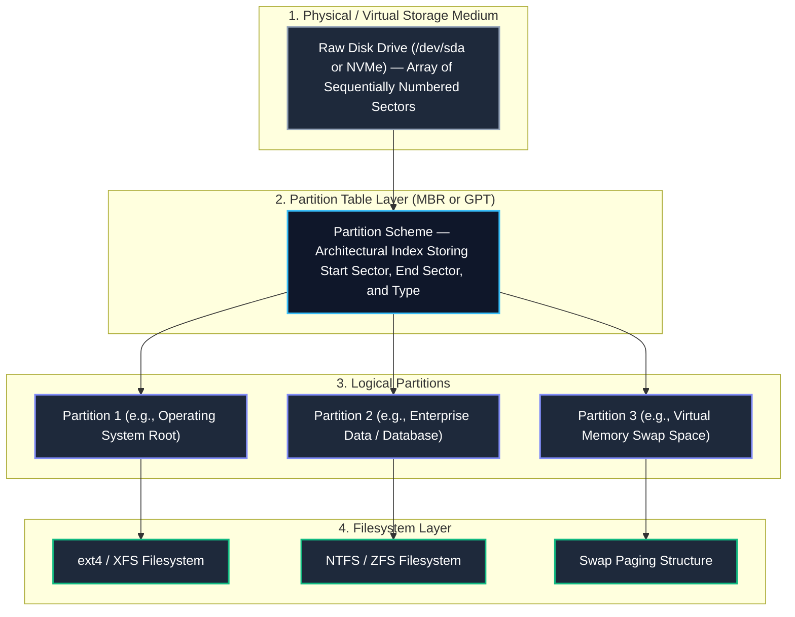
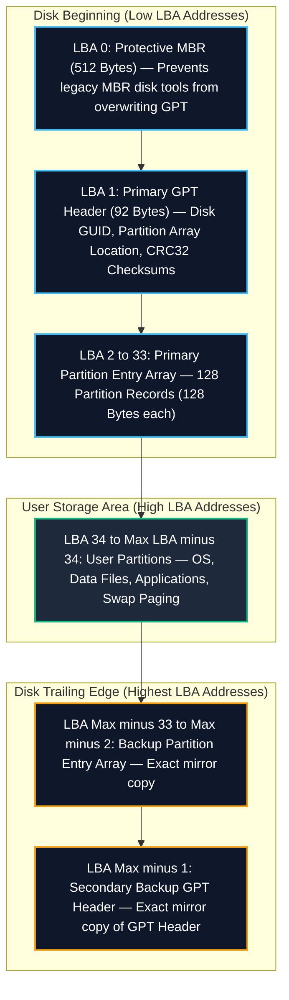
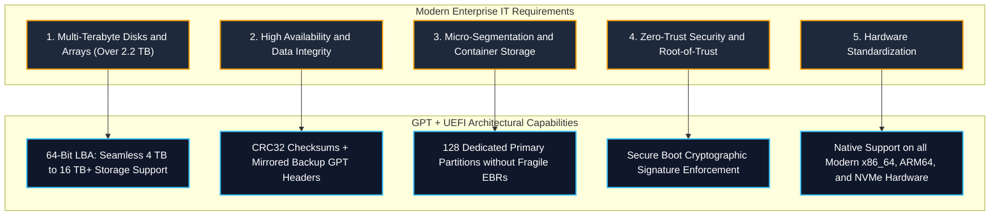

# System and Network Administration (SNA)
# Assignment 02: Comparative Analysis of MBR and GPT Partitioning Schemes

> **Course:** BSIT — System and Network Administration (SNA)  
> **Topic:** Storage Architecture: Master Boot Record (MBR) vs. GUID Partition Table (GPT)  
> **Document Type:** Academic Coursework Assignment & Architectural Comparison  
> **Target Audience:** Systems Administrators, Storage Engineers, and Infrastructure Architects  

---

## 📌 Assignment Overview & Topic

> [!IMPORTANT]
> **Assignment Problem Statement**  
> *"Compare MBR and GPT partitioning schemes in terms of disk capacity, partition limits, structure, reliability, BIOS/UEFI compatibility, and boot process, and recommend a suitable partitioning scheme for a modern computer or server with justification."*

### Why Storage Partitioning Architecture Matters
Before an operating system can store files, databases, or application packages on a physical drive, the drive must be divided into designated storage regions known as **partitions**. How the operating system maps, tracks, and locates these partitions depends entirely on the underlying **partitioning scheme**.

For decades, the computing industry relied on the **Master Boot Record (MBR)** scheme introduced in 1983 with IBM PC DOS 2.0. However, the explosive growth of disk capacities, virtualization, multi-terabyte enterprise storage arrays, and advanced firmware necessitated a modern standard: the **Globally Unique Identifier (GUID) Partition Table (GPT)**, developed by Intel as part of the Unified Extensible Firmware Interface (UEFI) specification.

Understanding the deep architectural contrasts between MBR and GPT is critical for systems administrators to ensure storage scalability, hardware compatibility, and operating system boot reliability.

---

## 🧠 Core Objectives & Student Learning Outcomes

By studying this comparative report, students and administrators will be able to:

1. **Understand Storage Layers:** Distinguish clearly between raw physical storage media, partition tables, logical partitions, and formatted filesystems.
2. **Deconstruct MBR Sector 0:** Analyze the internal structure of the 512-byte Master Boot Record, including bootstrap code, 16-byte partition entries, and the boot signature.
3. **Calculate the 2.2 TiB Barrier:** Mathematically derive why 32-bit Logical Block Addressing (LBA) limits MBR disks to 2.19 Terabytes at standard 512-byte sector sizes.
4. **Deconstruct GPT Layout:** Examine the multi-sector layout of GPT, including the Protective MBR, Primary GPT Header, Partition Entry Array, and Secondary (Backup) GPT structures.
5. **Evaluate Reliability & Data Integrity:** Contrast MBR's single point of failure with GPT's dual redundancy and CRC32 cyclic redundancy checksum verification.
6. **Compare Firmware & Boot Chains:** Trace the hardware initialization and execution pathway from Legacy BIOS to MBR boot code, contrasted with UEFI firmware loading signed EFI binaries from the EFI System Partition (ESP).
7. **Formulate Architectural Recommendations:** Justify why GPT combined with UEFI firmware is the mandatory standard for modern workstations, cloud instances, and enterprise servers.

---

## 1. Storage Fundamentals: Physical Media, Partition Tables, and Filesystems

To evaluate partitioning schemes accurately, one must first understand where the partition table fits within the broader storage hierarchy:



1. **Physical Storage Medium:** The physical hardware (SATA HDD, NVMe SSD, or virtual disk image) presented as an unbroken sequence of logical blocks or sectors, typically 512 bytes or 4,096 bytes (4Kn) in size.
2. **Partition Table Scheme (MBR or GPT):** The structural index written at designated sectors that divides the physical drive into logical segments by recording their starting sector, ending sector, partition type, and operational flags.
3. **Partitions:** Contiguous blocks of sectors isolated from one another to enable multi-boot environments, performance optimization, and failure containment.
4. **Filesystem:** The internal structure (allocation tables, directories, inodes) written inside a partition to organize files and folders.

---

## 2. Master Boot Record (MBR) Architecture

### A. Internal Structure of Sector 0
In the MBR scheme, all partitioning information and initial bootstrap code are packed entirely into the first physical sector of the drive (**Sector 0**, or LBA 0), comprising exactly **512 bytes**:

```text
+-------------------------------------------------------------------------+
|                  Master Boot Record (MBR) — Sector 0 (512 Bytes)         |
+------------------------------------+-------------------+----------------+
| Bootstrap Machine Code             | Partition Table   | Boot Signature |
| (Stage 1 Bootloader)               | (4 Entries x 16B) | (Magic Number) |
| 446 Bytes                          | 64 Bytes          | 2 Bytes        |
+------------------------------------+-------------------+----------------+
| Bytes 0x000 - 0x1BD                | Bytes 0x1BE-0x1FD | 0x1FE - 0x1FF  |
+------------------------------------+-------------------+----------------+
```

1. **Bootstrap Code Area (446 Bytes):**
   - Contains 16-bit x86 machine instructions executed by the motherboard BIOS during the power-on sequence.
   - Responsible for scanning the partition table, locating the partition flagged as "active" or "bootable", and loading its Volume Boot Record (VBR) into RAM.
2. **Partition Table Area (64 Bytes):**
   - Stores exactly four 16-byte partition records.
   - Because 64 bytes divided by 16 bytes equals 4, an MBR disk can hold a maximum of **four primary partitions**.
3. **Boot Signature / Magic Number (2 Bytes):**
   - Always contains the hexadecimal values `0x55` and `0xAA` (displayed as `0xAA55` in little-endian format).
   - If these 2 bytes are missing or corrupted, the BIOS rejects the disk as non-bootable and halts with errors such as *"Operating System not found"*.

---

### B. Anatomy of a 16-Byte MBR Partition Record
Each of the four partition table records consists of 16 bytes organized as follows:

| Byte Offset | Size | Field Name | Description |
|---|---|---|---|
| `0x00` | 1 Byte | **Boot Indicator / Drive Status** | `0x80` indicates active/bootable; `0x00` indicates non-bootable. |
| `0x01 - 0x03` | 3 Bytes | **Starting CHS Address** | Legacy Cylinder-Head-Sector coordinates (obsolete on modern drives). |
| `0x04` | 1 Byte | **Partition Type (System ID)** | Hex code identifying filesystem/purpose (`0x83` = Linux, `0x82` = Swap, `0x07` = NTFS). |
| `0x05 - 0x07` | 3 Bytes | **Ending CHS Address** | Legacy Cylinder-Head-Sector end coordinates. |
| `0x08 - 0x0B` | 4 Bytes (32 bits) | **Starting LBA Sector** | 32-bit integer indicating the starting sector offset from disk start. |
| `0x0C - 0x0F` | 4 Bytes (32 bits) | **Total Sectors in Partition** | 32-bit integer defining the partition's total sector count. |

---

### C. The Mathematical 2.2 Terabyte (2 TiB) Limit
The single greatest operational limitation of MBR is its inability to address disks larger than **2.19 Terabytes (2 TiB)**. This limitation is a direct mathematical consequence of 32-bit field widths:

$$\text{Max Addressable Sectors} = 2^{32} = 4,294,967,296 \text{ sectors}$$

$$\text{Max Addressable Capacity} = 4,294,967,296 \times 512 \text{ bytes} = 2,199,023,255,552 \text{ bytes}$$

Converting to binary tebibytes (TiB):

$$\frac{2,199,023,255,552}{1024^4} = 2.0 \text{ TiB} \approx 2.199 \text{ TB}$$

> [!WARNING]
> If an administrator installs an MBR partition table on a 4 TB, 8 TB, or 16 TB enterprise hard drive, any capacity beyond 2.2 TB is completely invisible and inaccessible to the operating system kernel. The remaining storage is wasted.

---

### D. The Extended Partition Workaround (Chained EBRs)
Because MBR only allows four entries in Sector 0, early systems engineers introduced **Extended Partitions** and **Logical Partitions** to bypass the 4-partition limit:
- Administrators can designate one of the four primary slots as an **Extended Partition** (Partition Type `0x05` or `0x0F`).
- The extended partition acts as an envelope containing an arbitrary number of **Logical Partitions**.
- Logical partitions are tracked via a linked list of **Extended Boot Records (EBR)** scattered across the disk.

**Structural Flaws of Chained EBRs:**
1. **Fragile Linked List:** If a single sector containing one intermediate EBR is damaged or overwritten, all subsequent logical partitions downstream in the chain become lost to the operating system.
2. **Boot Inflexibility:** Operating system bootloaders cannot execute directly from logical partitions on legacy systems without specialized multi-stage boot managers.

---

## 3. GUID Partition Table (GPT) Architecture

### A. Layout Across the Storage Medium
The GUID Partition Table (GPT) completely abandons the single-sector constraints of MBR. It structures the disk across dedicated reserved sectors at both the **beginning (Primary GPT)** and the **very end (Secondary/Backup GPT)** of the physical drive:



---

### B. Deconstructing Key GPT Architectural Components

#### 1. Protective MBR (LBA 0)
To maintain backward compatibility and safeguard modern storage from obsolete utilities:
- Sector 0 of a GPT disk contains an intentionally crafted MBR structure.
- It contains a single partition entry covering the entire disk with partition type **`0xEE`** (*GPT Protective*).
- **Security Safeguard:** If an older operating system or legacy partitioning tool (that does not understand GPT) inspects the drive, it sees the entire disk as a single occupied unknown partition. It will refuse to touch or overwrite the disk, preventing catastrophic data destruction.

#### 2. Primary GPT Header (LBA 1)
The GPT Header defines the structural boundaries of the disk:
- **Signature:** 8-byte ASCII string `"EFI PART"` (`0x5452415020494645`).
- **Disk GUID:** A 128-bit Globally Unique Identifier assigned randomly at initialization to identify the physical drive unambiguously.
- **LBA Pointers:** Records its own location (LBA 1), the alternate backup header location (trailing sector), the first usable LBA for data (LBA 34), and the last usable LBA.
- **CRC32 Checksums:** Stores a 32-bit CRC checksum of the header itself and a separate CRC32 checksum of the partition entry array.

#### 3. Partition Entry Array (LBA 2 to 33)
The UEFI standard mandates storage space for at least **128 partition entries**:
- Each partition record is allocated **128 bytes** of metadata.
- 128 entries multiplied by 128 bytes equals 16,384 bytes (16 KiB).
- On standard 512-byte sector disks, this array occupies exactly **32 sectors** (LBA 2 through LBA 33).
- **Every partition is a primary partition:** GPT eliminates extended partitions and logical partitions entirely.

#### 4. Anatomy of a 128-Byte GPT Partition Record
Unlike MBR's cramped 16-byte record, GPT devotes 128 bytes to each individual partition:

| Offset (Bytes) | Size | Field Name | Description |
|---|---|---|---|
| `0x00 - 0x0F` | 16 Bytes (128 bits) | **Partition Type GUID** | Unique 128-bit identifier defining partition purpose (e.g., Linux filesystem, EFI System Partition). |
| `0x10 - 0x1F` | 16 Bytes (128 bits) | **Unique Partition GUID** | Unique 128-bit identifier generated specifically for this individual partition. |
| `0x20 - 0x27` | 8 Bytes (64 bits) | **Starting LBA Address** | 64-bit integer pointing to the beginning sector. |
| `0x28 - 0x2F` | 8 Bytes (64 bits) | **Ending LBA Address** | 64-bit integer pointing to the terminating sector. |
| `0x30 - 0x37` | 8 Bytes (64 bits) | **Attribute Flags** | Bit flags denoting read-only, hidden, no-automount, or system-critical status. |
| `0x38 - 0x7F` | 72 Bytes | **Partition Name** | UTF-16LE encoded human-readable label (up to 36 characters) directly stored on disk. |

#### 5. 64-Bit Logical Block Addressing (LBA) Capacity
GPT utilizes **64-bit integers** to store starting and ending sector numbers:

$$\text{Max Addressable Sectors} = 2^{64} = 18,446,744,073,709,551,616 \text{ sectors}$$

$$\text{Max Capacity (512B Sectors)} = 2^{64} \times 512 \text{ bytes} = 9.44 \times 10^{21} \text{ bytes} \approx 9.4 \text{ Zettabytes (ZB)}$$

$$\text{Max Capacity (4KB Sectors)} = 2^{64} \times 4096 \text{ bytes} \approx 75.5 \text{ Zettabytes (ZB)}$$

> [!NOTE]
> 1 Zettabyte equals 1 Billion Terabytes. GPT's theoretical ceiling guarantees that the partitioning architecture will not become a bottleneck for enterprise storage architectures for the foreseeable future.

---

## 4. Comprehensive Comparison: MBR vs. GPT

The following matrix contrasts every critical architectural dimension of MBR and GPT:

| Comparison Dimension | Master Boot Record (MBR) | GUID Partition Table (GPT) |
|---|---|---|
| **Year of Introduction** | 1983 (IBM PC DOS 2.0) | 1999 (Intel EFI / UEFI Specification) |
| **Addressing Bit-Width** | 32-bit Logical Block Addressing (LBA) | 64-bit Logical Block Addressing (LBA) |
| **Maximum Disk Capacity** | **2.2 Terabytes (2.0 TiB)** | **9.4 Zettabytes (9.4 Billion Terabytes)** |
| **Partition Limit** | 4 Primary partitions (or 3 Primary + 1 Extended containing linked Logical partitions) | **128 Primary partitions** by default (standard permits expansion beyond 128) |
| **Partition Types** | 1-Byte Hex Codes (`0x83`, `0x82`, `0x07`, `0xFD`) | 16-Byte (128-bit) Globally Unique Identifiers (UUID / GUID) |
| **Partition Naming** | Not supported (relies on filesystem volume labels) | Built-in 36-character UTF-16LE partition label in table |
| **On-Disk Metadata Location** | Concentrated exclusively in Sector 0 (LBA 0) | Distributed across LBA 0-33 and mirrored at disk trailing edge |
| **Structural Redundancy** | **None.** Single point of failure. | **Dual redundancy.** Primary GPT at start; Secondary Backup GPT at end. |
| **Data Integrity Verification** | None. Corrupted partition tables are undetected until system crashes. | **CRC32 Checksums** on headers and partition arrays. Automatic corruption detection. |
| **Firmware Compatibility** | Native to **Legacy BIOS**; supported on UEFI via CSM | Native to **UEFI**; usable with BIOS as non-boot secondary data drives |
| **Boot Mechanism** | Executes raw 446-byte machine code in Sector 0 | Firmware parses FAT32 EFI System Partition (ESP) to load `.efi` binaries |
| **Security Architecture** | Highly vulnerable to bootkits, rootkits, and MBR overwrite attacks | Integrated with **UEFI Secure Boot** cryptographic signature enforcement |

---

## 5. Firmware Compatibility and the Boot Process

The partitioning scheme is inextricably linked to the underlying motherboard firmware: **Legacy BIOS** or **Modern UEFI**.


---

### A. The Legacy BIOS + MBR Boot Process
1. **Power-On Self-Test (POST):** The 16-bit BIOS tests motherboard hardware components in real mode.
2. **Reading Sector 0:** The BIOS accesses the first bootable device configured in CMOS and reads the 512 bytes of Sector 0 into physical RAM at address `0x7C00`.
3. **Stage 1 Bootloader Execution:** CPU control is transferred directly to the 446 bytes of machine code in the MBR.
4. **Active Partition Scanning:** The MBR code parses the 64-byte partition table, searching for an entry with the boot flag set to `0x80`.
5. **Volume Boot Record (VBR) Hand-off:** Once the active partition is identified, the MBR reads the first sector of that partition (the Volume Boot Record or Partition Boot Record) into RAM.
6. **Kernel Hand-off:** The VBR loads additional bootloader stages (e.g., GRUB legacy stage 1.5/2), which mount the filesystem and initialize the operating system kernel.

#### Critical Vulnerabilities of the BIOS-MBR Boot Sequence
- **Space Constraints:** 446 bytes is too small to understand modern filesystems; bootloaders must rely on dangerous multi-stage sector chaining.
- **Blind Execution:** The BIOS blindly executes whatever machine code resides in Sector 0 without checking authenticity or integrity.
- **Bootkit Susceptibility:** Malware can trivially overwrite the 446-byte bootstrap code to intercept system execution before the operating system kernel boots.

---

### B. The Modern UEFI + GPT Boot Process
1. **Hardware Initialization:** UEFI firmware operates in full 32-bit or 64-bit protected/long mode, initializing hardware components with independent native device drivers.
2. **NVRAM Variable Inspection:** UEFI reads its boot list directly from non-volatile RAM (NVRAM), identifying specific boot targets by their unique GUIDs and filesystem paths (e.g., `\EFI\redhat\grubx64.efi` or `\EFI\Microsoft\Boot\bootmgfw.efi`).
3. **Mounting the EFI System Partition (ESP):**
   - The ESP is a dedicated partition on a GPT drive formatted with a standard FAT16/FAT32 filesystem.
   - It possesses the distinct Partition Type GUID: `c12a7328-f81f-11d2-ba4b-00a0c93ec93b`.
4. **Secure Boot Cryptographic Verification:**
   - If UEFI Secure Boot is active, firmware verifies the digital signature of the target `.efi` executable against trusted keys embedded in firmware NVRAM (PK, KEK, db).
   - If the signature is invalid or belongs to a revoked key (dbx), execution is halted immediately.
5. **Direct Binary Execution:** UEFI loads the validated bootloader directly into RAM, which loads the kernel, initramfs, and starts the operating system.

---

## 6. Reliability, Redundancy, and Fault Tolerance Analysis

Reliability is the most decisive architectural divergence between MBR and GPT for mission-critical enterprise environments:

### A. The Single Point of Failure (SPOF) in MBR
- In MBR, the entire storage layout exists in **exactly one location**: Sector 0.
- If Sector 0 develops physical bad sectors, suffers a silent write drop during a power outage, or is partially overwritten by rogue installer software, the entire disk structure is destroyed.
- The operating system has no secondary on-disk copy to restore from, requiring labor-intensive forensic partition recovery utilities or full backups.

### B. Dual Redundancy and Self-Healing in GPT
- GPT writes two complete copies of its organizational metadata:
  1. **Primary GPT:** Located at the start of the disk (LBA 1 through LBA 33).
  2. **Secondary / Backup GPT:** Located at the very end of the disk (occupying the last 33 sectors).
- If the primary header is damaged by accidental block overwriting or media corruption, the operating system kernel detects the failure and automatically restores the primary partition table from the secondary backup copy at the trailing edge of the drive.

### C. Active Integrity Verification via CRC32 Checksums
- GPT incorporates **Cyclic Redundancy Checks (CRC32)** directly into its headers:
  - Header CRC32 validates the integrity of the header itself.
  - Partition Array CRC32 validates the contents of all 128 partition records.
- When the system initializes, the firmware and kernel compute the live CRC32 value and compare it against the value stored in the header.
- **Silent Corruption Defense:** If bit rot, electrical noise, or incomplete writes alter a single byte in the partition table, the checksum mismatch flags the error immediately before the system can corrupt user data. MBR possesses zero internal integrity verification.

---

## 7. Recommendation and Architectural Justification

### Official Recommendation
> [!IMPORTANT]
> **Definitive Recommendation:**  
> For any modern computer, workstation, enterprise server, cloud instance, or storage array, **GUID Partition Table (GPT) combined with UEFI firmware is the mandatory architectural standard.**  
> Master Boot Record (MBR) should be treated as a legacy deprecated technology, utilized strictly when maintaining legacy 32-bit hardware or retro operating systems.

---

### Architectural Justification Matrix for Modern Systems



#### 1. Disk Capacity Requirements in the NVMe / Big Data Era
Modern server storage drives routinely range from 4 TB to 24 TB, and enterprise SAN/LUN storage presentations frequently scale into hundreds of terabytes. MBR's hard mathematical limit of 2.2 TB renders it obsolete for modern infrastructure. GPT allows organizations to utilize full drive capacities without artificial volume slicing.

#### 2. Resiliency and Business Continuity
Enterprise high-availability environments cannot tolerate data loss caused by single-sector failures. GPT's secondary backup table and CRC32 error detection provide autonomous recovery mechanisms against sector corruption and power-loss write aborts.

#### 3. Partition Density for Complex Server Architectures
Production Linux servers require fine-grained storage segregation (`/`, `/boot`, `/boot/efi`, `/var`, `/var/log`, `/var/log/audit`, `/tmp`, `/home`, and dedicated database LUNs) to satisfy security benchmarks like CIS (Center for Internet Security) and DISA STIG. GPT easily accommodates these partitions natively, eliminating the unstable linked-list EBR chains required by MBR.

#### 4. Security Hardening & Zero-Trust Boot Chains
Modern cybersecurity standards require verifying the entire boot chain from hardware power-on to the user shell. Because MBR executes unverified machine code from Sector 0, it is fundamentally incompatible with **UEFI Secure Boot**. GPT provides the structured FAT32 EFI System Partition required to validate digital signatures, protecting enterprise systems against firmware-level bootkits and kernel-level rootkits.

#### 5. Industry Hardware Standardization
Intel, AMD, Microsoft, and Red Hat have formally phased out support for Legacy BIOS and the Compatibility Support Module (CSM) on server motherboards and client hardware. Modern server platforms (such as Intel Xeon Scalable and AMD EPYC architectures) ship exclusively with UEFI firmware, making GPT the sole supported bootable storage standard.

---

### When is MBR Still Acceptable?
MBR remains relevant strictly in niche, legacy-constrained scenarios:
1. **Legacy Embedded Systems:** Industrial controllers and older network appliances running specialized 32-bit real-time operating systems.
2. **Vintage Virtual Machines:** Maintaining unmaintained legacy guest operating systems (e.g., Windows XP, Windows Server 2003, or Linux kernels older than version 2.6).
3. **Small Removable Flash Drives:** Small USB drives (under 32 GB) intended for universal plug-and-play compatibility across ancient multimedia players, automotive audio consoles, and legacy BIOS diagnostic tools.

---

## 8. Summary Comparison Cheatsheet

```text
=================================================================================================
FEATURE / METRIC            MASTER BOOT RECORD (MBR)             GUID PARTITION TABLE (GPT)
=================================================================================================
Introduced                  1983 (PC DOS 2.0)                    1999 (Intel EFI / UEFI)
Addressing Bit Width        32-bit Logical Block Addressing      64-bit Logical Block Addressing
Max Usable Disk Capacity    2.19 Terabytes (2.0 TiB)             9.4 Zettabytes (9.4 Billion TB)
Max Primary Partitions      4 Primary Partitions                 128 Primary Partitions (minimum)
Sub-partitioning Hack       1 Extended containing Logical EBRs   None needed (all primary)
Partition Identification    1-Byte Hex System ID (e.g., 0x83)    16-Byte Unique GUID (UUID)
Partition Naming            None                                 36-character UTF-16LE labels
Structural Redundancy       None (Sector 0 is SPOF)              Dual (Primary at start, Backup at end)
Integrity Verification      None (silent corruption possible)    CRC32 Checksums on header & array
Firmware Compatibility      Legacy BIOS (native)                 UEFI (native)
Boot Code Location          446 Bytes raw code in Sector 0       Executable .efi binary in FAT32 ESP
Secure Boot Enforcement     Not possible                         Fully integrated with UEFI Secure Boot
Standard Modern Use Case    Legacy 32-bit hardware / Retro VMs   All modern servers, PCs & cloud VMs
=================================================================================================
```

---

## 9. Conclusion

The transition from Master Boot Record (MBR) to GUID Partition Table (GPT) represents one of the most critical evolutions in modern computer architecture:
- MBR served the computing industry effectively during the early PC era, but its 32-bit addressing, 512-byte Sector 0 bottleneck, 4-partition limit, and total absence of data redundancy make it completely unsuitable for 21st-century enterprise computing.
- GPT establishes an extensible, highly resilient, and mathematically unconstrained storage architecture. With 64-bit addressing capable of managing 9.4 Zettabytes, dual header redundancy, CRC32 integrity validation, 128 primary partitions, and native integration with UEFI Secure Boot, GPT is the indispensable foundation for modern systems administration, virtualization, and enterprise server infrastructure.
