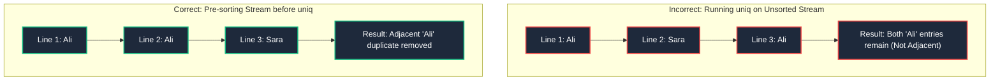

# System and Network Administration (SNA)
# Assignment 03: Linux Text Processing and Regular Expressions

> **Course:** BSIT — System and Network Administration (SNA)  
> **Topic:** Core Command-Line Text Processing Filters and Regular Expressions  
> **Document Type:** Coursework Assignment & Comprehensive Operational Reference  
> **Target Audience:** Systems Administrators, Network Engineers, and Security Analysts  

---

## 📌 Assignment Overview & Problem Statement

This assignment evaluates practical proficiency in Unix text stream processing, pipeline orchestration, character filtering, deduplication, and pattern matching using regular expressions (Regex).

### The Assignment Problem Set

```text
1. You are given a file students.txt containing student names. Some names are repeated and are not in alphabetical order. 
   Write commands to:
   - Display the file contents.
   - Sort the names alphabetically.
   - Display only unique names.
   - Count the total number of lines.

2. How to count the number of words in a file named report.txt. Write the appropriate command.

3. A file named data.txt contains duplicate entries. Write a command to display the duplicate-free entries.

4. A file has the following data:
   Ali BSCS 21
    Ahmed BSIT 22
    Sara BSCS 23
   Usman BSIT 24
    Ayesha BSCS 25 

   Write regular expressions to:
   a) Find lines starting with A.
   b) Find lines ending with BSCS.
   c) Find lines containing a two-digit number.
   d) Find lines containing the word BSIT.
   e) Find names beginning with a capital letter.

5. Write a regular expression to find all lines containing at least one digit.
```

---

## 🧠 Core Objectives & Student Learning Outcomes

By studying and completing this assignment, students and administrators will be able to:

1. **Leverage the Unix Philosophy:** Combine modular single-purpose utilities (`cat`, `sort`, `uniq`, `wc`, `grep`) using standard input/output streams and pipes (`|`).
2. **Master Collation & Sorting:** Understand ASCII and dictionary sorting mechanisms, reverse sorting, and numeric sorting using `sort`.
3. **Execute Stream Deduplication:** Explain why `uniq` requires pre-sorted input due to its adjacent-line comparison algorithm, and utilize `sort -u` for consolidated deduplication.
4. **Quantify Text Metrics with `wc`:** Correctly measure newlines, words, byte counts, and multi-byte characters across structured and unstructured text files.
5. **Construct Robust Regular Expressions:** Differentiate between Basic Regular Expressions (BRE) and Extended Regular Expressions (ERE), apply position anchors (`^`, `$`), word boundaries (`\b`), and character classes (`[0-9]`, `[A-Z]`).
6. **Handle Real-World Whitespace Variations:** Formulate regex patterns that gracefully handle leading, trailing, and irregular whitespace in real-world logs and tabular datasets.

---

## 1. Architectural Foundations: The Unix Pipeline Model

In Unix-like operating systems, text is the universal interface. Administrative utilities communicate via continuous byte streams organized into three standard file descriptors:

```mermaid
graph LR
    subgraph Stream_Sources ["Input Stream"]
        File["Data File (e.g., students.txt)"]
    end

    subgraph Pipeline_Processing ["Pipeline Processing Engine (stdout to stdin)"]
        Utility1["sort (Collate & Order)"]
        Utility2["uniq (Filter Adjacent Duplicates)"]
        Utility3["wc -l (Count Line Newlines)"]
    end

    subgraph Stream_Sinks ["Output Stream"]
        Terminal["Console Display (stdout)"]
    end

    File -->|Read Lines| Utility1
    Utility1 -->|Pipe stdout to stdin| Utility2
    Utility2 -->|Pipe stdout to stdin| Utility3
    Utility3 -->|Final Metric| Terminal

    classDef srcNode fill:#1e293b,stroke:#94a3b8,stroke-width:2px,color:#fff;
    classDef pipeNode fill:#0f172a,stroke:#38bdf8,stroke-width:2px,color:#fff;
    classDef sinkNode fill:#1e293b,stroke:#10b981,stroke-width:2px,color:#fff;

    class File srcNode;
    class Utility1,Utility2,Utility3 pipeNode;
    class Terminal sinkNode;
```



- **Standard Input (`stdin`, FD 0):** The stream from which commands read incoming data.
- **Standard Output (`stdout`, FD 1):** The stream to which commands send successful output.
- **The Pipe (`|`):** Connects the `stdout` of the preceding command directly to the `stdin` of the succeeding command in kernel memory without creating intermediate temporary files on disk.

---

## 2. Comprehensive Solutions & Deep-Dive Analysis

---

### Task 1: Student Records File (`students.txt`)

#### Scenario Data Setup
Suppose `/home/kashif/students.txt` contains the following unordered records with repeated names:

```text
Usman
Ali
Sara
Ahmed
Ali
Zain
Sara
Bilal
Ahmed
```

---

#### 1.1 Command to Display the File Contents

```bash
cat students.txt
```

**Underlying Mechanism & Explanation:**
- `cat` (concatenate) reads the file sequentially from the beginning to the end of file (EOF) marker and emits its contents directly to `stdout`.
- **Alternative Interactive Utilities:** For viewing large files that exceed the terminal buffer height, administrators utilize `less students.txt` (pageable navigation) or `nl students.txt` / `cat -n students.txt` to display line numbers alongside the records.

---

#### 1.2 Command to Sort the Names Alphabetically

```bash
sort students.txt
```

**Expected Terminal Output:**
```text
Ahmed
Ahmed
Ali
Ali
Bilal
Sara
Sara
Usman
Zain
```

**Underlying Mechanism & Explanation:**
- `sort` reads lines from input and arranges them according to ASCII / Unicode collation sequence.
- By default, `sort` compares characters starting from the first character of each line.
- **Useful Operational Flags:**
  - `sort -r students.txt`: Reverse alphabetical order (Z to A).
  - `sort -f students.txt`: Case-insensitive sort (treats `a` and `A` as equal).

---

#### 1.3 Command to Display Only Unique Names

There are two primary industry-standard approaches to deduplication:

##### Method A: Pipeline with `sort` and `uniq` (Standard Unix Methodology)
```bash
sort students.txt | uniq
```

##### Method B: Direct Consolidated Deduplication with `sort -u` (Optimized Single Utility)
```bash
sort -u students.txt
```

**Expected Terminal Output:**
```text
Ahmed
Ali
Bilal
Sara
Usman
Zain
```

**Critical Technical Deep-Dive: Why Must `sort` Precede `uniq`?**
A frequent mistake made by junior administrators is running `uniq students.txt` directly on an unsorted file. 

The `uniq` utility uses an **adjacent-line algorithm**: it reads the input stream line by line and compares the current line *only to the immediately preceding line*. If two identical lines are separated by other lines, `uniq` will **not** detect them as duplicates!



- When `sort` runs first, identical lines are gathered into contiguous adjacent blocks.
- `uniq` then processes the sorted stream and successfully strips every consecutive repeated line.
- Alternatively, `sort -u` performs internal sorting and unique-filtering in a single pass, saving memory and CPU cycles on large datasets.

---

#### 1.4 Command to Count the Total Number of Lines

```bash
wc -l students.txt
```

**Expected Output:**
```text
9 students.txt
```

**To output only the numeric value without the filename (ideal for shell scripts):**
```bash
wc -l < students.txt
# OR via pipeline:
cat students.txt | wc -l
```

**Underlying Mechanism:**
- `wc -l` counts the number of newline characters (`\n`, ASCII `0x0A`) present in the file stream.
- **Counting Unique Lines Only:** To count how many *distinct* students exist in the file:
  ```bash
  sort -u students.txt | wc -l
  # Output: 6
  ```

---

### Task 2: Counting Words in `report.txt`

#### Target Command
```bash
wc -w report.txt
```

**To suppress the filename in automated scripts:**
```bash
wc -w < report.txt
```

---

#### Technical Breakdown of the Word Count Utility (`wc`)

The `wc` (word count) utility analyzes text files across multiple statistical dimensions based on specific operational flags:

| Command / Flag | Metric Counted | Definition in Linux Subsystem |
|---|---|---|
| **`wc -w`** | **Words** | Contiguous sequences of non-whitespace characters delimited by spaces, tabs, or newlines. |
| **`wc -l`** | **Lines** | Total count of newline characters (`\n`). |
| **`wc -c`** | **Bytes** | Raw physical byte count of the file. |
| **`wc -m`** | **Characters** | Total character count (distinguishes multi-byte UTF-8 characters from raw bytes). |
| **`wc -L`** | **Max Line Length** | Returns the length (in characters) of the single longest line in the file. |
| **`wc report.txt`** | **Summary Trio** | Emits three default columns: lines, words, and bytes. |

**Demonstration Example:**
If `report.txt` contains:
```text
The Linux kernel manages system memory, storage drives, and CPU scheduling.
Virtual memory paging prevents unexpected system crashes.
```

Executing `wc report.txt` produces:
```text
 2 16 134 report.txt
```
*(Interpretation: 2 lines, 16 words, 134 bytes).*

---

### Task 3: Displaying Duplicate-Free Entries in `data.txt`

#### Target Command
```bash
sort -u data.txt
```
*(Or the classic pipeline equivalent: `sort data.txt | uniq`)*

---

#### Advanced Deduplication and Analysis with `uniq`

The `uniq` utility provides specialized options for diagnosing data corruption, auditing duplicate submissions, or extracting clean records:

| Command Variant | Operational Behavior | Practical SysAdmin Use Case |
|---|---|---|
| **`sort data.txt \| uniq`** | Standard deduplication: emits one copy of every unique and duplicate line. | Creating clean, deduplicated lookup tables. |
| **`sort data.txt \| uniq -u`** | **Strict uniqueness:** Emits *only* lines that appeared exactly once in the entire file. | Identifying unique transactions or non-colliding IDs. |
| **`sort data.txt \| uniq -d`** | **Duplicate detection:** Emits *only* lines that had duplicates (one copy per duplicate set). | Auditing duplicate network requests or repeated logins. |
| **`sort data.txt \| uniq -c`** | **Frequency counting:** Prefixes each line with the exact count of how many times it appeared. | Generating frequency histograms (e.g., top IP addresses). |
| **`sort data.txt \| uniq -c \| sort -nr`** | **Top Frequency Analysis:** Sorts lines numerically in reverse order by occurrence count. | Security analysis: ranking top attacking IP addresses. |

---

### Task 4: Regular Expressions on Structured Records

#### The Dataset
A text file (e.g., `records.txt`) contains the following student academic records:

```text
Ali BSCS 21
 Ahmed BSIT 22
 Sara BSCS 23
Usman BSIT 24
 Ayesha BSCS 25 
```

> [!NOTE]
> **Real-World Data Observation:**
> Notice that lines 2, 3, and 5 have **leading whitespace** (` Ahmed`, ` Sara`, ` Ayesha`), and line 5 has a **trailing space** (`25 `). In enterprise production environments, log files and CSV dumps frequently contain irregular whitespace. Professional administrators formulate regex patterns that account for these boundary conditions.

---

#### 4.a Find Lines Starting with 'A'

##### Strict Line-Beginning Anchor (No Leading Whitespace)
If the character `A` must appear as the very first character of the line at index 0:
- **Regular Expression:** `^A`
- **Execution Command:**
  ```bash
  grep '^A' records.txt
  ```
- **Matching Record:**
  - `Ali BSCS 21`

##### Robust Production Regex (Tolerates Optional Leading Whitespace)
In real-world data where names may be indented or preceded by spaces or tabs:
- **Regular Expression:** `^[[:space:]]*A` *(or `^\s*A` with ERE)*
- **Execution Command:**
  ```bash
  grep -E '^\s*A' records.txt
  ```
- **Matching Records:**
  - `Ali BSCS 21`
  - ` Ahmed BSIT 22`
  - ` Ayesha BSCS 25 `

**Syntax Explanation:**
- `^`: Line-start anchor. Asserts position at the beginning of a line.
- `\s*` or `[[:space:]]*`: Matches zero or more whitespace characters (spaces or tabs).
- `A`: Matches the literal capital letter 'A'.

---

#### 4.b Find Lines Ending with 'BSCS'

##### Strict Line-Ending Anchor (No Trailing Characters)
If `BSCS` is literally the terminating sequence on the line:
- **Regular Expression:** `BSCS$`
- **Execution Command:**
  ```bash
  grep 'BSCS$' records.txt
  ```
- **Analysis:** In the provided dataset, every line ends with an age number (`21`, `22`, `23`, `24`, `25`), so a strict `BSCS$` returns zero matches.

##### Regex to Match Records Where Degree is BSCS (Regardless of Trailing Fields)
To match lines that contain the degree `BSCS` before the trailing age number:
- **Regular Expression:** `\<BSCS\>` *(BRE)* or `\bBSCS\b` *(ERE)*
- **Execution Command:**
  ```bash
  grep -E '\bBSCS\b' records.txt
  ```
- **Matching Records:**
  - `Ali BSCS 21`
  - ` Sara BSCS 23`
  - ` Ayesha BSCS 25 `

##### Regex for Lines Ending with BSCS and Optional Trailing Spaces
If records ended with BSCS followed by accidental trailing spaces:
- **Regular Expression:** `BSCS[[:space:]]*$` *(or `BSCS\s*$`)*
- **Execution Command:**
  ```bash
  grep -E 'BSCS\s*$' records.txt
  ```

---

#### 4.c Find Lines Containing a Two-Digit Number

##### Regular Expression
- **BRE Syntax:** `[0-9][0-9]` or `[0-9]\{2\}`
- **ERE Syntax:** `\b[0-9]{2}\b` or `\b\d{2}\b`

##### Execution Commands
```bash
# Using Basic Regular Expressions (BRE)
grep '[0-9]\{2\}' records.txt

# Using Extended Regular Expressions with Word Boundaries (ERE)
grep -E '\b[0-9]{2}\b' records.txt
```

##### Matching Records (Matches all 5 lines):
- `Ali BSCS 21` (matches `21`)
- ` Ahmed BSIT 22` (matches `22`)
- ` Sara BSCS 23` (matches `23`)
- `Usman BSIT 24` (matches `24`)
- ` Ayesha BSCS 25 ` (matches `25`)

##### Syntax Explanation:
- `\b`: Word boundary anchor. Ensures the digits are an isolated 2-digit number (e.g., `21`), preventing accidental matches against 3-digit or 4-digit numbers like `125` or `2026`.
- `[0-9]`: Character bracket class matching any decimal digit from 0 through 9.
- `{2}`: Interval quantifier specifying exactly two consecutive occurrences of the preceding element.

---

#### 4.d Find Lines Containing the Word 'BSIT'

##### Regular Expression
- **Standard Token Match:** `BSIT`
- **Exact Word Match (prevents matching `BSIT_ENG` or `NOT_BSIT`):** `\bBSIT\b` or `\<BSIT\>`

##### Execution Commands
```bash
# Using Extended Regular Expression word boundaries
grep -E '\bBSIT\b' records.txt

# Using standard grep -w (word boundary flag)
grep -w 'BSIT' records.txt
```

##### Matching Records:
- ` Ahmed BSIT 22`
- `Usman BSIT 24`

##### Syntax Explanation:
- `-w`: Instructs `grep` to match only whole words bounded by whitespace or punctuation.
- `\b`: Word boundary anchor. Asserts a transition between a word character (`[a-zA-Z0-9_]`) and a non-word character (space, tab, or newline).

---

#### 4.e Find Names Beginning with a Capital Letter

In structured tables where the first textual column represents a personal name, we anchor to the start of the word or line.

##### Regular Expression
- **At Start of Line (with optional leading whitespace):** `^\s*[A-Z][a-z]+`
- **Any Capitalized Word Boundary:** `\b[A-Z][a-z]+\b`

##### Execution Commands
```bash
# Match lines where the leading name starts with an uppercase letter
grep -E '^\s*[A-Z][a-z]+' records.txt

# Extract and highlight only the matching names themselves (-o flag)
grep -oE '^\s*[A-Z][a-z]+' records.txt
```

##### Matching Names:
- `Ali` (from `Ali BSCS 21`)
- `Ahmed` (from ` Ahmed BSIT 22`)
- `Sara` (from ` Sara BSCS 23`)
- `Usman` (from `Usman BSIT 24`)
- `Ayesha` (from ` Ayesha BSCS 25 `)

##### Syntax Explanation:
- `^\s*`: Matches the start of the line and any leading whitespace padding.
- `[A-Z]`: Matches exactly one uppercase alphabetic character (`A` through `Z`).
- `[a-z]+`: Matches one or more lowercase alphabetic characters (`a` through `z`) following the capital letter.

---

### Task 5: Matching Lines Containing at Least One Digit

#### The Regular Expression
- **POSIX Bracket Expression:** `[0-9]` or `[[:digit:]]`
- **Perl-Compatible Expression:** `\d`

#### Execution Commands
```bash
# Basic Regular Expression (Universal across all Linux versions)
grep '[0-9]' records.txt

# Using POSIX Character Class
grep '[[:digit:]]' records.txt

# Using Extended Regular Expressions with quantifier (one or more digits)
grep -E '[0-9]+' records.txt
```

---

#### Comprehensive Technical Analysis of Digit Matching

1. **Why `[0-9]` Suffices for "At Least One Digit":**
   - By default, `grep` checks if the pattern matches *anywhere* in the line.
   - The character class `[0-9]` matches a single digit. If a line contains zero digits, the pattern cannot match. If a line contains one, two, or ten digits, the pattern finds a match on the very first digit it encounters and immediately returns exit status `0` (match found), printing the line.
2. **Quantifier Variations:**
   - `[0-9]+`: Matches one or more consecutive digits.
   - `^[0-9]+$`: Matches lines that consist *exclusively* of digits from start to end (no letters or spaces).
3. **Inverting the Search (Finding Lines Without Any Digits):**
   - To extract lines that contain **no numbers at all**, utilize `grep -v`:
     ```bash
     grep -v '[0-9]' input.txt
     ```

---

## 3. Systematic Task Summary Matrix

The following table consolidates all five assignment questions into a quick-reference study guide:

| Task ID | Operational Requirement | Command / Solution | Key Syntax Mechanics |
|---|---|---|---|
| **1.1** | Display file contents | `cat students.txt` | Sequential output to standard output (`stdout`). |
| **1.2** | Sort alphabetically | `sort students.txt` | ASCII / Unicode dictionary collation. |
| **1.3** | Display unique names | `sort -u students.txt` | Pre-sorts records and strips adjacent duplicates in a single pass. |
| **1.4** | Count total lines | `wc -l students.txt` | Scans stream for newline characters (`\n`). |
| **2** | Count words in file | `wc -w report.txt` | Counts whitespace-delimited character tokens. |
| **3** | Display duplicate-free entries | `sort -u data.txt` | Eliminates all duplicate records across the entire dataset. |
| **4.a** | Lines starting with 'A' | `grep -E '^\s*A' records.txt` | Caret anchor `^` asserts line-start; `\s*` handles leading whitespace. |
| **4.b** | Lines ending with 'BSCS' | `grep 'BSCS$' records.txt` | Dollar anchor `$` asserts position immediately before newline. |
| **4.c** | Lines with 2-digit number | `grep -E '\b[0-9]{2}\b' records.txt` | `\b` enforces word boundary; `{2}` specifies exact 2-digit interval. |
| **4.d** | Lines with word 'BSIT' | `grep -w 'BSIT' records.txt` | `-w` matches whole word isolated by whitespace or punctuation. |
| **4.e** | Names with capital letter | `grep -E '^\s*[A-Z][a-z]+' records.txt` | `[A-Z]` matches initial capital; `[a-z]+` matches trailing lowercase. |
| **5** | Lines with at least 1 digit | `grep '[0-9]' input.txt` | Character class `[0-9]` matches any decimal digit from 0 to 9. |

---

## 4. Core Metacharacter Quick-Reference Guide

```text
====================================================================================================
METACHARACTER       PURPOSE / MEANING                    PRACTICAL EXAMPLE          MATCHES
====================================================================================================
^                   Anchor to start of line              ^Root                      Lines beginning with "Root"
$                   Anchor to end of line                bash$                      Lines terminating with "bash"
.                   Matches any single character         r..t                       "root", "rest", "r12t"
[abc]               Character set (match any one)        [Ff]ailed                  "Failed", "failed"
[^abc]              Negated set (match any except)       [^0-9]                     Any non-digit character
[0-9]               Range of digits                      [0-9]{3}                   3-digit numbers (e.g., 404, 500)
[a-z]               Range of lowercase letters           [a-z]+                     One or more lowercase letters
*                   Zero or more of preceding item       ab*c                       "ac", "abc", "abbbc"
+                   One or more of preceding item (ERE)  ab+c                       "abc", "abbc" (not "ac")
?                   Zero or one of preceding item (ERE)  https?                     "http" or "https"
{n}                 Exactly n occurrences (ERE)          [0-9]{4}                   4 digits (e.g., year 2026)
\b                  Word boundary anchor                 \bssh\b                    "ssh" (not "sshd" or "openssh")
\s                  Whitespace character (space/tab)     \s+                        One or more spaces/tabs
|                   Alternation / Logical OR (ERE)       error|critical             Matches "error" or "critical"
====================================================================================================
```

---

## 5. Professional Best Practices for Enterprise Text Triage

1. **Always Quote Regex Patterns in the Shell:**
   Always wrap regular expressions in **single quotes** (`'...'`). If unquoted, the Linux shell will interpret metacharacters like `*`, `?`, `[`, and `$` as shell globbing or variable expansions before `grep` ever receives the argument.
   - *Dangerous:* `grep ^A* file.txt` (Shell attempts to glob filenames matching `^A*`).
   - *Safe & Correct:* `grep '^\s*A' file.txt`.
2. **Use `grep -E` (Extended Regex) for Readability:**
   In Basic Regular Expressions (BRE), special operators like `+`, `?`, `{m,n}`, and `()` must be escaped with backslashes (`\+`, `\?`, `\{2\}`). Using `grep -E` enables modern ERE syntax, eliminating confusing backslash clutter.
3. **Prefer `sort -u` Over `sort | uniq` for Performance:**
   When working with multi-gigabyte server logs, piping `sort | uniq` creates two distinct processes and passes gigabytes of data through an inter-process pipe. `sort -u` performs deduplication in-memory during the sorting phase, saving substantial CPU and I/O time.
4. **Leverage the `-o` Flag to Extract Exact Tokens:**
   When extracting IP addresses, email addresses, or error codes from massive log lines, combine `grep -oE` with your regex to output *only* the matching tokens rather than printing the entire 500-character log line.

---

## 6. Conclusion

Text processing utilities and regular expressions represent the core operational toolkit of any effective Linux System and Network Administrator:
- The combination of **`cat`**, **`sort`**, **`uniq`**, and **`wc`** provides a composable, modular framework for filtering and aggregating data streams without writing custom software.
- Mastering **Regular Expressions** allows administrators to transform unstructured system logs into actionable intelligence, conduct rapid security forensics, validate configuration files, and automate system maintenance with precision.
