# Linux Storage Administration: Disk Partitioning, Swap Configuration, and Software RAID 1 Mirroring

---

## 📌 Lab & Assignment Metadata

- **Topic:** Advanced Linux Storage Administration: Partitioning, Virtual Memory (Swap), and Software RAID
- **Target Operating System:** Red Hat Enterprise Linux (RHEL 6 / CentOS 6)
- **Host / Node Name:** `RHEL01` (`kashif@kashif`)
- **Target Storage Device:** `/dev/sdb` (2147 MB / 2.0 GiB virtual disk representing secondary disk `/dev/hdc`)
- **Primary Administrative Tools:** `fdisk`, `mkswap`, `swapon`, `mdadm`, `mkfs.ext4`, `lsblk`, `wipefs`, `partprobe`
- **Privilege Level:** Superuser / Administrative Root (`root`)

---

## 1. Assignment Topic & Problem Statement

> [!IMPORTANT]
> **Practical Examination & Lab Scenario**  
> *"Disk `/dev/hdc` on `RHEL01` needs to be partitioned. Use the following guidelines while partitioning the disk:*  
> *a. There should be three equal-sized partitions that consume the whole disk.*  
> *b. The third partition should be a swap partition.*  
> *c. The first two partitions should be set up in a RAID 1 array.*  
> *The task is complete when the partitions and RAID array have been created and can be verified."*

### Device Naming Context: `/dev/hdc` vs. `/dev/sdb`
In legacy IDE architecture, secondary hard drives connected as the master on the secondary IDE channel were named `/dev/hdc`. In modern virtualized and physical Linux environments (including Red Hat Enterprise Linux kernels utilizing `libata`), all SATA, SCSI, SAS, and virtual IDE disks are uniformly managed by the SCSI disk subsystem and assigned `/dev/sdX` device nodes. In our lab environment, the target secondary 2 GB drive attached to `RHEL01` corresponds to block device `/dev/sdb`.

---

## 2. Theoretical Foundations & Architecture

### A. Understanding Software RAID 1 (Disk Mirroring)
**Redundant Array of Independent Disks (RAID)** is a storage technology that combines multiple physical disk partitions into a single logical unit to provide redundancy, performance improvement, or both:

- **RAID Level 1 (Mirroring):** Writes identical copies of data simultaneously to two or more disks.
- **Fault Tolerance:** If one disk or partition fails, the system continues running transparently without data loss using the surviving mirror (`[U_]` or `[_U]`).
- **Storage Capacity Overhead:** Usable capacity is equal to the size of the smallest member partition (a 50% capacity overhead for a 2-drive array).
- **Performance Characteristics:** Read operations can occur in parallel across both disks (improving read throughput), while write operations require data to be written to both members concurrently.

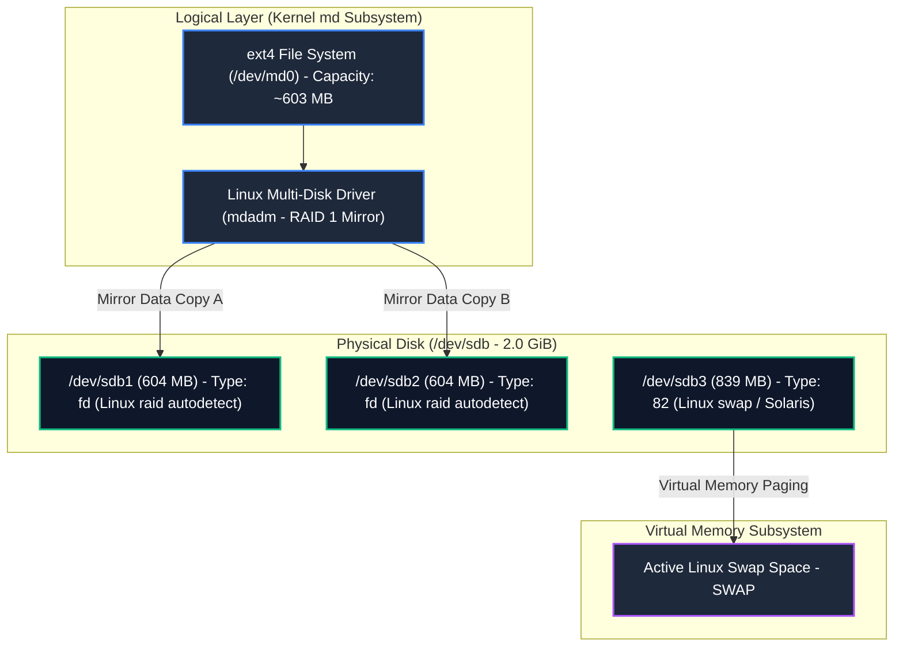

---

### B. Linux Virtual Memory: The Role of Swap Space
**Swap space** is dedicated storage on a disk drive used by the Linux kernel as an extension of physical random-access memory (RAM):
1. **Paging Inactive Memory:** When physical RAM fills up or when memory pages remain idle, the kernel memory manager (`kswapd`) pages out dormant memory chunks to swap space, freeing high-speed RAM for active processes and filesystem caching.
2. **Preventing Out-of-Memory (OOM) Panics:** Adequate swap prevents the kernel OOM killer from abruptly terminating critical application daemons during unexpected memory spikes.
3. **Partition Type Hex Code 82:** Marks the partition table entry specifically for the Linux swap subsystem.

---

### C. Partition System Types & Hex Codes
In the MBR (Master Boot Record) partition table, every partition entry contains a 1-byte System ID (Hex code) defining how operating system kernels should handle the partition:

| System ID (Hex) | Partition Type | Purpose in This Assignment |
|---|---|---|
| **`83`** | Standard Linux Native | Default for standard ext2/ext3/ext4 and XFS filesystems |
| **`82`** | Linux Swap / Solaris | Identifies partition as virtual memory paging space (`/dev/sdb3`) |
| **`fd`** | Linux RAID Autodetect | Informs the kernel during boot to inspect member superblocks and assemble the software RAID array (`/dev/sdb1`, `/dev/sdb2`) |
| **`8e`** | Linux LVM | Used when partitions are delegated as Physical Volumes for Volume Groups |

---

## 3. Step-by-Step Practical Implementation

The practical implementation was executed in three distinct phases:
- **Step 1:** Cleaning legacy partition tables, troubleshooting kernel lockouts, and partitioning `/dev/sdb`.
- **Step 2:** Initializing Swap space and creating the Software RAID 1 array.
- **Step 3:** Verifying array synchronization, block devices, and active virtual memory.

---

### Step 1: Delete Existing Partitions, Troubleshoot Kernel Locks, and Create New Partitions

#### Objective
Purge conflicting legacy volume groups and active partitions on `/dev/sdb`, resolve "Device or resource busy" kernel table locks, and create three equal-sized partitions dividing the disk according to specifications.

#### Execution Procedure & Command Log
1. **Inspect Existing Partitions:** Open terminal, escalate to superuser via `su`, and launch the MBR partition editor on `/dev/sdb`:
   ```bash
   su -
   fdisk /dev/sdb
   ```
   Execute the `p` (print) command. The disk reports 2147 MB (261 cylinders) containing 4 conflicting legacy partitions (`/dev/sdb1` through `/dev/sdb4`). Attempting to add a new partition (`n`) returns `You must delete some partition and add an extended partition first` because the MBR table is saturated at the 4 primary partition limit.

2. **Delete Old Partitions:**
   Within `fdisk`, systematically delete all 4 existing partition entries:
   ```text
   Command (m for help): d
   Partition number (1-4): 1
   Command (m for help): d
   Partition number (1-4): 2
   Command (m for help): d
   Partition number (1-4): 3
   Command (m for help): d
   Selected partition 4
   ```

3. **Writing Table and Resolving Kernel Busy Locks:**
   Write the cleared table using `w`. The kernel attempts to re-read the partition table via `ioctl()`, but fails with:
   `WARNING: Re-reading the partition table failed with error 16: Device or resource busy`.
   *Diagnosis:* The disk was actively locked by a previously mounted swap partition and an active LVM Volume Group (`VolGroup22`).
   *Resolution Commands:*
   ```bash
   # 1. Turn off all active swap space locking partitions on the disk
   swapoff -a

   # 2. Deactivate the locking volume group
   vgchange -an VolGroup22

   # 3. Forcefully remove the volume group and underlying logical volumes
   vgremove -f VolGroup22

   # 4. Wipe legacy signatures and partition tables
   wipefs -a /dev/sdb

   # 5. Perform a clean reboot to guarantee all kernel device locks are released
   reboot
   ```

4. **Creating Three Equal-Sized Partitions:**
   Following the reboot, launch `fdisk /dev/sdb` on the clean disk:
   - **Partition 1 (RAID Member):**
     - Command: `n` -> `p` (Primary) -> `1` -> First cylinder: `1` (default) -> Last cylinder: `+600M`
   - **Partition 2 (RAID Member):**
     - Command: `n` -> `p` (Primary) -> `2` -> First cylinder: `78` (default) -> Last cylinder: `+600M`
   - **Partition 3 (Swap Partition):**
     - Command: `n` -> `p` (Primary) -> `3` -> First cylinder: `155` (default) -> Last cylinder: `261` (default, consumes remaining ~840M)

5. **Updating System IDs (Hex Codes):**
   Use command `t` to assign appropriate system types:
   - `t` -> Partition `1` -> Hex code: `fd` (*Linux raid autodetect*)
   - `t` -> Partition `2` -> Hex code: `fd` (*Linux raid autodetect*)
   - `t` -> Partition `3` -> Hex code: `82` (*Linux swap / Solaris*)

6. **Confirm and Write to Disk:**
   Print the partition table (`p`) to verify boundaries and types, then write changes and sync disks using `w`:
   ```text
   Device Boot      Start         End      Blocks   Id  System
   /dev/sdb1            1          77      618471   fd  Linux raid autodetect
   /dev/sdb2           78         154     618502+   fd  Linux raid autodetect
   /dev/sdb3          155         261     859477+   82  Linux swap / Solaris
   ```

#### Visual Evidence: Step 1 (Partitioning & Troubleshooting)

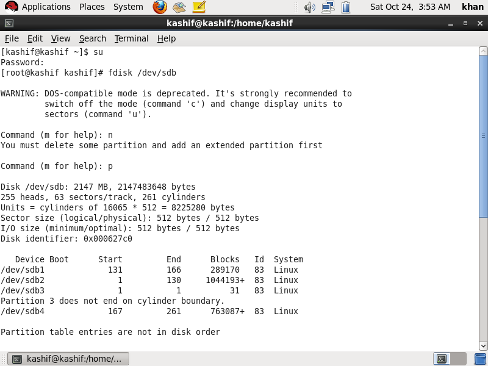
*Figure 1: Initial execution of `fdisk /dev/sdb` showing all 4 primary partition slots occupied.*

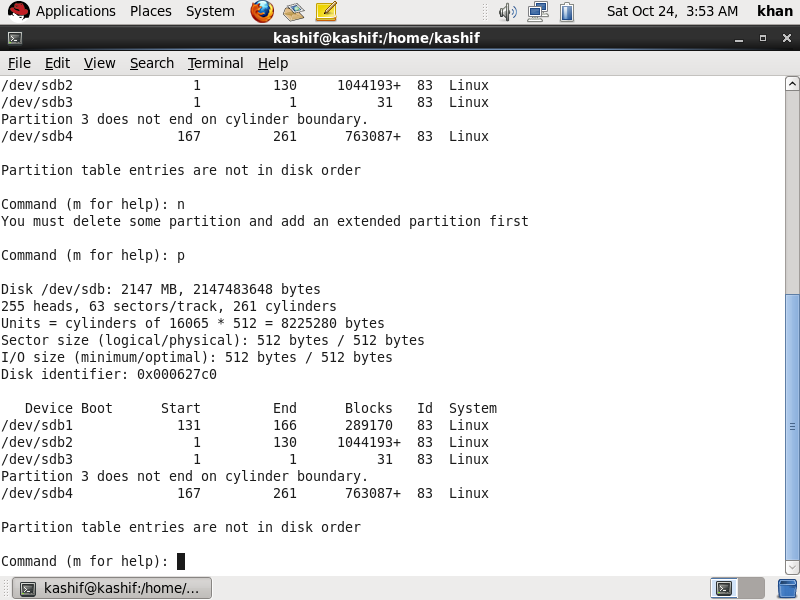
*Figure 2: Printing partition table details showing cylinders and conflicting boundaries.*

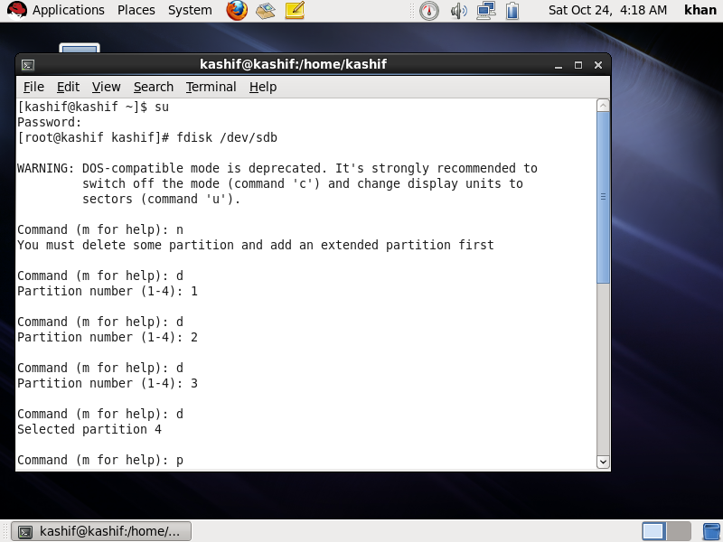
*Figure 3: Executing `d` command in `fdisk` to remove partitions 1, 2, 3, and 4.*

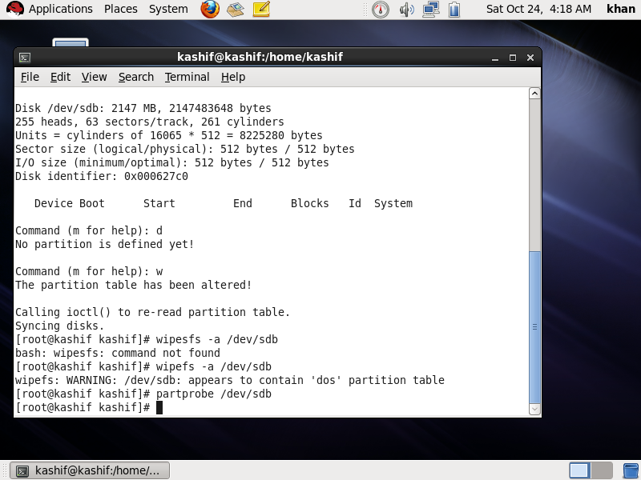
*Figure 4: Committing alterations with `w` and running `wipefs -a /dev/sdb`.*

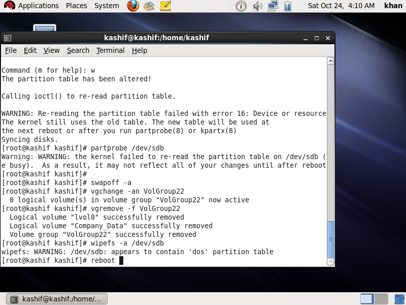
*Figure 5: Resolving "Device or resource busy" error by running `swapoff -a`, `vgremove -f VolGroup22`, and `reboot`.*

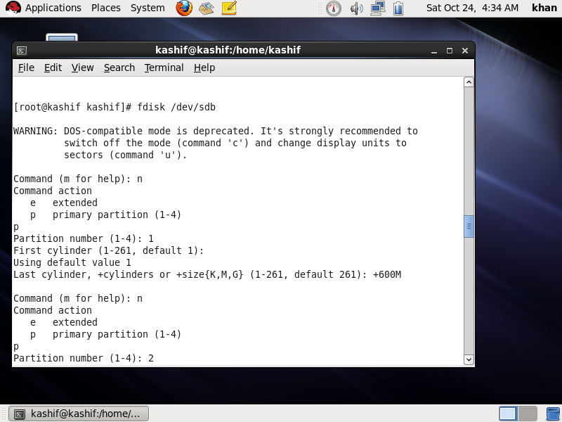
*Figure 6: Launching `fdisk /dev/sdb` post-reboot and creating primary partition 1 (`+600M`).*

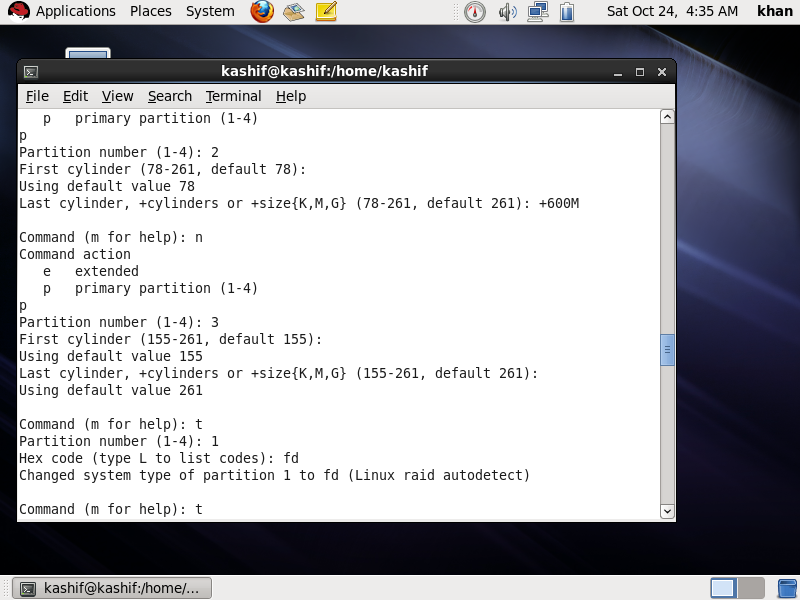
*Figure 7: Creating primary partition 2 (`+600M`) and primary partition 3 to consume the rest of the disk.*

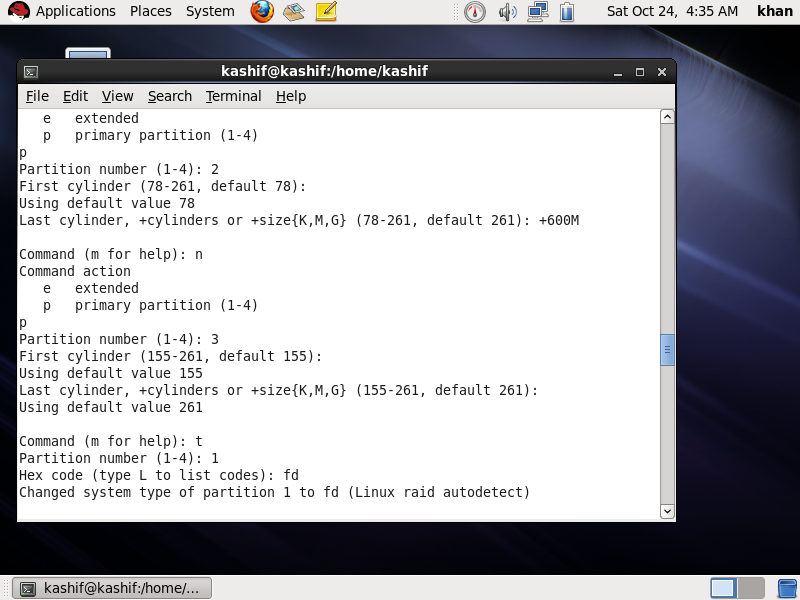
*Figure 8: Progression of partition allocation across cylinders 1 to 261.*

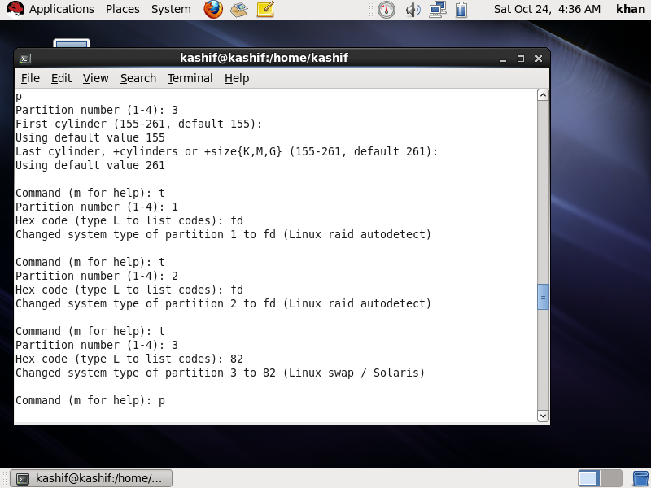
*Figure 9: Using `t` command to change partitions 1 and 2 to `fd`, and partition 3 to `82`.*

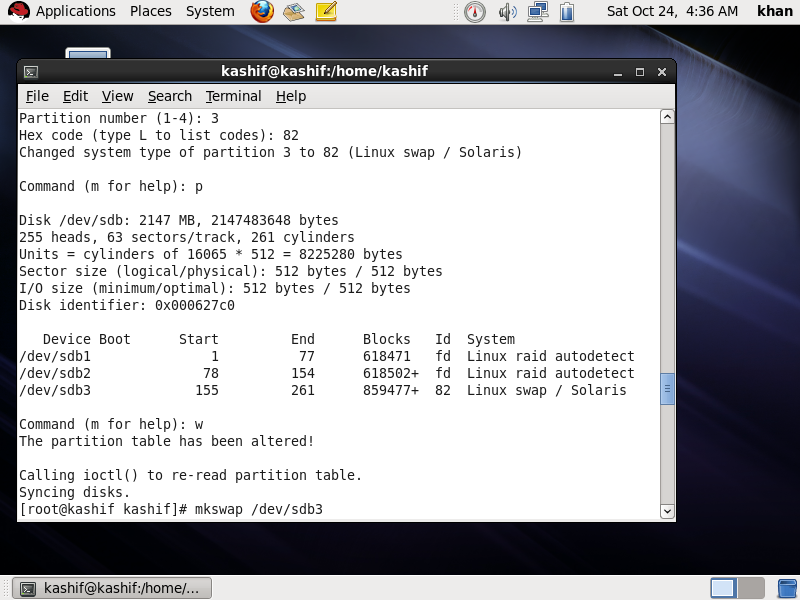
*Figure 10: Printing the finalized partition layout and writing changes to disk with `w`.*

---

### Step 2: Setup Swap Space and Create Software RAID 1 Array

#### Objective
Initialize and activate virtual memory paging on the swap partition (`/dev/sdb3`), assemble partitions `/dev/sdb1` and `/dev/sdb2` into an active RAID 1 mirrored device (`/dev/md0`), and format the array with an ext4 filesystem.

#### Execution Procedure & Command Log
1. **Format and Activate Swap Space:**
   Format partition `/dev/sdb3` as Linux swap space using `mkswap`:
   ```bash
   mkswap /dev/sdb3
   ```
   *Output:* Confirms swap space version 1 initialized with size `859472 KiB` (~839 MB) and assigned a unique UUID (`fac6327d-a127-4cf2-ad56-21510691c64c`).
   
   Activate the paging area immediately using `swapon`:
   ```bash
   swapon /dev/sdb3
   ```

2. **Assemble the Software RAID 1 Mirrored Array:**
   Use the Linux Multi-Disk administration tool `mdadm` to combine `/dev/sdb1` and `/dev/sdb2` into mirrored device `/dev/md0`:
   ```bash
   mdadm --create /dev/md0 --level=1 --raid-devices=2 /dev/sdb1 /dev/sdb2
   ```
   *Interactive Confirmation:* The utility notes metadata placement at the beginning of the array. When prompted `Continue creating array?`, type `y` and press `Enter`.
   *Result:* Array `/dev/md0` is started using default version 1.2 superblock metadata.

3. **Format the RAID Device with ext4 Filesystem:**
   Format the newly created logical RAID block device `/dev/md0` with the Fourth Extended Filesystem (`ext4`):
   ```bash
   mkfs.ext4 /dev/md0
   ```
   *Output Details:* `mke2fs` allocates 38,640 inodes and 154,480 4KB blocks (~603.4 MB usable capacity), writes the journal (4,096 blocks), and commits superblocks across the mirrored disks.

#### Visual Evidence: Step 2 (Swap & RAID Initialization)

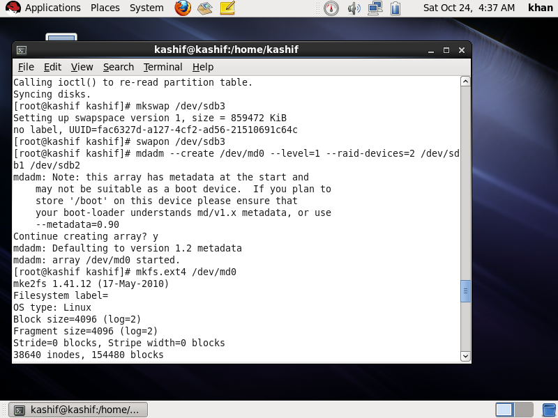
*Figure 11: Executing `mkswap /dev/sdb3`, `swapon /dev/sdb3`, `mdadm --create /dev/md0`, and starting `mkfs.ext4`.*

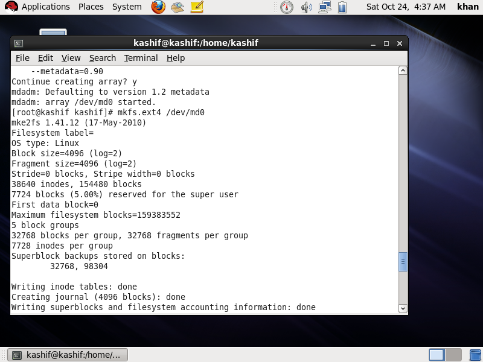
*Figure 12: Terminal output confirming inode tables, journaling, and superblocks successfully written to `/dev/md0`.*

---

### Step 3: Comprehensive Verification and Health Checks

#### Objective
Verify that the block device tree, RAID mirror state, and active virtual memory swap spaces are completely operational and recognized by the Linux kernel.

#### Execution Procedure & Command Log
1. **Block Device Hierarchy (`lsblk`):**
   ```bash
   lsblk
   ```
   *Analysis of Output:*
   - Under physical disk `sdb` (2G), three partitions are present:
     - `sdb1` (604M) is bound as a member of `md0` (`raid1`, 603.4M).
     - `sdb2` (604M) is bound as a member of `md0` (`raid1`, 603.4M).
     - `sdb3` (839.3M) is mounted as active `[SWAP]`.

2. **Kernel RAID Array State (`cat /proc/mdstat`):**
   ```bash
   cat /proc/mdstat
   ```
   *Analysis of Output:*
   ```text
   Personalities : [raid1] 
   md0 : active raid1 sdb2[1] sdb1[0]
         617920 blocks super 1.2 [2/2] [UU]

   unused devices: <none>
   ```
   - **`active raid1`:** Confirms the array is active and operating in mirroring mode.
   - **`sdb2[1] sdb1[0]`:** Shows both member partitions are registered with slot indexes 0 and 1.
   - **`617920 blocks`:** Usable block count (~603.4 MB).
   - **`[2/2] [UU]`:** The critical health indicator. `[2/2]` indicates 2 out of 2 expected devices are present. `[UU]` indicates both drive mirrors are Up and in sync (no degraded drives).

3. **Swap Subsystem Status (`swapon --show`):**
   ```bash
   swapon --show
   ```
   *Analysis:* Lists all active paging devices, confirming `/dev/sdb3` is online alongside any existing root system swap volumes.

#### Visual Evidence: Step 3 (Verification)

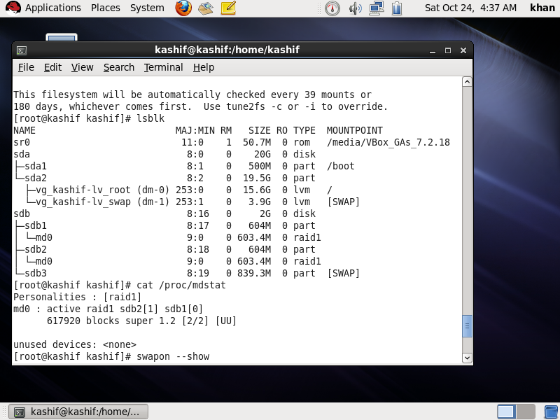
*Figure 13: Complete verification demonstrating healthy RAID 1 mirror `md0` (`[UU]`) and active swap on `sdb3`.*

---

## 4. Technical Analysis & Enterprise Best Practices

### A. Understanding the `[UU]` State in `/proc/mdstat`
The bracketed flags in `/proc/mdstat` represent the real-time operational status of each member disk in the array:
- **`[UU]` (Healthy Mirror):** Both member partitions (`sdb1` and `sdb2`) are online, fully synchronized, and processing reads/writes.
- **`[_U]` or `[U_]` (Degraded Mirror):** One member partition has failed or been detached. The array continues servicing I/O requests in degraded mode from the single surviving disk, but fault tolerance is lost until a spare is added and rebuilt.

### B. Troubleshooting the "Device or resource busy" Partition Error
When repartitioning disks that were previously utilized in a Linux system:
1. **Active Swap Locks:** If a partition was previously configured as swap, the kernel locks the block device. Running `swapoff -a` releases memory paging locks.
2. **LVM Volume Group Locks:** Active Volume Groups hold exclusive open file descriptors on physical volumes. Running `vgchange -an <VG>` deactivates logical volumes, and `vgremove -f <VG>` clears the metadata.
3. **Partition Table Cache:** If the kernel cannot dynamically re-read the table with `partprobe`, a system reboot ensures clean driver binding.

### C. Persistent Storage Configuration (`/etc/fstab` & `/etc/mdadm.conf`)
In an enterprise production environment, configurations must survive system reboots:
1. **RAID Array Configuration:** Save the array identity so the kernel automatically reassembles `/dev/md0` on boot:
   ```bash
   mdadm --detail --scan >> /etc/mdadm.conf
   ```
2. **Automated Filesystem and Swap Mounting (`/etc/fstab`):**
   Add entries using UUIDs (obtained via `blkid`) to guarantee deterministic mounting:
   ```text
   # Mount the RAID 1 array to /mnt/data
   UUID=xxxx-xxxx-xxxx    /mnt/data    ext4    defaults    1 2

   # Enable the secondary swap partition automatically on boot
   UUID=fac6327d-a127-4cf2-ad56-21510691c64c    swap    swap    defaults    0 0
   ```

---

## 5. Conclusion

This practical assignment successfully demonstrated enterprise-grade Linux storage administration on Red Hat Enterprise Linux:
1. **Partitioning:** Partitioned the target 2 GB disk (`/dev/sdb`) into three equal segments that fully consumed the storage volume.
2. **Swap Management:** Configured `/dev/sdb3` as an active virtual memory paging area using `mkswap` and `swapon`.
3. **Fault-Tolerant Mirroring:** Bound partitions `/dev/sdb1` and `/dev/sdb2` into a synchronized RAID 1 array (`/dev/md0`) using `mdadm` and formatted the device with `ext4`.
4. **Validation:** Confirmed storage architecture and health via `lsblk`, `/proc/mdstat` (`[UU]`), and `swapon --show`.
