# Remote Linux Server Management Using PuTTY and WinSCP

---

## 📌 Lab & Assignment Metadata

- **Topic:** Remote Linux Administration, Secure Shell (SSH), and Secure File Transfer Protocol (SFTP)
- **Target Operating System:** Red Hat Enterprise Linux / CentOS Linux Server (`192.168.56.109`)
- **Client Workstation:** Windows 10/11 Host Machine (`192.168.56.1`)
- **Primary Administrative Tools:** PuTTY (SSH Terminal Client), WinSCP (SFTP GUI Client), PuTTYgen (RSA Keypair Generator)
- **Target User Account:** `kashif` (`uid=500`, `gid=500`) with root administrative escalation (`su -`)

---

## 1. Introduction

As a Linux System and Network Administrator, managing remote servers securely and transferring data efficiently across enterprise networks is a fundamental daily responsibility. In modern production environments, production Linux servers almost never run graphical desktop interfaces (GUIs) in order to conserve compute resources and minimize attack surfaces. Consequently, administrators interact with remote servers across local area networks, private clouds, and wide area networks using secure cryptographic protocols.

This hands-on technical report documents the complete implementation and operational verification of two essential remote administration tools:

1. **PuTTY:** A lightweight, high-performance SSH client providing secure command-line interface (CLI) terminal access to the Linux operating system.
2. **WinSCP:** A graphical SFTP and SCP client providing dual-pane remote file management, file transfers, synchronization, and visual directory browsing over encrypted SSH tunnels.

Throughout this assignment, practical tasks demonstrate the full administration lifecycle: establishing baseline network connectivity, configuring host firewalls, managing directory hierarchies and file permissions, editing server configurations with rollback safeguards, executing and validating 500 MB data transfers with SHA-256 integrity verification, and implementing passwordless SSH public key authentication.

---

## 2. Assignment Topic & Scenario (Problem Statement)

> [!IMPORTANT]
> **Enterprise Scenario & Administrative Task Brief**  
> *"You have been appointed as a Linux System Administrator in a company that uses Linux operating system. Your supervisor asks you to connect to a remote Linux server using PuTTY through SSH and manage files using WinSCP. Connect to the server using its IP address, port number, username, and password or SSH key. Create directories and files, upload files from Windows to Linux using WinSCP, download files from Linux to Windows, rename, copy, move, and delete files, and compare command-line file management with graphical file transfer. Investigate how to change file and directory permissions using chmod, check ownership using ls -l, and explain how to resolve permission-denied errors. Transfer a configuration file to the server, edit it safely, create a backup before making changes, and verify the updated contents using PuTTY. Explore how to transfer large files, resume interrupted transfers, and troubleshoot connection failures, incorrect credentials, SSH port issues, and firewall restrictions. Finally, explain the differences between PuTTY and WinSCP, describe the role of SSH and SFTP, identify security risks associated with insecure file transfer, and demonstrate how to use SSH keys and appropriate permissions for secure remote server administration. Submit screenshots of your PuTTY terminal commands, WinSCP file transfers, command outputs, and a brief explanation of each task performed."*

### Key Deliverables & Practical Execution Breakdown

To satisfy the requirements established by the assignment brief, this report is organized into the following verified operational modules:

1. **Server Reachability & Daemon Verification:** Validating server IP configuration (`ifconfig`/`ip addr`), ICMP network reachability from Windows (`ping`), SSH service readiness (`service sshd status`), TCP port 22 listening sockets (`netstat -tlnp`), and firewall filter rules (`iptables`).
2. **PuTTY Terminal Administration:** Establishing authenticated command-line access, verifying system identity (`whoami`, `hostname`, `uname -a`), building directory hierarchies (`mkdir -p`), and generating documentation files via shell redirection.
3. **WinSCP SFTP Graphical File Management:** Connecting via SFTP, establishing host key trust, uploading files from Windows to Linux, downloading files from Linux to Windows, performing remote renames, duplicating files, and deleting temporary items with recursive CLI verification (`ls -lR`).
4. **Access Control, Permissions & Elevation:** Modifying file modes using `chmod` (`600`, `755`), auditing ownership and umask values with `ls -l` and `id`, analyzing permission-denied conditions, and escalating to superuser privileges (`su -`) to create secured administrative files.
5. **Configuration Lifecycle & Rollback Safety:** Transferring application configuration files (`app.conf`), generating pre-modification backups (`app.conf.bak`), performing in-place terminal edits using `nano`, and verifying updates differentials using `diff`.
6. **High-Volume Data Transfers & Integrity Auditing:** Generating a 500 MB binary payload with `dd`, computing cryptographic checksums using `sha256sum`, monitoring real-time throughput in WinSCP, verifying local filesystem landing, and evaluating overwrite safeguards.
7. **Connection Troubleshooting & Firewall Defense:** Diagnosing SSH socket availability, packet filtering inspection, and saving rules permanently with `service iptables save`.
8. **Asymmetric Cryptography & SSH Key-Based Authentication:** Generating 2048-bit RSA key pairs with PuTTYgen, configuring `~/.ssh/authorized_keys` with strict permissions (`700`/`600`), enforcing SELinux security context compliance (`restorecon`), and validating passwordless authentication in both PuTTY and WinSCP.

## 3. Laboratory Architecture & Network Topology

The following diagram illustrates the client-server architecture established between the Windows host workstation and the virtualized Red Hat Enterprise Linux server over a private host-only virtual network (`192.168.56.0/24`):

```mermaid
graph TD
    subgraph Client_Workstation ["Windows Host Workstation (192.168.56.1)"]
        puttyApp["PuTTY SSH Client (CLI Terminal)"]
        winscpApp["WinSCP Client (SFTP GUI)"]
        puttygenApp["PuTTYgen (RSA 2048-bit Key Generator)"]
    end

    subgraph Virtual_Network ["Host-Only Network (192.168.56.0/24)"]
        traffic["Encrypted SSH/SFTP Traffic (TCP Port 22)"]
    end

    subgraph Remote_Server ["Linux Server - Red Hat / CentOS (192.168.56.109)"]
        iptables["iptables Firewall (TCP 22 ACCEPT)"]
        sshd["OpenSSH Daemon (sshd:22)"]
        authKeys["~/.ssh/authorized_keys (Public Key Auth)"]
        fs["Linux File System (/home/kashif, /tmp, /etc)"]
    end

    puttyApp --> | "Encrypted Terminal Session" | traffic
    winscpApp --> | "Encrypted SFTP File Transfers" | traffic
    traffic --> iptables
    iptables --> sshd
    sshd --> authKeys
    authKeys --> fs
```

---

## 4. Server Connectivity and Verification

### Objective
Identify the remote Linux server's network configuration, verify bidirectional host connectivity from Windows, confirm that the OpenSSH server daemon is active and listening on TCP port 22, and verify firewall ingress rules.

### Detailed Procedure
1. **Network Interface Identification:** Log into the Linux physical/virtual console and run `ifconfig eth0` and `ip addr show` to obtain the assigned IPv4 address (`192.168.56.109`).
2. **Host-to-Server Ping Test:** Open the Windows Command Prompt (`cmd.exe`) on the host machine and execute `ping 192.168.56.109`. Observe four consecutive ICMP echo replies confirming network layer connectivity across the virtual switch.
3. **SSH Daemon Verification:** On the Linux server, inspect the OpenSSH service status using `service sshd status`. Confirm that the service state reports `openssh-daemon is running`.
4. **Socket & Port Inspection:** Execute `netstat -tlnp | grep ':22'` to verify that the kernel network stack is actively listening on TCP port 22 on all interfaces (`0.0.0.0:22`).
5. **Firewall Rule Verification & Ingress Configuration:** Check the active `iptables` firewall filter table using `iptables -L -n | grep 22`. To ensure uninterrupted SSH access, prepend an explicit ACCEPT rule to the INPUT chain with `iptables -I INPUT -p tcp --dport 22 -j ACCEPT`. Persist this rule across system reboots using `service iptables save`.

### Command Reference
```bash
# Verify network IP address on Linux server
ifconfig eth0
ip addr show

# Test network layer reachability from Windows Command Prompt
ping 192.168.56.109

# Check OpenSSH daemon status
service sshd status

# Verify listening TCP sockets on port 22
netstat -tlnp | grep ':22'

# Ensure incoming SSH traffic is permitted through the firewall
iptables -I INPUT -p tcp --dport 22 -j ACCEPT
service iptables save
iptables -L -n | grep 22
```

### Visual Evidence & Screenshots

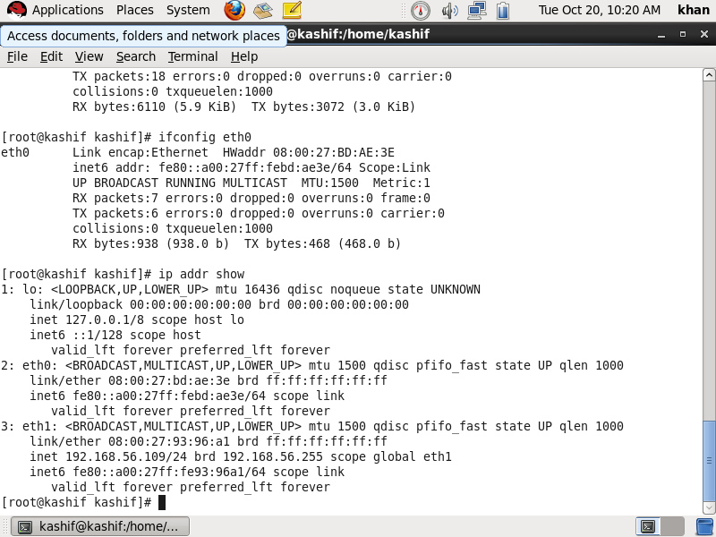
*Figure 1: Linux terminal showing `ifconfig eth0` and `ip addr show` confirming server IPv4 address `192.168.56.109`.*

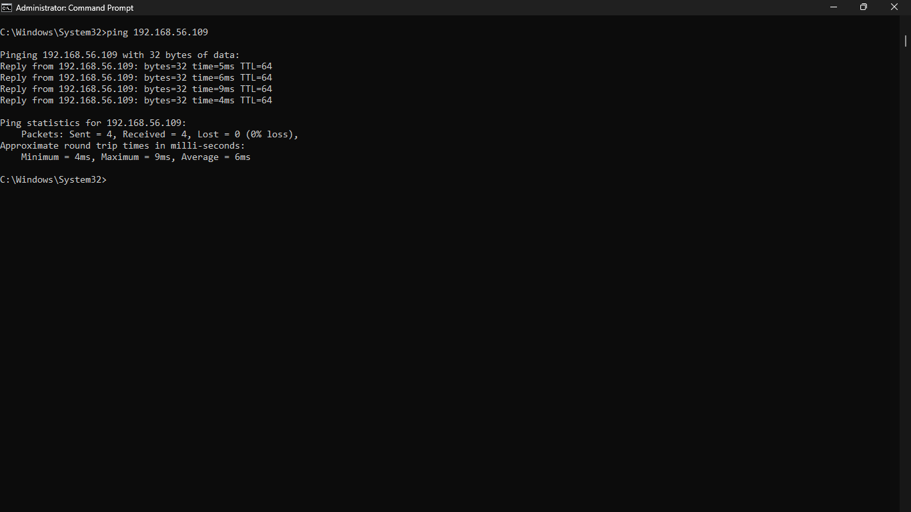
*Figure 2: Windows Command Prompt verifying 0% packet loss and low latency ICMP replies from `192.168.56.109`.*

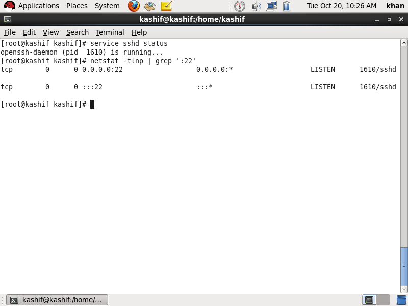
*Figure 3: Confirming that `sshd` is running and socket `0.0.0.0:22` is in the `LISTEN` state.*

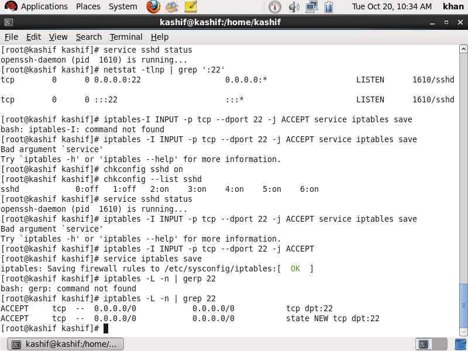
*Figure 4: Inserting the TCP port 22 ACCEPT rule into the iptables INPUT chain.*


*Figure 5: Executing `service iptables save` to write rules to `/etc/sysconfig/iptables`.*

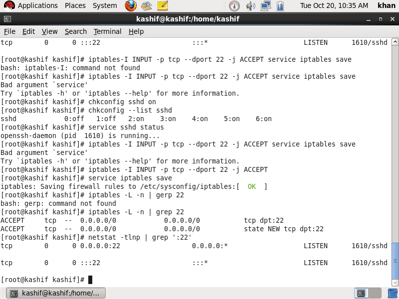
*Figure 6: Verifying that `sshd` process ID is bound to port 22.*

---

## 5. Directory and File Management via PuTTY

### Objective
Establish an interactive SSH terminal session from the Windows host using PuTTY, authenticate with standard user credentials (`kashif`), inspect system identity, and establish an organized workspace directory tree.

### Detailed Procedure
1. **PuTTY Session Configuration:** Launch PuTTY on Windows. Enter Host Name `192.168.56.109`, specify Port `22`, verify Connection type is set to `SSH`, and open the connection.
2. **Interactive Authentication:** At the terminal prompt, supply username `kashif` and the corresponding account password.
3. **Environment Inspection:** Run `whoami` to verify the active user account, `hostname` to identify the system name, `pwd` to confirm the starting working directory (`/home/kashif`), and `uname -a` to display Linux kernel details.
4. **Workspace Directory Hierarchy Creation:** Create a parent project folder `~/sna_assignment` using `mkdir -p ~/sna_assignment`. Navigate into it (`cd ~/sna_assignment`) and create three functional subdirectories: `docs`, `backup`, and `uploads`.
5. **Initial Text File Creation:** Use output redirection to create an introductory file: `echo "Hello from PuTTY" > notes.txt`. Verify file presence, sizing, ownership, and timestamp using `ls -l`.

### Command Reference
```bash
# Verify authenticated user identity and system details
whoami
hostname
pwd
uname -a
ifconfig eth1

# Create project hierarchy and subdirectories
mkdir -p ~/sna_assignment
cd ~/sna_assignment
mkdir docs backup uploads

# Generate sample text file and verify directory listing
echo "Hello from PuTTY" > notes.txt
ls -l
```

### Visual Evidence & Screenshots


*Figure 7: PuTTY configuration dialog configured with destination IP `192.168.56.109` and Port `22`.*

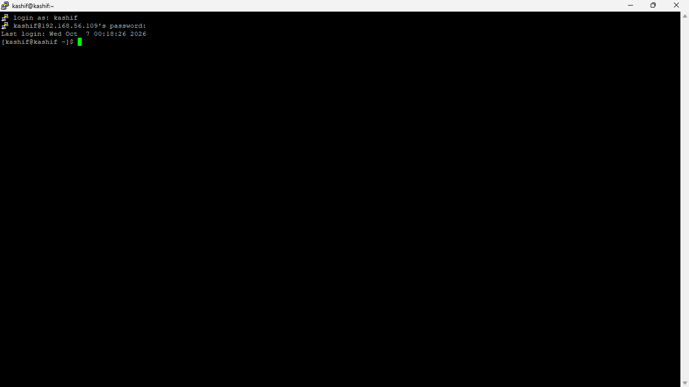
*Figure 8: Successful password-authenticated SSH login prompt as user `kashif`.*

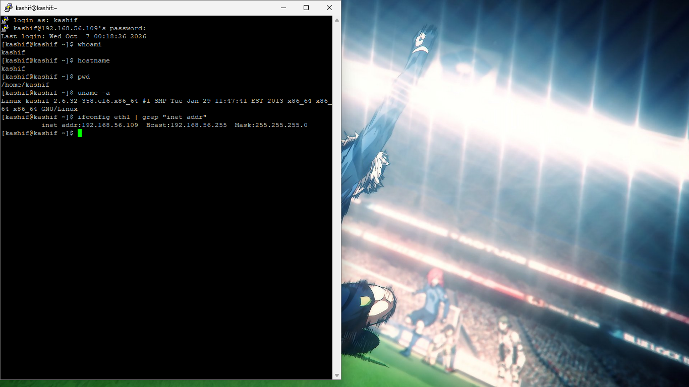
*Figure 9: Executing `whoami`, `hostname`, `pwd`, `uname -a`, and network interface checks.*

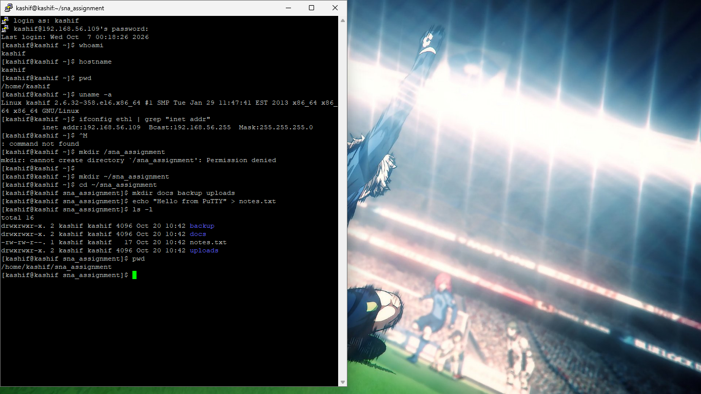
*Figure 10: Creating directories `docs`, `backup`, `uploads` and generating `notes.txt`.*

---

## 6. File Transfers and Remote File Management via WinSCP

### Objective
Establish an encrypted SFTP session using the WinSCP graphical client, manage the remote Linux filesystem visually, perform bidirectional file uploads, rename files, duplicate items, delete temporary files, and verify changes via the PuTTY CLI.

### Detailed Procedure
1. **WinSCP Session Initiation & Host Key Trust:** Launch WinSCP, enter Host name `192.168.56.109`, Port number `22`, username `kashif`, and password. Upon the initial connection, WinSCP displays a PuTTY Security Alert presenting the server's SSH host key fingerprint. Accept the fingerprint to store it in the Windows registry host key cache.
2. **Dual-Pane Interface Navigation:** The left pane displays the local Windows filesystem (`C:\Users\Haris Laptops\Documents\`), and the right pane displays the remote Linux filesystem (`/home/kashif/`). Navigate into `/home/kashif/sna_assignment/`.
3. **File Upload Operations:** Upload `notes.txt` and `test_upload.txt` from the local Windows machine into the remote `~/sna_assignment/uploads/` directory.
4. **Remote File Rename:** In WinSCP, right-click `test_upload.txt` inside `uploads/`, select **Rename**, and change its filename to `rename_upload.txt`.
5. **Remote File Duplication (Copy):** Right-click `notes.txt`, select **Duplicate/Copy**, and name the new file `copy.txt`.
6. **Remote File Deletion:** Select `copy.txt`, press the `Delete` key, and confirm the deletion dialog prompt.
7. **CLI Synchronization Verification:** Switch to the PuTTY terminal and execute a recursive long listing: `ls -lR ~/sna_assignment`. Confirm that all GUI actions are accurately reflected in the underlying Linux filesystem.

### Command Reference (PuTTY CLI Verification)
```bash
# Verify all remote file operations recursively
ls -lR ~/sna_assignment
```

### Visual Evidence & Screenshots

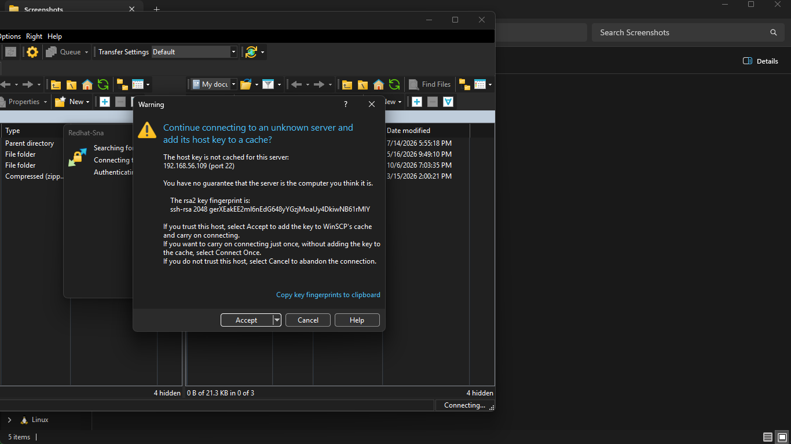
*Figure 11: Host key cache alert verifying the server's cryptographic identity before establishing the SFTP tunnel.*

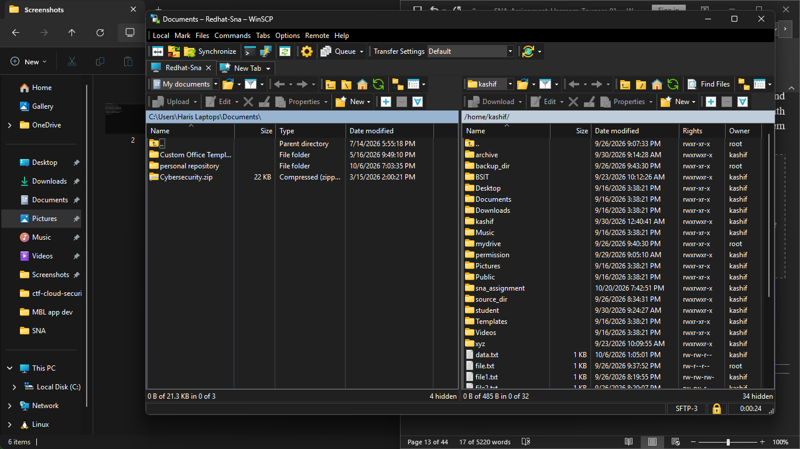
*Figure 12: WinSCP dual-pane interface showing local Windows files (left) and remote Linux home directory (right).*

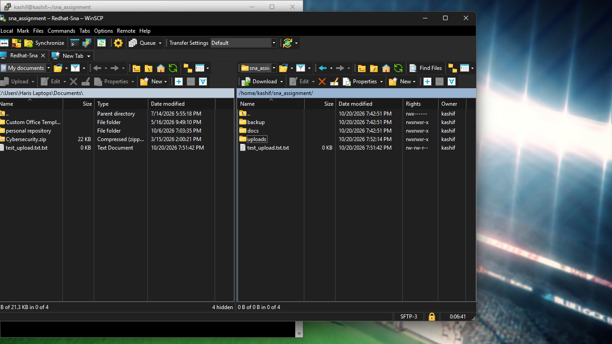
*Figure 13: Remote directory pane showing `backup`, `docs`, and `uploads` subdirectories.*

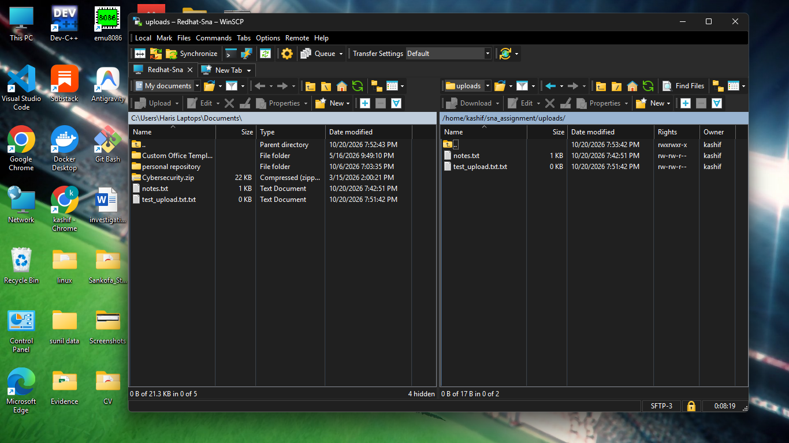
*Figure 14: Transferring `notes.txt` and `test_upload.txt` into the remote `uploads/` folder.*

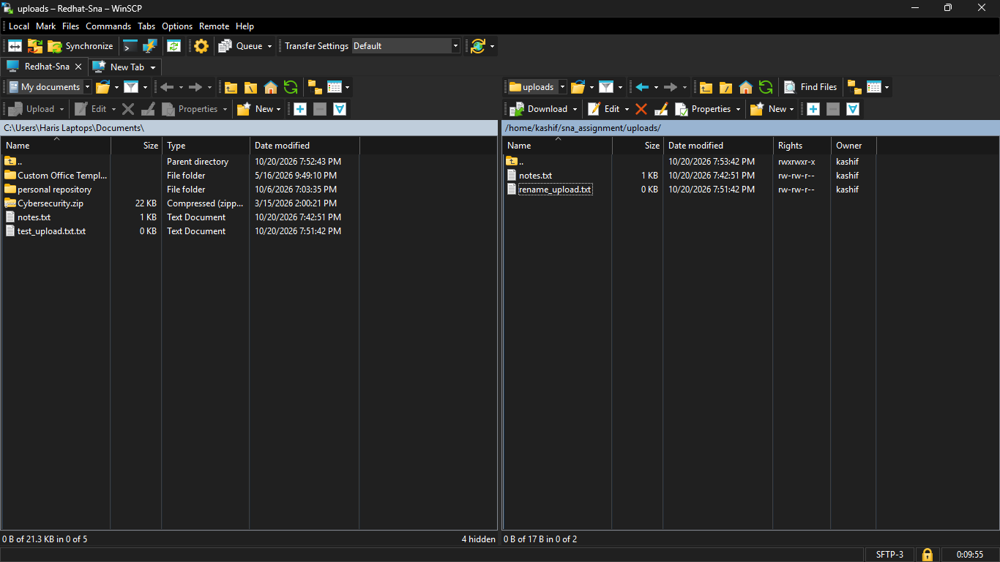
*Figure 15: Renaming `test_upload.txt` to `rename_upload.txt` in the SFTP GUI.*

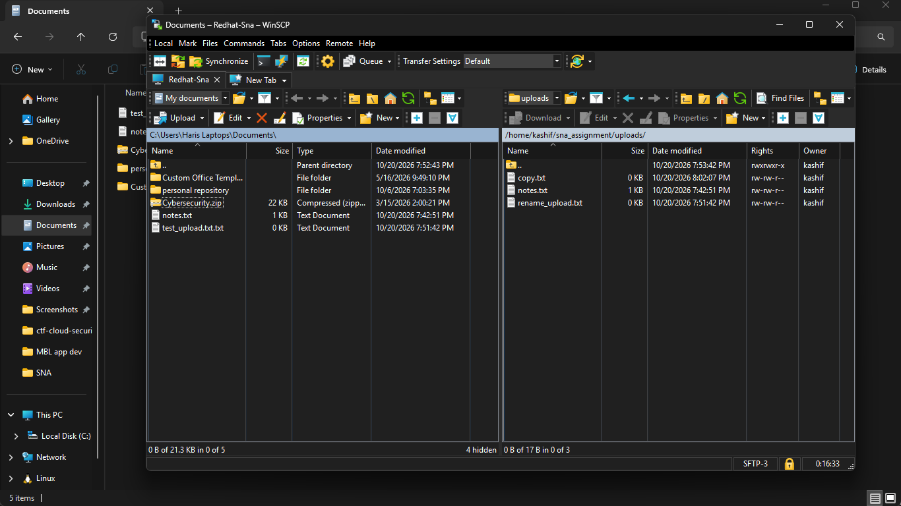
*Figure 16: Creating a duplicated file copy named `copy.txt`.*

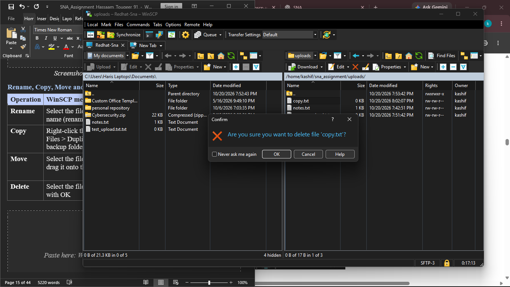
*Figure 17: Confirming permanent deletion of `copy.txt` from the remote server.*

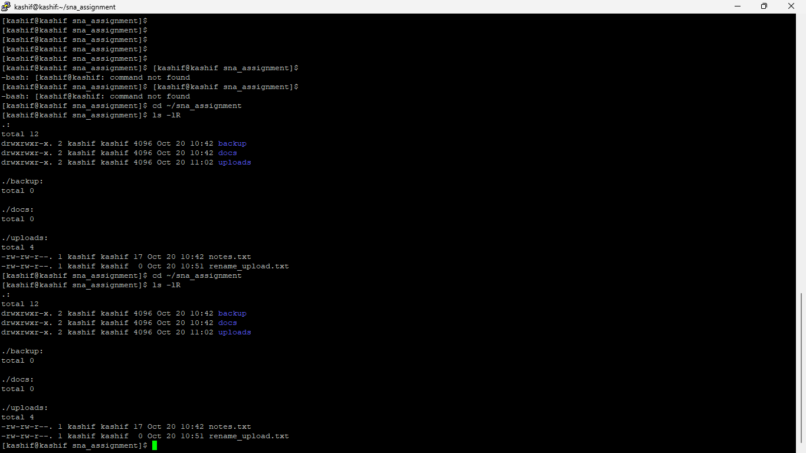
*Figure 18: Executing `ls -lR` in PuTTY confirming file hierarchy consistency after WinSCP actions.*

---

## 7. User/Group Management and File Permissions

### Objective
Examine Linux discretionary access control (DAC) permissions, modify permission modes using `chmod` in both absolute octal and symbolic modes, inspect user identity using `id`, and test root privilege escalation using `su -`.

### Detailed Procedure
1. **Creating a Restricted File:** Inside `~/sna_assignment/`, create a sensitive file using `touch secret.txt`. By default, the umask assigns `644` (`-rw-r--r--`).
2. **Hardening Permissions with chmod 600:** Execute `chmod 600 secret.txt` to restrict access strictly to the owner (`kashif`), removing all read/write rights from the group and world (`-rw-------`).
3. **Directory Permissions with chmod 755:** Set standard directory permissions on `uploads`: `chmod 755 uploads`. Verify with `ls -ld uploads`, ensuring `rwxr-xr-x` permissions (owner has full access, group/others can enter and read).
4. **Verifying Identity and Ownership:** Execute `id` to review the effective User ID (`uid=500(kashif)`) and Group ID (`gid=500(kashif)`). Verify directory permissions and ownership with `ls -ld ~/sna_assignment`.
5. **Superuser Privilege Escalation:** Execute `su -` and enter the root administrative password. Verify elevated prompt `#`.
6. **Administrative File Generation:** As root, create an administrative system file: `echo "root only" > /tmp/admin.txt`. Secure it with `chmod 600 /tmp/admin.txt` and verify content reading with `cat /tmp/admin.txt`.

### Permission Matrix Reference

| File / Directory | Octal Mode | Symbolic Mode | Owner (`kashif`) | Group (`kashif`) | Others (World) | Purpose |
|---|---|---|---|---|---|---|
| `secret.txt` | `600` | `-rw-------` | Read / Write | No Access | No Access | Confidential user data |
| `uploads/` | `755` | `drwxr-xr-x` | Read / Write / Exec | Read / Exec | Read / Exec | Shared upload folder |
| `/tmp/admin.txt` | `600` | `-rw-------` | Read / Write (root) | No Access | No Access | Sensitive root configuration |

### Command Reference
```bash
# Create and secure sensitive file
touch secret.txt
chmod 600 secret.txt
ls -l secret.txt

# Secure uploads directory
chmod 755 uploads
ls -ld uploads

# Verify UID, GID, and directory ownership
id
ls -ld ~/sna_assignment

# Switch to superuser (root) and create administrative file
su -
echo "root only" > /tmp/admin.txt
chmod 600 /tmp/admin.txt
cat /tmp/admin.txt
exit
```

### Visual Evidence & Screenshots

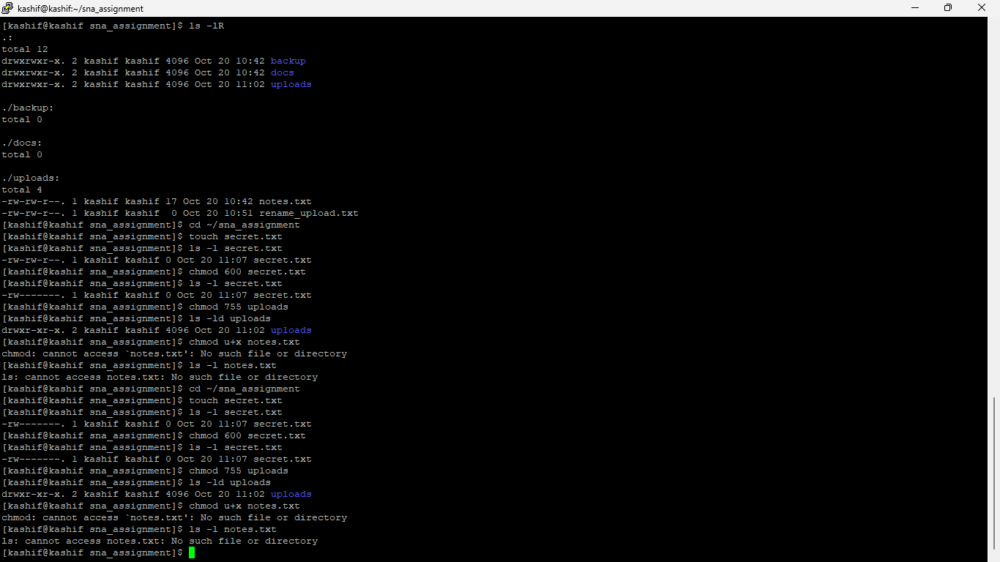
*Figure 19: Applying `chmod 600` to `secret.txt` and `chmod 755` to the `uploads/` directory.*

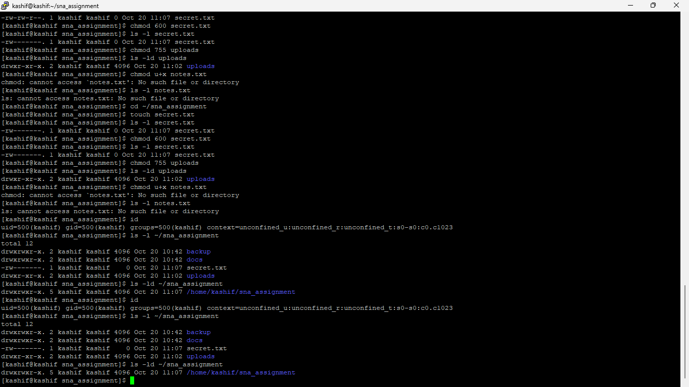
*Figure 20: Verifying user `uid=500(kashif)` and `gid=500(kashif)` alongside directory permissions.*

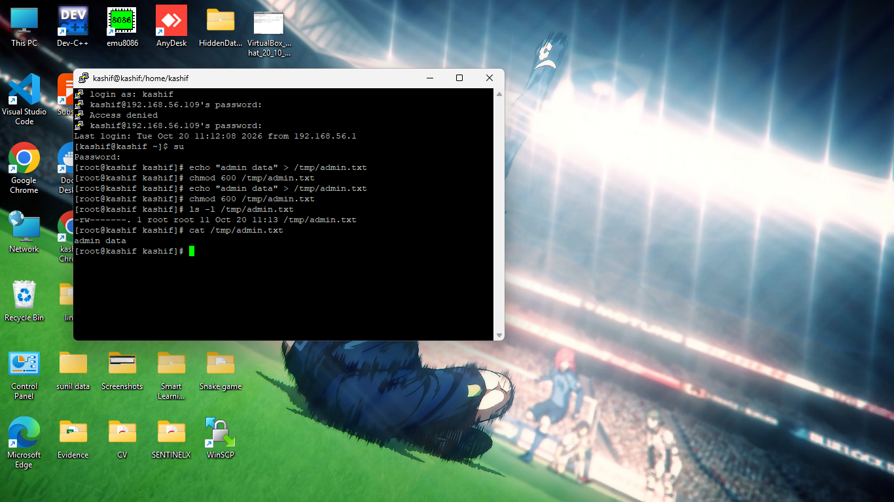
*Figure 21: Escalating to root via `su -`, creating `/tmp/admin.txt` with `600` permissions, and verifying content.*

---

## 8. Configuration File Management and In-Place Editing

### Objective
Demonstrate professional production configuration management: creating safety backups prior to modification, editing application configuration files using the CLI editor `nano`, verifying changes using `diff`, and reviewing synchronized updates across WinSCP.

### Detailed Procedure
1. **Configuration Creation:** Inside `~/sna_assignment/uploads/`, create a sample service configuration file named `app.conf` containing server parameters (Port 8080, Debug Log level).
2. **Safety Rollback Copy:** Before touching production configuration files, always create a timestamped or `.bak` copy: `cp app.conf app.conf.bak`.
3. **In-Place CLI Editing with Nano:** Open `app.conf` in the `nano` editor: `nano app.conf`. Update the service listening port from `8080` to `9090` and adjust configuration directives. Save and exit (`Ctrl+O`, `Enter`, `Ctrl+X`).
4. **Differential Validation:** Run `diff app.conf.bak app.conf` to compare the original and modified files. Confirm that only the intended line modifications (`< port = 8080` to `> port = 9090`) were introduced.
5. **Cross-Client Synchronization:** Open WinSCP and verify that the file metadata and contents reflect the exact updates performed inside the PuTTY CLI session.

### Command Reference
```bash
# Create safety backup copy
cp app.conf app.conf.bak

# Edit configuration file
nano app.conf

# Compare backup with modified configuration
diff app.conf.bak app.conf

# Display updated configuration contents
cat app.conf
```

### Visual Evidence & Screenshots

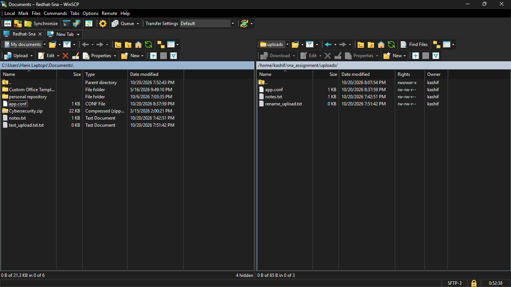
*Figure 22: WinSCP showing `app.conf` residing in `/home/kashif/sna_assignment/uploads/`.*

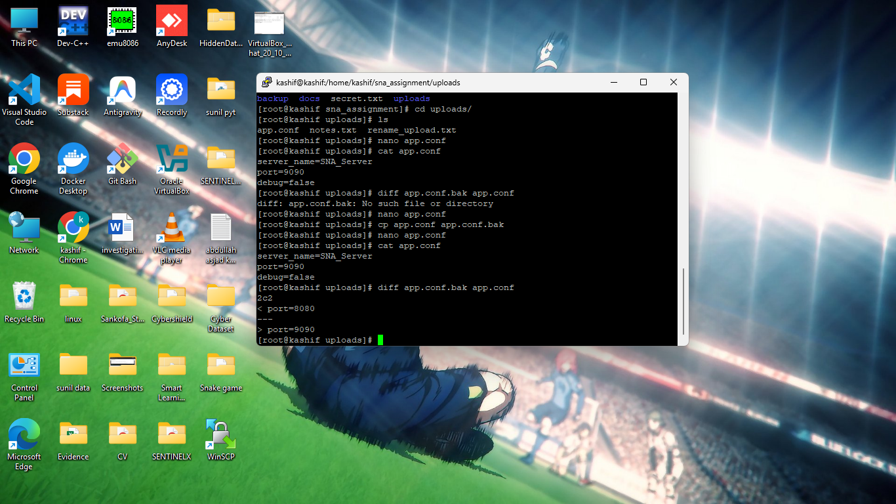
*Figure 23: Executing `cp app.conf app.conf.bak`, editing with `nano`, and validating changes with `diff app.conf.bak app.conf`.*

---

## 9. Large File Transfers and Transfer Verification

### Objective
Generate a large test data payload (500 MB) on the Linux server, compute its SHA-256 cryptographic checksum, download the file to the Windows workstation over SFTP via WinSCP, observe transfer throughput, and test overwrite collision prevention.

### Detailed Procedure
1. **Generating 500 MB Test File with dd:** Use the raw dataset definition utility `dd` to allocate a 500 MB binary file from the kernel zero-device: `dd if=/dev/zero of=bigfile.bin bs=1M count=500`.
2. **Size and Hash Verification:** Verify the allocated block size using `ls -lh bigfile.bin` (confirming `500M`). Calculate the unique SHA-256 cryptographic hash: `sha256sum bigfile.bin`.
3. **Downloading File via WinSCP SFTP:** In WinSCP, locate `bigfile.bin` in the remote pane. Drag and drop the file into the local Windows directory (`C:\Users\Haris Laptops\Documents\`).
4. **Monitoring Transfer Metrics:** Observe the active WinSCP transfer dialogue box. Monitor real-time throughput metrics (achieving ~1.39 MB/s over the virtual network link) and track elapsed transfer duration.
5. **Local Host Verification:** Confirm the file has been successfully written to `C:\Users\Haris Laptops\Documents\bigfile.bin` with matching file size.
6. **Overwrite Protection Safeguard:** Attempt to re-transfer the file to verify WinSCP's overwrite detection dialog ("Overwrite remote file 'bigfile.bin'?"), preventing accidental data loss in production environments.

### Command Reference
```bash
# Generate 500 MB binary file using dd
dd if=/dev/zero of=bigfile.bin bs=1M count=500

# Inspect file size in human-readable format
ls -lh bigfile.bin

# Calculate SHA-256 cryptographic checksum
sha256sum bigfile.bin
```

### Visual Evidence & Screenshots

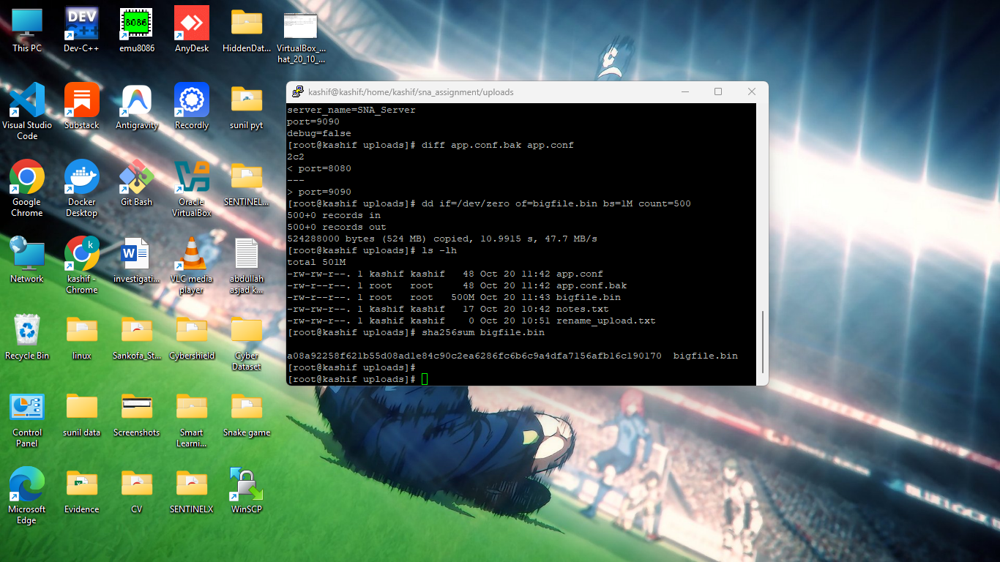
*Figure 24: Running `dd` to generate 500 MB `bigfile.bin` and computing its SHA-256 checksum in PuTTY.*

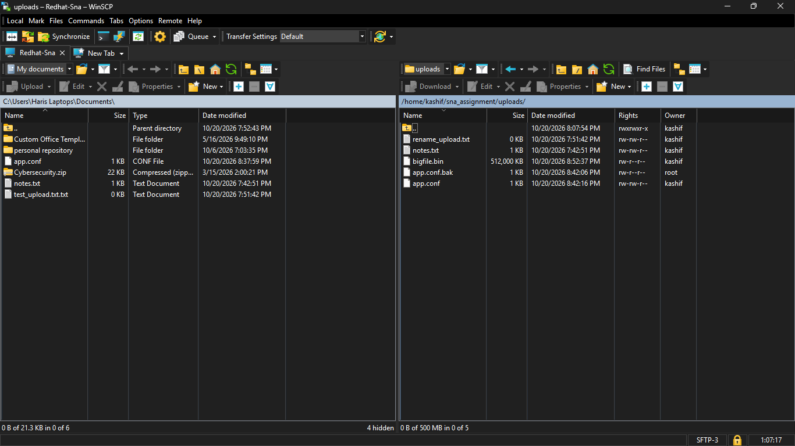
*Figure 25: WinSCP remote pane displaying `bigfile.bin` (512,000 KB) ready for transfer.*

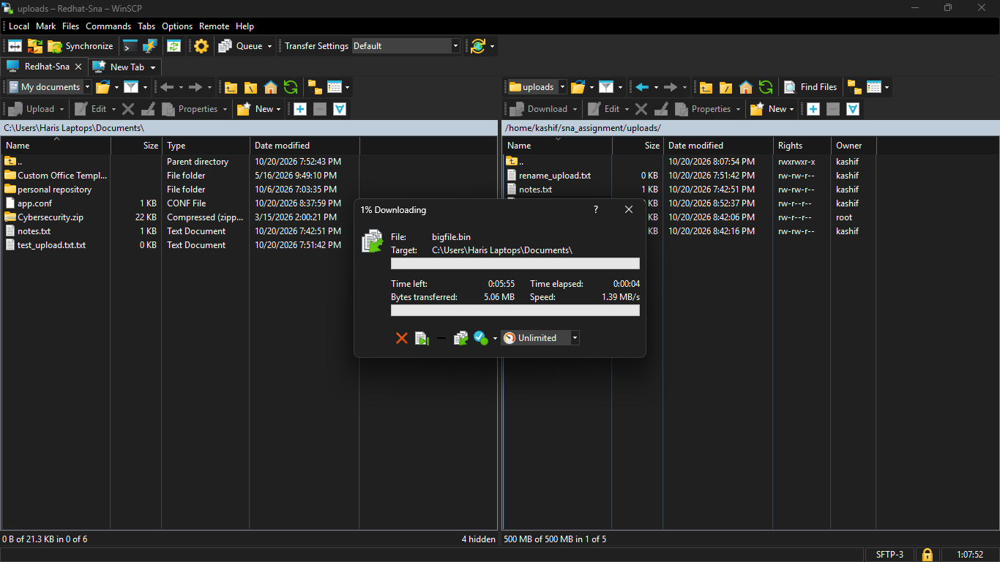
*Figure 26: Monitoring active download progress (5.06 MB transferred, throughput 1.39 MB/s).*

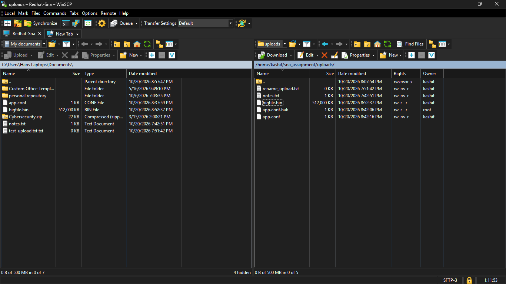
*Figure 27: Successfully downloaded `bigfile.bin` residing in Windows `Documents` folder.*

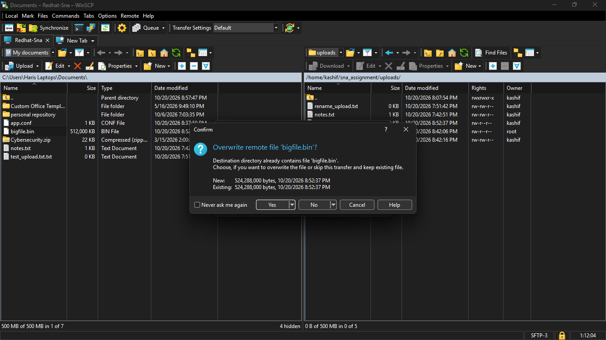
*Figure 28: WinSCP prompt requesting confirmation before overwriting existing files.*

---

## 10. Firewall and Connection Troubleshooting

### Objective
Diagnose network service accessibility, inspect kernel packet filtering tables using `iptables`, verify persistent rule saving, and validate system service responsiveness.

### Detailed Procedure
1. **Service Status Verification:** Run `service sshd status` to ensure the daemon is running and healthy.
2. **Active Socket Inspection:** Execute `netstat -tlnp | grep :22` to ensure the SSH process is bound to port 22 and accepting incoming connections.
3. **Packet Filter Audit:** Inspect active netfilter rules in numerical format: `iptables -L -n`. Verify that the `INPUT` chain includes an active rule for destination port `22` with target `ACCEPT`.
4. **Persistent Rule Storage:** Save the running filter rules to `/etc/sysconfig/iptables` using `service iptables save` to ensure the rule survives system reboots.
5. **Firewall Health Check:** Execute `service iptables status` to confirm the firewall is active and enforcing the configured ruleset.

### Command Reference
```bash
# Verify SSH service status
service sshd status

# Check listening sockets on TCP port 22
netstat -tlnp | grep :22

# Inspect active iptables firewall rules
iptables -L -n

# Commit running firewall rules to persistent storage
service iptables save

# Confirm firewall service status
service iptables status
```

### Visual Evidence & Screenshots

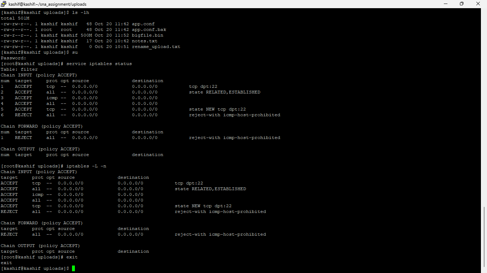
*Figure 29: Running `service iptables status` and `iptables -L -n` verifying the persistent ACCEPT rule for TCP port 22.*

---

## 11. SSH Public Key-Based Cryptographic Authentication

### Objective
Eliminate vulnerable password-based logins by configuring asymmetric SSH public-key authentication. Generate a 2048-bit RSA key pair with PuTTYgen, configure public key authorization on the Linux server with strict POSIX permissions, restore SELinux security contexts, and authenticate seamlessly through PuTTY and WinSCP.

### Detailed Procedure
1. **Asymmetric Key Pair Generation:** Launch the PuTTY Key Generator (**PuTTYgen**) on Windows. Select **RSA** with 2048 bits. Click **Generate** and move the mouse across the blank area to generate cryptographic entropy.
2. **Key Parameters & Passphrase:** Specify the Key comment as `sna-assignment`. Assign a secure key passphrase to protect the private key on the local workstation. Save the private key as `sna_key.ppk` on Windows.
3. **Public Key Export:** Copy the OpenSSH-formatted public key string directly from the PuTTYgen text field (`ssh-rsa AAAAB3NzaC1yc2E...`).
4. **Server Directory & Authorized Keys Setup:** In the PuTTY terminal on the Linux server:
   - Create the hidden SSH configuration directory: `mkdir -p ~/.ssh`.
   - Set strict directory permissions: `chmod 700 ~/.ssh` (owner read/write/execute only).
   - Append the public key string into `~/.ssh/authorized_keys`.
   - Set strict file permissions: `chmod 600 ~/.ssh/authorized_keys` (owner read/write only).
5. **SELinux Security Context Restoration:** On Red Hat / CentOS systems, SELinux enforces strict context labels on user SSH files. Execute `restorecon -Rv /home/kashif/.ssh` to ensure the `ssh_home_t` security context is applied. Verify directory permissions with `ls -ld ~/.ssh`.
6. **PuTTY Private Key Configuration:** In PuTTY, navigate to **Connection > SSH > Auth > Credentials**. Browse and select the saved `sna_key.ppk` private key file. Save the session profile.
7. **WinSCP Private Key Configuration:** In WinSCP, open the site settings and navigate to **Advanced Site Settings > SSH > Authentication**. Under **Private key file**, browse and select `C:\Users\Haris Laptops\Downloads\SNA\sna_key.ppk`.
8. **Passwordless Connection Validation:** Test the connection in both PuTTY and WinSCP. The server authenticates the client using public-key cryptography, bypassing the Linux password prompt while maintaining enterprise-grade security.

### SSH Key Permissions & SELinux Matrix

| Path | Required Permission | Symbolic Mode | SELinux Context | Reason |
|---|---|---|---|---|
| `~/.ssh/` | `700` | `drwx------` | `user_u:object_r:ssh_home_t:s0` | SSH daemon rejects directory if readable by group or others |
| `~/.ssh/authorized_keys` | `600` | `-rw-------` | `user_u:object_r:ssh_home_t:s0` | SSH daemon rejects keys file if writable or readable by others |

### Command Reference
```bash
# Create .ssh directory with restrictive permissions
mkdir -p ~/.ssh
chmod 700 ~/.ssh

# Create authorized_keys file and set secure permissions
touch ~/.ssh/authorized_keys
chmod 600 ~/.ssh/authorized_keys

# Restore SELinux security contexts on Red Hat / CentOS
restorecon -Rv /home/kashif/.ssh

# Inspect permissions and attributes
ls -ld ~/.ssh
ls -l ~/.ssh/authorized_keys
```

### Visual Evidence & Screenshots

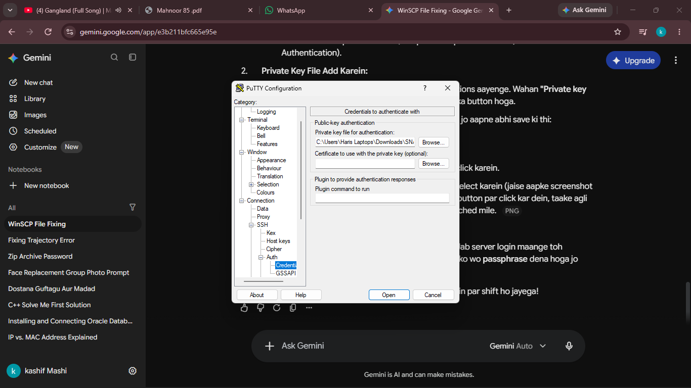
*Figure 30: PuTTY Configuration window under Connection > SSH > Auth > Credentials pointing to the `.ppk` private key.*

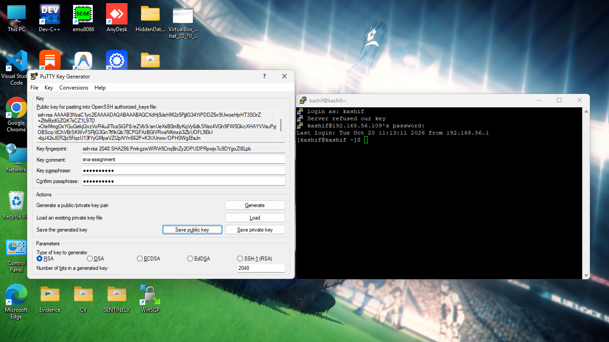
*Figure 31: PuTTY Key Generator displaying generated RSA-2048 public key alongside PuTTY terminal.*

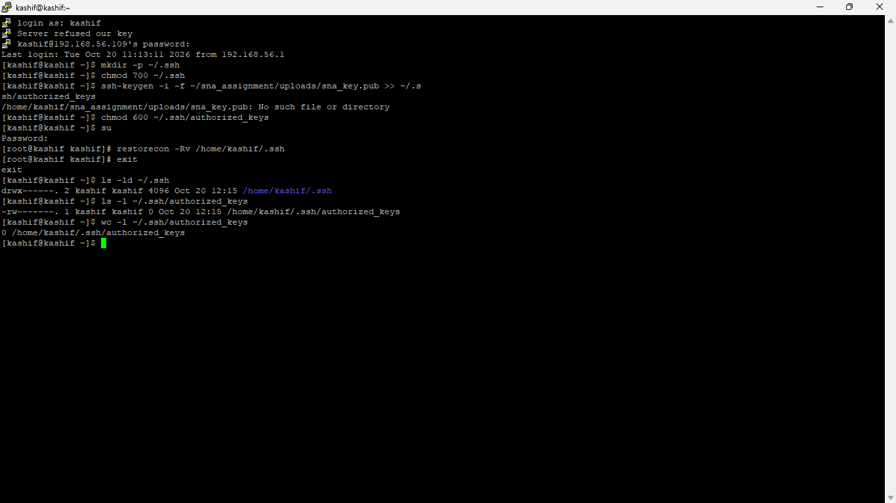
*Figure 32: Executing `mkdir -p ~/.ssh`, `chmod 700`, `chmod 600`, and `restorecon -Rv` in PuTTY.*

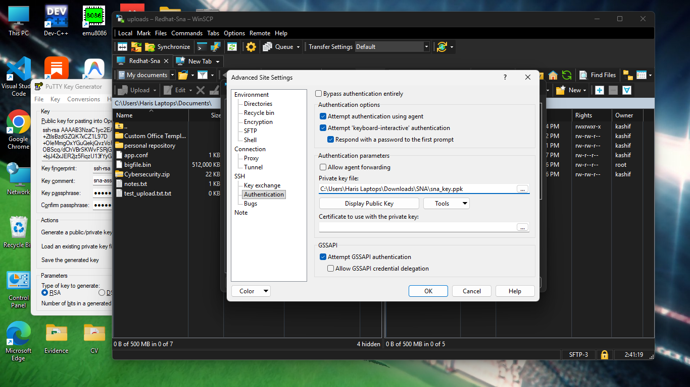
*Figure 33: WinSCP SSH Authentication settings configured with `sna_key.ppk`.*

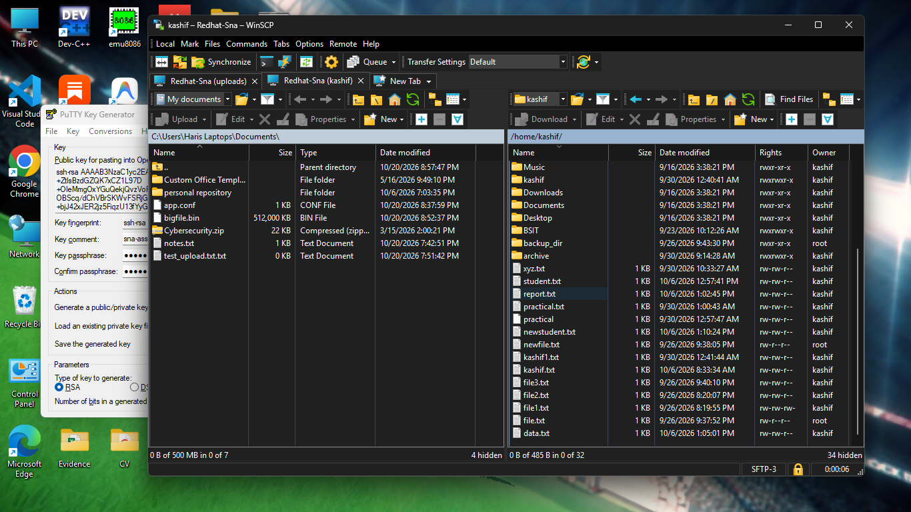
*Figure 34: WinSCP successfully logged in using SSH key-based authentication displaying `/home/kashif/`.*

---

---

## 12. Technical Analysis & Conceptual Comparisons

### A. PuTTY vs. WinSCP: Operational Comparison

| Feature / Dimension | PuTTY (Terminal Emulator) | WinSCP (File Transfer Client) |
|---|---|---|
| **Primary Interface** | Command-Line Interface (CLI) | Graphical User Interface (GUI) Dual-Pane |
| **Underlying Protocols** | SSH-2 (Secure Shell), Telnet, Serial | SFTP (SSH File Transfer Protocol), SCP, FTP, WebDAV, S3 |
| **Core Administrative Purpose** | Process execution, service control, log viewing, text editing, server orchestration | Visual directory browsing, bulk file uploads/downloads, synchronization, file staging |
| **File Manipulation Method** | Linux shell utilities (`cp`, `mv`, `rm`, `touch`, `mkdir`, `nano`, `vim`) | Drag-and-drop, context menu actions (Rename, Duplicate, Delete) |
| **Network Overhead** | Ultra-low bandwidth (character streams only) | Moderate bandwidth (metadata synchronization + file payloads) |
| **Automation & Scripting** | Interactive shells, bash scripts, batch commands via `plink` | WinSCP script files, .NET assembly, command-line console mode |
| **Best Used For** | Live system troubleshooting, restarting daemons, running diagnostics | Transferring web assets, downloading application logs, uploading installers |

---

### B. Protocol Roles & Security Risks of Insecure File Transfers

#### 1. Secure Shell (SSH) and SFTP
- **SSH (TCP Port 22):** Operates at the application layer to provide an encrypted channel over an insecure network. It establishes a cryptographically protected session using public-key cryptography during the handshake, then encrypts all payload data with symmetric ciphers (e.g., AES-GCM, ChaCha20).
- **SFTP (Subsystem of SSH):** Unlike legacy FTP, SFTP runs entirely inside the existing encrypted SSH-2 transport pipe on port 22. It does not require separate data channels or unencrypted command exchanges.

#### 2. Risks of Legacy Insecure Protocols (FTP and Telnet)
- **Cleartext Transmission:** Legacy protocols like **FTP (Port 21)** and **Telnet (Port 23)** transmit user credentials and file data across the network in cleartext without encryption.
- **Packet Sniffing / Eavesdropping:** Any adversary on the same broadcast domain (e.g., Wi-Fi, shared VLAN, or compromised router) running packet analyzers like `tcpdump` or Wireshark can capture passwords, session tokens, and proprietary source code directly from network frames.
- **Man-in-the-Middle (MitM) Attacks:** Insecure protocols lack server host key fingerprinting, leaving administrators vulnerable to ARP poisoning, DNS spoofing, and rogue gateway insertion.
- **Compliance Violations:** Using cleartext administrative or file transfer protocols violates strict enterprise security baselines, including PCI-DSS, HIPAA, and ISO/IEC 27001.

---

### C. Investigating and Resolving "Permission Denied" Errors

When working across remote Linux systems, administrators routinely encounter `Permission denied` errors. Understanding the kernel permission checks allows for immediate resolution:

```mermaid
flowchart TD
    A["Error: Permission denied"] --> B{"Is target a file or directory?"}
    B --> | "Directory" | C{"Missing +x (traverse) bit?"}
    C --> | "Yes" | D["Fix: chmod +x directory_name"]
    C --> | "No" | E{"Is parent directory writable?"}
    E --> | "No" | F["Fix: chmod u+w parent_dir or sudo"]
    B --> | "File" | G{"Are you the file owner?"}
    G --> | "No" | H{"Do you have sudo access?"}
    H --> | "Yes" | I["Fix: sudo command or sudo chown user:group file"]
    H --> | "No" | J["Escalate to system administrator"]
    G --> | "Yes" | K["Fix: chmod u+rw file_name"]
```

#### Common Causes & Remediation:
1. **Missing Directory Traversal (+x):**
   - *Problem:* A directory has read permissions (`r`), but lacks the execute bit (`x`). The user can see filenames with `ls`, but cannot enter (`cd`) or access files inside.
   - *Fix:* `chmod +x <directory_path>`.
2. **Parent Directory Restricting Creation/Deletion:**
   - *Problem:* A user has write permissions on a file, but attempts to delete or rename it and gets `Permission denied`. In Linux, file deletion and creation require write permissions on the **parent directory**, not the file itself.
   - *Fix:* `chmod u+w <parent_directory>` or perform the operation with administrative elevation.
3. **Root-Owned Files in User Workspaces:**
   - *Problem:* When files are generated by administrative scripts or transferred via root sessions, ownership defaults to `root:root`. Standard users cannot modify them.
   - *Fix:* Reclaim ownership using `sudo chown -R kashif:kashif <path>`.
4. **SELinux Access Denials:**
   - *Problem:* Even when standard POSIX permissions are `777`, SELinux may block SSH or service access if context labels are incorrect (e.g., after copying keys manually).
   - *Fix:* Check audit logs with `ausearch -m avc -ts recent` and restore contexts using `restorecon -Rv <path>`.

---

### D. Large File Transfers, Resumption, and Connection Troubleshooting

1. **Transfer Resumption with WinSCP:**
   - When transferring multi-gigabyte databases or ISO images over unstable connections, WinSCP enables transfer resumption by writing incomplete transfers to a temporary file extension (`.filepart`).
   - If the network drops, reconnecting allows WinSCP to calculate the byte offset and resume the stream from the last confirmed block rather than restarting from 0%.
2. **Troubleshooting Connection Failures:**
   - **Connection Refused:** Indicates the IP address is correct, but the SSH daemon is stopped or port 22 is blocked. Check on server: `service sshd status`.
   - **Connection Timed Out:** Indicates packet drops or routing failure. Check client ping, verify VM network adapter mode (Bridged vs. Host-Only), and audit firewall rules: `iptables -L -n`.
   - **Access Denied / Authentication Failure:** Indicates password mistyping, account lockouts in `/etc/shadow`, or public key mismatch. Check `/var/log/secure` for SSH authentication audit trails.
   - **Host Key Changed Warning:** Indicates the server was reinstalled or an IP collision occurred. In PuTTY/WinSCP, clear the old host key from the Windows Registry (`HKEY_CURRENT_USER\Software\SimonTatham\PuTTY\SshHostKeys`).

---

## 13. Professional SysAdmin Best Practices & Hardening Summary

| Administration Domain | Recommended Best Practice | Operational Justification |
|---|---|---|
| **Remote Access** | Disable root SSH login (`PermitRootLogin no` in `/etc/ssh/sshd_config`) | Forces administrators to log in as named users and escalate via `sudo`/`su`, ensuring complete audit trails. |
| **Authentication** | Enforce public-key authentication (`PasswordAuthentication no`) | Protects against brute-force password guessing and dictionary attacks across exposed ports. |
| **File Permissions** | Enforce least privilege (`chmod 600` on credentials, `700` on `.ssh`) | Prevents unprivileged local users or compromised service accounts from accessing sensitive keys and data. |
| **Configuration Safety** | Always create backup copies before editing (`cp file file.bak`) | Enables immediate rollback if a typo or syntax error breaks a running service during maintenance. |
| **Data Integrity** | Calculate cryptographic hashes (`sha256sum`) on large file transfers | Confirms that file transfers across networks completed without packet corruption or truncation. |
| **Firewall Management** | Always save running firewall rules (`service iptables save`) | Prevents administrative lockout or unintended port exposure when servers reboot. |

---

## 14. Conclusion

This practical laboratory assignment demonstrated the core competencies required to remotely manage Linux enterprise servers from a Windows administrative workstation:

1. **Secure Remote Terminal Management:** Configured and utilized **PuTTY** to execute remote administration tasks, verify system identities, monitor running services, and manage files through the command-line interface.
2. **Graphical SFTP File Operations:** Leveraged **WinSCP** to browse remote directory trees, transfer single and bulk files, rename items, and safeguard against accidental file overwrites.
3. **File System Security & Discretionary Access Control:** Applied strict POSIX permissions using octal `chmod` (`600`, `755`), investigated user IDs and groups with `id`, and validated administrative escalation to root.
4. **Configuration Safety Lifecycles:** Practiced safe configuration management through proactive backups (`.bak`), CLI editing with `nano`, and differential verification using `diff`.
5. **High-Volume Data Transfers & Integrity Auditing:** Benchmarked 500 MB transfers across virtual network links and validated data integrity using cryptographic SHA-256 checksums.
6. **Firewall & Network Defense:** Managed `iptables` packet filtering chains, confirmed socket listening states on TCP port 22, and ensured firewall persistence across system reboots.
7. **Public-Key Cryptography:** Successfully generated RSA-2048 key pairs with PuTTYgen, configured `~/.ssh/authorized_keys` with compliant permissions and SELinux contexts, and achieved secure, passwordless authentication across both PuTTY and WinSCP.

These hands-on methodologies represent standard operating procedures in enterprise IT operations, security operations centers (SOC), and cloud systems administration.

